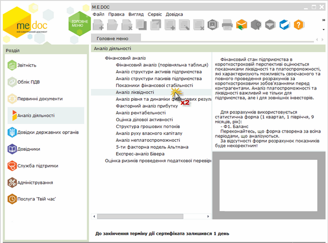
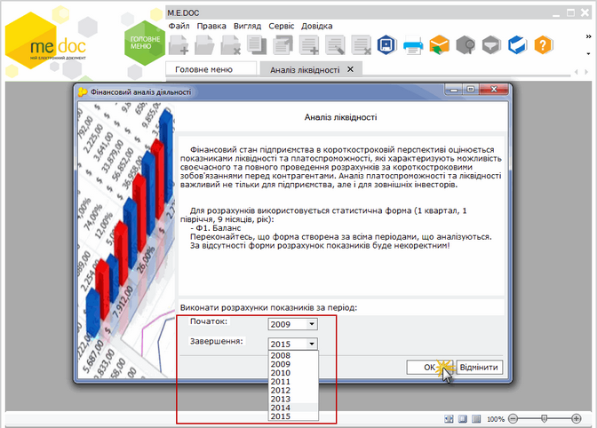
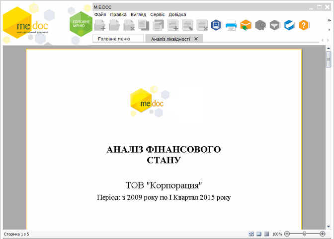
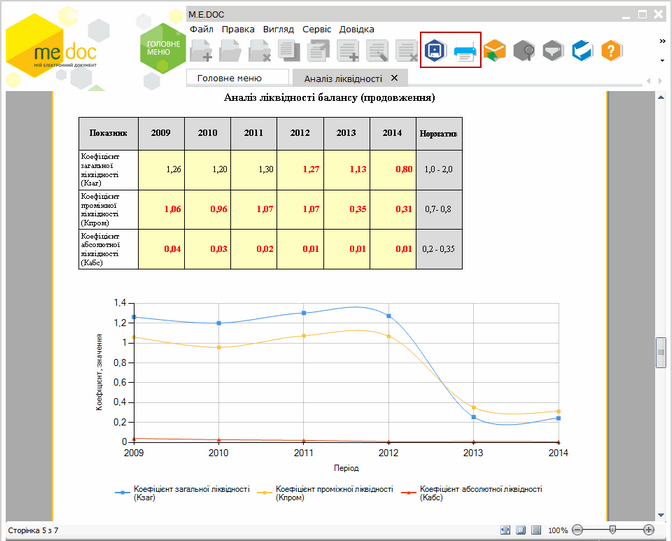
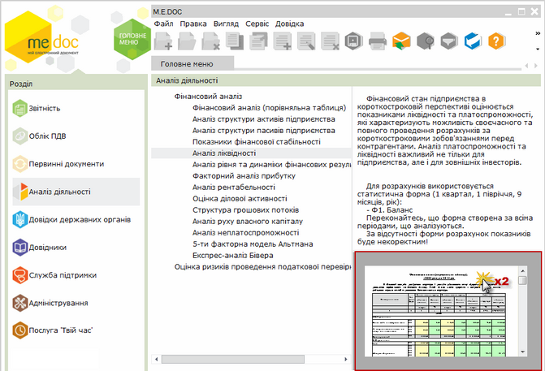
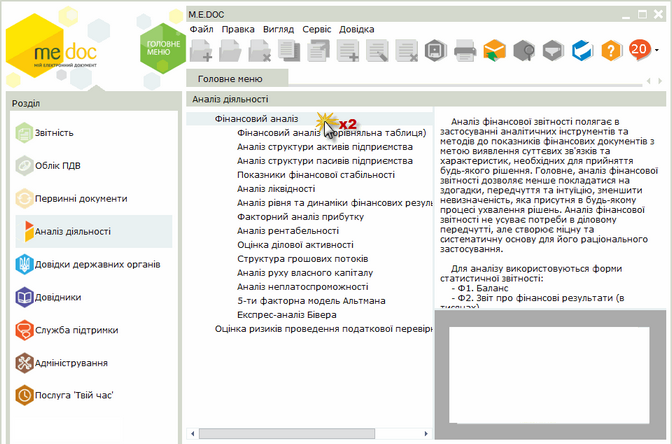
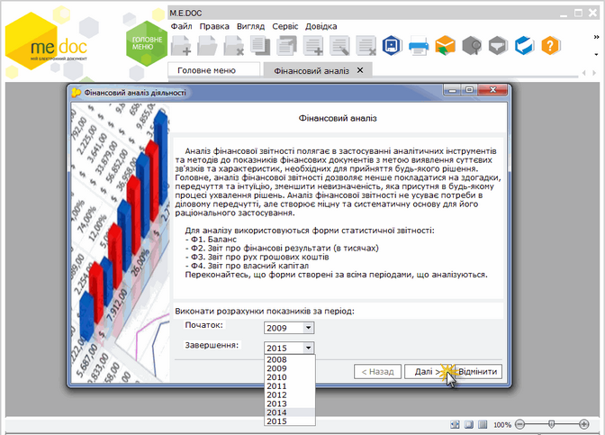
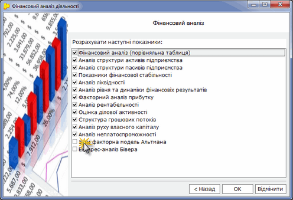

[← Зміст довідки](../)


# Аналіз діяльності

## Аналіз діяльності

_Шлях у довідці: Додатково: UCFinAn › Аналіз діяльності_

Мета фінансового аналізу – оцінка фінансового стану підприємства з урахуванням змін, що склалися в результаті діяльності підприємства за декілька останніх років. Його важливість полягає в тому, щоб визначити чинники, що вплинули на зміни та допоможуть прогнозувати майбутній фінансовий стан підприємства. Аналіз фінансового стану базується на даних фінансової звітності та бухгалтерського обліку.

Підсистема Аналіз діяльності являє собою потужний засіб для проведення фінансового аналізу діяльності підприємства. Реалізовані інструменти дозволять сформувати аналітичні таблиці та графіки. Вони допоможуть критично оцінити фінансові результати діяльності підприємства в динаміці, що дасть змогу визначити найбільш вузькі місця у фінансовій діяльності та способи, для ефективного використання фінансових ресурсів, їх раціонального використання.

Аналіз проводиться за загальноприйнятими методиками на основі наступних статистичних форм:

- Ф1. Баланс;
- Ф2. Звіт про фінансові результати;
- Ф3. Звiт про рух грошових коштів;
- Ф4. Звіт про власний капітал.

Оскільки динаміка показників більш зручна для довгострокового аналізу діяльності, найефективніше проводити аналіз на підставі річних звітів за кілька років (рекомендовано більше 2х). Для більшої наочності проаналізованих даних передбачено побудову графіків.

У даному розділі довідки розглянуто наступне:

- [Опис методів фінансового аналізу, що використовуються в модулі](#ucfinan-ucfinan_opys)
- [Як створити фінансово-аналітичний звіт](#ucfinan-ucfinan_stvor)

### Опис методів фінансового аналізу, що використовуються в модулі

_Шлях у довідці: Додатково: UCFinAn › Аналіз діяльності › Опис методів фінансового аналізу, що використовуються в модулі_

Фінансовий аналіз

Аналіз фінансової звітності полягає в застосуванні аналітичних інструментів та методів до показників фінансових документів з метою виявлення суттєвих зв'язків та характеристик, необхідних для прийняття будь-якого рішення. Головне, аналіз фінансової звітності дозволяє менше покладатися на здогадки, передчуття та інтуїцію, зменшити невизначеність, яка присутня в будь-якому процесі ухвалення рішень. Аналіз фінансової звітності не усуває потреби в діловому передчутті, але створює міцну та систематичну основу для його раціонального застосування.

Для аналізу використовуються форми статистичної звітності:

- Ф1. Баланс
- Ф2. Звіт про фінансові результати (в тисячах)
- Ф3. Звiт про рух грошових коштiв
- Ф4. Звіт про власний капітал

Фінансовий аналіз (порівняльна таблиця)

Порівняльний аналітичний баланс зводить воєдино та систематизує розрахунки балансу. Схемою порівняльного аналітичного балансу охоплено важливі показники:

- відносна величина структури, що показує, яка частка тієї чи іншої статті активу (пасиву) в майні підприємства (валюти балансу);
- показник абсолютного приросту, що показує, якою мірою змінилася величина статті в абсолютному вираженні;
- базисний темп зростання;
- показник, що відображає відносну зміна статей балансу за звітний період по відношенню до базисного.

Для розрахунків використовується статистична форма (1 квартал, 1 півріччя, 9 місяців, рік):

- Ф1. Баланс

Аналіз структури активів підприємства

Актив балансу містить відомості про розміщення капіталу, наявного в розпорядженні підприємства, тобто про вкладення його в конкретне майно та матеріальні цінності, про залишки вільної грошової готівки тощо. Аналіз структури активів містить низку найважливіших характеристик, що описують фінансово-майновий стан підприємства:

- загальна вартість майна підприємства;
- вартість необоротних засобів;
- вартість мобільних (оборотних) активів.

Для розрахунків використовується статистична форма (1 квартал, 1 півріччя, 9 місяців, рік):

- Ф1. Баланс

Аналіз структури пасивів підприємства

Відомості, які наводяться в пасиві балансу, дозволяють визначити, які зміни відбулися в структурі власного та позикового капіталу, скільки залучено в оборот підприємства довгострокових та короткострокових коштів, тобто пасив показує, звідки взялися кошти, спрямовані на формування майна підприємства. Фінансовий стан підприємства багато в чому залежить від того, які кошти воно має в своєму розпорядженні та куди вони вкладені.

Для розрахунків використовується статистична форма (1 квартал, 1 півріччя, 9 місяців, рік):

- Ф1. Баланс

Показники фінансової стабільності

Фінансова стабільність підприємства - це комплексне поняття. Вона характеризує такий фінансовий стан, коли підприємство функціонує на основі самофінансування та самоокупності, має достатній рівень платоспроможності.

Фінансова стабільність - це незалежність підприємства від випадковостей (зриви договорів, неплатежі тощо) та труднощів із залученням позикових коштів.

Фінансова стабільність підприємства залежить від ефективності використання та стану оборотних засобів та необоротних активів (особливо активної їх частини - основних фондів).

Для розрахунків використовується статистична форма (1 квартал, 1 півріччя, 9 місяців, рік):

- Ф1. Баланс

Аналіз ліквідності

Фінансовий стан підприємства в короткостроковій перспективі оцінюється показниками ліквідності та платоспроможності, які характеризують можливість своєчасного та повного проведення розрахунків за короткостроковими зобов'язаннями перед контрагентами. Аналіз платоспроможності та ліквідності важливий не тільки для підприємства, але і для зовнішніх інвесторів.

Для розрахунків використовується статистична форма (1 квартал, 1 півріччя, 9 місяців, рік):

- Ф1. Баланс

Аналіз рівня та динаміки фінансових результатів

Аналіз проводиться методом порівняння фактичних даних за звітний період з фактичними даними за попередній (-і) період (-и).

В ході аналізу:

- дається оцінка темпів зростання прибутку в цілому та окремо по кожній її частині;
- розраховуються фактори, що впливають на зміну прибутку, визначається рівень їх впливу;
- виявляються резерви збільшення прибутку.

Для розрахунків використовується статистична форма (1 квартал, 1 півріччя, 9 місяців, рік):

- Ф2. Звіт про фінансові результати (в тисячах)

Факторний аналіз прибутку

Факторний аналіз - це методика комплексного системного вивчення та вимірювання впливу різних факторів на величину результативних показників, тобто визначення впливу кожного фактора на прибуток від реалізації.

Для розрахунків використовуються статистичні форми (1 квартал, 1 півріччя, 9 місяців, рік):

- Ф1. Баланс
- Ф2. Звіт про фінансові результати (в тисячах)

Аналіз рентабельності

Рентабельність - це показник, що характеризує економічну ефективність. Існує безліч коефіцієнтів рентабельності, використання кожного з яких залежить від характеру оцінки ефективності фінансово-господарської діяльності підприємства. Виділяють три групи коефіцієнтів рентабельності:

- рентабельність інвестицій (капіталу);
- рентабельність продажів;
- рентабельність виробництва.

Для розрахунків використовуються статистичні форми (1 квартал, 1 півріччя, 9 місяців, рік):

- Ф1. Баланс
- Ф2. Звіт про фінансові результати (в тисячах)

Оцінка ділової активності

У широкому сенсі ділова активність означає весь спектр зусиль, спрямованих на просування фірми на ринках продукції, праці, капіталу. Ділова активність підприємства проявляється в динамічності її розвитку, досягненні поставлених цілей, ефективному використанні економічного потенціалу, розширенні ринків збуту.

Для розрахунків використовуються статистичні форми (1 квартал, 1 півріччя, 9 місяців, рік):

- Ф1. Баланс
- Ф2. Звіт про фінансові результати (в тисячах)

Структура грошових потоків

Групування потоків грошових засобів за категоріями дозволяє відобразити вплив кожного з основних напрямків діяльності фірми на рівень грошових надходжень.

Для розрахунків використовується статистична форма (річна):

- Ф3. Звiт про рух грошових коштiв

Аналіз руху власного капіталу

Аналіз руху дозволяє простежити, за рахунок яких джерел формувався той чи інший елемент власного капіталу, а також, в якому напрямку використаний власний капітал. Для того щоб проаналізувати стан та рух власного капіталу підприємства формується аналітична таблиця і розраховуються показники руху власного капіталу:

- коефіцієнт надходження;
- коефіцієнт вибуття.

Для розрахунків використовується статистична форма (річна):

- Ф4. Звіт про власний капітал

Аналіз неплатоспроможності

Діагностика неплатоспроможності являє собою систему цільового фінансового аналізу, що направлений на виявлення параметрів кризового розвитку підприємства, що генерують загрозу його банкрутства в майбутньому періоді. Для того щоб визначити ознаки неплатоспроможності підприємства, що характеризують фінансовий стан підприємства, розраховують наступні показники:

- поточної платоспроможності;
- коефіцієнт забезпечення власними коштами;
- коефіцієнт покриття.

Для розрахунків використовуються статистичні форми (1 квартал, 1 півріччя, 9 місяців, рік):

- Ф1. Баланс
- Ф2. Звіт про фінансові результати (в тисячах)

5-ти факторна модель Альтмана

Індекс Едварда Альтмана - функція від різних показників, що характеризують економічний потенціал підприємства та результати його роботи за минулий період.

Застосування методу Альтмана дозволяє прогнозувати фінансовий розвиток компанії. На сьогодні використовується у світовій практиці.

Для розрахунків використовуються статистичні форми (1 квартал, 1 півріччя, 9 місяців, рік):

- Ф1. Баланс
- Ф2. Звіт про фінансові результати (в тисячах)

4-х факторна модель Таффлера

Рекомендується для аналізу як модель, що враховує сучасні тенденції бізнесу та вплив перспективних технологій на структуру фінансових показників.

Експрес-аналіз Бівера

За допомогою коефіцієнта Бівера проводиться систематичний експрес-аналіз (фінансовий моніторинг).

### Як створити фінансово-аналітичний звіт

_Шлях у довідці: Додатково: UCFinAn › Аналіз діяльності › Як створити фінансово-аналітичний звіт_

Для формування таблиць необхідна наявність фінансових форм:

- Ф1. баланс
- Ф2. Звіт про Фінансові результати (в тисячах)
- Ф3. Звiт про рух грошових коштiв
- Ф4. Звіт про Власний капітал

Для квартальних (проміжних) аналітичних таблиць досить лише перших двох форм.

Перед початком формування звітів переконайтесь, що форми створена за всіма періодами, що аналізуються. За відсутності форм розрахунок показників буде некоректним!

Для того, щоб створити фінансово-аналітичний звіт виконайте дії у наступній послідовності:

1. Оберіть метод проведення аналізу та натисніть по ньому двічі лівою клавішею миші.

Натисніть, щоб збільшити малюнок

2. Відкриється вікно вибору періоду проведення розрахунків.

Для формуванням звіту необхідно вибрати період його формування. Рекомендується якомога більший період для аналізу (кілька років). Якщо звітів за попередні періоди немає, їх можна створити «заднім числом». За наявності декількох однотипних звітів програма вибере максимальний за датою модифікації.

Оберіть рік початку та завершення розрахунків та натисніть кнопку ОК.

Натисніть, щоб збільшити малюнок

3. Розпочнеться процес формування звіту на підставі показників вказаного періоду. Сформований звіт відкриється у окремій вкладці, де його можна переглянути.

Натисніть, щоб збільшити малюнок

Аналітичний звіт містить таблиці та графіки. Для більшої наочності використовують такі основні кольори:

- данні із звітів
- розраховані дані
- підсумкові дані
- дані на які варто звернути увагу

Вкінці звіту надається резюме і таблиця переліку документів, що використовувалися при проведенні аналізу.

4. Сформований звіт можна роздрукувати та/або зберегти у форматі \*.pdf, \*.rtf, \*.png, \*.odf.

Натисніть, щоб збільшити малюнок

5. Для повторного відкриття вже сформованого звіту, у вікні перегляду натисніть двічі лівою клавішею миші. Звіт відкриється у окремій вкладці.

Натисніть, щоб збільшити малюнок

Передбачено можливість створити звіт по всім методикам одночасно, або по окремим потрібним методикам.

1. Оберіть розділ Фінансовий аналіз та натисніть по ньому двічі лівою клавішею миші.

Натисніть, щоб збільшити малюнок

2. Оберіть рік початку та завершення періоду розрахунків. Натисніть кнопку Далі.

Натисніть, щоб збільшити малюнок

3. Встановіть галочки напроти потрібних методів розрахунків. Натисніть ОК.

Натисніть, щоб збільшити малюнок

4. Розпочнеться процес формування звіту на підставі показників вказаного періоду. Сформований звіт відкриється у окремій вкладці, де його можна переглянути, зберегти та роздрукувати.


