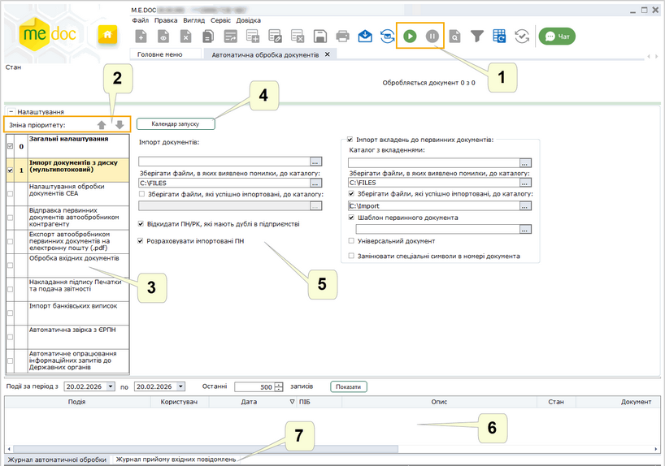
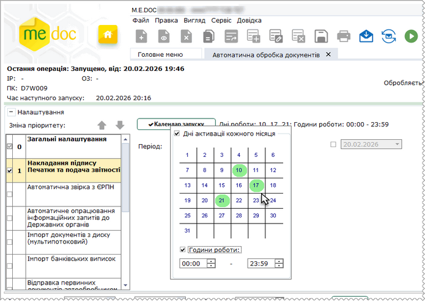

[← Зміст довідки](../)


# Автоматична обробка документів

## Автоматична обробка документів

_Шлях у довідці: Розділи програми › Первинні документи › Автоматична обробка документів_

В цьому розділі:

[Опис структури модуля](#ucglobalautoprocjournal-pdocs_avto)

[Налаштування автоматичної обробки](UCGlobalAutoProcJournalFunc.html#ucglobalautoprocjournalfunc-pdocs_avto_func)

[Запуск та робота сервісу](#ucglobalautoprocjournal-pdocs_avto)

Модуль Автоматична обробка документів призначений для автоматизації ручної обробки великої кількості документів. За допомогою модуля Ви можете організувати автоматичне виконання операцій:

- [імпорт документів](UCGlobalAutoProcJournalFunc.html#ucglobalautoprocjournalfunc-pdocs_avto_func), створених в інших бухгалтерських системах (Зверніть увагу!  В модулі виконується імпорт тільки первинних документів в форматі ДПС та форматі обміну);
- [подання звітних документів до контролюючих органів](UCGlobalAutoProcJournalFunc.html#ucglobalautoprocjournalfunc-pdocs_avto_func)  (ДПСУ, Державної статистичної служби);
- [реєстрація документів у Єдиному реєстрі податкових накладних (ЄРПН)](UCGlobalAutoProcJournalFunc.html#ucglobalautoprocjournalfunc-pdocs_avto_func);
- [відправка первинних документів контрагентам](UCGlobalAutoProcJournalFunc.html#ucglobalautoprocjournalfunc-pdocs_avto_func);
- відправка запитів щодо [отримання відомостей з Єдиного реєстру](UCGlobalAutoProcJournalFunc.html#ucglobalautoprocjournalfunc-pdocs_avto_func) податкових накладних;
- збереження вихідних документів, що були [прийняті або відхилені у ДПС](UCGlobalAutoProcJournalFunc.html#ucglobalautoprocjournalfunc-pdocs_avto_func), або були [затверджені або відхилені контрагентом](UCGlobalAutoProcJournalFunc.html#ucglobalautoprocjournalfunc-pdocs_avto_func);
- [експорт первинних документів у форматі PDF на електронну пошту](UCGlobalAutoProcJournalFunc.html#ucglobalautoprocjournalfunc-pdocs_avto_func);
- [збереження вхідних документів, обробку яких завершено](UCGlobalAutoProcJournalFunc.html#ucglobalautoprocjournalfunc-pdocs_avto_func);
- [імпорт банківських виписок](UCGlobalAutoProcJournalBank.html#ucglobalautoprocjournalbank-pdocs_avto_bank);
- [автоматична звірка з ЄРПН](UCGlobalAutoProcJournalERPN.html#ucglobalautoprocjournalerpn-pdocs_avto_erpn);
- [автоматичне опрацювання інформаційних запитів до Державних органів](UCGlobalAutoProcJournalFunc.html#ucglobalautoprocjournalfunc-do_avto_info).

Наприклад, податкові накладні, які створені у сторонній бухгалтерській системі, необхідно надіслати на реєстрацію у ДПС та відправити контрагентам. Для виконання цього завдання можна використати наступну схему обробки документів:

1. Експортувати податкові накладні з бухгалтерської системи у каталог на жорсткому диску у формат \*.XML.

2. У ПК M.E.Doc налаштувати та запустити сервіс автоматичної обробки.

3. Із вказаного каталогу сервіс Автоматичної обробки документів імпортує податкові накладні в програмний комплекс M.E.Doc.

4. В процесі автоматичної обробки податкових накладних та розрахунків коригування автоматично виконується звірення даних з Єдиним довідником контрагентів на сервері документообігу (ЄДК). Залежно від встановлених у Налаштуваннях параметрів, у документах можуть замінюватися/не замінюватися дані контрагентів, або ж незвірені документи не будуть відправлені.

5. Податкові накладні автоматично відправляються на електронну адресу ДПС з метою реєстрації їх в ЄРПН.

6. Документи відправляються контрагентам. Відправка документів відбувається згідно налаштувань сервісу Автоматичної обробки документів.

Зверніть увагу! Для того, щоб змінити налаштування роботи модуля, необхідно зупинити сервіс. Увімкнення-вимкнення операцій під час виконання автоматичної обробки неможливе. До моменту зупинення сервісу або виходу із програмного комплексу сервіс буде безперервно виконувати обрані операції. Інтервал часу, із яким виконуються операції, вказується в налаштуваннях сервісу.

Відкрити модуль Автоматичної обробки документів також можливо за допомогою команди головного меню Сервіс - Автоматична обробка документів.

Опис структури модуля

Модуль складається із 7 функціональних частин:

Натисніть, щоб збільшити малюнок

1. Панель інструментів

На панелі розташовані кнопки:

|  |  |
| --- | --- |
|  | Запустити автоматичну обробку |
|  | Зупинити автоматичну обробку |

2. Панель зміни пріоритету виконання операції

Містить засоби для налаштування порядку виконання автоматичних операцій.

Пріоритет операцій визначає послідовність, у якій будуть виконуватись операції.

Номер пріоритету операції відповідає порядковому номеру операції у черзі на виконання та відображається на Панелі з переліком автоматичних операцій. Так операція з пріоритетом "1" буде виконуватись першою, "2" - другою і так далі.

Зверніть увагу! Налаштування розділу Загальні налаштування мають найвищий пріоритет "0". Пріоритет цього розділу змінити неможливо.

Щоб змінити пріоритет, оберіть назву автоматичної операції на Панелі з переліком автоматичних операцій та натисніть кнопку:

|  |  |
| --- | --- |
|  | Збільшити пріоритет операції та перемістити її на один крок вище у черзі |
|  | Зменшити пріоритет операції та перемістити її на один крок нижче |

Змінювати пріоритет операцій можливо, якщо для виконання обрано хоча б дві автоматичні операції. За замовчуванням кожна новообрана операція отримає найнижчий пріоритет, тобто буде виконуватись останньою.

3. Панель з переліком автоматичних операцій

Містить перелік всіх доступних автоматичних операцій.

Щоб налаштувати виконання операції, оберіть її назву на цій панелі. Ліворуч від назви операції відображається її пріоритет.

Зверніть увагу! Перед запуском сервісу обов'язково потрібно обрати операції, що будуть виконуватись, задати параметри функціонування та встановити для кожної операції необхідний пріоритет.

Детальніше про налаштування див. розділ [Налаштування автоматичної обробки](UCGlobalAutoProcJournalFunc.html#ucglobalautoprocjournalfunc-pdocs_avto_func)

4. Кнопка налаштування календаря запуску автоматичної обробки

По натисканню кнопки відкриється панель, що містить засоби для налаштування дати та часу виконання автоматичної обробки певної операції:

Натисніть, щоб збільшити малюнок

- Дані активації кожного місяця

Встановіть позначку та оберіть числа, на які повинна виконуватись операція автоматичної обробки. Щоб обрати дату, клацніть мишею на числі у календарі. Призначені числа виділяються зеленим кольором. Операція буде виконуватись обраного числа кожного місяця.

- Години роботи

Встановіть позначку та введіть початок та закінчення періоду, у який буде виконуватись операція. Наприклад, з 4-ї до 6-ї години ранку. Опція доступна, якщо обрані числа для виконання автоматичної обробки.

Якщо для операції призначений календар запуску, праворуч від кнопки відобразяться обрані дні та години.

Зверніть увагу! Налаштування календаря запуску виконуються за необхідністю та є індивідуальними для кожної операції. Якщо для певної операції календар запуску не налаштовано, автоматична обробка цієї операції здійснюється згідно з налаштуваннями розділу Загальні налаштування (поле Автоматична обробка кожні ...).

Для місяців, в яких немає 31 числа (для лютого - 29 та 30 числа), відображається попередження про те, що автообробник не буде запущений.

5. Панель налаштування модулю

Містить засоби для налаштування операції автоматичної обробки.

Детальніше про налаштування див. розділ [Налаштування автоматичної обробки](UCGlobalAutoProcJournalFunc.html#ucglobalautoprocjournalfunc-pdocs_avto_func).

6. Протокол виконання операцій автоматичної обробки

У протоколі в хронологічному порядку відображається інформація про виконані операції. Протокол допомагає користувачу слідкувати за ходом автоматичної обробки.

У відповідних полях протоколу міститься інформація:

- Подія - дія, що була виконана сервісом автоматичної обробки.
- Користувач - ім'я облікового запису користувача в сиcтемі, який запустив сервіс автоматичної обробки.
- Дата - дата та час виконання події.
- ПІБ - прізвище ім'я та по батькові користувача, який запустив сервіс автоматичної обробки.
- Опис - детальніший опис події.
- Стан - статус документу.
- Документ - назва, номер та дата документу, який був оброблений сервісом.
- Контрагент - код ЄДРПОУ контрагента.
- Найменування - назва контрагента.
- Сума - сума, що зазначена у документі.

Для того, щоб переглянути всі поля, скористайтеся смугою прокрутки у нижній частині вікна.

7. Панель відображення

Містить вкладки відображення даних:

- Журнал автоматичної обробки - історія подій, які відбувалися під час автоматичної обробки документів. За замовчуванням відображається історія операції за поточну дату. Можна відібрати записи Журналу для перегляду, вказавши дату початку та закінчення періоду у полі Події за період з \_\_ по \_\_. У полі Останні \_\_\_ записів можна встановити кількість останніх записів для відображення у обраному періоді. За замовчуванням відображаються 500 останніх записів. Для відображення записів у журналі встановіть потрібні параметри та натисніть кнопку Показати;
- Журнал прийому вхідних повідомлень - відображає перелік опрацьованих документів. Можна відібрати записи Журналу, вказавши дату початку та закінчення періоду, а також, задавши кількість останніх записів для відображення.

[До початку](#ucglobalautoprocjournal-pdocs_avto)

Запуск та робота сервісу

Щоб запустити автоматичну обробку, натисніть на кнопку  на панелі інструментів.

В першу чергу перевіряється поштова скринька на наявність вхідних повідомлень, відкриється стандартне вікно підписання документу, де потрібно ввести пароль доступу до секретних ключів. Натисніть ОК. Розпочнеться процес завантаження надісланих повідомлень.

Після перевірки пошти, сервіс розпочне виконувати задані операції, у встановленій при налаштуванні послідовності.

Весь процес роботи сервісу відображається у хронологічному порядку виконання у протоколі виконаних операцій.

До моменту зупинення сервісу або виходу із програмного комплексу, сервіс буде безперервно виконувати оброку документів із вказаним проміжком часу, а також перевіряти поштову скриньку на наявність нових вхідних повідомлень.

Якщо не налаштовано жодних дій, автообробник виконує приймання вхідних повідомлень.

Щоб зупинити автоматичну обробку, натисніть на кнопку  на панелі інструментів.

[До початку](#ucglobalautoprocjournal-pdocs_avto)


