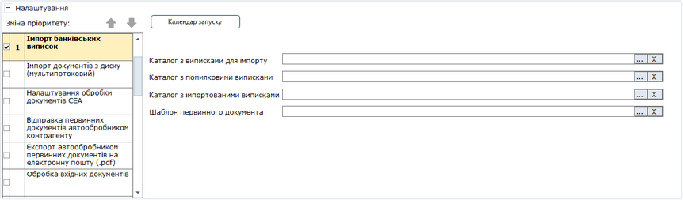

[← Зміст довідки](../)


# Імпорт банківських виписок

## Імпорт банківських виписок

_Шлях у довідці: Розділи програми › Первинні документи › Автоматична обробка документів › Налаштування автоматичної обробки документів › Імпорт банківських виписок_

6. Імпорт банківських виписок

У цьому розділі виконується масовий імпорт банківських виписок.

Натисніть, щоб збільшити малюнок

Для запуску роботи потрібно обрати такі каталоги:

- Каталог з виписками для імпорту - каталог з файлами, які потрібно проімпортувати;
- Каталог з помилковими виписками - каталог, куди будуть переміщені файли, які не пройшли перевірку;
- Каталог з імпортованими виписками - каталог, куди будуть переміщені файли, які пройшли перевірку та були проімпортовані до програми;
- Шаблон первинного документа - шаблон первинного документа "Банківська виписка", який буде супроводжувати проімпортовані файли.

Для видалення обраного каталогу або шаблона натисніть на кнопку  праворуч від потрібного поля.

Файли для імпорту проходять перевірку на наявність контрагента в Довіднику контрагентів та наявність у контрагента ліцензії на модуль Банківські виписки. Для документів, що пройшли перевірку, автоматично формується лист за вказаним шаблоном із файлом-вкладенням. Ці листи відображаються в модулі "Банківськи виписки". Самі файли переміщуються до папки, вказаної в полі Каталог з імпортованими виписками.

Файли, які не пройшли перевірку на наявність контрагента та наявність у контрагента ліцензії, переміщуються до папки, вказаної в полі Каталог з помилковими виписками.

Результати виконання імпорту записуються в журнал автоматичної обробки.

Файли, що не пройшли перевірку, виділяються в журналі червоним кольором. В таблиці журналу відображаються колонки Перевірка контрагента та Перевірка ліцензії, в яких можна побачити відмітку перевірки за цими параметрами.

В журналі відображаються 500 останніх подій. Всі інші записи можна подивитись в [Журналі подій](UCLogs.html#uclogs-admlogs).

Журнал можна експортувати в таблицю Excel. Для цього виберіть команду Файл - Експорт - Експорт таблиці в Excel.

[До початку](UCGlobalAutoProcJournalFunc.html#ucglobalautoprocjournalfunc-pdocs_avto_func)


