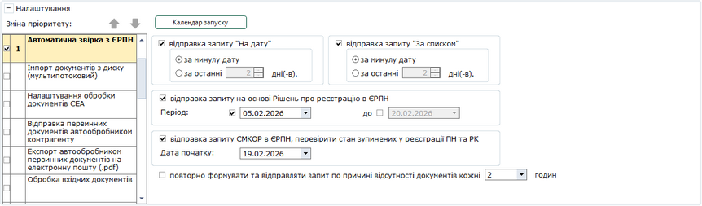

[← Зміст довідки](../)


# Автоматична звірка з ЄРПН

## Автоматична звірка з ЄРПН

_Шлях у довідці: Розділи програми › Первинні документи › Автоматична обробка документів › Налаштування автоматичної обробки документів › Автоматична звірка з ЄРПН_

7. Автоматична звірка з ЄРПН

У цьому розділі виконується автоматичне формування та відправка запитів в ЄРПН, отримання витягів, а також звірка з ЄРПН.

Автоматична звірка виконується, якщо у загальних налаштуваннях встановлений параметр Виконувати прийом повідомлень. Якщо вимикається параметр Виконувати прийом повідомлень, то також автоматично знімається позначка з операції Автоматична звірка з ЄРПН, і далі звірка виконуватись не буде.

Натисніть, щоб збільшити малюнок

- відправка запиту "На дату"
Якщо позначку встановлено, запит створюється за відсутності актуального витягу за дату.
За замовчуванням позначку встановлено.

- за минулу дату
Запит створюється за вчорашній день.

- за останні ... дні (-в)
Кількість останніх днів (максимум 30), за які відправляються запити (не включаючи поточну дату).

- відправка запиту "За списком"
Якщо позначку встановлено, за наявності актуального витягу «На дату» та не рівній кількості документів по звірці
створюється запит за списком  для завантаження у програму відсутніх документів із ЄРПН.
За замовчуванням позначку встановлено.

- за минулу дату
Запит створюється за вчорашній день.

- за останні ... дні (-в)
Кількість останніх днів (максимум 30), за які відправляються запити (не включаючи поточну дату).

- відправка запиту на основі Рішень про реєстрацію в ЄРПН
Якщо позначку встановлено, виконується створення та відправка у ЄРПН Запитів на основі «РІШЕННЬ про реєстрацію або відмову в реєстрації ПН/РК в ЄРПН» для отримання розблокованих ПН\РК.
Для створення Запиту виконується пошук Рішень за обраний період. Далі виконується перевірка наявності ПН\РК, що зазначені у Рішеннях, для ПН\РК, що відсутні у базі програми, формується Запит та відправляється у ЄРПН. У сформованому Запиті встановлюються опції За списком та Імпорт документу з квитанцією.

Період
Вкажіть дати початку та закінчення періоду, у який були отримані Рішення, на основі яких потрібно сформувати Запит.
Якщо період не встановлено, виконується пошук всіх Рішень, що наявні для поточного підприємства.

- повторно формувати та відправляти запит по причині відсутності документів кожні ... години
Якщо позначку встановлено, то у разі наявності запитів та відсутності витягів ("На дату" та/або "За списком") будуть формуватись та відправлятись нові запити.

Повторна відправка виконується, якщо встановлено позначки На дату та/або За списком.

Для організацій, у яких у Картці підприємства заповнено поле Код філії та не заповнено поле Організація від імені якої буде здійснюватись реєстрація податкових накладних в ЄРПН, формуються 2 окремі Запити:

- запит щодо отримання відомостей про ПН/РК, що отримані філією;
- запит щодо отримання відомостей про ПН/РК, що відправлені філією.
- відправка запиту СМКОР в ЄРПН, перевірити стан зупинених у реєстрації ПН та РК
Якщо позначку встановлено, виконується створення та відправка у ЄРПН «Запитів щодо отримання відомостей з ЄРПН стосовно ПН та РК, реєстрацію яких зупинено».
У полі Дата початку вкажіть дату початку інтервалу для формування Запитів.
Запити формуються за період від дати, вказаної у полі Дата початку, до дня, що передує поточному.

Для повторного формування та відправки запитів про стан реєстрації Податкових накладних та Розрахунків коригування, які були зупинені Системою моніторингу критеріїв оцінки ризиків (СМКОР) увімкніть опції:

- відправка запиту СМКОР в ЄРПН, перевірити стан зупинених у реєстрації ПН та РК;
- повторно формувати та відправляти запит по причині відсутності документів кожні ... годин та задайте інтервал повторної відправки.

Програма формуватиме та відправлятиме «Запит щодо отримання відомостей з ЄРПН стосовно ПН та РК, реєстрацію яких зупинено» через вказаний проміжок часу (у разі наявності запитів та відсутності витягів).

Результати виконання автоматичної звірки записуються в Журнал автоматичної обробки.

В журналі відображаються 500 останніх подій. Всі інші записи можна подивитись в [Журналі подій](UCLogs.html#uclogs-admlogs).

Журнал можна експортувати в таблицю Excel. Для цього виберіть команду Файл - Експорт - Експорт таблиці в Excel.

[До початку](UCGlobalAutoProcJournalFunc.html#ucglobalautoprocjournalfunc-pdocs_avto_func)


