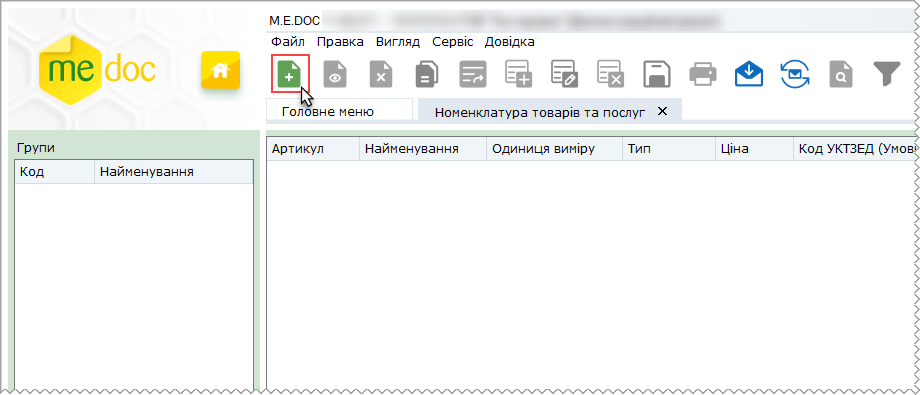
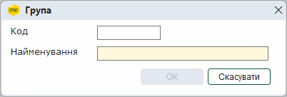
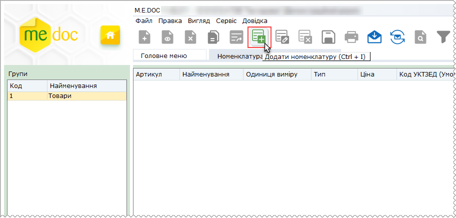
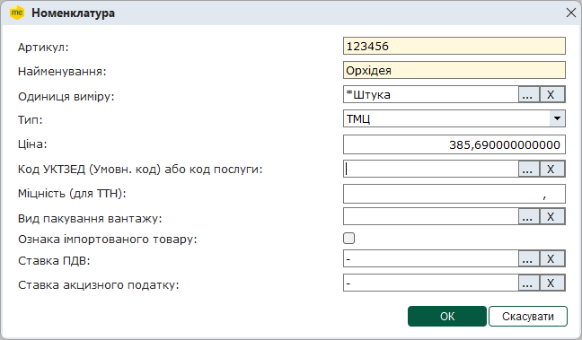
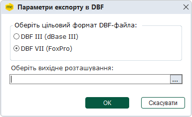

[← Зміст довідки](../)


# Номенклатура товарів та послуг

## Номенклатура товарів та послуг

_Шлях у довідці: Розділи програми › Довідники › Номенклатура товарів та послуг_

В цьому розділі:

[Створення номенклатурних груп](#ucgoodsrst-sprgoods)

[Створення та заповнення картки номенклатурної одиниці](#ucgoodsrst-sprgoods)

[Експорт номенклатури товарів та послуг](#ucgoodsrst-sprgoods)

[Імпорт номенклатури товарів та послуг](#ucgoodsrst-sprgoods)

[Редагування номенклатури товарів та послуг](#ucgoodsrst-sprgoods)

Даний довідник призначений для зберігання переліку товарів та послуг, які підприємство надає або споживає. Ця інформація необхідна для заповнення первинних документів, а також для ведення аналітичного обліку.

Для зручності та порядку довідник Номенклатура товарів та послуг умовно складається із двох частин: Групи та Номенклатура. Зліва у Групах відображається список номенклатурних груп, справа у Номенклатурі - перелік товарів/послуг вибраної групи При обранні певної групи у вікні справа відображається список товарів/послуг, які входять до обраної групи.

Модуль побудований у вигляді таблиці, окремий рядок якої відображає коротку інформацію кожного товару/послуги. Переглянути більш повну інформацію номенклатурної одиниці можна у окремому вікні Номенклатура, яке відкривається подвійним кліком по потрібному запису.

Дані кожної номенклатурної одиниці заповнюються у картці безпосередньо користувачем програмного комплексу. Передбачено імпорт даних із відповідних файлів, створених у інших системах, а також експорт номенклатури у спеціальний файл. Імпорт та експорт можливий тільки для dbf-файлів.

Дозволяє додавати нові номенклатурні одиниці, редагувати та видаляти існуючі.

Створення номенклатурних груп

Перш ніж заповнити перелік номенклатури, необхідно створити групу, якій він буде підпорядкований.

1. Для того, щоб створити нову групу, на панелі інструментів виберіть команду Створити, або натисніть комбінацію клавіш Ctrl+N.

Функція стає активною, якщо клікнути лівою кнопкою миші у будь-якому місці поля Групи.

2. Відкриється вікно Група. Заповніть запропоновані поля форми та натисніть кнопку ОК.

Поля, що підсвічені жовтим кольором, є обов'язковими для заповнення.

- Код - унікальний набір цифр для ідентифікації групи;
- Найменування - умовна назва номенклатурної групи.

3. Натисніть кнопку ОК. Нова група з'явиться у переліку груп.

В списку груп також доступні наступні функції:

|  |  |  |
| --- | --- | --- |
|  | Видалити групу (Shift+Del) | Дозволяє безповоротно вилучити запис.  УВАГА! При видаленні групи безповоротно видаляється увесь її вміст - всі підпорядковані їй записи. |
|  | Редагувати групу (Ctrl+F2) | Редагування даних в разі необхідності. |

[До початку](#ucgoodsrst-sprgoods)

Створення та заповнення картки номенклатурної одиниці

1. Для того, щоб додати нову номенклатурну одиницю, на панелі інструментів виберіть команду Створити запис, або натисніть комбінацію клавіш Ctrl+I.

Функція стає активною, якщо клікнути лівою кнопкою миші у будь-якому місці таблиці.

2. Відкриється вікно Номенклатура. Заповніть запропоновані поля форми.

- Артикул - цифрове або літерне позначення для кодування товарів або послуг. Заповнюється вручну із клавіатури;
- Найменування - назва товару або послуги. Заповнюється вручну із клавіатури;
- Одиниця виміру - назва одиниці, у якій вимірюється товар або послуга. Виберіть із підключеного довідника "Одиниці виміру".
- Тип - найменування типу номенклатурної одиниці. Виберіть зі списку значень;
- Ціна - значення вартості номенклатурної одиниці в національній валюті. Заповнюється вручну із клавіатури;
- Код УКТЗЕД - код номенклатурної одиниці у Довіднику кодів товарів згідно УКТЗЕД;
- Міцність (для ТТН) - міцність спирту використовується для заповнення ТТН на переміщення спирту;
- Ознака імпортованого товару - опція, що встановлює ознаку імпортованого товару, якщо опція встановлена, при заповнені ПН/РК для номенклатури автоматично проставлятиметься позначка у відповідних графах ПН та РК;
- Ставка ПДВ - оберіть значення у довіднику Ставки ПДВ;
- Ставка акцизного податку - за потреби, оберіть значення з довідника Ставки акцизного податку.

3. Натисніть кнопку ОК.

В переліку номенклатурних одиниць також доступні наступні функції:

|  |  |  |
| --- | --- | --- |
|  | Видалити номенклатуру (Ctrl+Y) | Дозволяє безповоротно вилучити запис. |
|  | Редагувати номенклатуру (F2) | Редагування даних в разі необхідності. |

[До початку](#ucgoodsrst-sprgoods)

Експорт номенклатури товарів та послуг

Функція експорту номенклатури товарів та послуг призначена для вивантаження та збереження файлів із даними довідника в каталог поза програмним комплексом.

Вивантажені данні зберігаються у форматі \*.dbf.

1. Для того щоб експортувати записи довідника у файл оберіть команду Експорт в меню Файл.

2. Відкриється вікно Параметри експорту в DBF. Вкажіть формат збереження DBF-файлу та каталог для збереження даних. Натисніть ОК для підтвердження вибору та початку експорту.

3. По закінченні процедури, система виведе результати експорту, де буде вказано шлях до розміщення файлів експорту та їх назву.

[До початку](#ucgoodsrst-sprgoods)

Імпорт номенклатури товарів та послуг

Номенклатура товарів та послуг може бути створена автоматично шляхом перенесення даних із файлу з розширенням \*.dbf. Для цього призначена функція імпорту.

1. Для того щоб імпортувати номенклатуру у програму оберіть команду Імпорт в меню Файл.

2. Відкривається вікно Відкриття файлу. Вкажіть шлях до каталогу розміщення dbf-файлів.

3. Натисніть ОК для початку процесу імпорту.

5. По закінченні процедури, система виведе протокол імпорту даних.

6. При імпорті записи довідника не розподіляються по групам, вони додаються в першу по списку групу. Якщо список груп порожній, автоматично створюється однойменна група (Створені автоматично), в яку додаються імпортовані записи.

Відредагуйте номенклатуру товарів та послуг відповідно до ваших потреб.

[До початку](#ucgoodsrst-sprgoods)

Редагування номенклатури товарів та послуг

У випадках, коли при імпорті записи довідника додаються всі в одну групу, або запис номенклатурної одиниці був випадково створений в іншій групі, використовується функція переміщення записів до іншої групи.

1. Виділіть у переліку записи номенклатурних одиниць, що потрібно перемістити. Оберіть команду Перемістити до іншої групи у контекстному меню (або Правка - Перемістити до іншої групи).

2. Відкриється вікно, що містить перелік груп довідника. Виберіть потрібну групу та натисніть кнопку Вибрати.

[До початку](#ucgoodsrst-sprgoods)


