[← Зміст довідки](../)


# Податкові довідки

## Податкові довідки

_Шлях у довідці: Розділи програми › Податкові довідки_

У розділі формуються запити до державних органів та відображаються відповіді на ці запити.

Також у модулі відображаються інформаційні повідомлення та листи, що надійшли від державних органів.

Розділ містить наступні модулі:

- [Інформаційна довідка](#ucgovqry-ucgovqry_info)
- [Отримання документів від ДПС](#ucgovqry-ucgovqry_1401901)
- [Експорт документів в файл Excel](#ucgovqry-ucgovqry_expexl)
- [Листи державних органів](#ucgovqry-ucgovqry_lyst)
- [Стан розрахунків з бюджетом](UCGovQryAccounting.html#ucgovqryaccounting-ucgovqryaccounting)

### Інформаційна довідка

_Шлях у довідці: Розділи програми › Податкові довідки › Інформаційна довідка_

В цьому розділі:

[Створення та відправлення запиту до державного органу](#ucgovqry-ucgovqry_info)

[Запит щодо отримання відомостей з ЄРПН](#ucgovqry-ucgovqry_info)

[Створення запиту за датою документів](#ucgovqry-ucgovqry_info)

[Створення запиту за списком документів](#ucgovqry-ucgovqry_info)

[Запит до ЄРПН на отримання електронних документів](#ucgovqry-ucgovqry_info)

[Автоматичне створення запиту до ЄРПН](#ucgovqry-ucgovqry_info)

[Відображення документів, отриманих з ЄРПН](#ucgovqry-ucgovqry_info)

[Запит щодо отримання відомостей з ЄРАН](#ucgovqry-ucgovqry_info)

[Створення запиту за датою документів](#ucgovqry-ucgovqry_info)

[Створення запиту за списком документів](#ucgovqry-ucgovqry_info)

[Запит до ЄРАН на отримання електронних документів](#ucgovqry-ucgovqry_info)

[Відображення документів, отриманих з ЄРАН](#ucgovqry-ucgovqry_info)

[Запит щодо отримання відомостей про РРО](#ucgovqry-ucgovqry_info)

[Прийом відповіді на запит](#ucgovqry-ucgovqry_info)

У модулі формуються запити до державних органів та відображаються відповіді на ці запити.

На поточний момент можливе формування запитів лише до ДПС.

Запити (довідки) згруповані у відповідні групи - СЕА ПДВ, СЕА РП, Інші.

Створення та відправлення запиту до державного органу

1. Для створення нового документа скористайтесь одним із наступних способів:

- на панелі інструментів натисніть кнопку Створити;
- виберіть команду Файл - Створити;
- у контекстному меню оберіть команду Створити;
- натисніть комбінацію клавіш Ctrl+N.

та оберіть потрібний тип довідок.

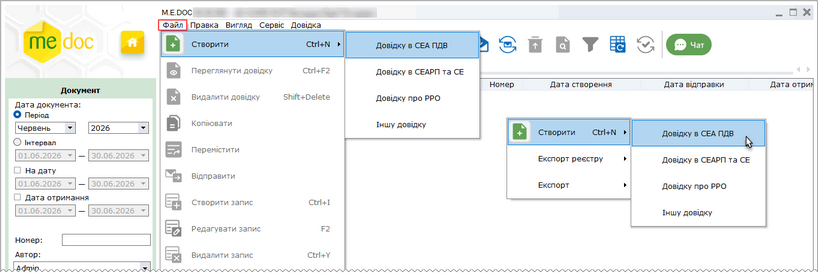

Натисніть, щоб збільшити малюнок

2. На виконання відкриється вікно Створити довідку. Перелік документів, що доступні у вікні, залежить від обраного типу довідок.

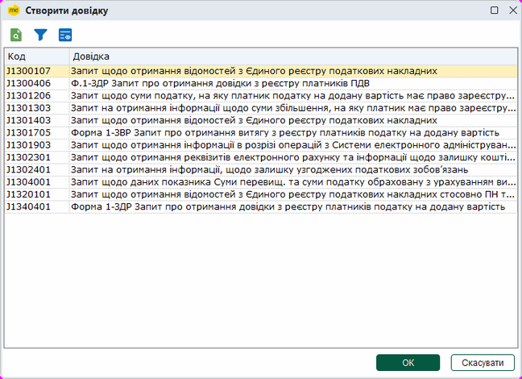

3. Натисніть кнопку ОК для початку формування запиту.

4. Якщо формуються [Запит щодо отримання відомостей з Єдиного реєстру податкових накладних](#ucgovqry-ucgovqry_info) або [Запит щодо отримання відомостей з Єдиного реєстру акцизних накладних](#ucgovqry-ucgovqry_info) , потрібно виконати додаткові налаштування та заповнити необхідні поля форми.

5. Розпочнеться процедура підписання документа.

Після підписання запиту печаткою установи у відкритому вікні обирається одержувач запиту - ДПС. Далі запускається процес відправки пошти. У разі успішного завершення цієї операції запис про відправку поміщається у даний модуль.

Відібрати документи для перегляду можна за допомогою панелі Фільтр:

- Період – відбір за місяцем та роком, в межах якого були створені документи;
- Інтервал – відбір за датою початку та закінчення довільного інтервалу, в межах якого були створені документи;
- На дату – за датою початку та закінчення довільного інтервалу, за який виконувався запит інформації;
- Дата отримання – за датою початку та закінчення довільного інтервалу, в межах якого були отриманні документи;
- Номер – для пошуку документів за номером;
- Автор – перегляд документів, що створені певним користувачем;
- Тип – перегляд документів певного типу: Довідка в СЕА ПДВ, Довідка в СЕАРП та СЕ, Довідка про РРО, Інша довідка;
- Стан обробки – перегляд документів, що знаходяться у роботі, або документів, переміщених до Корзини.

[До початку](#ucgovqry-ucgovqry_info)

Запит щодо отримання відомостей з Єдиного реєстру податкових накладних

Запит щодо отримання відомостей з Єдиного реєстру податкових накладних - призначений для перевірки наявності реєстрації Податкових накладних та Розрахунків коригування в Єдиному реєстрі податкових накладних.

Щоб сформувати запит оберіть команду Створити - Довідку в СЕА ПДВ.

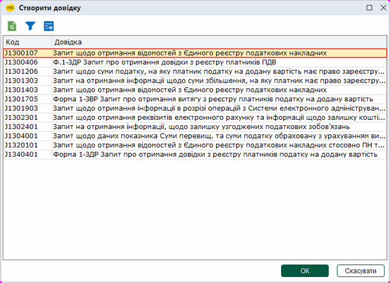

У окремому вікні відкриється бланк документа. Заповніть бланк документа, скориставшись одним із двох способів:

1) формування запиту для документів, [дата реєстрації яких відповідає вказаному значенню](#ucgovqry-ucgovqry_info);

2) формування запиту [за списком певних документів](#ucgovqry-ucgovqry_info).

Також, у бланку передбачена можливість звернутися до ЄРПН з запитом на [отримання необхідних електронних документів](#ucgovqry-ucgovqry_info).

Створення запиту за датою документів

1. Встановіть позначку ПН/РК, видані та отримані платником податку, зареєстровані в ЄРПН.

Позначка встановлена у системі за замовчуванням.

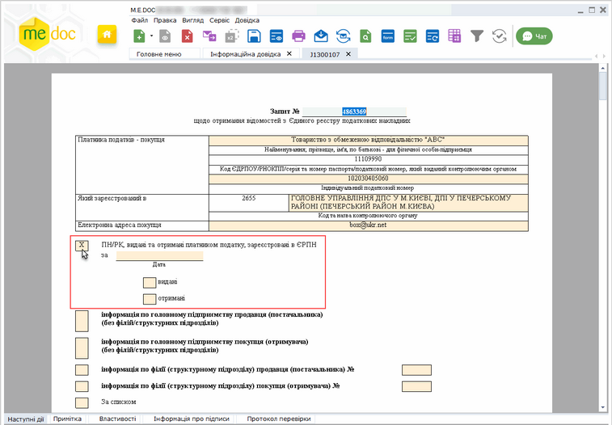

Натисніть, щоб збільшити малюнок

2. У полі Дата вкажіть дату, за яку потрібно отримати інформацію про Податкові накладні та Розрахунки коригування, зареєстровані у ЄРПН:

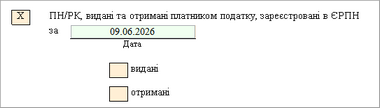

3. Встановіть позначки, що відповідають типу документів, для яких необхідно сформувати запит: видані та (або) отримані:

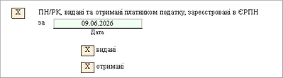

4. У разі потреби, встановіть позначки, що відповідають типу постачальника та/або отримувача для головного підприємства та/або філій:

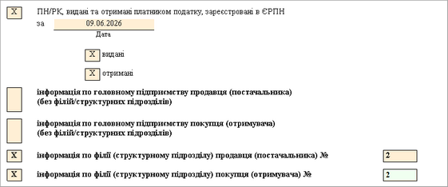

Якщо обрано отримання інформації по філії, у відповідному рядку вкажіть код філії.

За замовчуванням встановлення відміток та заповнення коду для філій виконується автоматично, згідно з даними, що вказані у Картці підприємства.

У разі потреби можна змінювати встановлені відмітки та коди філій вручну.

Якщо позначки не встановлено, у відповідь буде надіслано усю доступну інформацію (що відповідає параметрам запиту) як для головного підприємства, так і для філій.

Зверніть увагу!

Для успішного опрацювання Запиту заборонено встановлювати відмітки отримання інформації по постачальнику або по отримувачу одночасно для головного підприємства та філії.

У такому випадку при перевірці або збереженні запиту на вкладці Протокол перевірки виводиться попередження.

Для успішної обробки запиту можливо обирати типи отримання інформації:

- по головному підприємству постачальнику та/або отримувачу;
- по філії постачальнику та/або отримувачу.

5. Після заповнення документа на вкладці Наступні дії оберіть команду Перевірити звіт та далі Передати звіт на підпис.

6. Розпочнеться процедура підписання документа. Після підписання запиту печаткою установи у відкритому вікні обирається одержувач запиту - ДПС. Далі запускається процес відправки пошти. У разі успішного завершення цієї операції запис про відправку поміщається у даний модуль.

Створення запиту за списком документів

1. Встановіть позначку За списком.

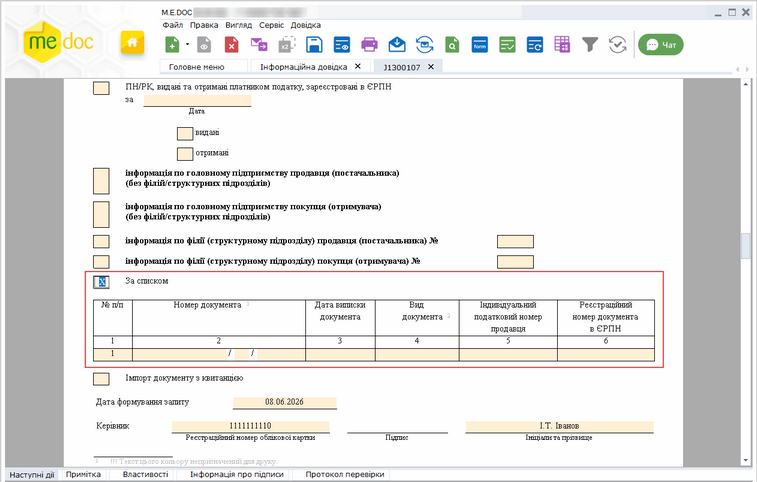

Натисніть, щоб збільшити малюнок

2. Обов'язково заповніть наступні поля:

- Номер документа - введіть номер документа по аналогії з номером податкової накладної;
- Дата виписки документа - введіть дату, коли була виписана податкова;
- Вид документа - введіть умовне позначення документа: ПН - податкова накладна; РК - розрахунок коригування кількісних і вартісних показників до податкової накладної;
- Індивідуальний податковий номер продавця - введіть ІПН постачальника (продавця);
- Реєстраційний номер документа в ЄРПН - введіть реєстраційний номер документа в ЄРПН, якщо відомий.

Значення полів Вид документа та Індивідуальний податковий номер продавця можна ввести вручну з клавіатури або обрати з довідника. Щоб обрати значення з довідника, встановіть курсор у поле та натисніть кнопку , що з'явиться у правій частині комірки. Відкриється вікно довідника, у якому оберіть потрібне значення.

3. Для формування запиту на декілька документів додайте рядок в таблицю, скориставшись кнопкою  ліворуч від таблиці. Відповідно, натискання кнопки  видаляє рядок з таблиці.

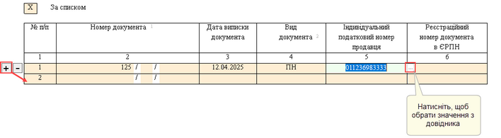

Натисніть, щоб збільшити малюнок

4. Після заповнення документа на вкладці Наступні дії оберіть команду Перевірити звіт та далі Передати звіт на підпис.

5. Розпочнеться процедура підписання документа. Після підписання запиту печаткою установи у відкритому вікні обирається одержувач запиту - ДПС. Далі запускається процес відправки пошти. У разі успішного завершення цієї операції запис про відправку поміщається у даний модуль.

Запит до ЄРПН на отримання електронних документів

Сформувати запит на отримання документів можливо незалежно від способу заповнення форми Запиту (за списком чи за датою).

Щоб надіслати запит на отримання документів, під час заповнення форми встановіть опцію Імпорт документу з квитанцією.

Крім витягу з ЄРПН Вам будуть надіслані зареєстровані документи, що були зазначені у запиті. Документи надходять у оригінальному вигляді з підписом контрагента. Особливості відображення отриманих документів описані у розділі [Відображення документів, отриманих від ДПС](#ucgovqry-ucgovqry_info).

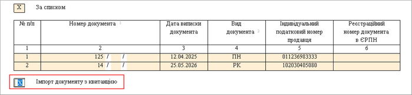

Натисніть, щоб збільшити малюнок

[До початку](#ucgovqry-ucgovqry_info)

Автоматичне створення запиту до Єдиного реєстру податкових накладних

Запит за списком обраних документів можливо сформувати у модулях [Реєстр податкових документів](UCDFDocsRst.html#ucdfdocsrst-pdocs_reestr) та [Реєстр виданих та отриманих податкових накладних](UCDocNaklRstMain5.html#ucdocnaklrstmain5-docnaklrst).

Для цього виконайте дії:

1. Виділіть документи, для яких необхідно сформувати запит, у таблиці модуля.

2. Виконайте команду меню Правка - Запит стану реєстрації ПН/Дод2 в ЄРПН.

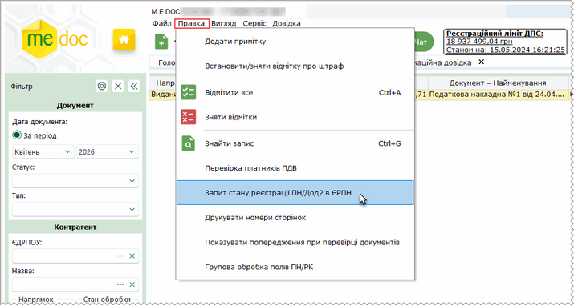

Натисніть, щоб збільшити малюнок

3. Відкриється вікно Запит стану реєстрації:

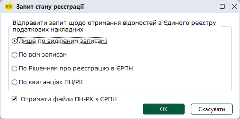

Натисніть, щоб збільшити малюнок

Оберіть один із способів формування Запиту, встановивши відповідну опцію:

- Лише по виділеним записам - у запит автоматично будуть додані лише обрані ПН/РК (ПН/РК, для яких необхідно сформувати Запит, необхідно попередньо виділити у таблиці реєстру);
- По всім записам -  виконується формування запитів для всіх документів, що присутні у таблиці реєстру (крім "РІШЕНЬ про реєстрацію або відмову в реєстрації ПН/РК в ЄРПН");
- По Рішенням про реєстрацію в ЄРПН  -  формування запиту, лише за даними обраних "РІШЕНЬ про реєстрацію або відмову в реєстрації ПН/РК в ЄРПН", (Рішення, за якими необхідно сформувати Запит, необхідно попередньо виділити у таблиці реєстру);
- По квитанціях ПН/РК  -  формування запиту, за даними отриманих «Квитанцій про реєстрацію податкової накладної/розрахунку коригування…», що мають статус Реєстрація зупинена, (Квитанції, за якими необхідно сформувати Запит, необхідно попередньо виділити у таблиці реєстру).

Встановіть опцію Отримати файли ПН-РК з ЄРПН для отримання з ЄРПН зареєстрованих документів з квитанціями, що зазначені у запиті.

4. Натисніть кнопку ОК. Розпочнеться процедура підписання документа.

Якщо ви бажаєте відправити запит пізніше, у вікні Підпис натисніть кнопку Скасувати. Сформований/відправлений запит доступний у модулі Інформаційна довідка та Звітність – Реєстр звітів.

Витяг... на Запит надходить у модуль Інформаційна довідка.

Запит документів виконується лише при встановленій опції Отримати файли ПН-РК з ЄРПН у вікні Запит стану реєстрації. Якщо опція не встановлена, запит, сформований у модулях [Реєстр податкових документів](UCDFDocsRst.html#ucdfdocsrst-pdocs_reestr) та [Реєстр виданих та отриманих податкових накладних](UCDocNaklRstMain5.html#ucdocnaklrstmain5-docnaklrst), здійснюється у режимі отримання відомостей про стан реєстрації документів у ЄРПН.

Примітка:

Існує можливість автоматичної перевірки статусу реєстрації Податкових накладних та Розрахунків коригування в ЄРПН.

Налаштування автоматичного запиту виконуються у модулі Первинні документи - [Автоматична обробка](UCGlobalAutoProcJournal.html#ucglobalautoprocjournal-pdocs_avto).

[До початку](#ucgovqry-ucgovqry_info)

Відображення документів, отриманих з ЄРПН

Якщо при формуванні запиту до ЄРПН було встановлено опцію Імпорт документів (ПН, РК), крім витягу з ЄРПН будуть надіслані зареєстровані документи, що були зазначені у запиті.

Отримані документи завантажуються у Реєстр податкових документів. Алгоритм відображення документів у таблиці Реєстру залежіть від наявності документа у реєстрі, та статусу документа:

|  |  |  |
| --- | --- | --- |
| 1. | Документи, для яких було відправлено запит до ЄРПН, відсутні у Реєстрі податкових документів: | Отримані з ЄРПН документи завантажуються у Реєстр податкових документів. Статус завантажених документів - Зареєстровано в ЄРПН. |
| 2. | Документ, присутній у Реєстрі, як Вихідний документ: | - якщо документ має статус Готується, Чорновий або відправлений на затвердження контрагенту, такий документ заміщується документом, отриманим з ЄРПН, статус документа змінюється на Зареєстровано в ЄРПН.  - якщо документ має статус Очікується доставка (очікується Квитанція №1), вихідний документ переміщується у Корзину, а документ, отриманій з ЄРПН, відображається у Реєстрі. Статус документа не змінюється.  - якщо документ уже зареєстровано у ЄРПН і отримано квитанцію про реєстрацію, документ НЕ замінюється. Статус документа - Зареєстровано в ЄРПН. |
| 3. | Документ, присутній у Реєстрі, як Вхідний документ, надісланий Контрагентом на узгодження (очікує відповіді: не узгоджений, не відхилений): | Документ буде замінено документом, завантаженим з ЄРПН. Статус документа - Зареєстровано в ЄРПН. |
| 4. | Документ, присутній у Реєстрі, як погоджений Вхідний документ від Контрагента: | Документ буде замінено документом, завантаженим з ЄРПН. Статус документа -  "Зареєстровано в ЄРПН". |
| 5. | Документ, присутній у Реєстрі, як відхилений Вхідний документ: | У Реєстрі податкових документів буде відображено два документи (створюються дублі документів):  - вхідний відхилений документ, що надійшов від Контрагента на узгодження, буде відображено червоним кольором;  - той самий документ, але завантажений з ЄРПН, відображається у окремому рядку чорним кольором зі статусом Зареєстровано в ЄРПН. |
| 6. | Вхідний документ від Контрагента присутній у Реєстрі, з квитанцією про реєстрацію у ЄРПН, та має статус Відхилено, Затверджено або Отриманий (очікує відповіді): | Документ отриманий з ЄРПН у Реєстр не завантажуються. У Реєстрі зберігається документ від Контрагента з квитанцією про реєстрацію. |
| 7. | Документ, був завантажений з ЄРПН, після чого цей документ отриманий від Контрагента з Квитанцією про реєстрацію: | У Реєстрі податкових документів зберігається документ, отриманий з ЄРПН з підписом контролюючого органу, але до нього прикріпляється Квитанція, отримана від Контрагента.  При прийомі вхідного документа від Контрагента виконується пошук дублів документа за значеннями номера, дати виписки, суми документа та коду ІПН покупця. Якщо такий документ знайдено, до нього прикріпляється Квитанція, отримана від Контрагента.  У Реєстрі відображається один документ. Статус документа - Зареєстровано в ЄРПН.  Відправнику (продавцю) після доставки квитанції покупцю автоматично надходить повідомлення "Покупець уже отримав документ з ЄРПН". На стороні відправника статус документа автоматично змінюється на Затверджено (без попереднього ручного погодження продавцем). |

У таблиці Реєстру податкових документів у колонці Походження документа для вхідних документів, завантажених з ЄРПН, відображається значення ЄРПН. Для вхідних документів, що отримані від Контрагентів, відповідно відображається значення Контрагент.

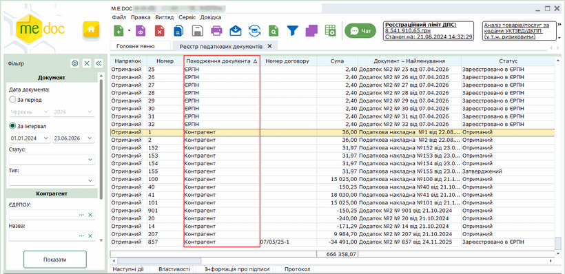

Натисніть, щоб збільшити малюнок

Для вхідних документів, завантажених з ЄРПН, на вкладці Протокол, у розділі Отримано, у якості відправника вказується значення - ДПС.

Для вхідних документів, що отримані від Контрагентів, у полі Відправник відображається значення ЄДРПОУ та назва Контрагента.

У ПН/РК, що були отримані з ЄРПН у відповідь на «Запит щодо отримання відомостей з Єдиного реєстру податкових накладних» зі встановленим параметром Імпорт документу з квитанцією, у поля розробника Вид цивільно-правового договору та Згідно рахунку-фактури переносяться дані про договір та рахунок-фактуру з відповідних ПН/РК, що були отримані від контрагента-відправника, за наявності таких документів у базі програми.

[До початку](#ucgovqry-ucgovqry_info)

Запит щодо отримання відомостей з Єдиного реєстру акцизних накладних

Запит щодо отримання відомостей з Єдиного реєстру акцизних накладних - призначений для перевірки наявності реєстрації Акцизних накладних та Розрахунків коригування в Єдиному реєстрі акцизних накладних.

Щоб сформувати запит оберіть команду Створити - Довідку в СЕАРП та СЕ.

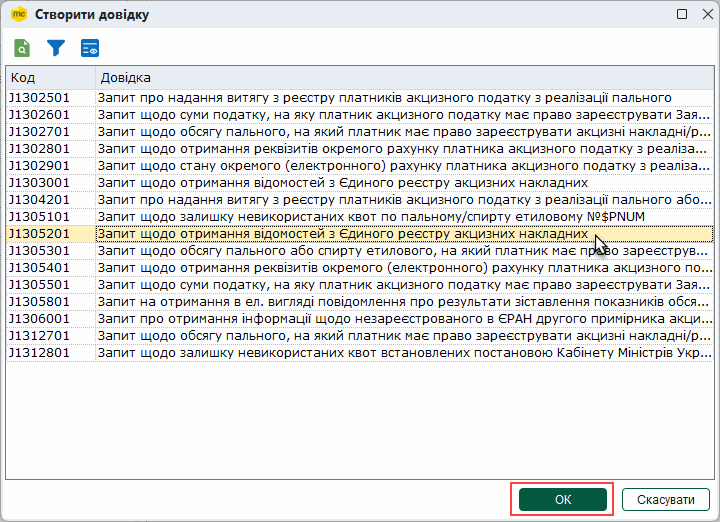

У окремому вікні відкриється бланк документа. Заповніть бланк документа, скориставшись одним із двох способів:

1) формування запиту для документів, [дата реєстрації яких відповідає вказаному значенню](#ucgovqry-ucgovqry_info);

2) формування запиту [за списком певних документів](#ucgovqry-ucgovqry_info).

Також, у бланку передбачена можливість звернутися до ЄРПН з запитом на [отримання необхідних електронних документів](#ucgovqry-ucgovqry_info).

Створення запиту за датою документів

1. Встановіть позначку, залежно віт типу даних, які необхідно отримати з ЄРАН: АН/РК за формою П або АН/РК за формою С.

Для отримання інформації щодо АН/РК за певною формою необхідно створити окремий запит для кожного типу форм (П або С).

2. Встановіть позначку АН/РК, видані та отримані платником податку, зареєстровані в ЄРАН.

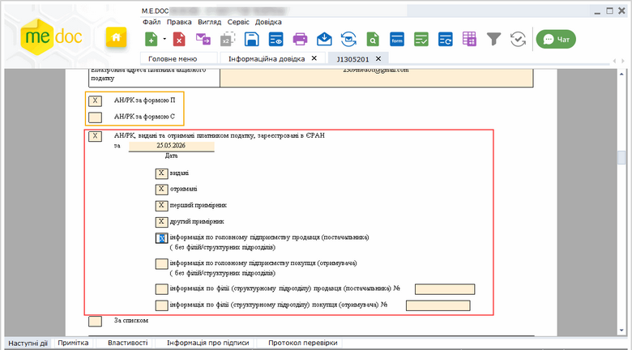

Натисніть, щоб збільшити малюнок

3. У полі Дата вкажіть дату, за яку потрібно отримати інформацію про ПН/РК, зареєстровані у ЄРАН:

4. Встановіть позначки, що відповідають типу документів, для яких необхідно сформувати запит:

- видані та (або) отримані,
- перший примірник та (або) другий примірник.

5. У разі потреби, встановіть позначки, що відповідають типу постачальника та/або отримувача для головного підприємства та/або філій:

Якщо обрано отримання інформації по філії, у відповідному рядку вкажіть код філії.

Якщо позначки не встановлено, у відповідь буде надіслано усю доступну інформацію (що відповідає параметрам запиту) як для головного підприємства, так і для філій.

6. Після заповнення документа на вкладці Наступні дії оберіть команду Перевірити звіт та далі Передати звіт на підпис.

7. Розпочнеться процедура підписання документа. Після підписання запиту печаткою установи у відкритому вікні обирається одержувач запиту - ДПС. Далі запускається процес відправки пошти. У разі успішного завершення цієї операції запис про відправку поміщається у даний модуль.

Створення запиту за списком документів

1. Встановіть позначку, залежно віт типу даних, які необхідно отримати з ЄРАН: АН/РК за формою П або АН/РК за формою С.

Для отримання інформації щодо АН/РК за певною формою необхідно створити окремий запит для кожного типу форм (П або С).

2. Встановіть позначку За списком.

Позначка За списком встановлена у системі за замовчуванням.

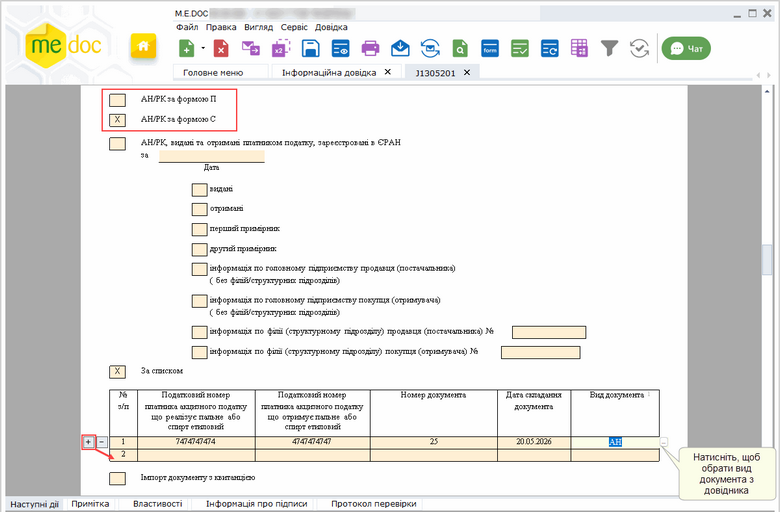

Натисніть, щоб збільшити малюнок

3. Обов'язково заповніть наступні поля:

- Номер документа - введіть номер документа по аналогії з номером податкової накладної;
- Дата виписки документа - введіть дату, коли була виписана податкова;
- Вид документа - введіть умовне позначення документа: АН - податкова накладна; РК - розрахунок коригування кількісних і вартісних показників до податкової накладної.

Значення поля Вид документа можна ввести вручну з клавіатури або обрати з довідника. Щоб обрати значення з довідника, встановіть курсор у поле та натисніть кнопку , що з'явиться у правій частині комірки. Відкриється вікно довідника, у якому оберіть потрібне значення.

4. Для формування запиту на декілька документів додайте рядок в таблицю, скориставшись кнопкою  зліва від таблиці. Відповідно, натискання кнопки  видаляє рядок з таблиці.

5. Після заповнення документа на вкладці Наступні дії оберіть команду Перевірити звіт та далі Передати звіт на підпис.

6. Розпочнеться процедура підписання документа.

Після підписання запиту печаткою установи у відкритому вікні обирається одержувач запиту - ДПС.

Далі запускається процес відправки пошти. У разі успішного завершення цієї операції запис про відправку поміщається у даний модуль.

Запит до ЄРАН на отримання електронних документів

Сформувати запит на отримання документів можливо незалежно від типу Запиту щодо отримання відомостей з Єдиного реєстру акцизних накладних (за датою або за списком документів).

Щоб надіслати запит на отримання документів, під час заповнення форми встановіть опцію Імпорт документу з квитанцією.

Крім витягу з ЄРАН Вам будуть надіслані зареєстровані документи з квитанціями, що були зазначені у запиті. Документи надходять у оригінальному вигляді з підписом контрагента. Особливості відображення отриманих документів описані у розділі [Відображення документів, отриманих з ЄРАН](#ucgovqry-ucgovqry_info).

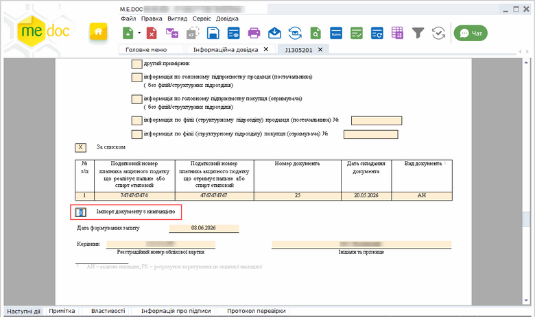

Натисніть, щоб збільшити малюнок

[До початку](#ucgovqry-ucgovqry_info)

Відображення документів, отриманих з ЄРАН

Якщо при формуванні запиту до ЄРАН було встановлено опцію Імпорт документу з квитанцією, крім витягу з ЄРАН будуть надіслані зареєстровані документи, що були зазначені у запиті.

Отримані документи завантажуються у Реєстр акцизних документів. Алгоритм відображення документів у таблиці Реєстру залежіть від наявності документа у реєстрі, та статусу документа:

|  |  |  |
| --- | --- | --- |
| 1. | Документи, для яких було відправлено запит до ЄРАН, відсутні у Реєстрі акцизних документів: | Отримані з ЄРПН документи завантажуються у Реєстр акцизних документів. Статус завантажених документів - "Зареєстровано в ЄРАН". |
| 2. | Документ, присутній у Реєстрі, як Вихідний документ: | - якщо документ має статус Готується, Чорновий або відправлений на затвердження контрагенту, такий документ заміщується документом, отриманим з ЄРАН, статус документа змінюється на "Зареєстровано в ЄРАН".  - якщо документ має статус Очікується доставка (очікується Квитанція №1), вихідний документ переміщується у Корзину, а документ, отриманій з ЄРАН, відображається у Реєстрі. Статус документа не змінюється.  - якщо документ уже зареєстровано у ЄРАН і отримано квитанцію про реєстрацію, документ НЕ замінюється. Статус документа - "Зареєстровано в ЄРАН". |
| 3. | Документ, присутній у Реєстрі, як Вхідний документ, надісланий Контрагентом на узгодження (очікує відповіді: не узгоджений, не відхилений): | Документ буде замінено документом, завантаженим з ЄРАН. Статус документа -  "Зареєстровано в ЄРАН". |
| 4. | Документ, присутній у Реєстрі, як погоджений Вхідний документ від Контрагента: | Документ буде замінено документом, завантаженим з ЄРАН. Статус документа -  "Зареєстровано в ЄРАН". |
| 5. | Документ, присутній у Реєстрі, як відхилений Вхідний документ: | У Реєстрі податкових документів буде відображено два документи (створюються дублі документів):  - вхідний відхилений документ, що надійшов від Контрагента на узгодження, буде відображено червоним кольором;  - той самий документ, але завантажений з ЄРАН, відображається у окремому рядку чорним кольором зі статусом "Зареєстровано в ЄРАН". |
| 6. | Вхідний документ від Контрагента присутній у Реєстрі, з квитанцією про реєстрацію у ЄРАН, та має статус Відхилено, Затверджено або Отриманий (очікує відповіді): | Документ отриманий з ЄРАН у Реєстр не завантажуються. У Реєстрі зберігається документ від Контрагента з квитанцією про реєстрацію. |
| 7. | Документ, був завантажений з ЄРАН, після чого цей документ отриманий від Контрагента з Квитанцією про реєстрацію: | У Реєстрі податкових документів зберігається документ, отриманий з ЄРАН з підписом ДПС, але до нього прикріпляється Квитанція, отримана від Контрагента.  При прийомі вхідного документа від Контрагента виконується пошук дублів документа за значеннями номера, дати виписки, суми документа. Якщо такий документ знайдено, до нього прикріпляється Квитанція, отримана від Контрагента.  У Реєстрі відображається один документ. Статус документа -  Зареєстровано в ЄРАН.  Відправнику (продавцю) після доставки квитанції покупцю автоматично надходить повідомлення Покупець уже отримав документ з ЄРАН. На стороні відправника статус документа автоматично змінюється на "Затверджено" (без попереднього ручного погодження продавцем). |

У таблиці Реєстру акцизних документів у колонці Походження документа для вхідних документів, завантажених з ЄРАН, відображається значення ЄРАН. Для вхідних документів, що отримані від Контрагентів, відповідно відображається значення Контрагент.

[До початку](#ucgovqry-ucgovqry_info)

Запит щодо отримання відомостей про РРО

У розділі можливо отримати інформацію з реєстру екземплярів РРО та/або з реєстру центрів сервісного обслуговування РРО.

Щоб сформувати запит:

1. Оберіть команду Створити - Довідку про РРО.

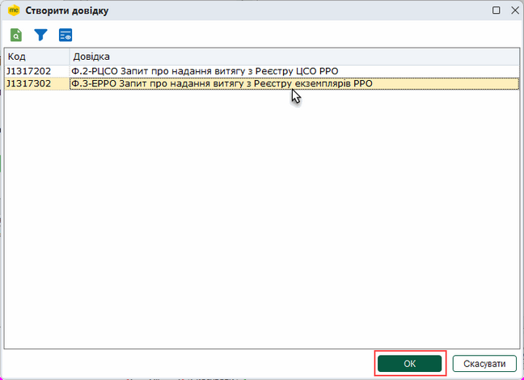

2. У окремому вікні відкриється бланк документа. Поля запиту автоматично заповнюються даними з довідників. Перевірте коректність заповнення та введіть дані у незаповнені поля документа, наприклад:

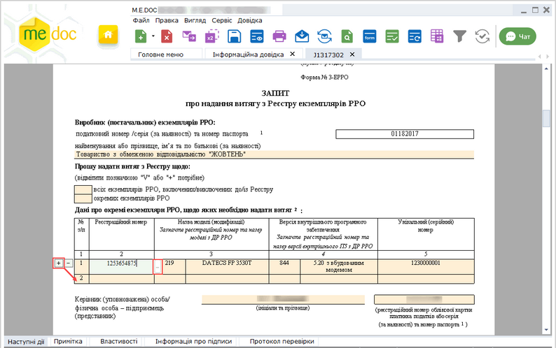

Натисніть, щоб збільшити малюнок

Поля, підсвічені жовтим кольором, обов'язкові для заповнення.

Запит про надання витягу з реєстру екземплярів РРО може формуватися на декілька екземплярів РРО. Дані кожного екземпляру вказуються у окремому рядку.

Щоб додати рядок у таблицю бланка, встановіть курсор у рядок та натисніть кнопку  зліва від таблиці. Відповідно, натискання кнопки  видаляє рядок з таблиці.

Щоб обрати дані з довідника, натисніть кнопку . У вікні довідника Перелік РРО оберіть потрібне значення:

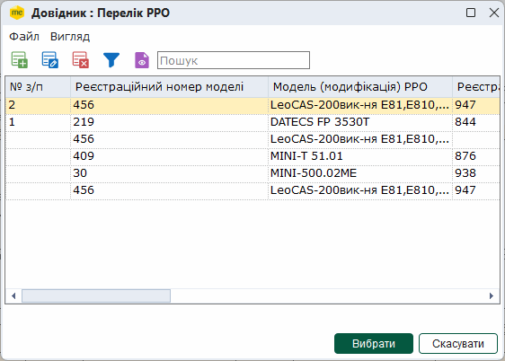

Зверніть увагу, довідники РРО заповнюються користувачем! При першому відкритті довідники не містить записів! Попередньо необхідно заповнити довідники РРО відповідно до потреб установи. Детально дивіться у розділі [Довідники РРО](UCRRO_dovidnyky.html#ucrro_dovidnyky-ucrro_dovidnyky).

3. Після заповнення документа на вкладці Наступні дії оберіть команду Перевірити звіт та далі Передати звіт на підпис.

4. Розпочнеться процедура підписання документа.

Після підписання запиту печаткою установи у відкритому вікні обирається одержувач запиту - ДПС.

Далі запускається процес відправки пошти. У разі успішного завершення цієї операції запис про відправку поміщається у даний модуль.

[До початку](#ucgovqry-ucgovqry_info)

Прийом відповіді на запит

Прийом відповіді з податкової інспекції на відісланий запит відбувається стандартним засобами системи за допомогою функції Отримати повідомлення (кнопка ).

Після отримання інформаційна довідка буде збережена у розділі Довідки державних органів - Інформаційна довідка.

Для перегляду отримана відповідь відкривається подвійним кліком по потрібному запису. У відповіді детально викладено інформацію по запиту.

Також є можливість відкрити довідку-відповідь безпосередньо з відправленого запиту, і навпаки (з довідки-відповіді відкрити запит). Для цього у вікні відкритого документа на вкладці Наступні дії оберіть опцію Відкрити зв’язану довідку.

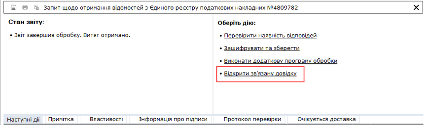

Натисніть, щоб збільшити малюнок

Переглянути Витяг з Єдиного реєстру податкових накладних можливо у Реєстрі податкових документів. Для цього у таблиці модуля оберіть документ, на який було отримано Витяг. Відкрийте вкладку Наступні дії, та оберіть опцію Відкрити витяг з ЄРПН.

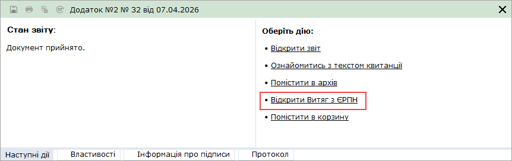

Отримана довідка не є підставою для здійснення фінансових та інших операцій установами банків, судовими органами, нотаріусами тощо.

[До початку](#ucgovqry-ucgovqry_info)

### Отримання документів від ДПС

_Шлях у довідці: Розділи програми › Податкові довідки › Отримання документів від ДПС_

В програмному комплексі у розділі Інформаційна довідка реалізовано отримання від ДПС наступних витягів:

J1401903        Витяг в розрізі операцій з Системи електронного адміністрування ПДВ

F1401903        Витяг в розрізі операцій з Системи електронного адміністрування ПДВ

Для отримання цих витягів потрібно виконати такі дії:

1. Для створення нового документа скористайтесь одним із наступних способів:

- на панелі інструментів натисніть кнопку Створити - Довідку в СЕА ПДВ;
- виберіть команду Файл - Створити - Довідку в СЕА ПДВ;
- у контекстному меню оберіть команду Створити - Довідку в СЕА ПДВ;
- натисніть комбінацію клавіш <Ctrl+N> та оберіть тип Довідку в СЕА ПДВ у вікні Оберіть тип запиту.

На виконання відкриється вікно Створити довідку.

2. Оберіть "Запит щодо отримання інформації в розрізі операцій з Системи електронного адміністрування ПДВ" J(F)1301903.

3. Натисніть кнопку ОК для формування запиту.

У вікні запиту потрібно обов'язково зазначити дату, інформацію за яку потрібно отримати, та додати операції, в розрізі яких потрібно отримати дані.

Щоб додати необхідні операції, встановіть курсор у комірку вибір типу операції по фільтру, натисніть кнопку  та у вікні довідника Назва операції з СЕА ПДВ, що відкриється, виберіть потрібну операцію.

Щоб додати наступну операцію натисніть кнопку , у вікні Запиту з'явиться новий рядок, для якого також оберіть операцію з довідника. Відповідно, щоб видалити рядок операції із Запиту, натисніть кнопку .

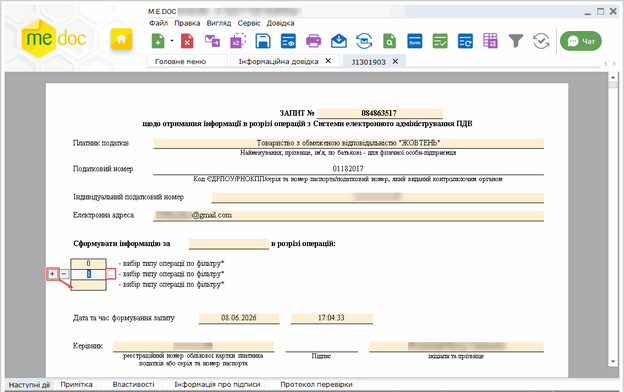

Натисніть, щоб збільшити малюнок

Якщо необхідно сформувати запит за всіма доступними операціями, оберіть фільтр з номером 999 всі типи операцій, що знаходиться у кінці списку довідника Назва операції з СЕА ПДВ.

4. Після заповнення документа на вкладці Наступні дії оберіть команду Перевірити звіт та далі Передати звіт на підпис.

Розпочнеться процедура підписання документа.

5. Після підписання запиту у відкритому вікні обирається одержувач запиту - ДПС.

Далі запускається процес відправки пошти. У разі успішного завершення цієї операції запис про відправку поміщається у даний модуль.

У відповідь на відправлений запит буде отримано J(F)1401903 Витяг в розрізі операцій з Системи електронного адміністрування ПДВ.

У цьому витягу відобразяться дані по тим операціям, які були зазначені в запиті:

- дата та час операції;
- тип операції;
- номер документа;
- дата документа;
- сума по операції;
- сума ліміту та складових ліміту.

В програмному комплексі у розділі Інформаційна довідка також реалізовано отримання від ДПС наступних документів:

J1490004        Інформаційне повідомлення

J1490202        Довідка щодо обсягів податкового кредиту, сформованого за рахунок податкових накладних, не зареєстрованих в ЄРПН

Отримані документи необхідно відкрити та переглянути.

### Експорт Витягів у файл Excel

_Шлях у довідці: Розділи програми › Податкові довідки › Експорт Витягів у файл Excel_

Для Витяг з Єдиного реєстру податкових накладних та Витяг в розрізі операцій з Системи електронного адміністрування ПДВ реалізований експорт в файл Excel. Експортувати можна один або одночасно декілька  витягів.

Для експорту витягів потрібно виконати такі дії:

1. В модулі Інформаційна довідка виберіть один або декілька витягів.

2. Виберіть команду Файл - Експорт витягів в Excel.

3. На виконання відкриється модальне вікно Огляд папок. Вкажіть каталог, де зберегти створений файл та натисніть ОК.

4. Файл буде збережено у вказане місце. У файлі міститиметься дві вкладки  - Отримані та Видані.

### Листи державних органів

_Шлях у довідці: Розділи програми › Податкові довідки › Листи державних органів_

У цьому розділі відображаються інформаційні повідомлення та листи, що надходять від контролюючих органів: довідки про податкову заборгованість та інші службові повідомлення.

Інформаційні повідомлення надходять як звичайна вхідна кореспонденція.

Порядок отримання кореспонденції - стандартний для програмного комплексу:

- натисніть кнопку Отримати повідомлення на панелі інструментів -
- або натисніть функціональну клавішу F9.


