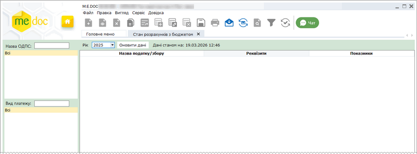
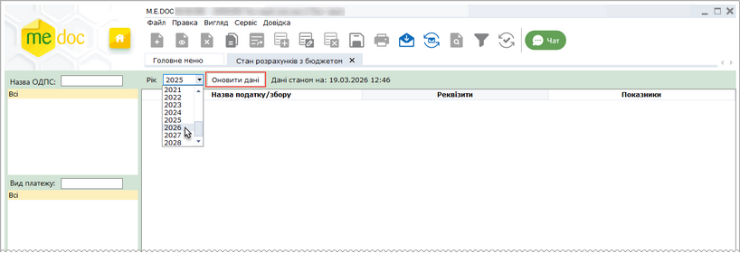
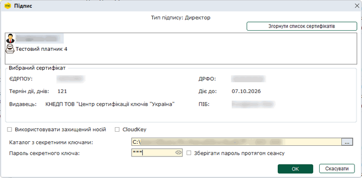
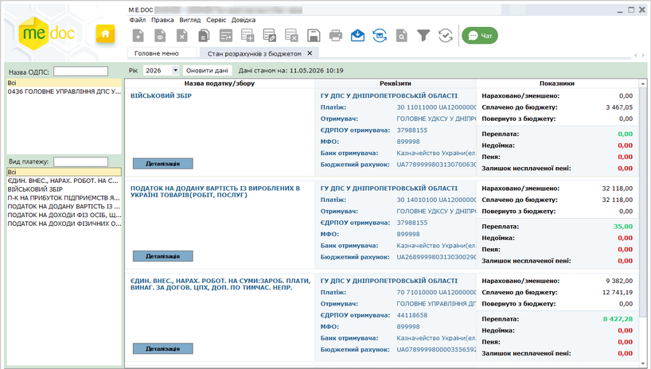
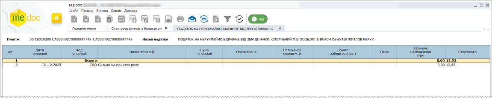
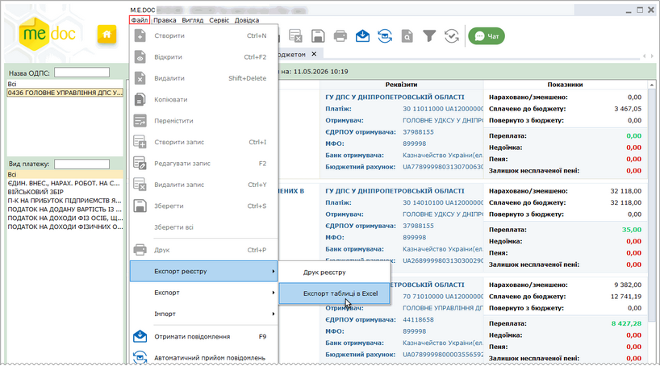
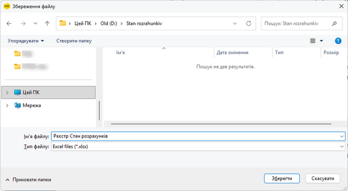
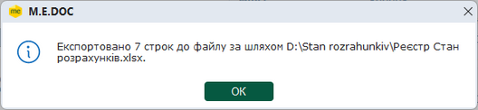

[← Зміст довідки](../)


# Стан розрахунків з бюджетом

## Стан розрахунків з бюджетом

_Шлях у довідці: Розділи програми › Податкові довідки › Стан розрахунків з бюджетом_

В цьому розділі:

[Отримання відомостей щодо стану розрахунків з бюджетом](#ucgovqryaccounting-ucgovqryaccounting)

[Експорт даних щодо розрахунків у форматі Excel](#ucgovqryaccounting-ucgovqryaccounting)

[Друк даних про стан розрахунків з бюджетом](#ucgovqryaccounting-ucgovqryaccounting)

Отримання відомостей щодо стану розрахунків з бюджетом

Модуль Стан розрахунків з бюджетом надає можливість отримати відомості щодо стану рахунків підприємства із сплати податків, зборів та інших платежів.

При першому відкритті модуль не містить інформації (запит даних не виконувався):

Натисніть, щоб збільшити малюнок

Для звірки розрахунків:

1. Оберіть рік, за який необхідно отримати інформацію, та натисніть кнопку Оновити дані.

Натисніть, щоб збільшити малюнок

2. Підтвердіть відправку запиту за допомогою будь-якого доступного сертифіката:

Натисніть, щоб збільшити малюнок

3. У модулі будуть відображені дані станом на момент запиту, що містять інформацію по кожному виду платежу. Дані щодо певного виду платежу відображаються у окремому рядку:

Натисніть, щоб збільшити малюнок

За допомогою панелі фільтрів можливо відібрати отриману інформацію за Назвою ОДПС та/або Видом платежу. Значення можливо ввести у поля для пошуку або обрати зі списку.

Дата та час, на які отримано дані, відображаються у верхній частині вікна.

Червоним кольором позначені суми податків/зборів, по яких існує заборгованість до бюджету.

Для перегляду деталізованої інформації по податку (платежу) в розрізі проведених операцій натисніть кнопку Деталізація у рядку платежу.

Підтвердіть відправку запиту за допомогою будь-якого доступного сертифіката.

Відкриється вкладка, що містить докладну інформацію:

Натисніть, щоб збільшити малюнок

При наступному відкритті модуля Стан розрахунків з бюджетом за замовчуванням будуть відображені дані за поточний рік, які були отримані при останньому запиті інформації. Щоб оновити інформацію у розділі виконайте операції, описані вище.

[До початку](#ucgovqryaccounting-ucgovqryaccounting)

Експорт даних щодо розрахунків у форматі Excel

У файл Excel експортуються дані, що відображені у таблиці модуля (з урахуванням обраних фільтрів) на момент виконання експорту.

Для збереження даних щодо розрахунків на електронному носії чи у обраному каталозі:

1. Оберіть команду головного меню Файл – Експорт реєстру – Експорт таблиці в Excel.

Натисніть, щоб збільшити малюнок

2. У вікні Збереження файлу оберіть каталог для збереження даних, ведіть ім'я файлу та натисніть кнопку Зберегти.

Натисніть, щоб збільшити малюнок

3. Система повідомить про результати експорту даних. Файл з даними про розрахунки буде збережено у обраному каталозі.

Натисніть, щоб збільшити малюнок

Для експорту деталізованої інформації по податку (платежу) у [вкладці, що містить докладну інформацію](#ucgovqryaccounting-ucgovqryaccounting), оберіть команду головного меню Файл – Експорт – Експорт таблиці в Excel.

[До початку](#ucgovqryaccounting-ucgovqryaccounting)

Друк даних про стан розрахунків з бюджетом

Роздруковуються дані, що відображені у таблиці модуля (з урахуванням обраних фільтрів) на момент виконання команди.

Для друку даних виконайте наступне:

1. Оберіть команду одним із наступних способів:

- команда меню Файл - Друк реєстру;
- у контекстному меню команда  Друк реєстру.

2. У вікні Друк оберіть принтер, на який потрібно роздрукувати дані. Натисніть ОК.

3. Розпочнеться друк даних на обраний принтер. Система відобразить процес виконання друку:

[До початку](#ucgovqryaccounting-ucgovqryaccounting)


