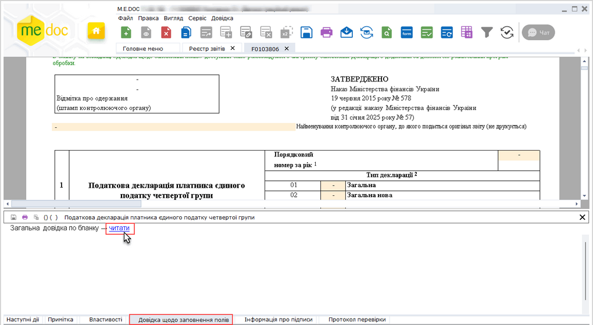
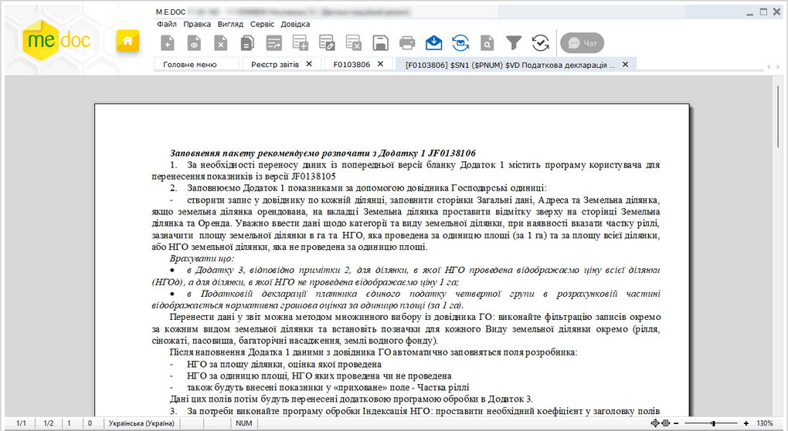

[← Зміст довідки](../)


# Довідка щодо заповнення бланку та полів бланку

## Довідка щодо заповнення бланку та полів бланку

_Шлях у довідці: Основні робочі процедури › Робота з документами › Довідка щодо заповнення бланку та полів бланку_

В допомогу користувачу, з метою коректного заповнення звітних документів, надано підказки щодо заповнення бланку та полів бланку.

1. Одним із загально вживаних способів створіть необхідний звіт, наприклад, виберіть команду Файл - Створити. В окремому вікні відкриється новий документ.

2. Під час заповнення даними поля документа, на панелі вкладок звіту відкрийте вкладку Довідка щодо заповнення полів.

Натисніть, щоб збільшити малюнок

3. Для перегляду довідки натисніть на посилання читати. Довідка до бланку відкриється в окремому вікні програми:

Натисніть, щоб збільшити малюнок


