[← Зміст довідки](../)


# Фінансова звітність за МСФЗ (формат iXBRL)

## Фінансова звітність за МСФЗ (формат iXBRL)

_Шлях у довідці: Розділи програми › Звітність › Фінансова звітність за МСФЗ (формат iXBRL)_

Модуль Фінансова звітність за МСФЗ (формат iXBRL) призначений для підприємств, які складають фінансову звітність за міжнародними стандартами фінансової звітності (МСФЗ). Модуль надає можливість формувати фінансову звітність за МСФЗ на основі таксономії разом із звітом аудитора в єдиному електронному форматі, визначеному Міністерством фінансів України.

За допомогою модуля можливо здійснювати:

- автоматичний обмін інформацією між аудитором та підприємством для підтвердження даних, зазначених у фінансовій звітності, створення звіту аудитора, а також, підписання звіту у форматі iXBRL;
- заповнення великих таблиць звітів за допомогою [Майстра заповнення форм](UCIFRSTgrRst_stvor.html#ucifrstgrrst_stvor-ucifrstgrrst_stvor);
- експорт звітів у PDF-форматі, що надає можливість оприлюднення річної фінансової звітності на власній веб-сторінці відповідно до вимог чинного законодавства України;
- комплексну одночасну перевірку всіх документів пакета звітності.

Модуль Фінансова звітність за МСФЗ (формат iXBRL) також буде корисним для Компаній з управління активами та фондів, якими керують ці компанії:

- КІФ – корпоративні інвестиційні фонди;
- ПІФ – пайові інвестиційні фонди;
- НФП – недержавні пенсійні фонди.

Зверніть увагу! Ви використовуєте MVP версію модуля, що містить основні функції при роботі зі звітністю за МСФЗ. Функціонал модуля буде вдосконалюватися та розширюватися у наступних оновленнях програми. Будемо вдячні за ваші зауваження та побажання щодо роботи модуля.

У даному розділі довідки розглянуто здійснення операцій зі створення та конвертації фінансової звітності за МСФЗ:

- [Опис основних функціональних елементів інтерфейсу](#ucifrstgrrst-ucifrstgrrst_interface)
- [Створення, заповнення та редагування звітності за МСФЗ](UCIFRSTgrRst_stvor.html#ucifrstgrrst_stvor-ucifrstgrrst_stvor)
- [Підписання та відправка звітності за МСФЗ](#ucifrstgrrst-ucifrstgrrst_vidp)
- [Створення Аудиторських звітів](UCIFRSTgrRst_audyt.html#ucifrstgrrst_audyt-ucifrstgrrst_audyt)
- [Створення Інформації аудитора](UCIFRSTgrRst_zvit_audyt.html#ucifrstgrrst_zvit_audyt-ucifrstgrrst_zvit_audyt)
- [Створення документів аудитором з ЄДРПОУ клієнтів-суб'єктів господарювання](UCIFRSTgrRst_audyt_klient.html#ucifrstgrrst_audyt_klient-ucifrstgrrst_audyt_klient)
- [Обмін запитами та відповідями на них між аудитором та клієнтами](UCIFRSTgrRst_audyt_zapyt.html#ucifrstgrrst_audyt_zapyt-ucifrstgrrst_audyt_zapyt)
- [Конвертація пакета документів у формат iXBRL](UCIFRSTgrRst_iXBRL.html#ucifrstgrrst_ixbrl-ucifrstgrrst_ixbrl)
- [Підписання документів iXBRL](#ucifrstgrrst-ucifrstgrrst_psdpys_ixbrl)
- [Експорт документів iXBRL](#ucifrstgrrst-ucifrstgrrst_export_ixbrl)
- [Консолідація звітів від підзвітних установ](UCIFRSTgrRst_konsolidacia.html#ucifrstgrrst_konsolidacia-ucifrstgrrst_konsolidacia)

та додаткові операції

- [Експорт даних в форматі «для обміну звітністю»](#ucifrstgrrst-ucifrstgrrst_export_obmin)
- [Імпорт даних](#ucifrstgrrst-ucifrstgrrst_imp)
- [Копіювання документів](UCIFRSTgrRst_stvor.html#ucifrstgrrst_stvor-ucifrstgrrst_stvor)
- [Друк документів у форматі PDF](#ucifrstgrrst-ucifrstgrrst_print_pdf)

### Опис основних функціональних елементів інтерфейсу модуля

_Шлях у довідці: Розділи програми › Звітність › Фінансова звітність за МСФЗ (формат iXBRL) › Опис основних функціональних елементів інтерфейсу модуля_

Модуль побудований у вигляді таблиці-реєстру, окремий рядок якої відображає коротку інформацію про кожен документ. Таблиця умовно розділена на дві частини. Перша частина містить інформацію про сформовані документи пакета у форматі xml, друга частина – інформацію про сконвертований звіт у форматі iXBRL.

У лівій частині модуля розташована навігаційна панель. Панель містить області, що призначені для полегшення пошуку документів. При виборі певного значення на панелі навігації, в робочій області відображаються документи, що відповідають заданим умовам фільтрації.

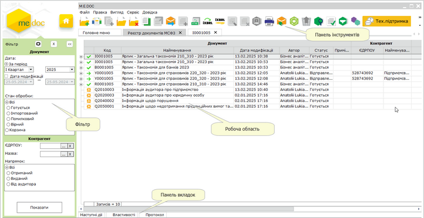

Натисніть, щоб збільшити малюнок

 Щоб швидко розгорнути/згорнути всі пакети звітів у таблиці модуля, скористайтеся відповідною командою головного меню: Вигляд - Розгорнути всі пачки або Згорнути всі пачки.

Реєстр складається з 4 частин:

Фільтр

Робота з Реєстром розпочинається з Фільтру - інструменту відбору потрібних документів.

У Фільтрі представлені атрибути документів, за якими здійснюється пошук та сортування:

Ви можете самостійно задавати відображення параметрів відбору в Реєстрі. Натисніть на кнопку  та в окремому вікні, що відкрилось, встановіть/зніміть галочки напроти потрібного атрибуту:

Документ:

Дата - встановіть позначку для вибору певного періоду:

- За період - вкажіть звітний період, в межах якого були створені потрібні первинні документи;
- Дата модифікації - вкажіть дату початку та закінчення довільного інтервалу, в межах якого у документах виконувалися зміни, відбір здійснюється лише за датами модифікації ярликів, не враховуючи дати модифікації дочірніх документів.

Стан обробки

Містить перемикач між призначеннями документів:

- Всі – всі звіти крім видалених;
- Готується – пакети звіти, що знаходяться в роботі, неперевірені та не відправлені на підпис;
- Імпортований – пакети звітів, що були імпортовані у реєстр;
- Помилковий – пакети звітів, які містять хоча б один помилковий звіт;
- Вірний – пакети звітів, у яких всі документи і мають статус Вірний;
- Корзина – видалені пакети звітів ([переміщені](#ucifrstgrrst-ucifrstgrrst_interface) у Корзину).

За замовчуванням обрано відображення всіх звітів.

Контрагент:

- ЄДРПОУ - дозволяє знайти документи контрагента, що були відправлені/прийняті, якщо відомо його код установи за Єдиним державним реєстром підприємств та організацій України. Значення вводиться з клавіатури, обирається з підключеного довідника (кнопка ) або заповнюється автоматично при виборі інших даних контрагента з довідника;
- Назва - дозволяє знайти документи, які були виписані на ім'я або отримані від певного контрагента. Назва контрагента можна ввести як з клавіатури, так і вибрати із довідника Контрагенти, який відкривається після натиснення на кнопку . При виборі контрагента із довідника, автоматично заповнюються поле ЄДРПОУ.

Напрямок:

Містить перемикач між напрямками документів. Передбачені наступні варіанти:

- Всі - всі документи незалежно від напрямку;
- Отриманий - отримані документи;
- Виданий - документи, створені у поточному підприємстві;
- Від аудитора - документи, отримані від аудитора.

Після встановлення параметрів фільтрації натисніть на кнопку Показати. В робочій області відобразиться перелік документів відповідно до заданих параметрів пошуку.

Для того, щоб очистити Фільтр від даних, натисніть на кнопку .

Якщо панель Фільтра не потрібна та/або заважає, її можна згорнути. Для цього натисніть на кнопку . Щоб розгорнути Фільтр, натисніть на згорнуту панель.

Робоча область

Містить безпосередньо записи Реєстру  звітів за міжнародними стандартами фінансової звітності: відображає записи, що відповідають заданим умовам фільтрації та сортування.

Документи, що містять помилки відображаються червоним кольором.

Щоб відкрити документ, оберіть його у списку та скористайтеся одним із способів:

- натисніть 2 рази лівою кнопкою миші на документі у списку;
- виконайте команду меню Файл - Відкрити;
- оберіть команду Відкрити у контекстному меню;
- натисніть кнопку Відкрити  на панелі інструментів;
- скористайтесь комбінацією клавіш Ctrl+F2.

Стан пакета звітів позначається відповідною іконкою:

|  |  |
| --- | --- |
|  | Новий неперевірений пакет звітів (наприклад, імпортований або скопійований) |
|  | Перевіреній пакет, що не містить помилок |
|  | Пакет містить помилки (некоректно заповнені звіти) |
|  | Підписаний або переданий на підпис пакет звітів (у форматі xml) |
|  | Пакет, відправлений адресату |
|  | Пакет, доставлений адресату |
|  | Отриманий пакет звітів |
|  | Сформовано пакет у форматі iXBRL |
|  | Підписаний пакет у форматі iXBRL |

Підпорядкований документ у пакеті або весь пакет звітів можна видалити. Для цього виділіть рядок підпорядкованого документа у пакеті або рядок головного документа (для видалення всього пакета) та скористайтеся одним із способів:

- виконайте команду головного меню Файл – Видалити;
- оберіть команду контекстного меню Видалити;
- натиснути кнопку  на панелі інструментів;
- натисніть комбінацію клавіш <Shift+Delete>.

Зверніть увагу! При видаленні підпорядкованого документа пакета виконується остаточне видалення документа без можливості відновлення.

Пакети звітів після видалення вилучаються з обробки та переміщаються до Корзини. Щоб переглянути вилучені пакети звіти, на панелі Фільтр встановіть опцію Корзина та натисніть кнопку Показати. У таблиці модуля будуть відображені лише ті пакети звітів, що були вилучені з обробки. Для відновлення вилученого пакета звітів, виділіть рядок головного документа пакета та скористайтеся одним із способів:

- виконайте команду головного меню Правка – Відновити з корзини;
- оберіть команду контекстного меню Відновити з корзини;
- натиснути кнопку  на панелі інструментів.

Панель вкладок

Містить службову інформацію щодо обраного документа. Панель доступна як у відкритому документі, так і з Реєстру (за умови виділення потрібного документа).

- Наступні дії – містить інформацію щодо поточного стану документа, а також перелік можливих дій з документом у цьому стані. Слугує підказкою користувачу про доступні дії, які можна виконати з документом у поточному стані;
- Властивості – у режимі читання містить всю службову інформацію про документ, таку як: стан, період створення, дата та час останньої модифікації, інформація про сертифікати, якими підписано документ тощо. Інформація на цій вкладці постійно оновлюється та доповнюється при будь-яких змінах документа;
- Протокол – містить перелік подій, що відбулись з документом під час його обробки в хронологічному порядку. При виборі події справа на панелі відображається її детальний опис.

У вікні відкритого документа доступна вкладка:

- Примітка – текстове поле для внесення будь-якої інформації стосовно поточного документа. Вкладка доступна тільки до моменту відправлення документа. Інформація, яка внесена в дане поле також відображається в колонці Примітка реєстру.

Панель інструментів.

Містить кнопки, що надають швидкий доступ до найбільш часто використовуваних функцій. Наведіть покажчик миші на інструмент і чекайте протягом секунди, для відображення короткої підказки, що описує його призначення.

|  |  |
| --- | --- |
|  | Створення документа |
|  | Створити Звіт аудитора на основі обраного пакета звітності |
|  | Перегляд (редагування) поточного документа |
|  | Вилучення поточного документа |
|  | Створення копії документа. Копія документа створюється, якщо він може повторюватися у рамках звітних періодів, а також у випадку, якщо потрібно відредагувати та повторно відіслати раніше відправлений електронною поштою звіт (у тому числі і підписаний ЕП) |
|  | Друкування обраного документа |
|  | Відправити документ |
|  | Отримати повідомлення |
|  | Сформувати пакет у форматі iXBRL |
|  | Підписати пакет у форматі iXBRL |
|  | Консолідація звітів від підзвітних установ |
|  | Автоматичне переформування текстових полів |

### Робота з документами фінансової звітності за МСФЗ

_Шлях у довідці: Розділи програми › Звітність › Фінансова звітність за МСФЗ (формат iXBRL) › Робота з документами фінансової звітності за МСФЗ_

В цьому розділі:

[Взаємодія з аудитором](#ucifrstgrrst-ucifrstgrrst_funkc)

[Подання звітності КІФ/НПФ за підписом керуючих компаній](#ucifrstgrrst-ucifrstgrrst_funkc)

Призначення модуля - максимально спростити формування та подання фінансової звітності за МСФЗ у форматі іХBRL до Центру збору фінансової звітності, операційне управління яким здійснюється НКЦПФР.

Для створення та конвертування фінансової звітності за МСФЗ у модулі виконуються операції:

1. Суб'єкт господарювання [створює пакет документів](UCIFRSTgrRst_stvor.html#ucifrstgrrst_stvor-ucifrstgrrst_stvor), наприклад, Загальна таксономія 210\_310, пакет створюється у форматі xml та заповнюється суб’єктом господарювання. Користувач має можливість перевірити створені звіті у програмі. Ця функція доступна, як суб’єкту господарювання, так і аудитору.

2. Суб'єкт господарювання [підписує пакет звітів](#ucifrstgrrst-ucifrstgrrst_vidp) у форматі xml. Підписання здійснюється комплектом підписів, що налаштований у модулі [Адміністрування - Параметри системи - Підпис](#ucifrstgrrst-ucifrstgrrst_vidp) (розділ Фінансова звітність за МСФЗ).

3. Суб'єкт господарювання відправляє підписаний xml пакет звітів на перевірку аудитору.

Далі виконується обмін створеним звітом з аудитором та з актуарієм (для страхових компаній).

Взаємодія з аудитором

1. Суб'єкт господарювання створює пакет звітності xml, підписує та надсилає аудитору.

2. Користувачі за погодженням з аудитором мають обрати, який з двох аудиторських звітів надавати у складі пакета звітності на порталі СФЗ: скорочений [104000-1] чи повний [104000-2].

3. Аудитор після отримання пакету перевіряє отриманий xml пакет звітів та, у разі правильного заповнення пакета звітів, формує Звіт незалежного аудитора. Аудиторський звіт може бути створений аудитором або в модулі програми за шаблоном, наданим у складі таксономії - [104000-2] Звіт незалежного аудитора, або за межами програми у довільному форматі (\*doc, \*pdf ).

У разі використання інших форматів для створення аудиторського звіту аудитор за бажанням може створити в пакеті звітності скорочений звіт [104000-1] Інформація про аудиторський звіт. В ньому заповнюється лише мінімальна інформація та вказується, на якій вебсторінці розміщений безпосередньо сам аудиторський звіт.

Звіти [104000-1] Інформація про звіт аудитора та [104000-2] Звіт незалежного аудитора на боці аудитора створюються за допомогою функції [Створити звіт аудитора на основі пакета](UCIFRSTgrRst_audyt.html#ucifrstgrrst_audyt-ucifrstgrrst_audyt).

Після створення в пакеті звітності форм 104000-1 або 104000-2 аудитор надсилає дозаповнений пакет звітності з новою формою суб’єкту господарювання.

4. Суб'єкт господарювання після отримання Звіту незалежного аудитора, у разі, якщо аудитор не заповнив або заповнив не повністю звіти 104000-1 чи 104000-2 у складі пакету звітності, самостійно створює та заповнює скорочений звіт [104000-1] Інформація про аудиторський звіт.

5. Після завершення роботи з пакетом звітності (заповнення звітів 1040000-1 або 1040000-2) суб’єкт господарювання конвертує пакет звітів у формат iXBRL, підписує пакет та надсилає аудитору.

6.  Аудитор підписує отриманий iXBRL файл та повертає підписаний файл суб'єкту господарювання.

7.  Суб’єкт господарювання [експортує підписаний файл iXBRL](#ucifrstgrrst-ucifrstgrrst_export_ixbrl). При експорті зберігаються дані документа у форматі .html та підписи, накладені на документ, в форматі p7s, ці дані зберігаються у вигляді архіву. Експортований файл звітності подається, відповідно до вимог чинного законодавства України.

8. Суб'єкт господарювання [перегляд iXBRL в форматі для друку](#ucifrstgrrst-ucifrstgrrst_print_pdf) та друкує (зберігає) звіт [в форматі pdf](#ucifrstgrrst-ucifrstgrrst_print_pdf) для розміщення на сайті відповідно до вимог законодавства.

[До початку](#ucifrstgrrst-ucifrstgrrst_funkc)

Подання звітності КІФ/НПФ за підписом КУА/адміністратора НПФ

1. Суб'єкт господарювання КІФ/НПФ створює пакет звітності xml та надсилає його на перевірку аудитору.

2. Аудитор перевіряє отриманий xml пакет звітів та, у разі правильного заповнення пакета звітів, формує Звіт незалежного аудитора або Інформацію про аудиторський звіт, підписує пакет та повертає КІФ/НПФ.

3. КІФ/НПФ у разі потреби дозаповнює в пакеті звітності звіт [104000-1] Інформація про звіт аудитора (якщо аудитор не створював у пакеті ані 104000-2, ані 104000-1), конвертує пакет звітів у формат iXBRL, якщо необхідно - підписує створений файл, та файл iXBRL у складі пакету надсилає КУА/адміністратору НПФ.

4. Зі свого боку КУА/адміністратор НПФ перевіряє отриманий iXBRL-звіт та, у разі правильного заповнення, підписує iXBRL-файл та повертає його КІФ/НПФ.

5. КІФ/НПФ відправляє підписаний керуючою компанією iXBRL-звіт на перевірку аудитору.

6. Аудитор перевіряє та підписує отриманий iXBRL файл, після чого повертає його суб'єкту господарювання.

7. КІФ/НПФ отримує підписаний аудитором iXBRL-файл та [експортує його](#ucifrstgrrst-ucifrstgrrst_export_ixbrl). При експорті зберігаються дані документа у форматі .html та підписи, накладені на документ, в форматі p7s, ці дані зберігаються у вигляді архіву. Експортований файл звітності подається, відповідно до вимог чинного законодавства України.

8. Суб'єкт господарювання [переглядає iXBRL в форматі для друку](#ucifrstgrrst-ucifrstgrrst_print_pdf) та друкує (зберігає) звіт [в форматі pdf](#ucifrstgrrst-ucifrstgrrst_print_pdf) для розміщення на сайті відповідно до вимог законодавства.

[До початку](#ucifrstgrrst-ucifrstgrrst_funkc)

### Підписання ЕП та відправка звітності за МСФЗ

_Шлях у довідці: Розділи програми › Звітність › Фінансова звітність за МСФЗ (формат iXBRL) › Підписання ЕП та відправка звітності за МСФЗ_

В цьому розділі:

[Налаштування комплекту підписів для пакета звітності за МСФЗ](#ucifrstgrrst-ucifrstgrrst_vidp)

[Підписання та відправка пакета звітності за МСФЗ](#ucifrstgrrst-ucifrstgrrst_vidp)

[Відправка документів декільком суб'єктам документообігу](#ucifrstgrrst-ucifrstgrrst_vidp)

[Відправка документів консультанту](#ucifrstgrrst-ucifrstgrrst_vidp)

Налаштування комплекту підписів для пакета звітності за МСФЗ

Обов'язково налаштуйте комплект підписів, якими будуть підписуватись пакети звітності за МСФЗ, обравши комплекти підписів для типу Фінансова звітність за МСФЗ. Налаштування комплектів підписів виконується у розділі [Адміністрування - Параметри системи - Підпис](FormCompanyParams.html#formcompanyparams-admcomanyparams_pen).

1. У блоці Комплект підписів оберіть тип Фінансова звітність за МСФЗ.

2. Під назвою типу, із списку оберіть варіант комплекту накладання електронних підписів відповідно до потреб вашого підприємства.

3. Для редагування списку підписантів, виділіть тип сертифікату та натисніть кнопку .

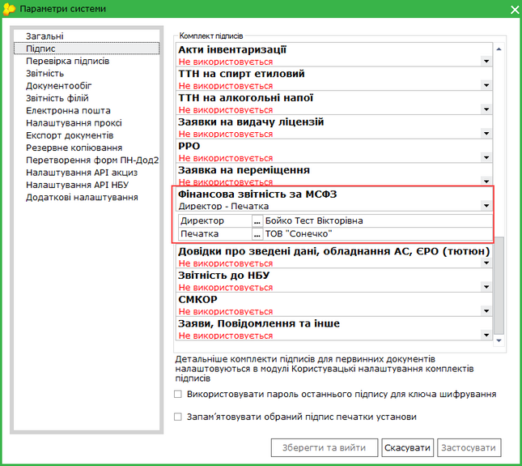

Натисніть, щоб збільшити малюнок

4. Відкриється вікно Налаштування комплекту підписів. За допомогою кнопки Додати оберіть потрібний сертифікат.

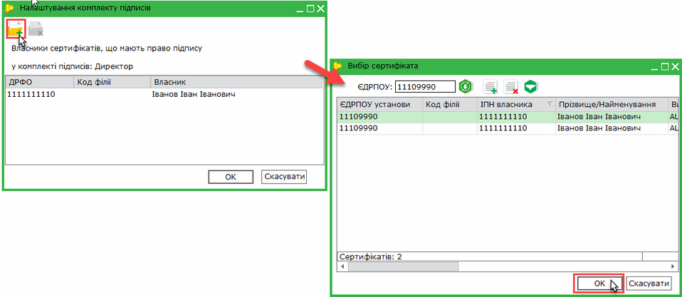

Натисніть, щоб збільшити малюнок

Таким же чином оберіть всіх необхідних підписантів.

5. При підписанні документа буде виводитись список заданих відповідальних осіб.

[До початку](#ucifrstgrrst-ucifrstgrrst_vidp)

Підписання та відправка пакета звітності за МСФЗ

Для успішної відправки у відповідних полях ярлика пакета документів повинні бути зазначені дані контрагента (аудитора та/або актуарія), якому відправляється документ.

Існує декілька способів відправки документів:

1. Із вкладки "Наступні дії"

Даний спосіб дозволяє відправити лише один пакет звітності - відкритий або виділений в реєстрі.

В доступних діях з документом передбачено декілька варіантів для зручності користувача:

Передати пакет на підпис

На виконання цієї команди пакет звітів блокується від редагування та набуває статусу На підпис ... (статус залежить від [обраного комплекту підписів](#ucifrstgrrst-ucifrstgrrst_vidp) для документів). Пакет знаходиться в стані очікування.
В Наступних діях стає доступним можливість [Підписати пакет](UC_ECP.html#uc_ecp-ecp).

Підписати пакет

На виконання команди відразу розпочнеться стандартний процес [підписання документа](UC_ECP.html#uc_ecp-ecp) ЕП.

Підписаний або переданий на підпис пакет звітів позначається у реєстрі іконкою .

Після накладення комплекту підписів та виконання функції Відправити пакет контрагенту програма запропонує обрати сертифікат шифрування, таким чином підписується "конверт", в який поміщається файл для відправки.

Відправити пакет контрагенту

На виконання команди розпочнеться [підписання документа](UC_ECP.html#uc_ecp-ecp) ЕП та одразу відправка документа адресату.

Відправлений пакет звітів позначається у реєстрі іконкою .

2. Безпосередньо з Реєстру документів МСФЗ

У реєстрі виберіть потрібний пакет звітності та оберіть один із варіантів:

- на панелі інструментів натисніть кнопку Відправити - ;
- виберіть команду Файл - Відправити;
- у контекстному меню оберіть команду Відправити;
- на вкладці наступні дії оберіть команду Відправити пакет контрагенту.

На виконання команди розпочнеться [підписання документа](UC_ECP.html#uc_ecp-ecp) ЕП та одразу відправка документа адресату. По закінченню процедури, система виведе протокол відправки документів.

Якщо пакет документів не перевірено, перед підписанням програма запропонує виконати перевірку документів.

[До початку](#ucifrstgrrst-ucifrstgrrst_vidp)

Відправка документів декільком суб'єктам документообігу

У разі, якщо вихідний документ може бути надісланий як актуарію, так і аудитору (наприклад, Таксономія для страховиків 210\_310) передбачено зручний спосіб вибору адресата:

1. У реєстрі виберіть потрібний документ та оберіть один із варіантів:

- на панелі інструментів натисніть кнопку Відправити - ;
- виберіть команду Файл - Відправити;
- у контекстному меню оберіть команду Відправити;
- на вкладці наступні дії оберіть команду Відправити пакет контрагенту.

2. Відкриється вікно Оберіть адресата:

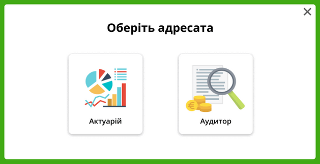

Натисніть, щоб збільшити малюнок

3. Натисніть кнопку, що відповідає адресату, якому потрібно відправити документ: Актуарій або Аудитор.

4. На виконання команди розпочнеться [підписання документа](UC_ECP.html#uc_ecp-ecp) ЕП (якщо документ не підписаний) та відправка документа обраному адресату. По закінченню процедури, система виведе протокол відправки документів.

Для успішної відправки у документі повинні бути зазначені дані аудитора та/або актуарія, яким відправляється документ.

[До початку](#ucifrstgrrst-ucifrstgrrst_vidp)

Відправка документів консультанту

Для успішної відправки у головному документі пакета повинні бути зазначені дані консультанта, якому відправляється документ.

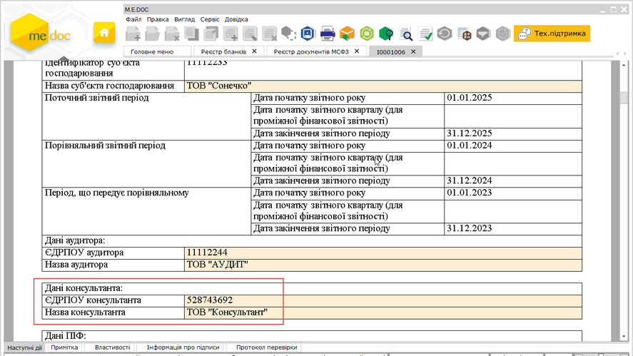

Натисніть, щоб збільшити малюнок

Функція доступна за наявності у зазначеного консультанта ліцензії Фінансова звітність за МСФЗ (формат iXBRL) – Аудитор (повна).

1. У реєстрі виберіть потрібний документ.

2. Виконайте команду головного меню Файл - Відправити консультанту:

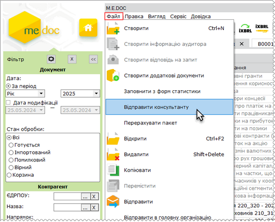

Натисніть, щоб збільшити малюнок

3. На виконання команди розпочнеться [підписання документа](UC_ECP.html#uc_ecp-ecp) ЕП (якщо документ не підписаний) та відправка документа обраному адресату. По закінченню процедури, система виведе протокол відправки документів.

Якщо пакет документів не перевірено, перед підписанням програма запропонує виконати перевірку документів.

[До початку](#ucifrstgrrst-ucifrstgrrst_vidp)

### Підписання документів iXBRL

_Шлях у довідці: Розділи програми › Звітність › Фінансова звітність за МСФЗ (формат iXBRL) › Підписання документів iXBRL_

Для підписання пакета у форматі iXBRL:

1. Виділіть у реєстрі головний документ пакета або будь-який документ, що належить пакету.

2. Оберіть один із способів:

- на панелі інструментів натисніть кнопку Підписати iXBRL - ;
- із контекстного меню команда Підписати iXBRL;
- команда Файл - Підписати iXBRL.

3. Розпочнеться процедура підписання пакета звітів. У вікні Підпис оберіть сертифікат для підписання та введіть пароль. Натисніть ОК.

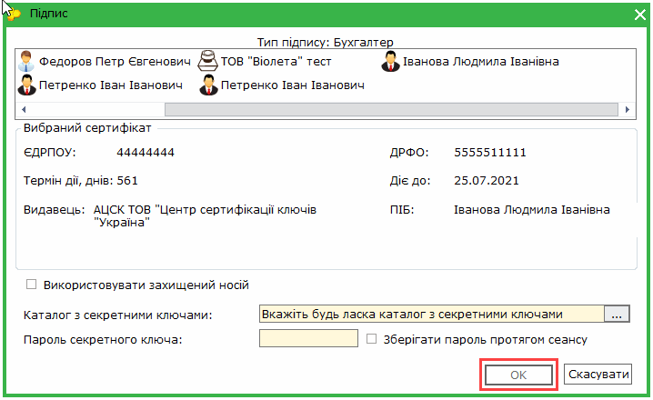

4. Підписаний пакет позначається у реєстрі іконкою . На панелі вкладок з'явиться нова вкладка Підписи iXBRL, що містить інформацію про підписи накладені на iXBRL документ.

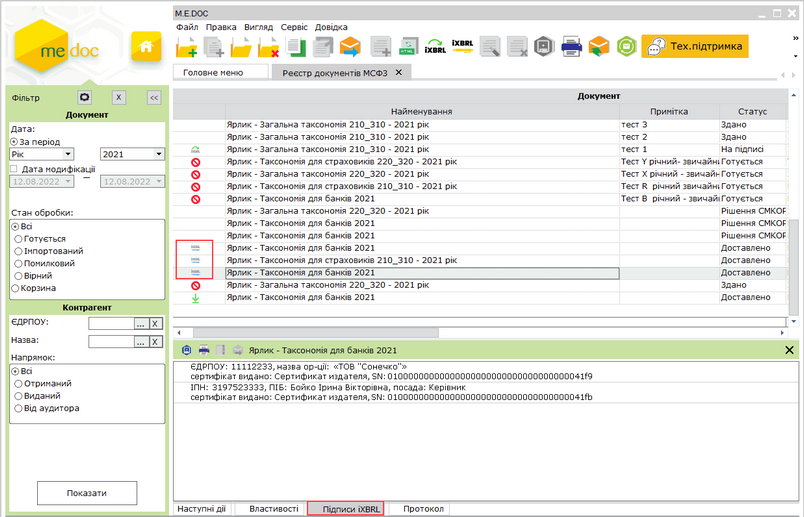

Натисніть, щоб збільшити малюнок

### Експорт пакета звітів у форматі iXBRL

_Шлях у довідці: Розділи програми › Звітність › Фінансова звітність за МСФЗ (формат iXBRL) › Експорт пакета звітів у форматі iXBRL_

Експорт документів МСФЗ призначений для збереження пакета звітів формату iXBRL у обраному каталозі або електронному носії .

При експорті у форматі iXBRL виконується збереження даних документів пакета у форматі html, підписи, накладені на документ (за наявності), зберігаються у файлах формату p7s. Всі дані зберігаються у вигляді архіву zip.

Експорт виконується у наступній послідовності:

1. Виділіть головний документ пакета або будь-який документ, що належить пакету, який потрібно експортувати.

2. Експорт викликається одним із наступних способів:

- команда Файл - Експорт - Експорт;
- із контекстного меню команда Експорт.

3. На виконання функції експорту відкриється вікно Експорт. Оберіть опцію Експорт даних в форматі iXBRL:

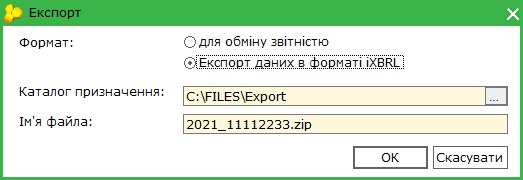

4. У полі Каталог призначення вкажіть каталог для збереження експортованих даних. Ім'я файлу генерується автоматично, містить в собі код ЕДРПОУ підприємства.

6. Система повідомить про закінчення процесу експорту.

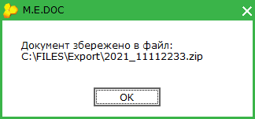

### Експорт даних в форматі «для обміну звітністю»

_Шлях у довідці: Розділи програми › Звітність › Фінансова звітність за МСФЗ (формат iXBRL) › Експорт даних в форматі «для обміну звітністю»_

В цьому розділі:

[Експорт пакетів звітів](#ucifrstgrrst-ucifrstgrrst_export_obmin)

[Експорт окремого документа пакета](#ucifrstgrrst-ucifrstgrrst_export_obmin)

Експорт пакетів звітів

У реєстрі реалізована можливість експортувати як один пакет звітів, так і декілька пакетів одночасно.

Експортовані дані зберігаються у обраному каталозі або електронному носії. Всі експортовані дані зберігаються у одному файлі формату XML.

Експорт документів виконується у наступній послідовності:

1. У таблиці  Реєстрі документів МСФЗ виділіть головний документ пакета або будь-який документ, що належить пакету, який потрібно експортувати.

Для групового експорту пакетів звітів виділіть будь-які документи, що належать потрібним пакетам, утримуючи клавішу <Shift> або <Ctrl>.

2. Експорт викликається одним із наступних способів:

- команда Файл - Експорт - Експорт;
- із контекстного меню команда Експорт.

3. На виконання функції експорту відкриється вікно Експорт. Оберіть опцію для обміну звітністю:

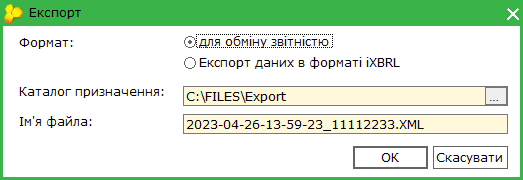

4. У полі Каталог призначення вкажіть каталог для збереження експортованих даних. Ім'я файлу генерується автоматично, містить в собі дату, час створення та код ЕДРПОУ підприємства.

5. Натисніть ОК.

6. Система повідомить про закінчення процесу експорту:

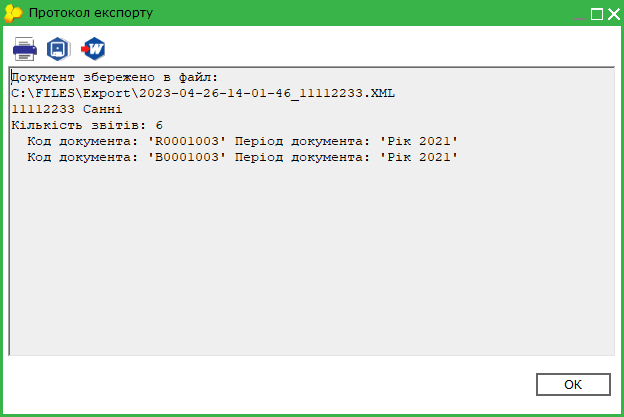

[До початку](#ucifrstgrrst-ucifrstgrrst_export_obmin)

Експорт окремого документа пакета

Експорт окремого документа пакета виконується з вікна відкритого документа.

1. Відкрийте документ, який потрібно експортувати.

2. Виконайте команду головного меню Файл - Експорт - Експорт.

3. На виконання функції експорту відкриється вікно Експорт. Оберіть опцію для обміну звітністю:

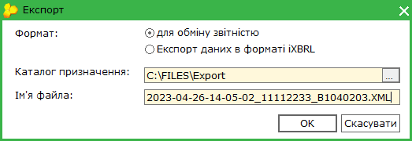

4. У полі Каталог призначення вкажіть каталог для збереження експортованих даних. Ім'я файлу генерується автоматично, містить в собі дату, час створення та код ЕДРПОУ підприємства.

5. Натисніть ОК.

6. Система повідомить про закінчення процесу експорту:

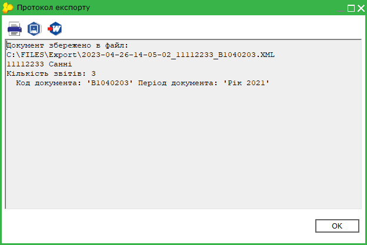

[До початку](#ucifrstgrrst-ucifrstgrrst_export_obmin)

### Імпорт даних

_Шлях у довідці: Розділи програми › Звітність › Фінансова звітність за МСФЗ (формат iXBRL) › Імпорт даних_

Дана функція призначена для імпорту пакетів звітів МСФЗ, створених в інших бухгалтерських системах.

1. У меню оберіть команду Файл - Імпорт - Імпорт звітів.

2. На виконання команди відкриється вікно вибору файлів вказаного формату, які імпортуються.

3. Вкажіть шлях до каталогу розміщення файлів. Оберіть файли та натисніть Відкрити для початку процесу імпорту.

4. По закінченні процедури система виведе протокол імпорту даних.

Імпортований пакет позначається у реєстрі іконкою .

### Друк документів у PDF

_Шлях у довідці: Розділи програми › Звітність › Фінансова звітність за МСФЗ (формат iXBRL) › Друк документів у PDF_

В цьому розділі:

[Друк документів у PDF](#ucifrstgrrst-ucifrstgrrst_print_pdf)

[Перегляд iXBRL в форматі для друку](#ucifrstgrrst-ucifrstgrrst_print_pdf)

Друк у PDF

Дана функція дозволяє зберегти обрані документи на диску комп’ютера у файлах формату .pdf.

Для друку документів у PDF необхідно виділити потрібний документ пакета.
У Реєстрі документів МСФЗ реалізована можливість друку як одного файлу, так и групи файлів одночасно. Для групового друку документів виділіть потрібні звіти пакета курсором миші, утримуючи клавішу <Shift> або <Ctrl>.

Для друку документів у PDF:

1. Оберіть один із способів:

- із контекстного меню команда Друк в PDF;
- команда меню Файл - Друк в PDF.

2. У вікні Огляд папок вкажіть каталог, у якому потрібно зберегти файли .pdf.

3. Система повідомить про закінчення операції друку.

Також функція друку документа  у PDF доступна і у відкритому вікні документа: команда меню Файл - Друк в PDF. Із вікна відкритого документа у форматі PDF зберігається тільки поточний документ.

[До початку](#ucifrstgrrst-ucifrstgrrst_print_pdf)

Перегляд iXBRL в форматі для друку

Дана функція дозволяє здійснювати друк документів iXBRL.

Для друку документів iXBRL:

1. Виділіть документ iXBRL у таблиці розділу.

2. Оберіть один із способів:

- у головному меню оберіть команду Файл – Перегляд iXBRL в форматі для друку;
- у контекстному меню Перегляд iXBRL в форматі для друку.

3. На виконання функції у окремій вкладці відкриється документ iXBRL, призначений для подальшого друку в форматі pdf:

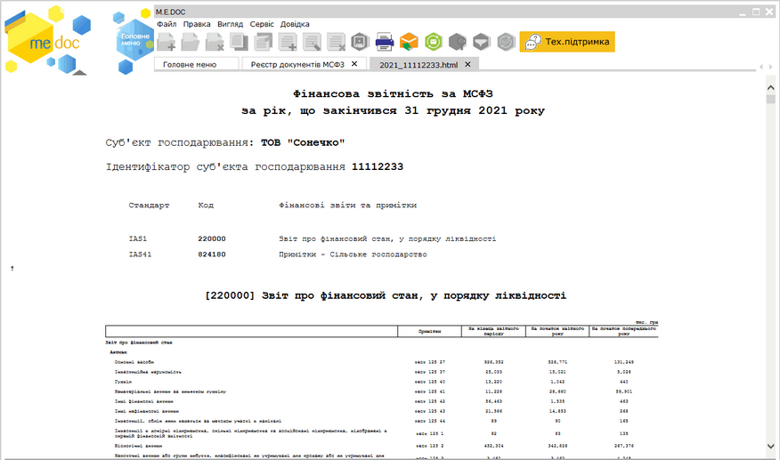

Натисніть, щоб збільшити малюнок

4. У відкритому вікні документа, оберіть команду Друк:

- у головному меню Файл;
- натисніть кнопку  на панелі інструментів.

5. У вікні попереднього перегляду документа виконайте необхідні налаштування та натисніть кнопку Друк документа .

[До початку](#ucifrstgrrst-ucifrstgrrst_print_pdf)


