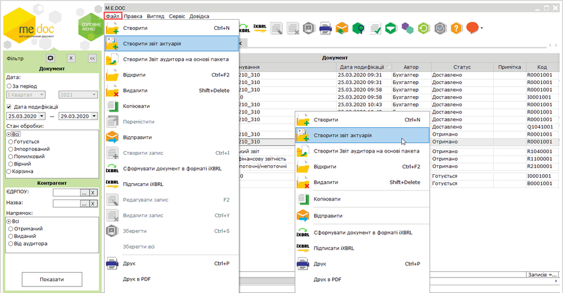
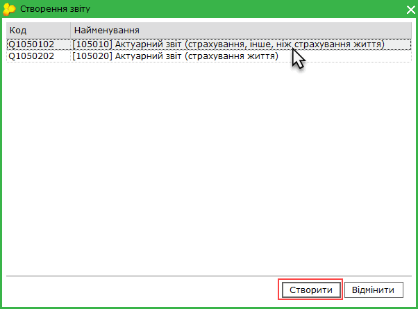
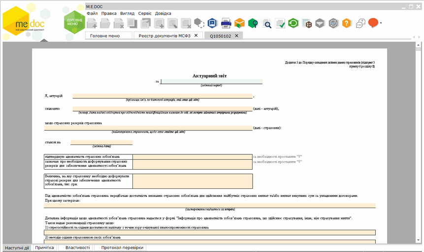
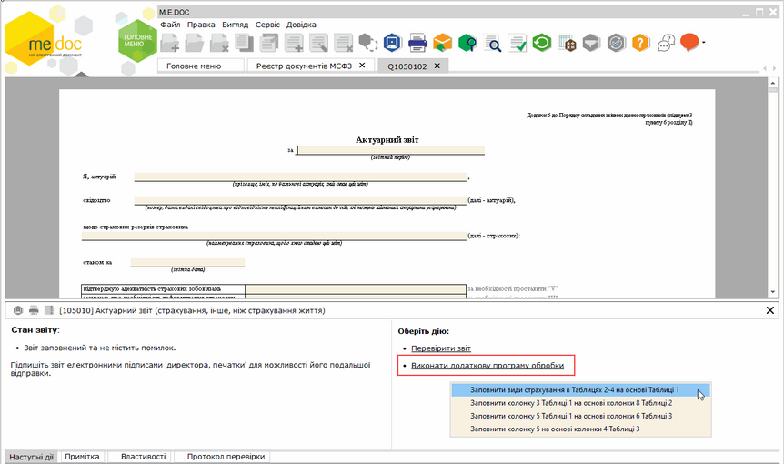
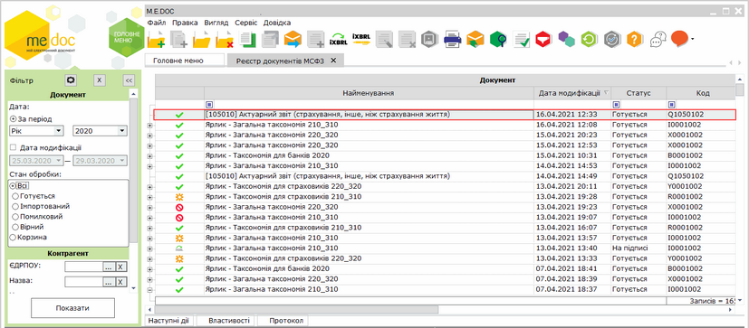
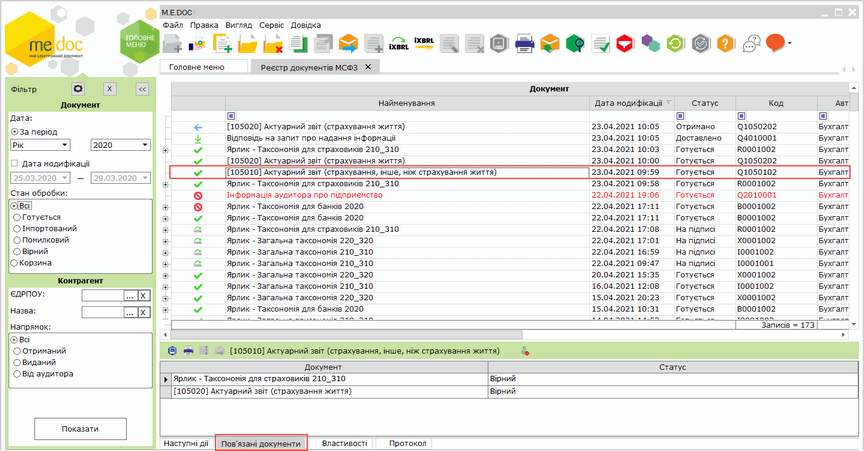

[← Зміст довідки](../)


# Створення Актуарного звіту на основі отриманого пакета

## Створення Актуарного звіту на основі отриманого пакета

_Шлях у довідці: Додатково: UCIFRSTgrRst_aktuarij › Створення Актуарного звіту на основі отриманого пакета_

Створення Актуарного звіту можливе (команда меню доступна) для пакетів документів, що мають статус Отриманий, та якщо ЄДРПОУ актуарія, зазначене у документах, співпадає з ЄДРПОУ поточної організації.

Актуарний звіт створюється як окремий документ та не входить у пакет звітності, сформований згідно таксономії.

Для формування Актуарного звіту:

1. Оберіть у таблиці реєстру отриманий пакет документів, у якому потрібно створити Актуарний звіт.

Скористайтесь одним із способів:

- виберіть команду Файл - Створити звіт актуарія;
- у контекстному меню оберіть команду Створити звіт актуарія.

Натисніть, щоб збільшити малюнок

2. Відкриється вікно Створення звіту.

Оберіть шаблон звіту. Натисніть кнопку Створити у нижній частині вікна або натисніть два рази ліву кнопку миші на потрібному шаблоні.

3. У окремому вікні відкриється бланк документа, який потрібно заповнити.

Натисніть, щоб збільшити малюнок

4. Внесіть дані в поля, які потребують заповнення.

Для заповнення звіту можна скористатися додатковими програмами обробки на вкладці Наступні дії:

Натисніть, щоб збільшити малюнок

За допомогою додаткових програми здійснюється автоматичне заповнення даних у Таблицях звіту:

 Заповнити види страхування в Таблицях 2-4 на основі Таблиці 1 -  автоматичне заповнення у Таблицях 2 - 4 кількості рядків та колонки Вид страхування;

 Заповнити колонку 3 Таблиці 1 на основі колонки 8 Таблиці 2 -  автоматичне заповнення Колонки 3 даними з Колонки 8 Таблиці 2;

 Заповнити колонку 5 Таблиці 1 на основі колонки 6 Таблиці 3 - автоматичне заповнення Колонки 5 даними з Колонки 6 Таблиці 3;

 Заповнити колонку 5 на основі колонки 4 - автоматичне заповнення Колонки 5 даними з Колонки 4.

5. Оберіть команду Правка - Перевірити документ або F4 для перевірки документа.

Перевіряється правильність заповнення полів, і, у випадку помилок, система підсвітить червоним кольором поля, що необхідно виправити. Виправте помилки та знову виконайте перевірку.

6. Збережіть документ, натиснувши кнопку  або комбінацію клавіш Ctrl+S.

Актуарний звіт створюється як окремий документ та не входить у пакет звітності, сформований згідно таксономії.

Натисніть, щоб збільшити малюнок

Перед створенням Актуарного звіту можливо перевірити пакет звітності за МСФЗ, для якого створюється Актуарний звіт.

Перевірити пакет звітності можливо, обравши команду Перевірити пакет на вкладці Наступні дії. Також можливо перевірити окремий документ пакета. Для цього відкрийте документ та оберіть команду меню Правка - Перевірити звіт або натисніть F4.

Можливо редагувати Актуарний звіт в отриманому пакеті документів МСФЗ, редагування доступне за умови, якщо ЄДРПОУ актуарія, зазначене у документах, співпадає з ЄДРПОУ поточної організації.

Якщо створено пакет у форматі iXBRL, при спробі редагувати отриманий Актуарний звіт або створити в отриманому пакеті Актуарний звіт, програма виведе повідомлення "Редагування звіту призведе до видалення iXBRL. Відкрити в режимі перегляду?". Натиснувши відповідну кнопку можливо виконати дії:

- Так - відкрити Актуарний звіт в режимі перегляду;
- Ні - редагувати Актуарний звіт. Файл iXBRL буде видалено;
- Відміна - закрити вікно повідомлення та скасувати редагування/створення звіту.

Інформація про ярлик пакета звітів, на основі якого було створено Актуарний звіт відображається на вкладці Пов'язані документи. Також, для ярлика пакета на вкладці Пов'язані документи відображається інформація про створені на його основі Актуарні звіти.

Натисніть, щоб збільшити малюнок

Для перегляду пов'язаних документів натисніть два рази лівою кнопкою миші на їх назві на вкладці Пов'язані документи. Документ буде відкрито у окремій вкладці.


