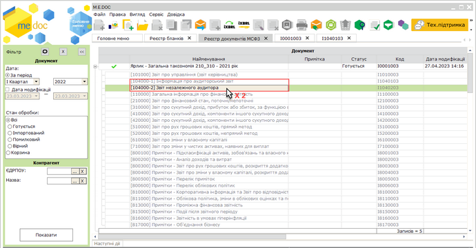
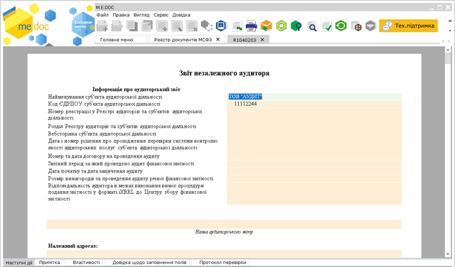
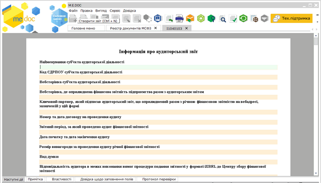
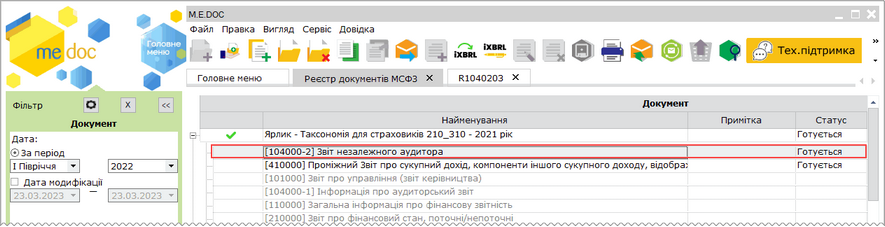
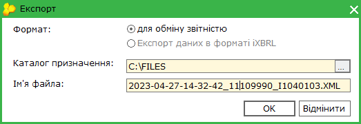

[← Зміст довідки](../)


# Створення Аудиторських звітів

## Створення Аудиторських звітів

_Шлях у довідці: Розділи програми › Звітність › Фінансова звітність за МСФЗ (формат iXBRL) › Створення Аудиторських звітів_

В цьому розділі:

[Створення Звіту незалежного аудитора або Інформації про аудиторський звіт](#ucifrstgrrst_audyt-ucifrstgrrst_audyt)

[Звіту незалежного аудитора або Інформації про аудиторський звіт](#ucifrstgrrst_audyt-ucifrstgrrst_audyt)

Функція доступна за наявності ліцензії Фінансова звітність за МСФЗ (формат iXBRL) – Аудитор або Фінансова звітність за МСФЗ (формат iXBRL).

Користувачі самостійно обирають, який з двох аудиторських звітів надавати у складі пакета звітності на порталі СФЗ: [скорочений [104000-1] Інформація про аудиторський звіт](#ucifrstgrrst_audyt-ucifrstgrrst_audyt) чи [повний [104000-2] Звіт незалежного аудитора](#ucifrstgrrst_audyt-ucifrstgrrst_audyt). Тип звіту, що буде створюватися у пакеті, погоджується з аудитором.

Перед створенням Звіту незалежного аудитора можливо перевірити пакет звітності за МСФЗ, для якого створюється Звіт незалежного аудитора.

Перевірити пакет звітності можливо, обравши команду Перевірити пакет на вкладці Наступні дії. Також можливо перевірити окремий документ пакета. Для цього відкрийте документ та оберіть команду меню Правка - Перевірити звіт або натисніть F4.

Можливо редагувати Звіт незалежного аудитора/Інформацію про аудиторський звіт в отриманому пакеті документів МСФЗ, редагування доступне за умови, якщо ЄДРПОУ аудитора, зазначене у документах, співпадає з ЄДРПОУ поточної організації.

Якщо створено пакет у форматі iXBRL, при спробі редагувати отриманий Звіт незалежного аудитора/Інформацію про аудиторський звіт або створити в отриманому пакеті документи аудитора, програма виведе повідомлення "Редагування звіту призведе до видалення iXBRL. Відкрити в режимі перегляду?". Натиснувши відповідну кнопку можливо виконати дії:

- Так - відкрити Звіт/Інформацію в режимі перегляду;
- Ні - редагувати Звіт/Інформацію. Файл iXBRL буде видалено;
- Відміна - закрити вікно повідомлення та скасувати редагування/створення звіту.

Створення Звіту незалежного аудитора або Інформації про аудиторський звіт

Якщо аудитор використовує надану в таксономії форму [104000-2] Звіт незалежного аудитора, у складі пакету звітності заповнюється лише цей аудиторський звіт до річної звітності.

Звіт [104000-1] Інформація про аудиторський звіт у пакеті не створюється.

Документи Звіт незалежного аудитора або Інформація про аудиторський звіт створюються у складі пакета таксономії:

1. У таблиці реєстру розгорніть пакет звітів, у якому необхідно створити Звіт незалежного аудитора або Інформацію про аудиторський звіт, та натисніть 2 рази лівою кнопкою миші на рядку звіту, який потрібно створити:

Натисніть, щоб збільшити малюнок

2.  У окремому вікні відкриється бланк документа. Заповніть необхідні поля документа.

Натисніть, щоб збільшити малюнок

Звіт незалежного аудитора

Натисніть, щоб збільшити малюнок

Інформація про аудиторський звіт

4. Збережіть Звіт, натиснувши кнопку  , або комбінацію клавіш Ctrl+S.

Під час збереження виконається перевірка правильності заповнення полів і, у випадку помилок, система підсвітить червоним кольором поля, що необхідно виправити. Виправте помилки та знову збережіть документ.

Перевірити документ також можливо, обравши команду меню Правка - Перевірити документ, натиснувши F4, або, виконавши команду Перевірити звіт на вкладці Наступні дії.

У таблиці реєстру Звіт буде відображено як документ пакета, у якому він був створений:

Натисніть, щоб збільшити малюнок

[До початку](#ucifrstgrrst_audyt-ucifrstgrrst_audyt)

Експорт Звіту незалежного аудитора або Інформації про аудиторський звіт

Щоб зберегти файл документа Звіт незалежного аудитора або Інформація про аудиторський звіт, виконайте експорт документа:

1. Виділіть потрібний документ у таблиці реєстру.

2. Скористайтесь одним із способів:

- виберіть команду Файл - Експорт;
- у контекстному меню оберіть команду  Експорт.

3. У вікні, що відкриється оберіть шлях для збереження файлу та натисніть Зберегти.

[До початку](#ucifrstgrrst_audyt-ucifrstgrrst_audyt)


