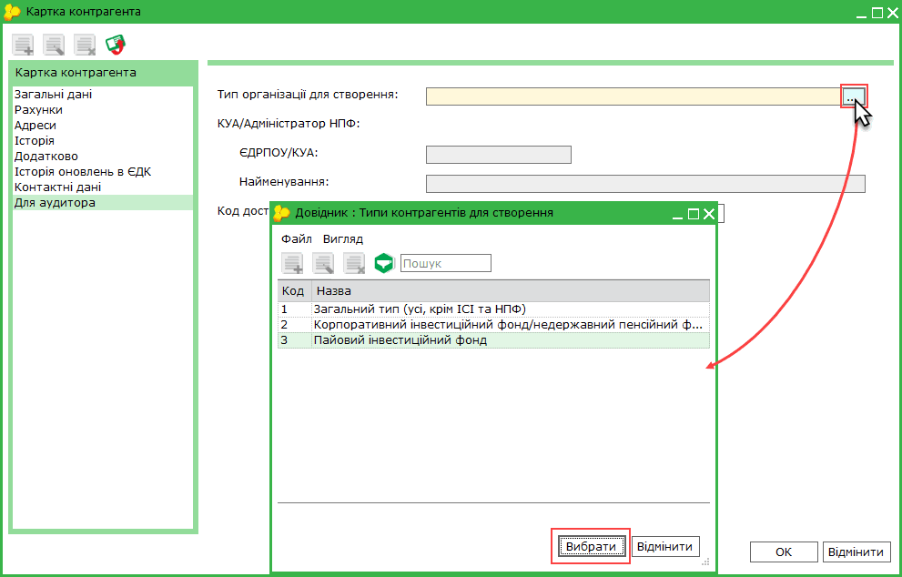
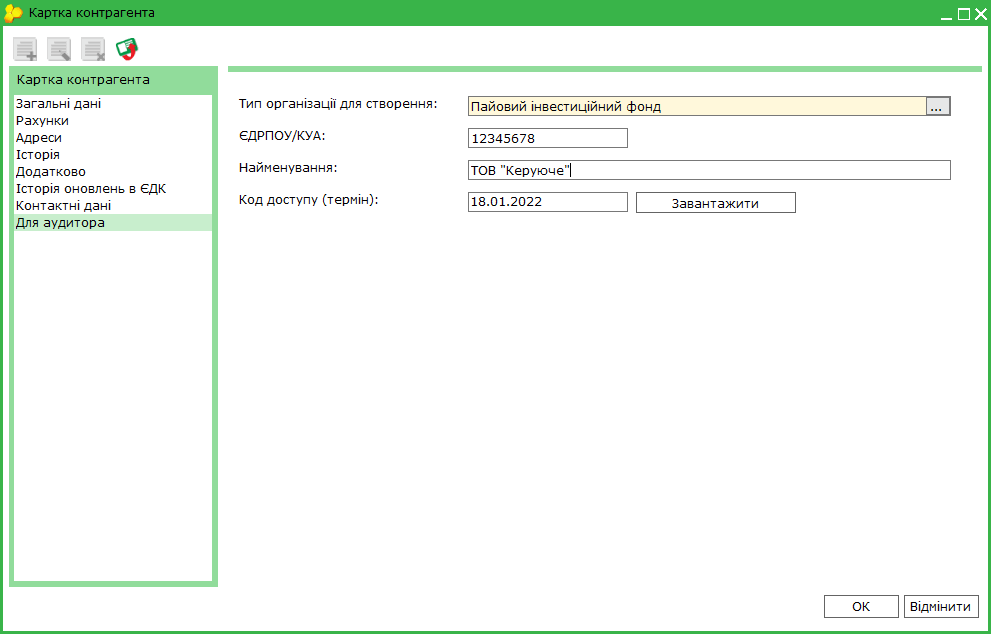
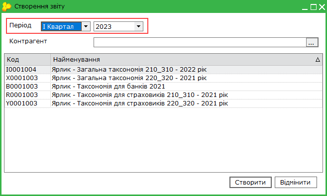
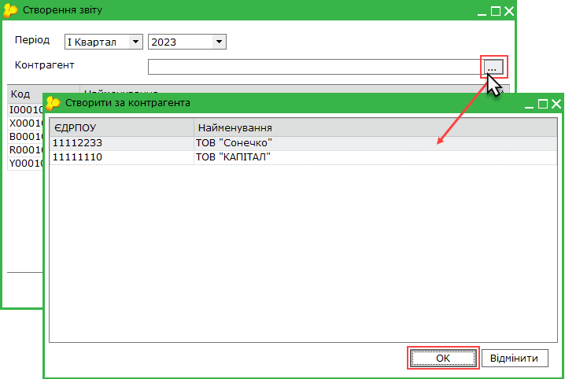
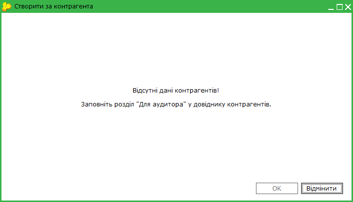
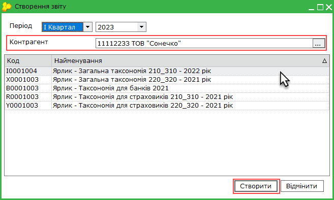
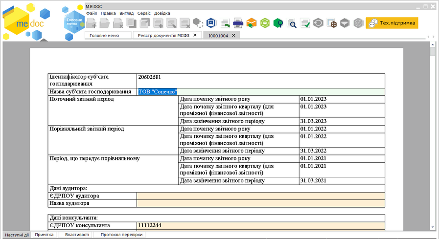

[← Зміст довідки](../)


# Створення документів аудитором з ЄДРПОУ клієнтів-суб'єктів господарювання

## Створення документів аудитором з ЄДРПОУ клієнтів-суб'єктів господарювання

_Шлях у довідці: Розділи програми › Звітність › Фінансова звітність за МСФЗ (формат iXBRL) › Створення документів аудитором з ЄДРПОУ клієнтів-суб'єктів господарювання_

В цьому розділі:

[Налаштування даних контрагентів для створення пакетів звітів](#ucifrstgrrst_audyt_klient-ucifrstgrrst_audyt_klient)

[Формування пакету звітів з ЄДРПОУ клієнта-суб'єкта господарювання](#ucifrstgrrst_audyt_klient-ucifrstgrrst_audyt_klient)

Аудитори, що надають клієнтам консультаційні послуги, мають можливість створювати документи фінансової звітності з ЄДРПОУ клієнтів-суб'єктів господарювання.

У такому випадку опрацювання звітності виконується у наступній послідовності:

1. Аудитор створює та заповнює пакет документів (включно з Звітом аудитора та/або Інформацією про аудиторський звіт) та надсилає його клієнту-суб'єкту господарювання. (Аудитор також може створити, підписати та відправити клієнту файл iXBRL.)

2. Клієнт перевіряє та, у разі потреби, редагує отриманий звіт. Якщо у звіт було внесено зміни, клієнт створює і підписує новий файл iXBRL та повертає пакет звітів Аудитору для допідписання.

3. Зі свого боку аудитор перевіряє отриманий пакет звітів та, у разі правильного заповнення пакета звітів, підписує отриманий iXBRL файл та знов відправляє файл клієнту.

4. Після підписання усіма сторонами суб’єкт господарювання експортує підписаний файл iXBRL та подає у відповідні органи, а також друкує (зберігає) звіт в форматі pdf для розміщення на сайті відповідно до вимог чинного законодавства України.

Контрагент може редагувати отриманий звіт за допомогою функції Змінити звіт вкладки Наступні дії.

Якщо відредагований документ було надіслано аудитору, на боці аудитора зберігається всі версії документа: оригінал (створений аудитором) та варіант документа, відредагований контрагентом.

З боку аудитора функціонал доступний за наявності ліцензії Фінансова звітність за МСФЗ (формат iXBRL) - Аудитор (повна).

З боку клієнтів аудитора функціонал доступний за наявності будь-якої ліцензії, що надає можливість роботи з модулем Фінансова звітність за МСФЗ (формат iXBRL).

Налаштування даних контрагентів для створення пакетів звітів

Для створення звітів з ЄДРПОУ клієнтів обов'язково налаштуйте дані щодо використання клієнтом модуля МСФЗ на вкладці Для аудиторів у Картці контрагента.

Вкладка доступна лише за наявності ліцензії Фінансова звітність за МСФЗ (формат iXBRL) - Аудитор (повна).

1. Перейдіть у розділ Довідники - Контрагенти. У таблиці розділу оберіть контрагента, з ЄДРПОУ якого потрібно створювати звітність. Натисніть на рядку контрагента два рази лівою кнопкою миші. Відкриється вікно Картка контрагента.

Якщо дані контрагента відсутні у Довіднику, попередньо необхідно додати картку контрагента, як описано у розділі [Створення та заповнення картки контрагента](UCPartnerRst.html#ucpartnerrst-sprpartner).

2. У вікні Картка контрагента перейдіть на вкладку Для аудитора.

3. У полі тип організації для створення натисніть . У вікні, що відкриється, оберіть тип організації, з ЄДРПОУ якої створюватимуться звіти. Натисніть Вибрати:

4. Якщо контрагент є ПІФ, КІФ або НПФ, у полях ЄДРПОУ/КУА та Найменування введіть данні Компанії з управління активами (КУА)/адміністратора НПФ.

Зверніть увагу! Для ПІФ у Картці контрагента на вкладці Загальні дані у полі ЄДРПОУ повинен бути зазначений код ЄДРІСІ.

5. Завантажте інформацію про ліцензію контрагента на використання модуля МСФЗ. Натисніть кнопку Завантажити. У полі Код доступу (термін) буде відображено термін дії ліцензії контрагента. Для Пайових інвестиційних фондів перевіряється ліцензія Компанії з управління активами (КУА).

Можливо створення звітності з ЄДРПОУ лише тих контрагентів, які мають діючу ліцензію на використання модуля МСФЗ будь-якого типу.

6. Натисніть кнопку ОК у вікні Картка контрагента, щоб зберегти налаштування:

[До початку](#ucifrstgrrst_audyt_klient-ucifrstgrrst_audyt_klient)

Формування пакету звітів з ЄДРПОУ клієнта-суб'єкта господарювання

Для формування звіту з ЄДРПОУ клієнта-суб'єкта господарювання:

1. Скористайтесь одним із способів:

- на панелі інструментів натисніть кнопку Створити за контрагента ;
- виберіть команду Файл - Створити за контрагента;
- у контекстному меню оберіть команду Створити за контрагента.

2. Відкриється вікно Створення звіту. Оберіть період, у якому створюється звіт:

3. Оберіть Контрагента, з ЄДРПОУ якого створюватиметься пакет звітів. Натисніть  у полі Контрагент. У вікні Створити за контрагента оберіть найменування клієнта. Натисніть ОК:

У разі, якщо не виконані необхідні налаштування у Картках контрагентів, відкриється повідомлення:

4. У вікні Створення звіту оберіть шаблон для створення звіту. Натисніть Створити:

5. У окремому вікні відкриється бланк документа, який потрібно заповнити.

Натисніть, щоб збільшити малюнок

6. Внесіть дані в поля, які потребують заповнення. Поля Ідентифікатор суб'єкта господарювання та Назва суб'єкта господарювання недоступне для редагування та містить дані обраного контрагента.

Заповніть звіти, що входять у пакет. Перевірте та бережіть документи пакету, як описано у розділі [Створення звітності за МСФЗ](UCIFRSTgrRst_stvor.html#ucifrstgrrst_stvor-ucifrstgrrst_stvor).

7. Підпишіть та відправте пакет контрагенту, з ЄДРПОУ якого створювалася звітність (див. [Підписання ЕП та відправка звітності за МСФЗ](UCIFRSTgrRst.html#ucifrstgrrst-ucifrstgrrst_vidp)).

[До початку](#ucifrstgrrst_audyt_klient-ucifrstgrrst_audyt_klient)


