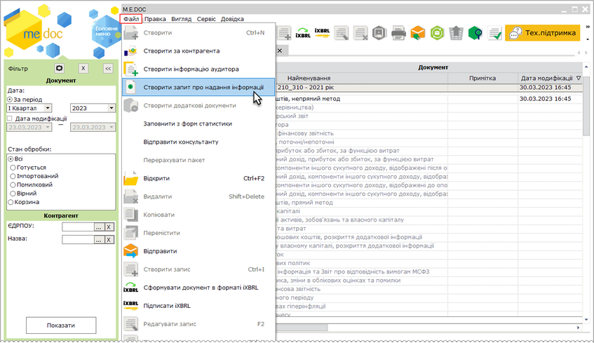
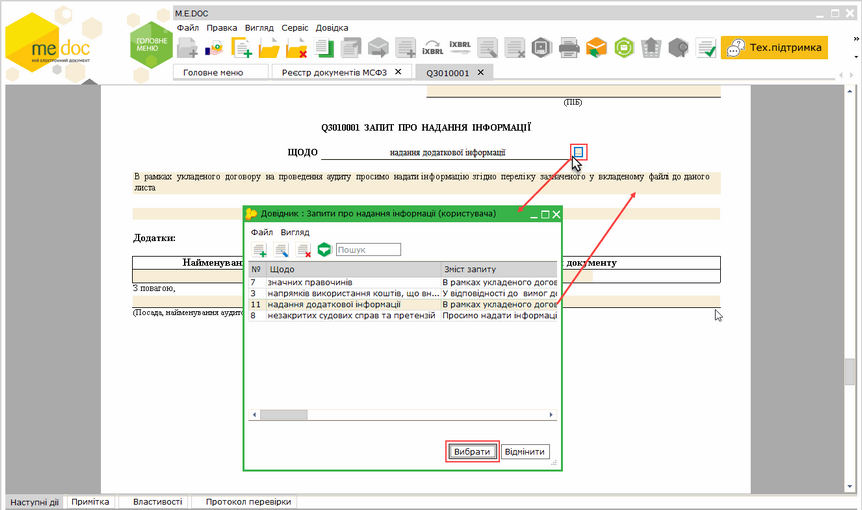
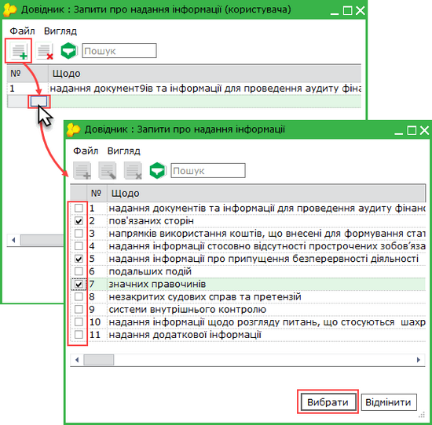
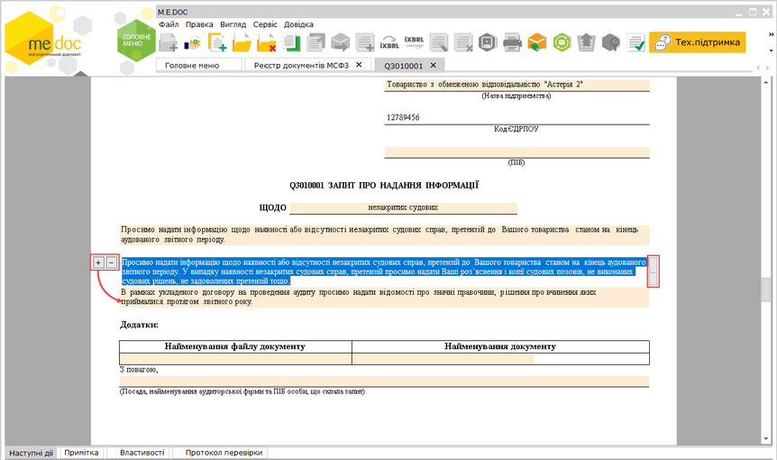
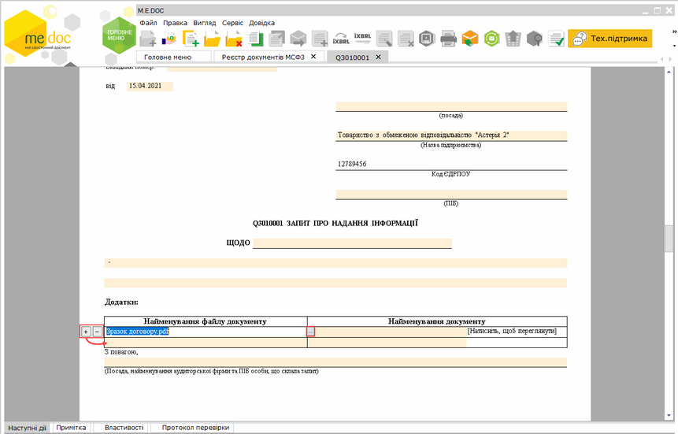
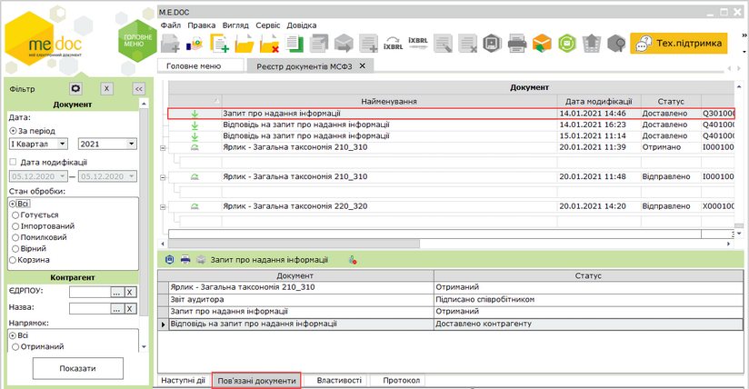
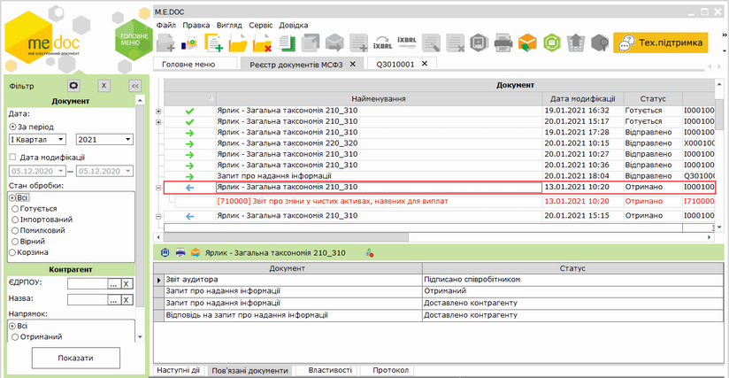
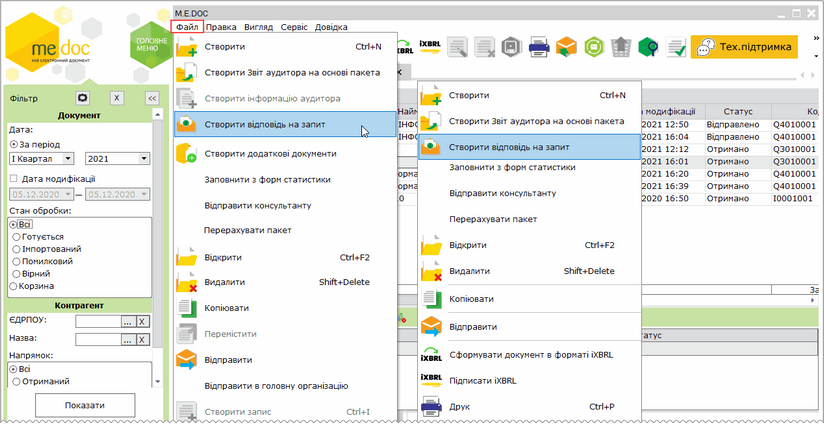
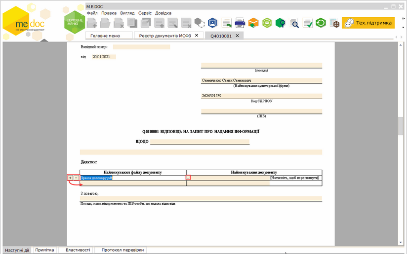
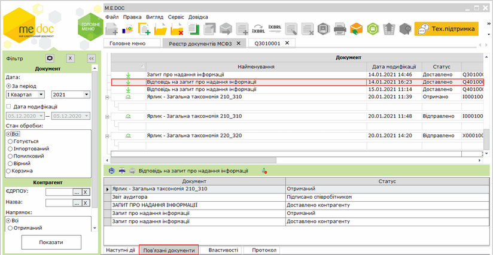

[← Зміст довідки](../)


# Обмін запитами та відповідями на них між аудитором та клієнтами

## Обмін запитами та відповідями на них між аудитором та клієнтами

_Шлях у довідці: Розділи програми › Звітність › Фінансова звітність за МСФЗ (формат iXBRL) › Обмін запитами та відповідями на них між аудитором та клієнтами_

В цьому розділі:

[Створення запиту про надання інформації](#ucifrstgrrst_audyt_zapyt-ucifrstgrrst_audyt_zapyt)

[Створення відповідь на запит](#ucifrstgrrst_audyt_zapyt-ucifrstgrrst_audyt_zapyt)

У модулі можливо здійснювати обмін запитами та відповідями на них між аудитором та його клієнтами.

Аудитор може створювати «Запит про надання інформації» щодо певного пакету звітності. Клієнти у відповідь на запит можуть створити «Відповідь на запит про надання інформації». Документи підписуються ЕП та відправляються адресату. Вхідні Запити та Відповіді надходять як звичайна вхідна кореспонденція. Отримати вхідні документи можливо, за допомогою функції Отримати повідомлення.

Також можливо імпортувати/експортувати файли Запитів та Відповідей за допомогою функцій головного меню Файл - Імпорт та/або Експорт.

Створення запиту про надання інформації

Функція доступна на стороні аудитора за наявності ліцензії Фінансова звітність за МСФЗ (формат iXBRL) – Аудитор.

Для формування Запиту про надання інформації:

1. Виділіть будь-який документ у реєстрі МСФЗ.

2. Скористайтесь одним із способів:

- виберіть команду Файл - Створити запит про надання інформації;
- у контекстному меню оберіть команду Створити запит про надання інформації.

Натисніть, щоб збільшити малюнок

3. У окремому вікні відкриється бланк документа Q3010001 «Запит про надання інформації», який потрібно заповнити.

Поля, що підсвічені жовтим кольором, доступні для заповнення та редагування.

Заповнити поля Щодо та зміст запиту можна, обравши потрібні запити з довідника Запити про надання інформації (користувача). Встановіть курсор у поле та натисніть кнопку . У вікні довідника оберіть потрібне значення:

Натисніть, щоб збільшити малюнок

Довідник Запити про надання інформації (користувача) заповнюється користувачем та при першому використанні не містить записів. За допомогою цього довідника користувачі можуть налаштувати персональний перелік шаблонів запитів, додавши потрібні значення.

Щоб додати запис, у вікні довідника Запити про надання інформації (користувача) натисніть кнопку .  У новому рядку введіть потрібні значення вручну або оберіть значення з системного довідника Запити про надання інформації.

Щоб додати запис з системного довідника, у новому рядку натисніть на колонці №. Відкриється вікно системного довідника Запити про надання інформації, цей довідник недоступний для редагування та використовується для формування персонального довідника запитів. Оберіть потрібні запис та натисніть Вибрати:

Натисніть, щоб збільшити малюнок

Обрані записи буде додано у Запити про надання інформації (користувача). Текст полів довідника Запити про надання інформації (користувача) можна редагувати. Значення поля № необхідно ввести вручну.

Щоб замінити або видалити запис, виділіть запис у довіднику та скористайтеся відповідно кнопками  або .

Для додавання додаткових полів для опису зміст запиту, встановіть курсор у поле та натисніть кнопку  . Відповідно, натискання кнопки  видаляє поле. Щоб додати текст у поле з довідника, скористайтеся кнопкою .

Натисніть, щоб збільшити малюнок

4. Щоб додати сканкопію документа, встановіть курсор у поле Найменування файлу документу та натисніть кнопку . У вікні, що відкриється, оберіть потрібний файл. Назва обраного файлу відобразиться у полі документа.

Натисніть, щоб збільшити малюнок

Можливо додати файли у форматах: \*.pdf, \*.doc, \*.docx, \*.xls, \*.xlsx. Загальний розмір файлів не повинен перевищувати 8Мб. Якщо необхідно переслати файли, загальний розмір яких перевищує ліміт, необхідно створити кілька Запитів та розподілити між ними файли згідно з встановленим обмеженням за розміром.

Для перегляду вкладень натисніть лівою кнопкою миші на полі Найменування документу.

Якщо необхідно додати кілька сканкопій документів, додайте рядок в таблицю, скориставшись кнопкою   зліва від таблиці. Відповідно, натискання кнопки  видаляє рядок з таблиці.

5. Оберіть команду Правка - Перевірити документ або F4 для перевірки документа.

Перевіряється правильність заповнення полів, і, у випадку помилок, система підсвітить червоним кольором поля, що необхідно виправити. Виправте помилки та знову виконайте перевірку.

6. Збережіть документ, натиснувши кнопку  або комбінацію клавіш Ctrl+S.

Для Запиту, що був створений на основі пакета звітів, на вкладці Пов'язані документи відображається інформація про ярлик пакету звітів, на основі якого було створено Запит:

Натисніть, щоб збільшити малюнок

Відповідно для ярлика пакета звітів, на основі яких створено Запит, на вкладці Пов'язані документи відображається інформація про Запит:

Натисніть, щоб збільшити малюнок

Для перегляду пов'язаних документів натисніть два рази лівою кнопкою миші на їх назві на вкладці Пов'язані документи. Документ буде відкрито у окремій вкладці.

[До початку](#ucifrstgrrst_audyt_zapyt-ucifrstgrrst_audyt_zapyt)

Створення відповідь на запит

Функція доступна на стороні клієнта-суб'єкта господарювання за наявності ліцензії Фінансова звітність за МСФЗ (формат iXBRL).

Для формування Відповідь на запит:

1. Виділіть будь-який документ у реєстрі МСФЗ.

2. Скористайтесь одним із способів:

- виберіть команду Файл - Створити відповідь на запит;
- у контекстному меню оберіть команду Створити відповідь на запит.

Натисніть, щоб збільшити малюнок

3. У окремому вікні відкриється бланк документа «Відповідь на запит про надання інформації», який потрібно заповнити.

Поля, що підсвічені жовтим кольором, доступні для заповнення та редагування.

Натисніть, щоб збільшити малюнок

4. Щоб додати сканкопію документа, встановіть курсор у поле Найменування файлу документу та натисніть кнопку . У вікні, що відкриється, оберіть потрібний файл. Назва обраного файлу відобразиться у полі документа.

Можливо додати файли у форматах: \*.pdf, \*.doc, \*.docx, \*.xls, \*.xlsx. Загальний розмір файлів не повинен перевищувати 8Мб. Якщо необхідно переслати файли, загальний розмір яких перевищує ліміт, необхідно створити кілька Відповідей та розподілити між ними файли згідно з встановленим обмеженням за розміром.

Для перегляду вкладень натисніть лівою кнопкою миші на полі Найменування документу.

Якщо необхідно додати кілька сканкопій документів, додайте рядок в таблицю, скориставшись кнопкою   зліва від таблиці. Відповідно, натискання кнопки  видаляє рядок з таблиці.

5. Оберіть команду Правка - Перевірити документ або F4 для перевірки документа.

Перевіряється правильність заповнення полів, і, у випадку помилок, система підсвітить червоним кольором поля, що необхідно виправити. Виправте помилки та знову виконайте перевірку.

6. Збережіть документ, натиснувши кнопку  або комбінацію клавіш Ctrl+S.

Для Відповіді на вкладці Пов'язані документи відображається інформація про Запит, на основі якого було створено Відповідь, а також інформація про ярлик пакету звітів, для яких створювалися документи:

Натисніть, щоб збільшити малюнок

Відповідно для ярлика пакета звітів, на вкладці Пов'язані документи відображається інформація про Відповідь.

Для перегляду пов'язаних документів натисніть два рази лівою кнопкою миші на їх назві на вкладці Пов'язані документи. Документ буде відкрито у окремій вкладці.

[До початку](#ucifrstgrrst_audyt_zapyt-ucifrstgrrst_audyt_zapyt)


