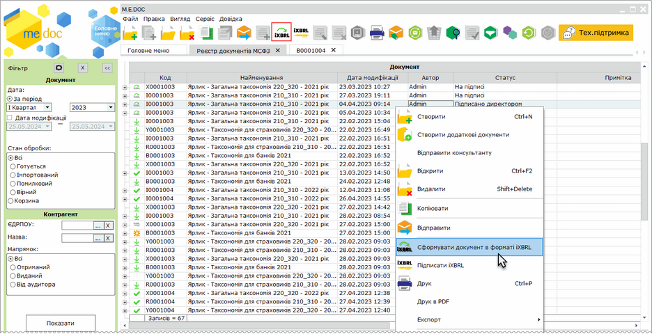
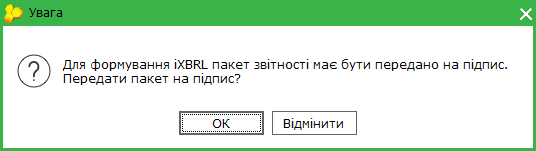
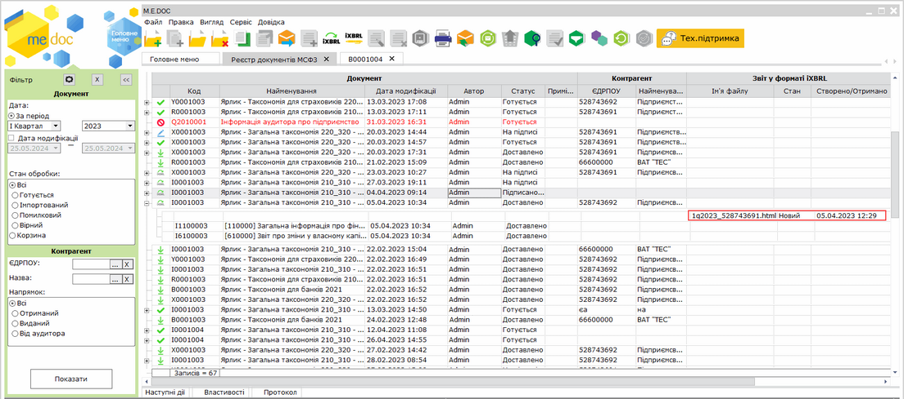
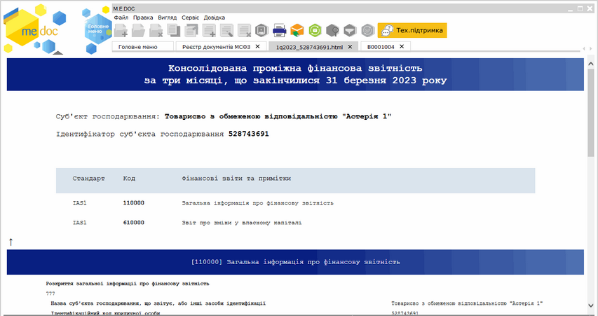
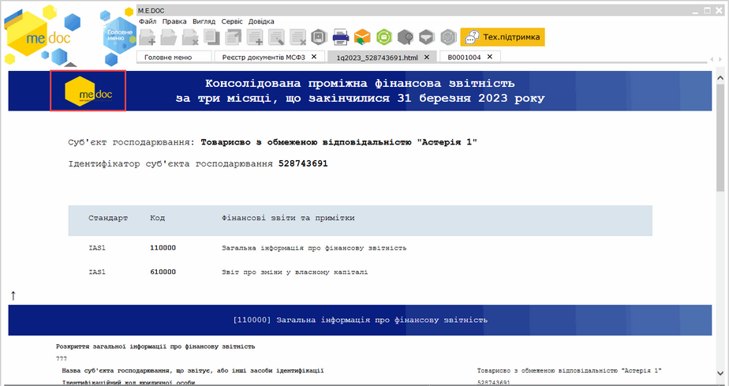

[← Зміст довідки](../)


# Конвертація пакета документів у формат iXBRL

## Конвертація пакета документів у формат iXBRL

_Шлях у довідці: Розділи програми › Звітність › Фінансова звітність за МСФЗ (формат iXBRL) › Конвертація пакета документів у формат iXBRL_

В цьому розділі:

[Конвертація пакета документів у формат iXBRL](#ucifrstgrrst_ixbrl-ucifrstgrrst_ixbrl)

[Налаштування відображення логотипу підприємства у документах iXBRL](#ucifrstgrrst_ixbrl-ucifrstgrrst_ixbrl)

Зверніть увагу, при формуванні файлів у форматі iXBRL виконується перевірка терміну дії ліцензії.

Конвертація у форматі iXBRL для пакетів звітності, створених у майбутніх періодах, можлива за умови, якщо ліцензія буде дійсною у періоді створення документів.

При формуванні аудиторами [звітів з ЄДРПОУ клієнтів-суб'єктів господарювання](UCIFRSTgrRst_audyt_klient.html#ucifrstgrrst_audyt_klient-ucifrstgrrst_audyt_klient) перевірятиметься термін дії ліцензії клієнта.

Для конвертації пакета:

1. Виділіть у реєстрі головний документ пакета або будь-який документ, що належить пакету.

2. Оберіть один із способів:

- на панелі інструментів натисніть кнопку Сформувати документ в форматі iXBRL - ;
- із контекстного меню команда Сформувати документ в форматі iXBRL;
- команда Файл - Сформувати документ в форматі iXBRL.

Натисніть, щоб збільшити малюнок

3. Якщо пакет звітів не підписаний або не переданий на підпис, відкриється вікно повідомлення:

Для формування файлу у форматі iXBRL натисніть кнопку ОК.

Накладання електронних підписів на пакет звітності для формування файлу у форматі iXBRL не є обов'язковим.

4. Буде виконано конвертацію пакета звітів. Сконвертований пакет позначається у реєстрі іконкою . Ім'я iXBRL-файлу буде відображено у реєстрі у розділі Звіт у форматі iXBRL:

Натисніть, щоб збільшити малюнок

Непідписаний пакет звітності, для якого сформовано файл iXBRL, набуває статусу На підписі.

Для перегляду документа iXBRL натисніть 2 рази лівою кнопкою миші на назві файлу. Документ буде відкрито у окремій вкладці. Для швидкого переходу до даних певного звіту, натисніть на назві звіту лівою кнопкою миші:

Натисніть, щоб збільшити малюнок

Якщо необхідно змінити документи пакета, видаліть iXBRL-файл з пакета. Оберіть рядок документа iXBRL у пакеті та виконайте команду Видалити. Або скористайтеся командою вкладки Наступні дії - Змінити звіт. Сформований файл iXBRL буде автоматично видалений з пакета. Внесіть необхідні зміни та повторно виконайте [конвертацію пакета документів у формат iXBRL](#ucifrstgrrst_ixbrl-ucifrstgrrst_ixbrl).

[До початку](#ucifrstgrrst_ixbrl-ucifrstgrrst_ixbrl)

При створені документа iXBRL для пакетів Загальна таксономія 210\_310, Таксономія для страховиків 210\_310 та Таксономія для банків можливо налаштувати відображення логотипу компанії у заголовку документа iXBRL:

1. Завантажте зображення логотипу у розділі [Довідники - Картка підприємства - Логотип](UCOrg.html#ucorg-logo).

2. Виконайте [конвертацію пакета документів у формат iXBRL](#ucifrstgrrst_ixbrl-ucifrstgrrst_ixbrl).

3. У заголовку створеного документа iXBRL буде відображено логотип організації.

Натисніть, щоб збільшити малюнок

У разі, якщо логотип організації змінено (завантажено нове зображення у розділі [Довідники - Картка підприємства - Логотип](UCOrg.html#ucorg-logo) ), для оновлення зображення логотипа у документі iXBRL скопіюйте пакет звітів та у скопійованому пакеті виконайте [конвертацію пакета документів у формат iXBRL](#ucifrstgrrst_ixbrl-ucifrstgrrst_ixbrl).

[До початку](#ucifrstgrrst_ixbrl-ucifrstgrrst_ixbrl)


