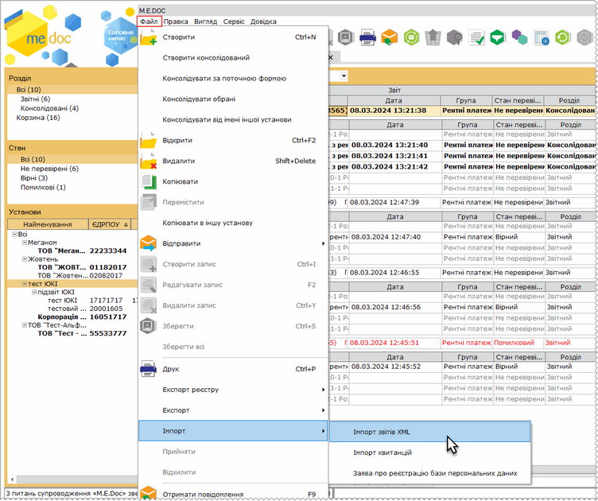
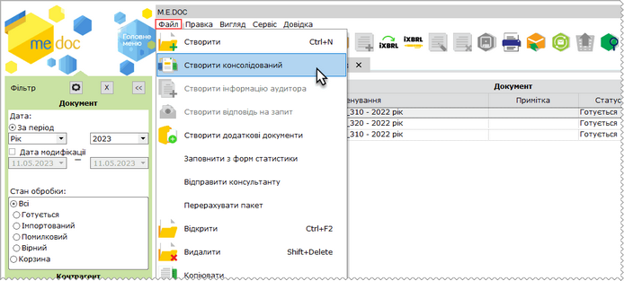
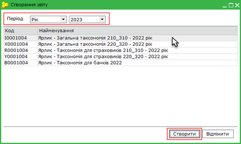
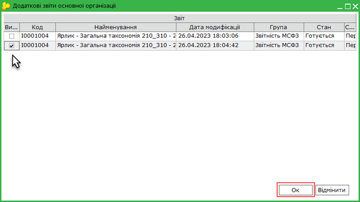
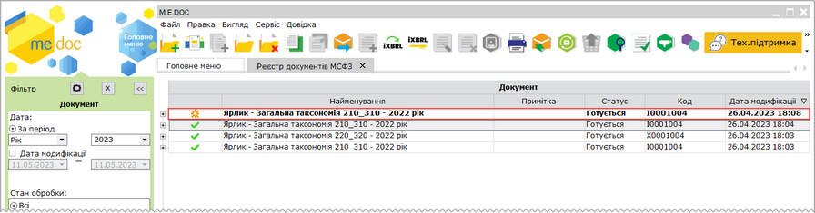
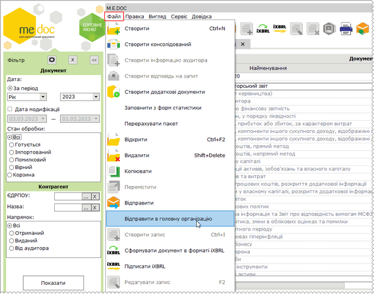
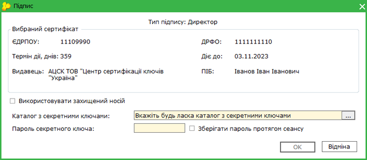
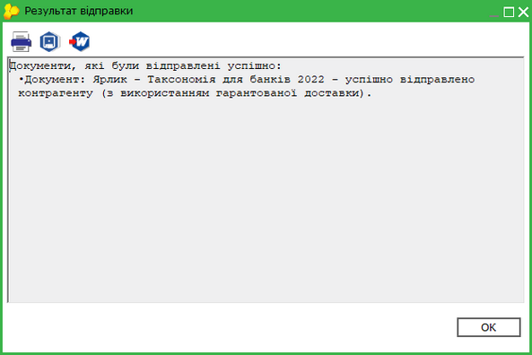

[← Зміст довідки](../)


# Консолідація звітів від підзвітних установ

## Консолідація звітів від підзвітних установ

_Шлях у довідці: Розділи програми › Звітність › Фінансова звітність за МСФЗ (формат iXBRL) › Консолідація звітів від підзвітних установ_

В цьому розділі:

[Консолідація звітів МСФЗ](#ucifrstgrrst_konsolidacia-ucifrstgrrst_konsolidacia)

[Відправка звітів у головну установу](#ucifrstgrrst_konsolidacia-ucifrstgrrst_konsolidacia)

Консолідація звітів призначена для підприємств з розгалуженою ієрархічною структурою та забезпечує швидке автоматизоване зведення  даних звітності в єдину форму для подальшої обробки.

Консолідація звітів МСФЗ

Консолідація виконується у підприємстві головної установи та доступна за наявності ліцензій на модуль Фінансова звітність за МСФЗ (формат iXBRL) та M.E.Doc.Корпорація, а також за обов’язкової наявності Апаратного ключа.

Для здійснення консолідації необхідно попередньо у підприємстві головної установи налаштувати підпорядкованість установ у модулі [Довідники – Підзвітні підприємства](UCIncRst.html#ucincrst-m_e_doc-corp_pidzvitni).

Для виконання консолідації  у підприємстві головної установи:

1. Імпортуйте звіти підзвітних установ у модулі [Прийом та обробка звітності – Реєстр консолідованих звітів](CorpIncRst.html#corpincrst-m_e_doc-corp_modul_rz_robota).

Натисніть, щоб збільшити малюнок

2. Перейдіть у модуль Звітність – Фінансова звітність за МСФЗ (формат iXBRL) та виконайте команду головного меню Файл – Створити консолідований або натисніть кнопку  на панелі інструментів:

Натисніть, щоб збільшити малюнок

3. Відкриється вікно Створення звітів, у якому оберіть період звітності, що консолідується, та пакет для консолідації:

Натисніть, щоб збільшити малюнок

4. У вікні Додати звіти основної організації оберіть звіти головної установи, що консолідуються:

Натисніть, щоб збільшити малюнок

5. Після завершення консолідації у реєстрі модуля Фінансова звітність за МСФЗ буде відображено консолідований пакет документів, що виділяється жирним шрифтом:

Натисніть, щоб збільшити малюнок

Зверніть увагу! Імпортовані звіти підпорядкованих установ зберігаються у модулі [Прийом та обробка звітності – Реєстр консолідованих звітів](CorpIncRst.html#corpincrst-m_e_doc-corp_modul_rz).

У блоці Установи відображаються назви підпорядкованих підприємств, звіти від яких було імпортовано у Реєстр консолідованих звітів. Для перегляду звітів певного підприємства оберіть його назву у списку.

[До початку](#ucifrstgrrst_konsolidacia-ucifrstgrrst_konsolidacia)

Відправка звітів у головну установу

Відправка звітів підпорядкованою організацією доступна за наявності ліцензій на модуль Фінансова звітність за МСФЗ (формат iXBRL) та Подача звітів тільки у головну установу.

Коди ЄДРПОУ і назви головної установи зберігається у ліцензії Подача звітів тільки у головну установу та доступні для перегляду у розділі [Адміністрування - Керування кодом доступу - Подання](FormLicInfo.html#formlicinfo-admlic).

Підпорядковані організації  можуть відправляти звіти з у головну установу.

1. Виділіть ярлик або документ пакету у таблиці розділу.

2. Виконайте команду меню Файл – Відправити в головну організацію.

Натисніть, щоб збільшити малюнок

3. У вікні оберіть шлях до каталогу з секретними ключами та введіть пароль. Натисніть ОК.

Натисніть, щоб збільшити малюнок

4. У наступному вікні оберіть сертифікати шифрування для відправки пакета документів, оберіть шлях до каталогу з секретними ключами, введіть пароль. Натисніть ОК.

5. Виконається формування пакету документів та його відправка у головну установу. ЄДРПОУ головної організації, у яку відправляється звіти, визначається ліцензією і зазначається у розділі програми Адміністрування – Керування кодом доступу, вкладка Подання.

6. Програма повідомить про результат виконання операції:

Натисніть, щоб збільшити малюнок

Надісланий у головну установу пакет документів набуває статусу Відправлено.

На боці головної установи звіти, отримані від підпорядкованих підприємств, доступні у розділі програми Прийом та обробка звітності – Реєстр консолідованих звітів. Документи набувають статусу Імпортований.

[До початку](#ucifrstgrrst_konsolidacia-ucifrstgrrst_konsolidacia)


