[← Зміст довідки](../)


# Створення звітності за МСФЗ

## Створення звітності за МСФЗ

_Шлях у довідці: Розділи програми › Звітність › Фінансова звітність за МСФЗ (формат iXBRL) › Створення звітності за МСФЗ_

В цьому розділі:

[Створення пакета звітності](#ucifrstgrrst_stvor-ucifrstgrrst_stvor)

[Додавання форматованого тексту](#ucifrstgrrst_stvor-ucifrstgrrst_stvor)

[Автоматичне переформування текстових полів](#ucifrstgrrst_stvor-ucifrstgrrst_stvor)

[Перенесення даних із статистичних звітів](#ucifrstgrrst_stvor-ucifrstgrrst_stvor)

[Створення звітності КІФ/НПФ для подання за підписом КУА/адміністратора ПІФ](#ucifrstgrrst_stvor-ucifrstgrrst_stvor)

[Створення додаткових документів](#ucifrstgrrst_stvor-ucifrstgrrst_stvor)

[Експорт Повідомлення про вибір аудитора та додаткових документів](#ucifrstgrrst_stvor-ucifrstgrrst_stvor)

[Редагування звітів](#ucifrstgrrst_stvor-ucifrstgrrst_stvor)

[Копіювання звітів](#ucifrstgrrst_stvor-ucifrstgrrst_stvor)

Створення пакета звітності

Для створення нового пакета фінансової звітності за МСФЗ у форматі xml:

1. Скористайтесь одним із способів:

- на панелі інструментів натисніть кнопку Створити ;
- виберіть команду Файл - Створити;
- у контекстному меню оберіть команду Створити.

2. Відкриється вікно Створення звіту.

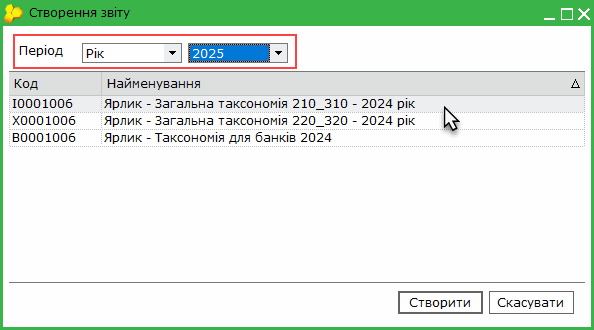

Оберіть період, у якому створюється пакет звітів та шаблон для створення пакета. Натисніть кнопку Створити у нижній частині вікна або натисніть два рази ліву кнопку миші на потрібному шаблоні.

- Для Компаній з управління активами, що керують ПІФ

Для Компанії з управління активами є можливість отримання ліцензії на модуль Фінансова звітність за МСФЗ, у яку додаються коди ЄДРІСІ ПІФ. У такому випадку, КУА отримує можливість створювати звіти для інвестиційних фондів, якими вона керує.

За наявності ліцензії із кодами ПІФ у вікні Створення звіту відображається додаткове поле ПІФ:

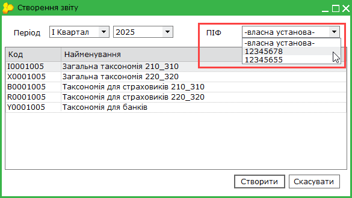

У списку, що відкривається оберіть код ПІФ, для якого створюється звіт.  Значення коду ЄДРІСІ та назва ПІФ будуть автоматично занесені у відповідні поля звіту.

У разі створення звітності безпосередньо для Компанії з управління активами оберіть значення -власна установа-.

 Звітність ПІФ підписують бухгалтер та директор Компанії з управління активами.

Для зручності роботи користувачів-співробітників КУА у таблиці реєстру документів МСФЗ наводиться інформація про ЄДРІСІ та найменування ПІФ у створених звітах:

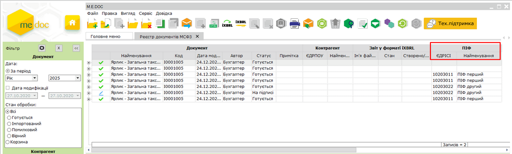

Натисніть, щоб збільшити малюнок

У таблиці наводяться дані з полів ярлика отриманого пакету звітів:

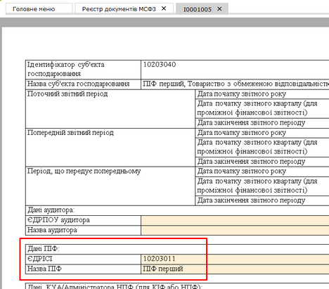

Натисніть, щоб збільшити малюнок

За допомогою полів ЄДРІСІ та Найменування ПІФ можна налаштувати швидкий та зручний відбір звітів. Для цього натисніть кнопку на панелі інструментів . Над реєстром з'явиться додаткова панель. Лівою кнопкою миші перетягніть на цю панель колонку ЄДРІСІ або Найменування:

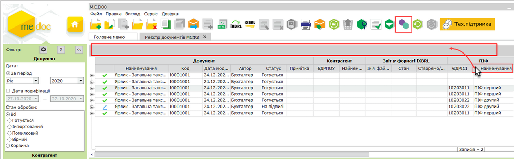

Натисніть, щоб збільшити малюнок

Пакети звітів будуть згруповані за обраними параметрами:

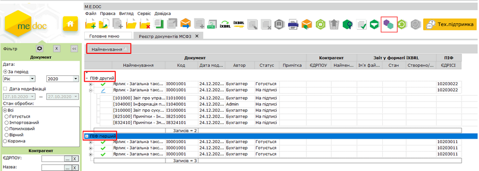

Натисніть, щоб збільшити малюнок

Щоб повернутися до звичайного відображення таблиці реєстру, перетягніть назви колонок з додаткової панелі у таблицю або повторно натисніть кнопку .

3. У окремому вікні відкриється бланк ярлика до обраного пакета звітності, який потрібно заповнити.

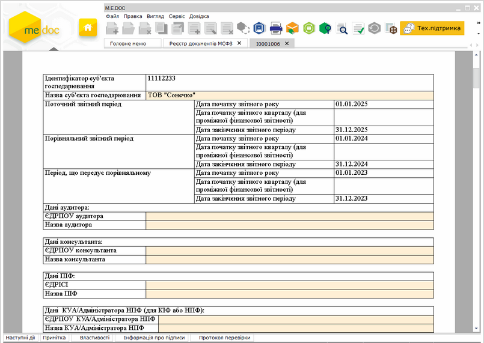

Натисніть, щоб збільшити малюнок

4. Внесіть дані в поля, які потребують заповнення.

Щоб додати новій абзац при заповненні текстового поля, натисніть комбінацію клавіш <Shift>+<Enter>.

Для додавання нового абзацу у полі, що призначене для зберігання великого обсягу текстової інформації, натисніть клавішу <Enter>.

Для заповнення звітів пакета можна скористатися додатковими програмами обробки. Для цього відкрийте вікно звіту та на вкладці Наступні дії оберіть програму обробки:

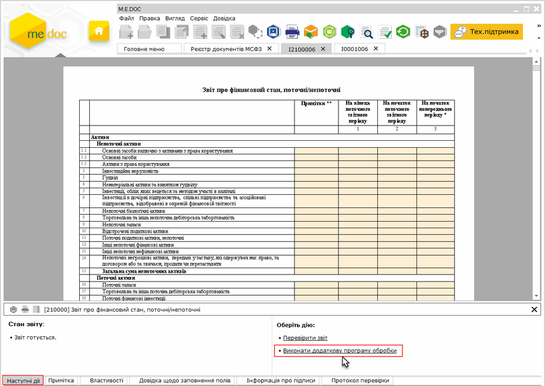

Натисніть, щоб збільшити малюнок

За допомогою додаткових програми здійснюється автоматичне заповнення даних у таблицях звіту:

 Перенесення з порівняльного періоду попереднього року – перенесення даних з актуального звіту за попередній календарний рік;

 Перенесення з попереднього періоду поточного року – перенесення даних актуального звіту за відповідний період поточного календарного року.

5. Оберіть команду вкладки Наступні дії - Перевірити звіт або натисніть клавішу F4 для перевірки документа. (Команда, також, доступна з головного меню Правка - Перевірити документ.)

Перевіряється правильність заповнення полів, і, у випадку помилок, система підсвітить червоним кольором поля, що необхідно виправити. Виправте помилки та знову виконайте перевірку.

6. Збережіть документ, натиснувши кнопку  або комбінацію клавіш Ctrl+S.

7. Пакет звітів буде відображено у таблиці реєстру. Пакет звітів, що не містить помилок, позначається у реєстрі іконкою :

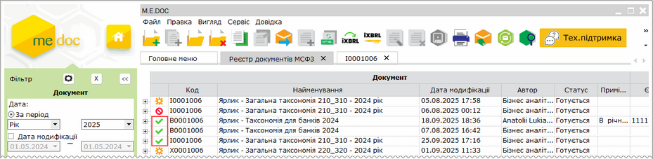

Натисніть, щоб збільшити малюнок

У разі, якщо є необхідність порівняти вміст кількох документів, можна відкрити ці документи у [окремих вікнах програми](UCPravila.html#ucpravila-pravyla). Щоб відкрити документ у окремому вікні, виділіть документ у таблиці реєстру та скористайтеся одним із способів:

- у головному меню програми виконайте команду Вигляд – Перегляд у вікні;
- виконайте команду контекстного меню Перегляд у вікні.

8. Заповніть звіти, що входять у пакет (нестворені звіти відображаються сірим кольором). Для цього відкрийте звіт, скориставшись одним із способів:

- на панелі інструментів натисніть кнопку Відкрити ;
- виберіть команду Файл - Відкрити;
- у контекстному меню оберіть команду Відкрити;
- натисніть два рази лівою кнопкою миші на рядку звіту у реєстрі.

9.  У окремому вікні відкриється бланк обраного звіту:

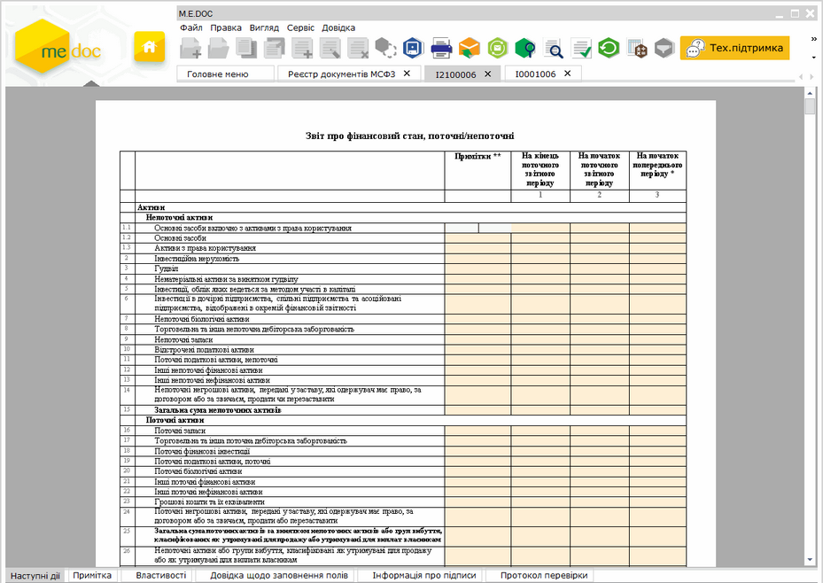

Натисніть, щоб збільшити малюнок

Внесіть дані в поля, які потребують заповнення.

Заповнення документів, що містять велику кількість граф (наприклад, Примітки - Нематеріальні активи), здійснюється за допомогою Майстра заповнення звітів. Майстер заповнення відкривається автоматично при відкритті відповідних документів. Майстер дає можливість обрати розділ звіту для заповнення зі списку, що відкривається. Переміщуватись між розділами звіту також можна за допомогою кнопок Назад та Далі:

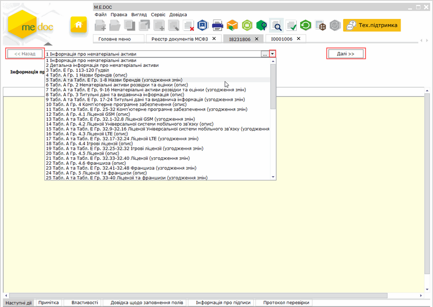

Натисніть, щоб збільшити малюнок

Перемикання режиму відображення документа (Майстер заповнення / форма документа для перегляду) здійснюється по натисканню клавіші <F11>. Збільшити масштаб відображення форми документа можна, натиснувши праву кнопку миші:

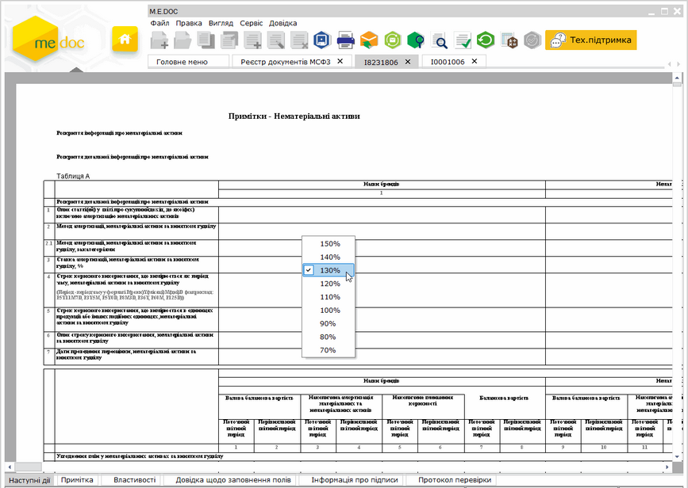

Натисніть, щоб збільшити малюнок

10. Оберіть команду вкладки Наступні дії - Перевірити звіт або натисніть клавішу F4 для перевірки документа. Перевіряється правильність заповнення полів, і, у випадку помилок, система підсвітить червоним кольором поля, що необхідно виправити. Виправте помилки та знову виконайте перевірку.

11. Збережіть документ, натиснувши кнопку  або комбінацію клавіш Ctrl+S. При збереженні виконується автоматична перевірку заповнення пакета.

12. Виконайте комплексну перевірку створеного пакета. На вкладці Наступні дії виконайте команду Перевірити пакет:

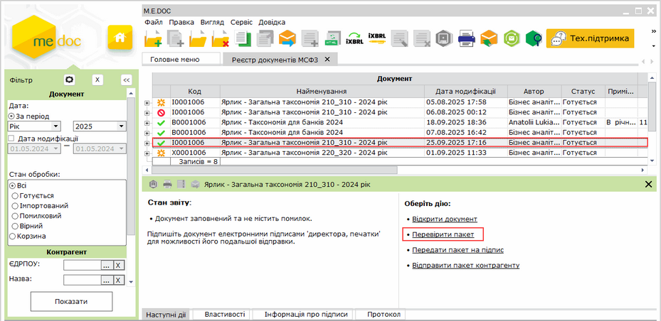

Натисніть, щоб збільшити малюнок

Буде виконано одночасну перевірку даних у всіх звітах пакета. Створені та коректно заповнені звіти відображаються у реєстрі чорним кольором. Звіти, що містять помилки - червоним.

13. Створений та перевірений пакет звітів готовий до підписання та відправки.

Зверніть увагу, для заповнення звітів можна скористатися додатковими функціями:

- Автоматичний розрахунок - функція за замовчанням включена в усіх звітах. При внесенні числових значень програма автоматично перераховує такі дані у тих полях, де це передбачено, та виправляє помилки. Також в процесі роботи виконується перевірка правильності заповнення полів та коректність внесених даних. Для вимкнення автоперерахунку видаліть позначку у полі Автоматичний розрахунок меню Правка.
- Перерахувати пакет - перерахунок будь-якого звіту. Виділіть рядок будь-якого звіту пакета у таблиці розділу та оберіть пункт головного меню Файл -  Перерахувати пакет. Буде виконано послідовний перерахунок звітів пакета, для яких встановлена відмітка у головному меню Правка - Автоматичний розрахунок. Функція доступна лише для непідписаних звітів.

[До початку](#ucifrstgrrst_stvor-ucifrstgrrst_stvor)

Додавання форматованого тексту

У формах звітів можна зберігати дані у вигляді форматованих текстів, таблиць тощо. Зберігається така інформація у полях для введення великого обсягу текстових даних.

Збереження форматованого тексту здійснюється за допомогою спеціального редактора, який дозволяє зберігати текст у html-форматі.

Зверніть увагу! Для того, щоб мати можливість викликати текстовий редактор, у Ролі користувача (у розділі програми [Управління ролями](UCManageRoles.html#ucmanageroles-ucmanageroles)) обов’язково повинен бути встановлений доступ до загальних довідників:

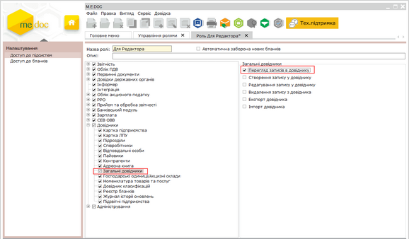

Натисніть, щоб збільшити малюнок

1. Для виклику редактора натисніть кнопку html:

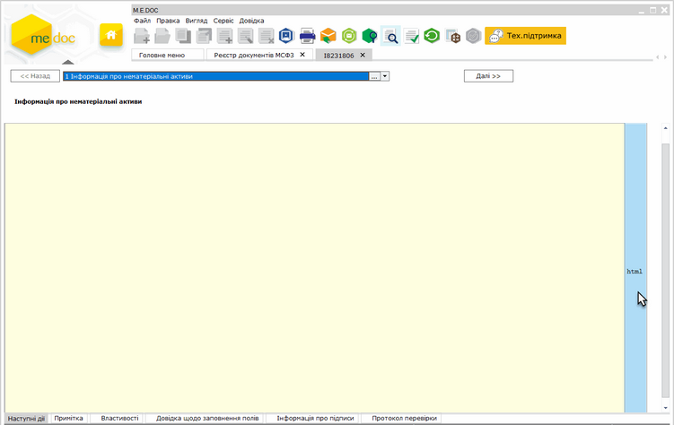

Натисніть, щоб збільшити малюнок

або , що знаходиться праворуч від поля для введення текстових даних:

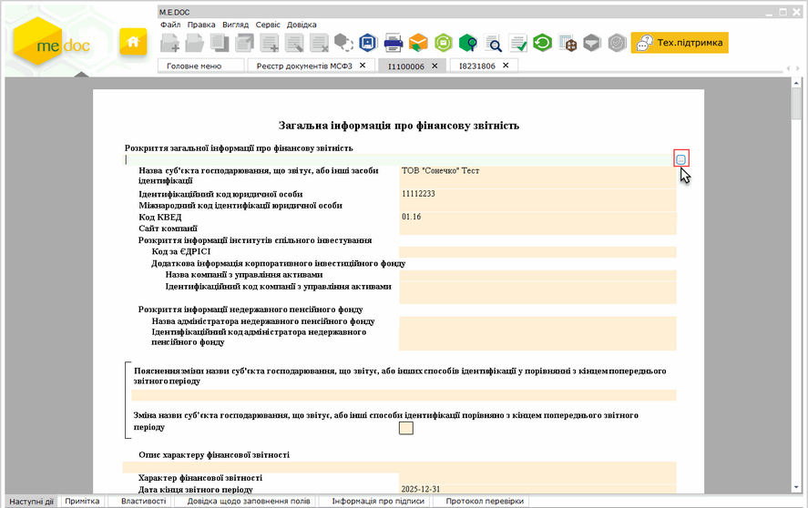

Натисніть, щоб збільшити малюнок

2. Редактор буде відкрито у окремому вікні. Введіть необхідну текстову інформацію та відформатуйте її за допомогою інструментів редактора.

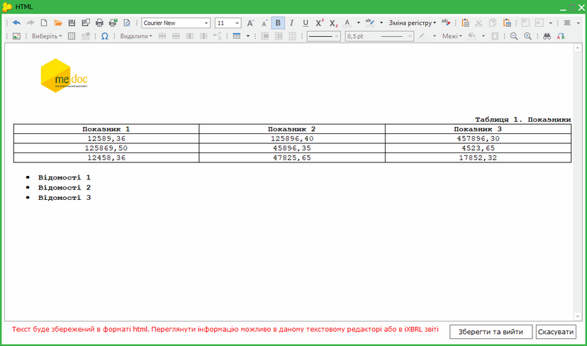

Натисніть, щоб збільшити малюнок

3. Для збереження інформації у вікні редактора натисніть кнопку Зберегти і вийти. Введений текст буде конвертовано у html-формат та відображено у відповідному полі форми:

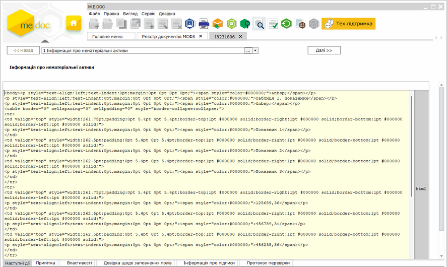

Натисніть, щоб збільшити малюнок

Зверніть увагу редагувати форматований текст можна лише за допомогою редактора по натисканню кнопки html.

Також у поля для введення великого обсягу текстових даних можна вводити неформатований текст. Введення, змінення та редагування неформатованого тексту здійснюється безпосередньо у полі форми:

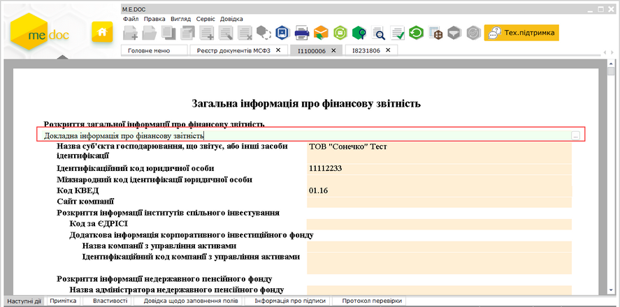

Натисніть, щоб збільшити малюнок

[До початку](#ucifrstgrrst_stvor-ucifrstgrrst_stvor)

Автоматичне переформування текстових полів

У випадках, коли вміст текстових полів (МЕМО-полів) формувався у сторонніх текстових редакторах, можна автоматично переформувати всі текстові поля звіту без використання [вбудованого html-редактора](#ucifrstgrrst_stvor-ucifrstgrrst_stvor).

Переформування можна виконувати для окремого звіту, для кількох звітів одночасно або для ярлика звітності.

Програма повідомить про таку можливість. При відкритті модулі Фінансова звітність за МСФЗ (формат iXBRL) з'явиться вікно повідомлення:

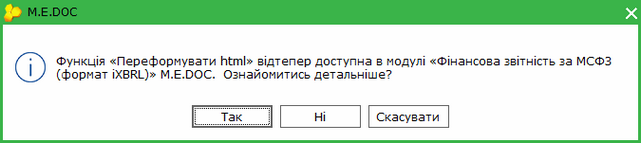

Натисніть, щоб збільшити малюнок

Щоб детальніше ознайомитися з функцією, натисніть на кнопку Так.

Щоб відключити відображення цього повідомлення при відкритті модуля, натисніть Скасувати.

Для автоматично переформування текстових полів виконайте дії:

1. Виділіть у реєстрі звіт (кілька звітів) або ярлик звітності, які необхідно переформувати, та оберіть один із способів:

- виконайте команду головного меню Файл – Переформувати html;
- виконайте команду контекстного меню Переформувати html;
- натисніть кнопку на панелі інструментів .

Функція Переформувати html доступна для створеної та збереженої в реєстрі звітності МСФЗ, що має статус Готується.

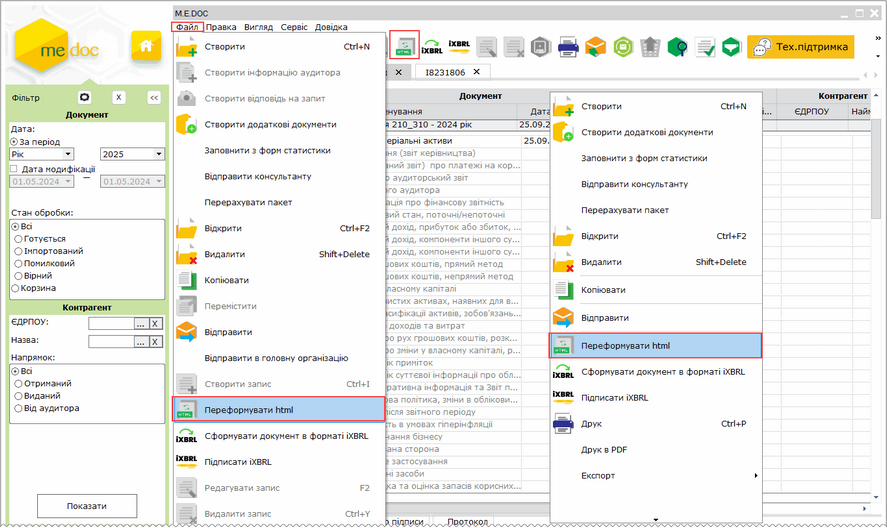

Натисніть, щоб збільшити малюнок

2. Розпочнеться опрацювання даних, що залежить від обсягу інформації й може тривати певний час.

3. Після завершення переформування відкриється протокол виконання операції:

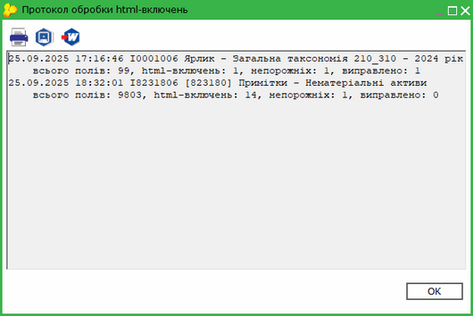

Натисніть, щоб збільшити малюнок

[До початку](#ucifrstgrrst_stvor-ucifrstgrrst_stvor)

Перенесення даних із статистичних звітів

Для поточної організації у розділі Звітність - Реєстр звітів повинні бути наявні відповідні статистичні звіти, період яких відповідає періоду документів МСФЗ.

1. У таблиці розділу оберіть період створення звітності та виділіть будь-який документ пакета, у який потрібно перенести дані. Скористайтесь одним із способів:

- виберіть команду головного меню Файл - Заповнити з форм статистики;
- у контекстному меню оберіть команду Заповнити з форм статистики.

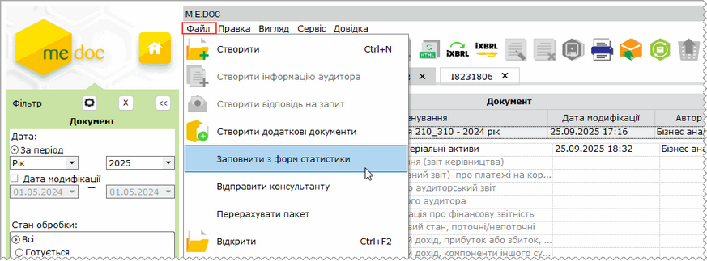

Натисніть, щоб збільшити малюнок

2. Відкриється вікно Довідник. Вікно містить перелік статистичних звітів, дані яких доступні для перенесення у обраний документ МСФЗ та за обраний період.

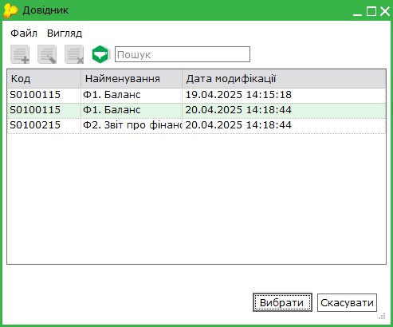

Оберіть потрібний звіт та натисніть Вибрати.

3. Відкриється вікно майстра Перенесення даних:

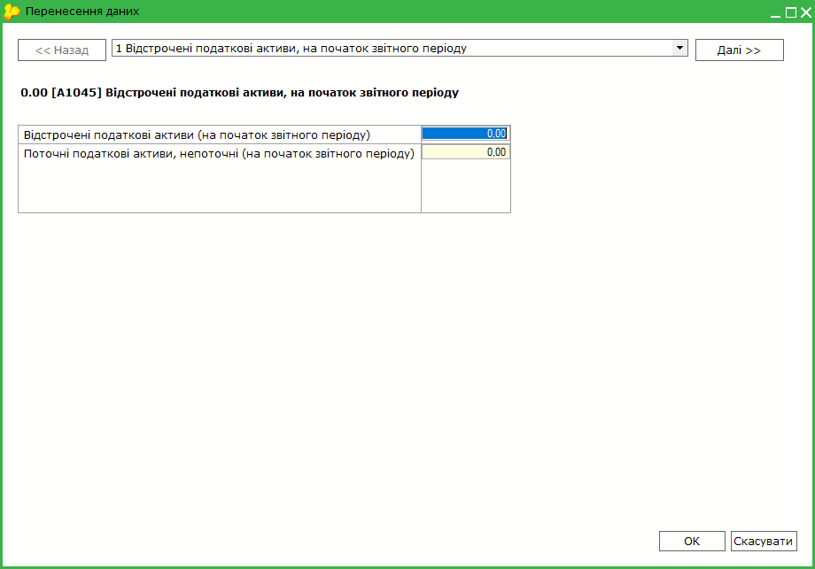

4. У полі, що розташоване у верхній частині вікна наводиться назва поля статистичної форми, з якого буде здійснюватися перенесення даних. Щоб брати потрібне поле, оберіть назву поля у списку, що відкривається, або скористайтеся кнопками Далі та Назад:

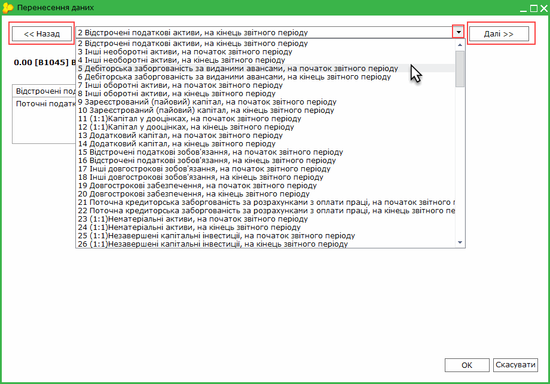

Залежно від обраного поля статистичної форми у вікні з'являється таблиця з назвами полів форм МСФЗ та редаговані поля для внесення значень:

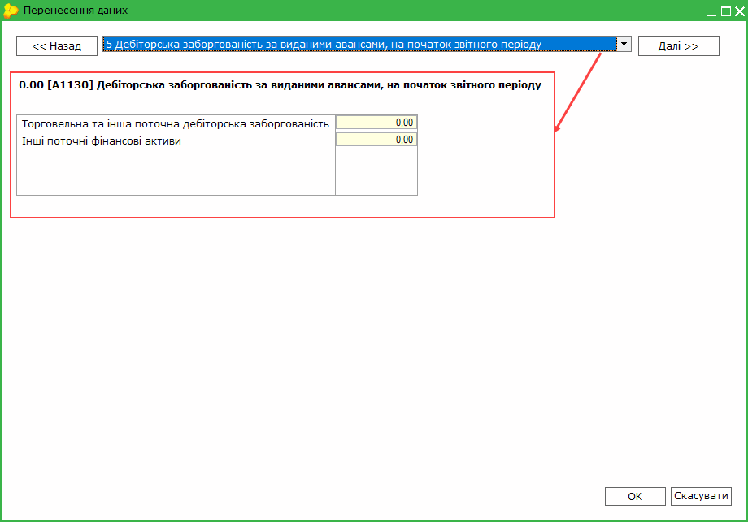

Якщо в переліку полів звітів МСФЗ, в які потрібно здійснити перенесення даних, наявне лише одне поле, то значення з відповідного поля статистичного звіту буде заповнено автоматично. Поля, що мають однозначну відповідність, позначаються у списку (1:1), наприклад: 23 (1:1)Нематеріальні активи, на початок звітного періоду.

5. Введіть необхідні розподілені значення у редаговані поля. Буде виконана автоматична перевірка початкового значення з відповідного поля статистичного звіту та суми, обрахованої з урахуванням внесених даних. У разі виявлення невідповідності у вікні з'явиться повідомлення про помилку.

6. Перейдіть до наступного поля статистичного звіту, натиснувши Далі, або оберіть назву поля зі списку. Таким чином заповніть всі розподілені значення у полях звіту МСФЗ.

7. Збережіть розподілені дані, натиснувши ОК. Відкриється протокол з результатами перенесення даних:

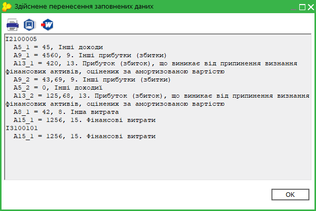

У разі потреби, за допомогою кнопок на панелі інструментів протокол можна роздрукувати, зберегти на диску в зручному форматі або експортувати в Word.

Для продовження роботи натисніть ОК. Дані можна перевірити в пакеті звітності МСФЗ.

Якщо форма, в яку відбувається перенесення даних, відсутня, вона буде автоматично створена у обраному пакеті.

Зверніть увагу на деякі особливості збереження даних:

- Якщо поле для введення значень зустрічається на декількох кроках майстра, на кожному кроці потрібно вводити розподілені значення поля (поле відображається зі значенням 0,00), після збереження всі проміжні значення будуть просумовані та збережені у відповідному полі документа МСФЗ.
- Кожне збереження майстра (натискання на кнопку ОК у вікні Перенесення даних) перезаписує дані в відповідних полях звітів МСФЗ. Якщо поле у майстрі не заповнювалось (має значення 0,00 на всіх кроках), існуючі значення в відповідних полях звітів МСФЗ не змінюються.

[До початку](#ucifrstgrrst_stvor-ucifrstgrrst_stvor)

Створення звітності КІФ/НПФ для подання за підписом КУА/адміністратора НПФ

Оскільки фінансову звітність інститутів спільного інвестування та недержавних пенсійних фондів складають, відповідно, компанії з управління активами та адміністратори недержавних пенсійних фондів, у програмі реалізовано можливість підписання звітів посадовими особами керуючих компаній – КУА/адміністратора НПФ.

Цей функціонал з боку КІФ або НПФ доступний за наявності ліцензії Фінансова звітність за МСФЗ (формат iXBRL) - Обмін з КУА. У ліцензії зберігається інформація про коди ЄДРПОУ КУА або адміністраторів НПФ.

Функціонал підписання з боку КУА/адміністраторів НПФ доступний за наявності ліцензії Фінансова звітність за МСФЗ (формат iXBRL) - КУА.

Для створення та подальшого підписання звітності посадовими особами керуючих компаній/адміністраторів ПІФ у вікні Створення звіту оберіть код ЄДРПОУ потрібного КУА або адміністратора НПФ. За наявності відповідної ліцензії у вікні Створення звіту відображається додаткове поле:

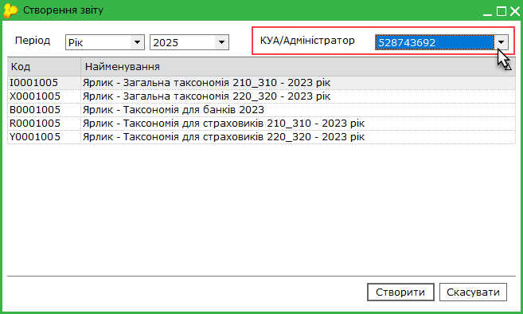

У списку, що відкривається оберіть код ЄДРПОУ КУА або адміністратора НПФ, що повинен підписувати звітність.

Створіть пакет фінансової звітності за МСФЗ у форматі xml, як [описано вище](#ucifrstgrrst_stvor-ucifrstgrrst_stvor).

 Значення коду ЄДРПОУ та назва КУА або адміністратора НПФ будуть автоматично занесені у відповідні поля звіту.

Алгоритм опрацювання звітності дивіться у розділі [Подання звітності КІФ/НПФ за підписом КУА/адміністратора НПФ](UCIFRSTgrRst.html#ucifrstgrrst-ucifrstgrrst_funkc).

[До початку](#ucifrstgrrst_stvor-ucifrstgrrst_stvor)

Створення додаткових документів

Функція призначена для створення документів, що не зв'язані з певними пакетами фінансової звітності за МСФЗ, та можуть бути створені окремо, за потреби підприємства. Також, за допомогою функції можна сформувати Повідомлення про вибір аудитора.

Зверніть увагу!

З боку клієнтів аудитора функціонал доступний за наявності будь-якої ліцензії, що надає можливість роботи з модулем Фінансова звітність за МСФЗ (формат iXBRL) по команді Створити додаткові документи.

З боку аудитора функціонал доступний за наявності ліцензії Фінансова звітність за МСФЗ (формат iXBRL) - Аудитор або Аудитор (повна)  по команді [Створити інформацію аудитора](UCIFRSTgrRst_zvit_audyt.html#ucifrstgrrst_zvit_audyt-ucifrstgrrst_zvit_audyt).

Для формування додаткових документів:

1. Скористайтесь одним із способів:

- виберіть команду Файл - Створити додаткові документи;
- у контекстному меню оберіть команду Створити додаткові документи.

2. Відкриється вікно Створення звіту. Оберіть період, у якому створюється документ:

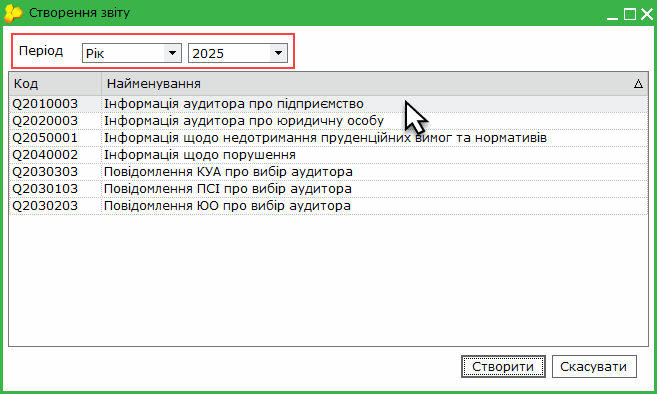

3. Оберіть шаблон для створення звіту. Натисніть Створити.

Перелік шаблонів, доступних для створення документів, визначається обраним періодом.

4. У окремому вікні відкриється бланк документа, який потрібно заповнити.

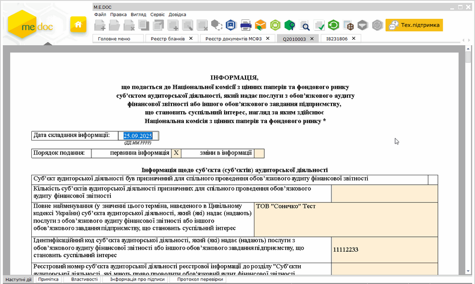

Натисніть, щоб збільшити малюнок

5. Внесіть дані в поля, які потребують заповнення. Перевірте та бережіть документ, як описано у розділі [Створення звітності за МСФЗ](#ucifrstgrrst_stvor-ucifrstgrrst_stvor).

[До початку](#ucifrstgrrst_stvor-ucifrstgrrst_stvor)

Експорт Повідомлення про вибір аудитора та додаткових документів

Підприємствам, що становлять суспільний інтерес, необхідно надсилання повідомлення НКЦПФР про вибір аудитора (у разі вибору або заміни суб’єкта аудиторської діяльності, який надаватиме послуги аудиту фінансової звітності підприємства). Повідомлення про вибір аудитора може бути направлене в НКЦПФР в паперовому та електронному вигляді.

У програмі можна створити Повідомлення у вигляді електронного документа за допомогою команди [Створити додаткові документи](#ucifrstgrrst_stvor-ucifrstgrrst_stvor).

Щоб зберегти файл Повідомлення про вибір аудитора або файли звітів Інформація аудитора про підприємство, Інформація аудитора про юридичну особу, Інформація щодо порушення для подальшого підписання та подання до НКЦПФР, виконайте експорт документа:

1. Виділіть документ у таблиці реєстру.

2. Скористайтесь одним із способів:

- виберіть команду Файл - Експорт - Експорт в форматі НКЦПФР;
- у контекстному меню оберіть команду  Експорт в форматі НКЦПФР.

3. У вікні, що відкриється оберіть шлях для збереження файлу та натисніть Зберегти.

При експорті файл документа зберігається з іменем Report.xml, яке є затвердженим наказом Національної комісії з цінних паперів та фондового ринку.

Якщо потрібно експортувати кілька документів, необхідно виконати операцію експорту окремо для кожного документа.

[До початку](#ucifrstgrrst_stvor-ucifrstgrrst_stvor)

Редагування звітів

Редагування доступне для непідписаних та невідправлених документів.

Документ відкривається на редагування одним зі способів:

- подвійне натискання мишею на рядку документа в реєстрі;
- кнопка  Відкрити на панелі інструментів;
- пункт головного меню Файл - Відкрити;
- пункт контекстного меню Відкрити;
- комбінація клавіш Ctrl+F2.

[До початку](#ucifrstgrrst_stvor-ucifrstgrrst_stvor)

Копіювання звітів

Для копіювання пакета звітів:

1. Виділіть ярлик пакета, копію якого потрібно створити.

2. Оберіть один із способів копіювання:

- на панелі інструментів натисніть кнопку Копіювати - ;
- із контекстного меню команда Копіювати;
- команда Файл - Копіювати.

3. Відкриється вікно Копіювання звіту, де запропоновано обрати період:

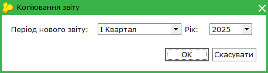

За замовчуванням встановлюється період виписки пакета, що копіюється та поточний рік.

4. Оберіть потрібний період та рік та натисніть кнопку ОК.

5. Ярлик пакета відкриється у окремому вікні. За необхідності внесіть зміни у документ та збережіть його, натиснувши .

Скопійований пакет (у який не вносилися зміни) позначається у реєстрі іконкою .

Для копіювання звіту:

1. Виділіть звіт, копію якого потрібно створити.

2. Оберіть один із способів копіювання:

- на панелі інструментів натисніть кнопку Копіювати - ;
- із контекстного меню команда Копіювати;
- команда Файл - Копіювати.

3. Відкриється вікно Копіювання звіту, де запропоновано обрати період:

За замовчуванням встановлюється період виписки пакета, що копіюється та поточний рік.

4. Оберіть потрібний період та рік та натисніть кнопку ОК.

5. У вікні Пачки звітів оберіть спосіб копіювання: Нова - скопіювати обраний звіт у новий пакет звітів або Наявна - скопіювати звіт у існуючий пакет.

6. Якщо обрано копіювання у новий пакет, у реєстрі буде створено новий пакет, звіт, що копіюється, буде розміщено у цьому пакеті. Новий пакет створюється у періоді та році, що були вказані у п.3.

7. Якщо обрано копіювання у наявний пакет, оберіть у полі праворуч ярлик пакета, у який потрібно скопіювати звіт, та натисніть ОК.

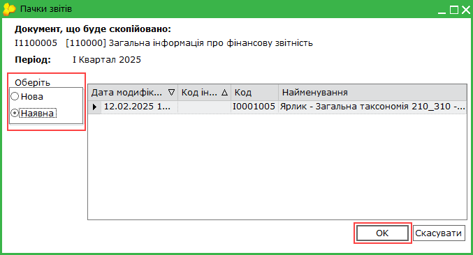

Звіт, що копіюється, буде розміщено у обраному пакеті. Можливо обрати пакет, який створено у періоді та році, що були вказані у п.3.

[До початку](#ucifrstgrrst_stvor-ucifrstgrrst_stvor)

### Алгоритм створення звітності за МСФЗ на період відсутності звітів нової таксономії

_Шлях у довідці: Розділи програми › Звітність › Фінансова звітність за МСФЗ (формат iXBRL) › Створення звітності за МСФЗ › Алгоритм створення звітності за МСФЗ на період відсутності звітів нової таксономії_

Незважаючи на відсутність затвердженої нової таксономії, користувачі можуть розпочати попередню підготовку для заповнення звітності за рік, таксономія для якого очікується.

У програмі передбачено алгоритм дій щодо попереднього створення звітності за МСФЗ на період відсутності звітів нової таксономії.

Для прикладу розглянемо підготовку для заповнення звітності за рік 2022:

1. Створіть новий пакет звітності за таксономією 2021, що наявна у програмі.

   Скористайтесь одним із способів:

- на панелі інструментів натисніть кнопку Створити ;
- виберіть команду Файл - Створити;
- у контекстному меню оберіть команду Створити.

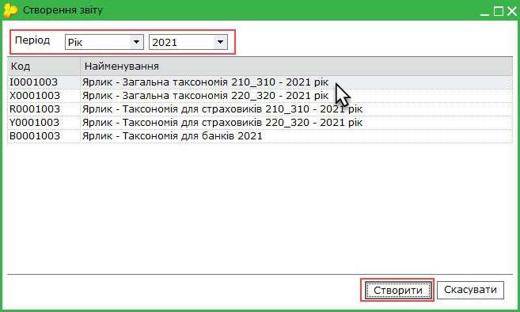

 Якщо пакет звітів створено та заповнено у сторонній програмі, його можна експортувати. У такому випадку пакет, що експортується, повинен бути збережений за таксономією 2021.

2. Створений новий пакет звітності заповнювати не потрібно. Закрийте вікно створеного ярлика пакету звітів та підтвердіть збереження звіту, натиснувши Так, у вікні, що відкриється. Або ж для збереження нового пакета натисніть кнопку  на панелі інструментів перед закриттям вкладки.

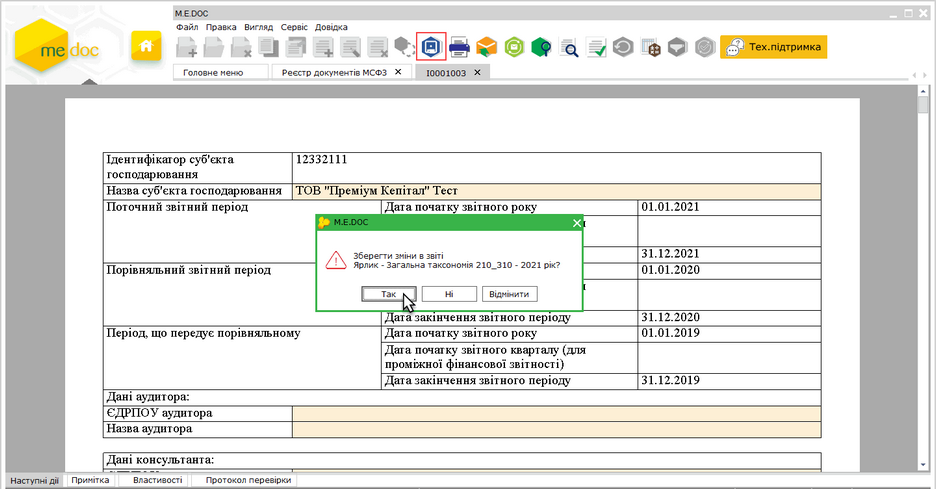

Натисніть, щоб збільшити малюнок

3. Виділіть створений (експортований) пакет звітності за таксономією 2021 у таблиці реєстру та скопіюйте його у період рік 2022.

Для копіювання скористайтеся одним із способів:

- на панелі інструментів натисніть кнопку Копіювати - ;
- із контекстного меню команда Копіювати;
- команда Файл - Копіювати.

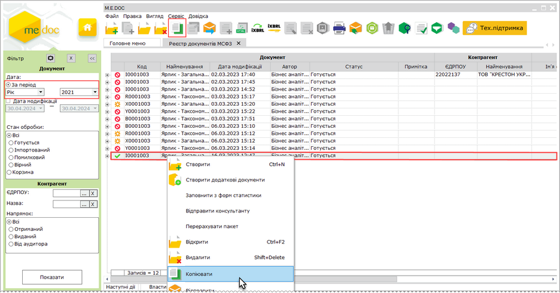

Натисніть, щоб збільшити малюнок

4. Відкриється вікно Копіювання звіту. Оберіть у полі Період нового звіту значення рік та у полі Рік оберіть значення року 2022. Натисніть ОК:

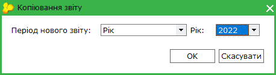

5. У окремому вікні відкриється бланк ярлика до скопійованого пакета звітності, який потрібно заповнити.

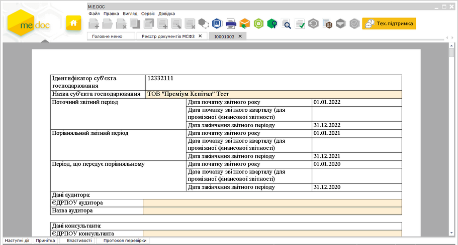

Натисніть, щоб збільшити малюнок

Також заповніть необхідні звіти пакету та збережіть зміни.  Внесіть дані в поля, які потребують заповнення або, якщо пакет звітів було експортовано, перевірте коректність даних у звітах.

6. Збережіть документ, натиснувши кнопку  або комбінацію клавіш Ctrl+S.

7. Після затвердження нових форматів таксономії виконайте конвертацію попередньо створеного пакета звітності в новий затверджений пакет звітності.

Для цього скопіюйте попередньо заповнений пакет.

8. Відкриється вікно попередження. Для продовження натисніть Так:

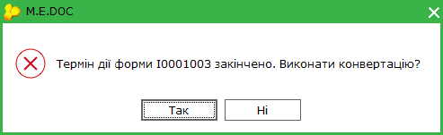

9. При копіюванні автоматично створиться новий ярлик (відповідно до пакета звітності I000100\_, R000100\_, X000100\_, Y000100\_, B000100\_) за новою таксономією. Дані із попередньо створеного пакета будуть перенесені у відповідні поля пакета звітності за новою таксономією. У разі потреби, дозаповнити нові поля, які не містив попередньо створений пакет звітності, та збережіть пакет (на малюнку відповідно до нашого прикладу - вкладка з кодом пакета звітності за рік 2022):

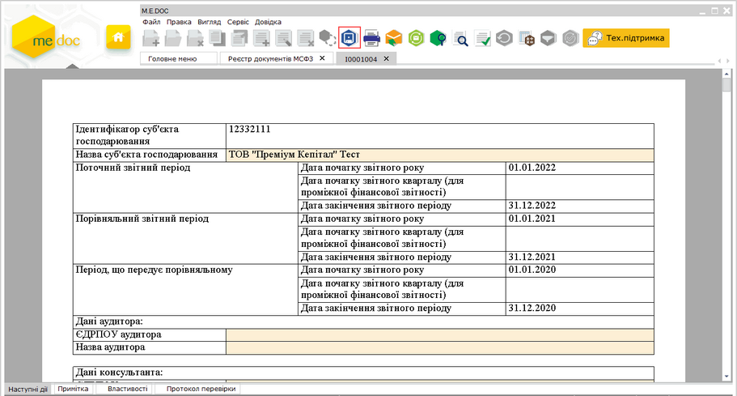

Натисніть, щоб збільшити малюнок

10. Знайдіть пакет звітів, що створений за таксономією 2021 і використовувався для копіювання, та видаліть його з реєстру. Для пошуку пакета скористайтеся полем За період на панелі Фільтр.

Щоб позначити призначення пакетів звітності можна скористатися полем Примітка. Для цього у вікні ярлика пакету на вкладці Примітка введіть текст, що позначатиме призначення пакета. Введений текст відображатиметься у колонці Примітка реєстру документів МСФЗ.

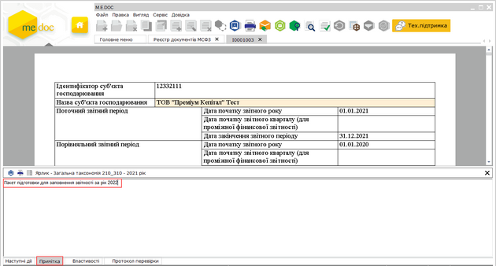

Натисніть, щоб збільшити малюнок

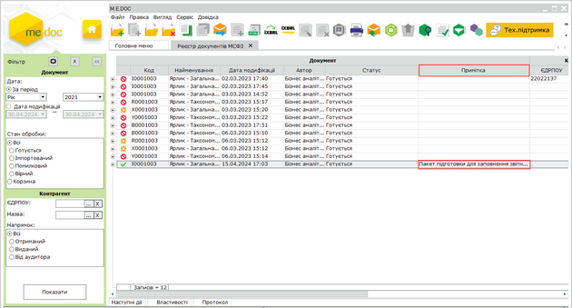

Натисніть, щоб збільшити малюнок

Зверніть увагу, при спробі сформувати пакет у форматі iXBRL для попередньо створеного пакета звітності, буде виведено повідомлення:

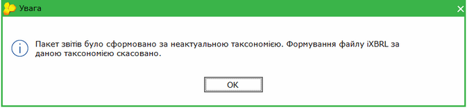

Натисніть, щоб збільшити малюнок


