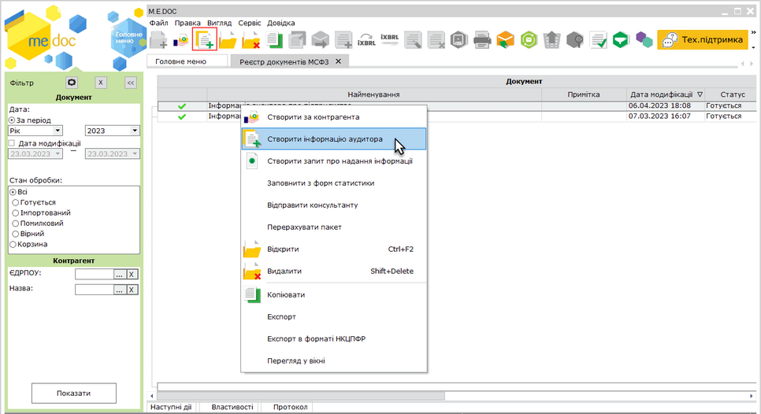
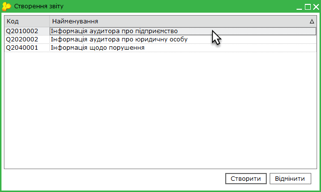
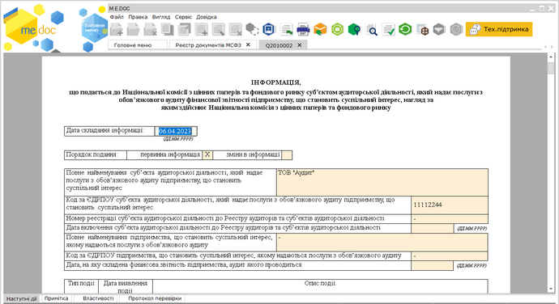
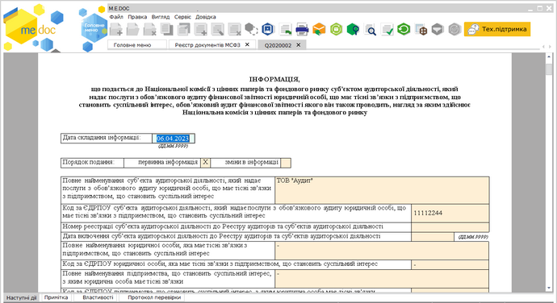
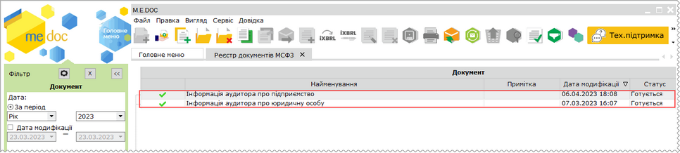

[← Зміст довідки](../)


# Створення Інформації аудитора

## Створення Інформації аудитора

_Шлях у довідці: Розділи програми › Звітність › Фінансова звітність за МСФЗ (формат iXBRL) › Створення Інформації аудитора_

В цьому розділі:

[Створення Інформації аудитора](#ucifrstgrrst_zvit_audyt-ucifrstgrrst_zvit_audyt)

[Експорт Інформації аудитора](#ucifrstgrrst_zvit_audyt-ucifrstgrrst_zvit_audyt)

З боку аудитора функція доступна за наявності ліцензії Фінансова звітність за МСФЗ (формат iXBRL) – Аудитор або Фінансова звітність за МСФЗ (формат iXBRL) – Аудитор (повна).

З боку клієнтів аудитора функціонал доступний за наявності будь-якої ліцензії, що надає можливість роботи з модулем Фінансова звітність за МСФЗ (формат iXBRL) по команді [Створити додаткові документи](UCIFRSTgrRst_stvor.html#ucifrstgrrst_stvor-ucifrstgrrst_stvor).

Суб’єкт аудиторської діяльності, який надає послуги з обов’язкового аудиту підприємству, зобов’язаний інформувати орган, який відповідно до законодавства здійснює нагляд за таким підприємством про:

- порушення законодавства з питань, що належать до компетенції органу нагляду;
- суттєву загрозу або сумніви щодо можливості підприємства продовжувати діяльність на безперервній основі;
- відмову від висловлення думки або надання негативної чи модифікованої думки.

Аудитор повинен повідомляти про будь-яку інформацію щодо питань, зазначених вище, про яку йому стало відомо під час виконання завдання з обов’язкового аудиту юридичної особи, що має  зв’язки з підприємством, що становить суспільний інтерес, обов’язковий аудит фінансової звітності якого він також проводить.

Аудитор повідомляє про виявлені факти у звітах:

- Інформація аудитора про підприємство - інформація, що подається до НКЦПФР суб’єктом аудиторської діяльності, який надає послуги з обов’язкового аудиту фінансової звітності підприємству, що становить суспільний інтерес, нагляд за яким здійснює НКЦПФР;
- Інформація аудитора про юридичну особу - інформація, що подається до НКЦПФР суб’єктом аудиторської діяльності, який надає послуги з обов’язкового аудиту фінансової звітності юридичній особі, що має тісні зв’язки з підприємством, що становить суспільний інтерес, обов’язковий аудит фінансової звітності якого він також проводить, нагляд за яким здійснює НКЦПФР;
- Інформація щодо порушення - інформація про порушення, що могли мати місце або мали місце, зокрема шахрайство щодо фінансової звітності підприємства та відносно яких не вжиті відповідні заходи щодо їх усунення, що подається до НКЦПФР суб’єктом аудиторської діяльності, який надає послуги з обов’язкового аудиту фінансової звітності  підприємству, що становить суспільний інтерес, нагляд за яким здійснює НКЦПФР.

Інформація подається не пізніше закінчення третього робочого дня після дати виявлення таких фактів. Інформація подається на сайті агента подання, у вигляді файлу [Report.xml](#ucifrstgrrst_zvit_audyt-ucifrstgrrst_zvit_audyt), підпис на файл накладається окремо на сайті.

Створення Інформації аудитора

Для створення Інформації:

1. У таблиці реєстру оберіть один із способів:

- виберіть команду Файл - Створити інформацію аудитора;
- у контекстному меню оберіть команду  Створити інформацію аудитора;
- натиснути кнопку на панелі інструментів  Створити інформацію аудитора.

Натисніть, щоб збільшити малюнок

2. Відкриється вікно Створення звіту.

Оберіть шаблон потрібного звіту. Натисніть кнопку Створити у нижній частині вікна або натисніть два рази ліву кнопку миші на потрібному шаблоні.

3.  У окремому вікні відкриється бланк документа. Заповніть необхідні поля документа.

Натисніть, щоб збільшити малюнок

Інформація аудитора про підприємство

Натисніть, щоб збільшити малюнок

Інформація аудитора про юридичну особу

4. Збережіть документ, натиснувши кнопку  , або комбінацію клавіш Ctrl+S.

Під час збереження виконається перевірка правильності заповнення полів і, у випадку помилок, система підсвітить червоним кольором поля, що необхідно виправити. Виправте помилки та знову збережіть документ.

Перевірити документ також можливо, обравши команду меню Правка - Перевірити документ, натиснувши F4, або, виконавши команду Перевірити звіт на вкладці Наступні дії.

У таблиці реєстру Інформація відображається як окремий документ:

Натисніть, щоб збільшити малюнок

[До початку](#ucifrstgrrst_zvit_audyt-ucifrstgrrst_zvit_audyt)

Експорт Інформації аудитора

Щоб зберегти файл Інформації аудитора для подальшого підписання та подання на сайті агента подання, виконайте експорт документа:

1. Виділіть потрібний документ у таблиці реєстру.

2. Скористайтесь одним із способів:

- виберіть команду Файл - Експорт - Експорт в форматі НКЦПФР;
- у контекстному меню оберіть команду  Експорт в форматі НКЦПФР.

3. У вікні, що відкриється оберіть шлях для збереження файлу та натисніть Зберегти. При експорті за замовчуванням файл документа зберігається з іменем Report.xml.

Якщо потрібно експортувати кілька документів, необхідно виконати операцію експорту окремо для кожного документа.

[До початку](#ucifrstgrrst_zvit_audyt-ucifrstgrrst_zvit_audyt)


