[← Зміст довідки](../)


# Корпорація

## Корпорація

_Шлях у довідці: Розділи програми › Корпорація_

Розділ Корпорація призначений для підприємств з розгалуженою ієрархічною структурою. У модулі здійснюється підготовка, прийом/передача, обробка і накопичення звітних документів між організаціями. Розділ забезпечує швидке автоматизоване зведення (консолідацію) даних звітності в єдину базу для подальшої обробки і подачі в державні органи, згідно чинному законодавству України.

У даному розділі довідки розглянуто наступне:

[Налаштування підпорядкованості установ](#ucincrst-m_e_doc-corp_pidzvitni)

- [Налаштування програмного комплексу](#ucincrst-m_e_doc-corp_nalasht)
- [Робота з розділом "Корпорація"](CorpIncRst.html#corpincrst-m_e_doc-corp_funkc)
- [Реєстр консолідованих звітів](CorpIncRst.html#corpincrst-m_e_doc-corp_modul_rz)
- [Опис основних функціональних елементів інтерфейсу](CorpIncRst.html#corpincrst-m_e_doc-corp_modul_rz_inter)
-  [Робота з розділом "Реєстр консолідованих звітів"](CorpIncRst.html#corpincrst-m_e_doc-corp_modul_rz_robota)
- [Реєстр запитів на консолідацію](CorpIncRst.html#corpincrst-m_e_doc-corp_modul_rzapytiv)
- [Додаткові функції](ConsRst.html#consrst-m_e_doc-corp_dod_funkc)
- [РПН в режимі "M.E.Doc.Корпорація"](ConsRst.html#consrst-m_e_doc-corp_dod_reestr_rnn)
- [Консолідація Запитів щодо відомостей з ЄРПН](ConsRst.html#consrst-m_e_doc-corp_dod_reestr_cons)
- [Для підзвітних підприємств](#ucincrst-m_e_doc-corp_modul_rz_robota_pidzv)
- [Журнал вхідної-вихідної кореспонденції](#ucincrst-m_e_doc-corp_journ)
- [Пакет звітних документів](#ucincrst-rdocs_paket_corp)

### Налаштування підпорядкованості установ

_Шлях у довідці: Розділи програми › Корпорація › Налаштування підпорядкованості установ_

В цьому розділі:

[Створення груп установ](#ucincrst-m_e_doc-corp_pidzvitni)

[Призначення групи підприємству](#ucincrst-m_e_doc-corp_pidzvitni)

[Підпорядкування підприємств](#ucincrst-m_e_doc-corp_pidzvitni)

Для правильного виконання консолідації документів, що є основною функцією розділу, необхідно створити Реєстр організацій і установ і виконати їх підпорядкування.

Для коректного налаштування підпорядкованості організацій, при вході в програмний комплекс у вікні Вибір установи потрібно вибрати підприємство, яке є Головним в корпорації.

Для полегшення пошуку Головної установи у вікні Вибір установи в меню Вигляд оберіть опцію Сховати підзвітні установи.

У Головному меню програми оберіть розділ Довідники та далі розділ Підзвітні підприємства.

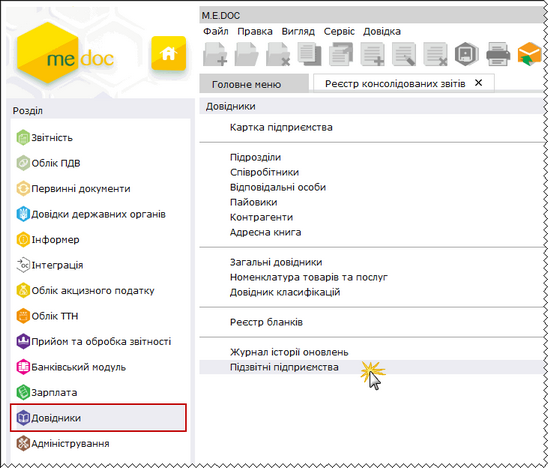

Натисніть, щоб збільшити малюнок

Вікно розділу складається з трьох частин: у лівій частині вікна розташована навігаційна панель Групи установ, праворуч, у верхній частині, наводиться список установ, що входить до вибраної групи, а в нижній частині - список підзвітних установ для обраного підприємства.

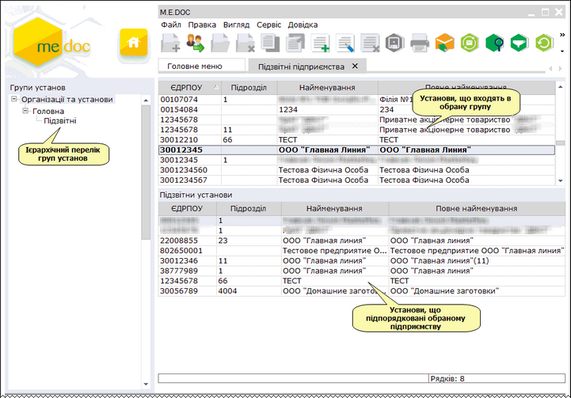

Натисніть, щоб збільшити малюнок

[До початку](#ucincrst-m_e_doc-corp_pidzvitni)

Створення груп установ

1. Для того, щоб створити нову групу, на панелі інструментів виберіть команду Створити, або натисніть комбінацію клавіш Ctrl+N.

Для створення підпорядкованої групи, виділіть рядок відносно якого буде додаватись підрозділ.

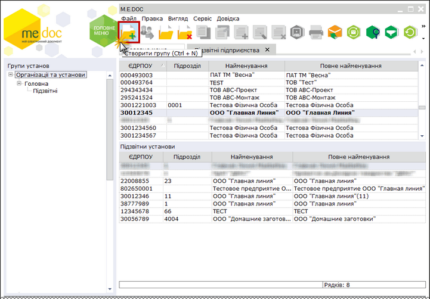

Натисніть, щоб збільшити малюнок

2. Відкриється вікно Група установ. Введіть найменування групи та натисніть кнопку ОК.

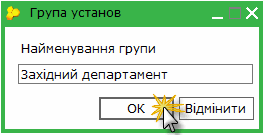

3. Запис групи додасться на навігаційну панель.

4. В списку груп також доступні наступні функції:

|  |  |  |
| --- | --- | --- |
|  | Shift+Del | Дозволяє безповоротно вилучити запис.  УВАГА!   При видаленні групи безповоротно видаляється увесь її вміст - всі підпорядковані їй групи. |
|  | Ctrl+F2 | Редагування назви групи в разі необхідності. |

[До початку](#ucincrst-m_e_doc-corp_pidzvitni)

Призначення групи підприємству

Для того, щоб призначити або змінити групу підприємству, виконайте дії у наступній послідовності:

1. На навігаційній панелі Групи установ оберіть групу Організації та установи.

2. У списку підприємств оберіть потрібну установу та скористайтесь одним із наступних способів:

- на панелі інструментів натисніть кнопку Призначити групу;
- виберіть команду Правка/Призначити групу;
- у контекстному меню оберіть команду Призначити групу (натисніть правою клавішею миші на рядку обраної установи).

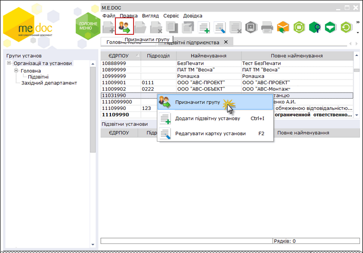

Натисніть, щоб збільшити малюнок

3. Відкриється вікно Призначити групу. Оберіть потрібну групу та натисніть ОК.

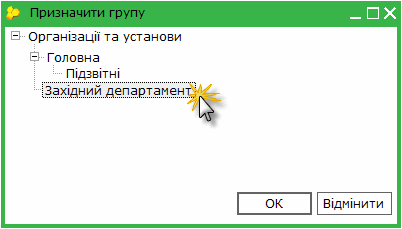

4. Підприємство додасться у вказану групу.

[До початку](#ucincrst-m_e_doc-corp_pidzvitni)

Підпорядкування підприємств

Для того, щоб підприємство призначити головною установою, а також сформувати список підзвітних їй установ виконайте дії у наступній послідовності:

1. В списку установ виділити установу, для якої формується список підзвітних установ

2. Скористайтесь одним із наступних способів:

- на панелі інструментів натисніть кнопку Додати підзвітну установу;
- виберіть команду Правка/Додати підзвітну установу;
- у контекстному меню оберіть команду Додати підзвітну установу;
- натисніть комбінацію клавіш Ctrl+I.

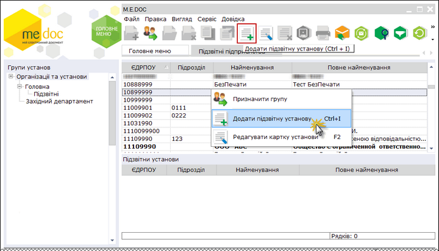

Натисніть, щоб збільшити малюнок

3. Відкриється довідник із списком всіх існуючих установ в програмному комплексі. Встановіть позначку у рядку підприємства, які потрібно призначити підзвітним, і натисніть кнопку ОК. Можливо обрати декілька підприємств. Щоб встановити позначки для всіх підприємств у списку, натисніть кнопку

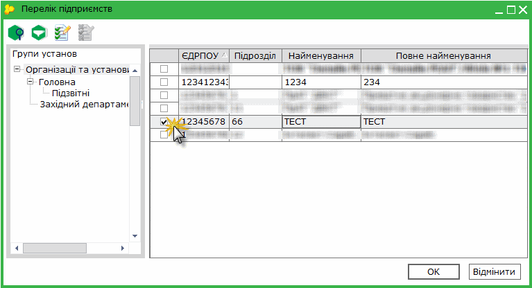

4. Підприємство додасться в список підзвітних установ.

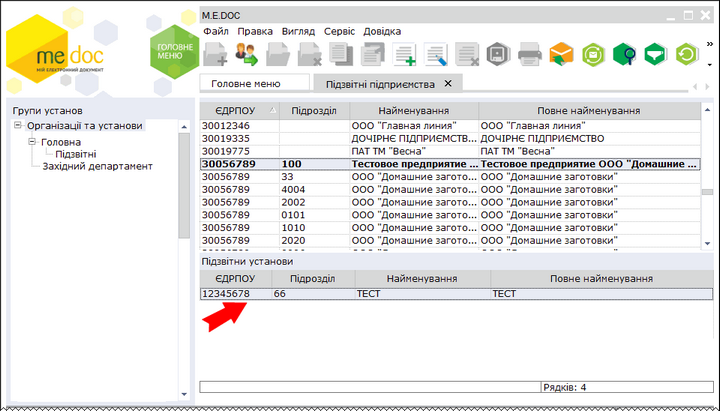

Натисніть, щоб збільшити малюнок

5. Також доступні наступні функції:

|  |  |  |
| --- | --- | --- |
|  | Ctrl+Y | Дозволяє безповоротно вилучити запис із списку підзвітних підприємств. |
|  | F2 | Відкриває картку підприємства. |

6. Можливо ввести ліцензію для підзвітної установи безпосередньо у довіднику Підзвітні підприємства. Для цього відкрийте картку підзвітної установи. У картці оберіть розділ Керування ліцензіями та введіть код ліцензії.

[До початку](#ucincrst-m_e_doc-corp_pidzvitni)

### Налаштування програмного комплексу

_Шлях у довідці: Розділи програми › Корпорація › Налаштування програмного комплексу_

Для налаштування основних параметрів конфігурації M.E.Doc.Корпорація, пов'язаних із її експлуатацією, у пункті головного меню Адміністрування оберіть розділ Параметри системи - Прийом та обробка звітності.

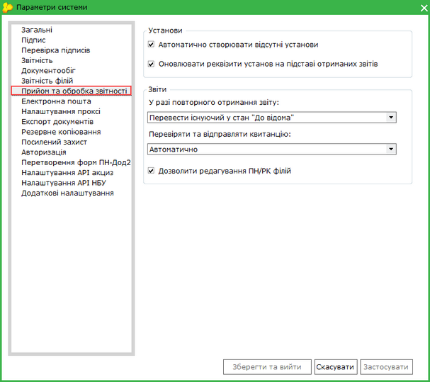

- Автоматично створювати відсутні установи
Якщо встановлена дана галочка, при отримані звітів від підзвітних установ, в програмному комплексі автоматично створюється картка установи, за умови її відсутності.

- Оновлювати реквізити установ на підставі отриманих звітів
Встановлена галочка в цьому полі включає функцію автоматичного оновлення реквізитів підзвітних підприємств в картках підприємств, на підставі даних, зазначених в звітах, які надійшли від підзвітних підприємств. Оновлення здійснюється в разі, якщо дані відрізняються з реквізитами отриманих звітів.

- У разі повторного отримання звіту
Налаштовується алгоритм обробки повторно отриманих звітів від підзвітних установ, має наступні значення:
- Перевести існуючий у стан "До відома" - при повторному отриманні звіту існуючий документ зберігається у програмі, але вилучається з обробки і його статус змінюється на "До відома";
- Замінити існуючий - повторно отриманий звіт замінює документ, що вже був отриманий раніше.
- Перевіряти та відправляти квитанцію
Налаштовується відповідна реакція при прийомі звітів від підзвітних установ, має наступні значення:
- Автоматично - при прийомі звітів автоматично формується квитанція про доставку документів, а також результати обробки (при автоматичному режимі документи завжди прийняті);
- У ручному режимі - при прийомі звітів формується лише квитанція про доставку документів, а [результати обробки потрібно фіксувати вручну](CorpIncRst.html#corpincrst-m_e_doc-corp_modul_rz_robota).
- Дозволити редагування ПН/РК філій
Дозволяє головній організації виконувати редагування та підписання ПН/РК підзвітних організацій.

### Для підзвітних підприємств

_Шлях у довідці: Розділи програми › Корпорація › Для підзвітних підприємств_

Якщо ваше підприємство є підзвітним і ви звітуєтесь у Головну установу, необхідно коректно налаштувати відправку звітів електронною поштою.

1. У Головному меню програми оберіть розділ Довідники та далі розділ Адресна книга.

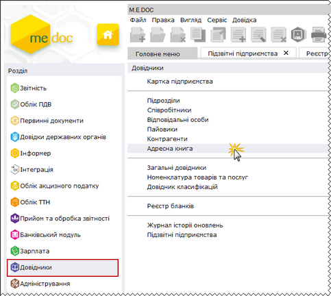

Натисніть, щоб збільшити малюнок

2. У адресній книзі оберіть групу Інші.

3. На панелі інструментів виберіть команду Додати адресата, або натисніть комбінацію клавіш Ctrl+I.

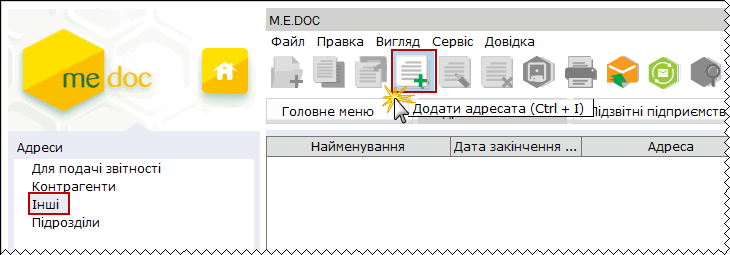

4. Відкриється вікно Запис адресної книги. Заповніть запропоновані поля форми:

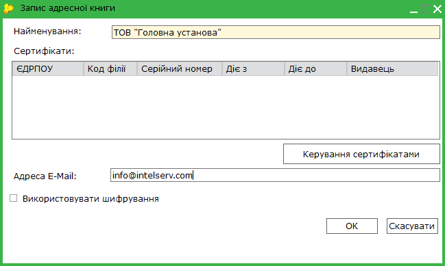

- Найменування - введіть вручну з клавіатури назву Головної установи.
- Сертифікати - не обов'язкове для заповнення поле.
Якщо ви бажаєте завантажити сертифікат Головної установи, натисніть на кнопку Керування сертифікатами.
Відкриється вікно Вибір сертифіката. Оберіть потрібний сертифікат та натисніть кнопку Ок.

Для зручності пошуку потрібного сертифікату радимо використовувати фільтри на панелі інструментів.

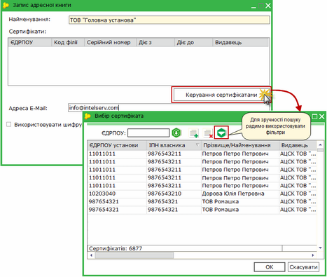

Натисніть, щоб збільшити малюнок

- Адреса E-Mail - введіть вручну з клавіатури електронну адресу Головної установи.
Якщо був завантажений сертифікат, дане поле заповнюється автоматично значенням із сертифікату.

- Використовувати шифрування - наявність галочки в даному полі вказує на те, при відправлені на вказану адресу листи шифруватимуться.
Шифрування документів забезпечує повну конфіденційність відправленого документа та гарантує, що ніхто не зможе прочитати листа окрім одержувача.
Зверніть увагу! Для здійснення шифрування відправленого документа обов'язково повинен бути завантажений сертифікат Головної установи!!!

3. Після закінченню внесення даних натисніть кнопку ОК.

Після виконання вищеописаних налаштувань, при відправці звіту у вікні Вибір адресата відображатиметься додана адреса Головної установи.

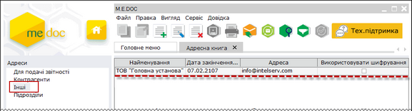

Натисніть, щоб збільшити малюнок

### Журнал вхідної-вихідної кореспонденції

_Шлях у довідці: Розділи програми › Корпорація › Журнал вхідної-вихідної кореспонденції_

Модуль доступний (у пункті Головного меню Адміністрування) лише за умови наявності ліцензії на використання ПК у конфігурації М.E.Doc.Корпорація. В демонстраційному режимі програми даний модуль не доступний.

У журналі в систематизованому вигляді зберігається вся інформація про електронне листування, тобто ведеться архів всіх відправлених та отриманих документів - звітів та електронних квитанцій.

Дані до журналу заносяться автоматично підчас підписання та відправлення звітних документів. Редагування та видалення записів у журналі неможливе!

Журнал вхідної-вихідної кореспонденції зліва містить ієрархічний список установ, у яких в межах обраного періоду, було відправлено або отримано повідомлення, а справа – перелік кореспонденції по обраному підприємству, який в згорнутому вигляді містить назву відправленого/отриманого документа і дату та час відправки/отримання. Повна інформація стосовно обігу чи стану документа закріплена за кожною із позицій Журналу. Достатньо розгорнути той чи інший документ, щоб її побачити. Записи містять назву операції - відправлено чи отримано, дату та час здійснення операції, назву адресата та його електронну адресу, найменування файлу електронної пошти.

Подвійний клік лівою клавішею миші по документу або по записах до нього відкриває документ в окремій вкладці.

З часом документація буде накопичена в достатньо великих об'ємах. В журналі передбачені зручні функції сортування інформації за датою, установою та за типом адресата. Користування ними дуже просте і значно полегшує та прискорює пошук інформації в журналі.

За допомогою полів за період з... і по... вкажіть період для відображення кореспонденції. Дату можна внести як вручну, так і скориставшись вбудованим календарем.

На панелі Установи розташовані фільтри, які відповідають найменуванням підзвітних організацій та установ. Відображаються тільки ті назви установ, у яких в обраному періоді є вхідна або вихідна кореспонденція.

У полі Тип адресата оберіть найменування типу адресата із списку.

Передбачена можливість відображати лише непрочитані повідомлення, для цього натисніть на кнопку  на панелі інструментів.

Таким чином Ви будете бачити тільки ту кореспонденцію, що задовольняє вимогам відбору.

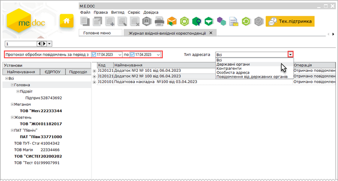

Натисніть на картинку, щоб збільшити її

Для модуля Журнал вхідної - вихідної кореспонденції не передбачено функції автоматичного оновлення списку повідомлень.

Для оновлення списку повідомлень натисніть кнопку  на панелі інструментів.

### Пакет звітних документів

_Шлях у довідці: Розділи програми › Корпорація › Пакет звітних документів_

В цьому розділі:

[Створення пакета звітності](#ucincrst-rdocs_paket_corp)

[Створення додатка до основного документа](#ucincrst-rdocs_paket_corp)

[Консолідація пакетів звітних документів](#ucincrst-rdocs_paket_corp)

[Відправлення пакета звітних документів](#ucincrst-rdocs_paket_corp)

[Експорт пакета звітних документів](#ucincrst-rdocs_paket_corp)

[Імпорт пакета звітних документів](#ucincrst-rdocs_paket_corp)

[Отримання звітів від підзвітних установ](#ucincrst-rdocs_paket_corp)

[Створення копії пакета звітних документів](#ucincrst-rdocs_paket_corp)

[Переміщення звітів між пакетами](#ucincrst-rdocs_paket_corp)

[Видалення звітів з пакета](#ucincrst-rdocs_paket_corp)

Пакет звітних документів – це певний перелік документів як однотипних, так і різнотипних, що подаються в одному звітному періоді. Пакет містить основний документ звітності та необхідні додатки до нього.

В програмному комплексі біля основного документа пакета звітних документів відображається / та нижче нього у вигляді дерева - додатки до основного документа.
Згорнути вміст пакета звітних документів можна натиснувши на  зліва від основного документа. Відповідно розгорнути вміст можна натиснувши на .
Для того, щоб одночасно розгорнути та згорнути вміст всіх пакетів Реєстру, в меню "Вигляд" передбачені команди відповідно "Розгорнути всі пачки" та "Згорнути всі пачки".

Створення пакета звітності

Пакет документів створюється як звичайний звіт - див. розділ [Створення звітів](CorpIncRst.html#corpincrst-m_e_doc-corp_modul_rz_robota).

При створенні обирається основний документ, при цьому в Реєстрі звітів відображаються підлеглі йому додатки, які можуть бути створені до основного документа в даному пакеті.

Нестворені додатки до основного документа відображаються сірим кольором.

Згорнути вміст пакета звітних документів можна натиснувши на  зліва від основного документа. Відповідно розгорнути вміст можна натиснувши на .

Наприклад:
При створенні Податкової декларації з ПДВ в пакеті відображаються Дод. 1-7, Уточнюючий розрахунок (Додаток),на основі яких формується Декларація.

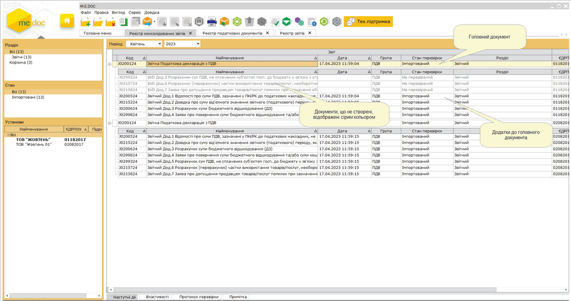

Натисніть на картинку, щоб збільшити її

Правила заповнення та редагування основного документа описано у розділі [Створення, заповнення та редагування звітів](UCDocRstByPer5.html#ucdocrstbyper5-rdoc_robota_stvor) даного документа.

[До початку](#ucincrst-rdocs_paket_corp)

Створення додатка до основного документа

Для створення додатку до основного документа виберіть його із переліку вмісту пакета і двічі натисніть по ньому лівою клавішею миші.
Додаток відкривається в окремому вікні програми.

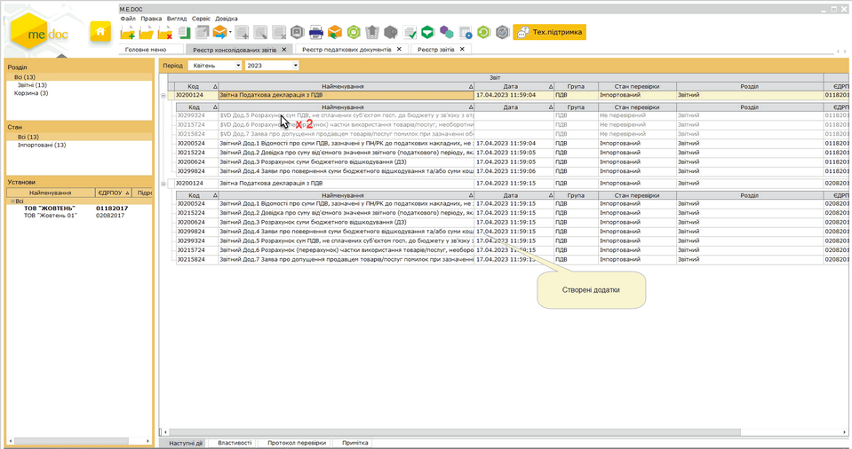

Натисніть на картинку, щоб збільшити її

В реєстрі звітів створений додаток відображається чорним кольором (або червоним, якщо звіт помилковий) і в таблиці заповнюються такі колонки, як Дата модифікації, Стан, Автор тощо.
Створені додатки завжди відображаються в пакеті зверху.

Правила заповнення та редагування додатків до основного документа описано у розділі [Створення, заповнення та редагування звітів](UCDocRstByPer5.html#ucdocrstbyper5-rdoc_robota_stvor).

[До початку](#ucincrst-rdocs_paket_corp)

Консолідація пакетів звітних документів

Послідовність дій користувача для консолідації пакета звітних документів повністю відповідає описаному в розділах [Консолідація звітів](CorpIncRst.html#corpincrst-m_e_doc-corp_modul_rz_robota) та [Реєстр запитів на консолідацію](CorpIncRst.html#corpincrst-m_e_doc-corp_modul_rzapytiv).

Особливості консолідації пакета звітних документів:

Консолідація відбувається якщо обраний основний документ або додаток до основного документа по всім підзвітним підприємствам, зареєстрованим в програмному комплексі.

В консолідований пакет звітних документів попадають всі створені звіти, навіть якщо є хоч один додаток в єдиному екземплярі.

Консолідований пакет документів розміщується вкінці Реєстру консолідованих звітів, позначається жирним шрифтом.

Для підсумкових полів передбачена функція [Розшифровка консолідації](CorpIncRst.html#corpincrst-m_e_doc-corp_modul_rz_robota).

[До початку](#ucincrst-rdocs_paket_corp)

Відправлення пакета звітних документів

Перед відправкою документів електронною поштою переконайтесь в наявності в системі актуальних сертифікатів ЕЦП, налаштований відповідний комплект підписів, налаштовано поштове з’єднання для відправки/отримання документів в електронному вигляді.

Основною особливістю пакета звітних документів є те, що незалежно від способу відправки (з Реєстру - при виділені основного документа або будь-якого додатку; з відкритого документа - основного або будь-якого додатку) завжди відправляється повністю весь пакет документів: основний документ та всі створені до нього додатки.

В контролюючий орган пакет документів відправляється стандартним для програмного комплексу способом - див. розділ [Відправлення звітів на підпис](UCDocRstByPer5.html#ucdocrstbyper5-rdoc_robota_na_pidpus) та [Підписання документів ЕЦП та відправлення їх електронною поштою](UC_ECP.html#uc_ecp-ecp).

Від імені підзвітної установи пакет документів відправляється стандартним способом - див. розділ [Відправка звіту від імені підзвітної установи](CorpIncRst.html#corpincrst-m_e_doc-corp_modul_rz_robota).

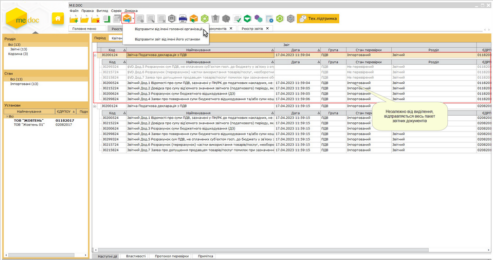

Натисніть на картинку, щоб збільшити її

Пакет документів відправляється як з Реєстру звітів - при виділенні основного документа або додатку до нього, так і з відкритого основного документа або відкритого додатку. Але в усіх випадках завжди відправляється весь пакет створених звітів.

Після відправлення стан усіх створених документів пакета змінюється на В дорозі (колонка Стан).

Якщо при відправці за будь-яких причин не відправився один або більше з документів пакета, необхідно відправити весь пакет знову.

Зверніть увагу! Документи, що були відправлені, редагуванню не підлягають. Для внесення змін [скопіюйте звіт](#ucincrst-rdocs_paket_corp).

[До початку](#ucincrst-rdocs_paket_corp)

Отримання звітів від підзвітних установ

Послідовність дій користувача для отримання поштою пакета звітних документів повністю відповідає отриманню поштою звичайних документів - див. розділ [Отримання звітів від підзвітних установ поштою](CorpIncRst.html#corpincrst-m_e_doc-corp_modul_rz_robota).

При отриманні документів від підзвітних установ виконується перевірка на актуальність версії встановленого програмного забезпечення, якщо версія програми підзвітної установи нижче 10.00.186, підзвітна установа отримує повідомлення про невірний XML-файл.

[До початку](#ucincrst-rdocs_paket_corp)

Експорт пакета звітних документів

Послідовність дій для експорту пакета звітних документів повністю відповідає процесу експорту звичайних звітних документів в Реєстрі звітів - див. розділ [Експорт звітних документів](UCDocRstByPer5.html#ucdocrstbyper5-rdoc_robota_export).

Особливості вивантаження пакета звітних документів:

При виборі варіанту [для обміну звітністю](UCDocRstByPer5.html#ucdocrstbyper5-rdoc_robota_export) та/або експорт документа з квитанціями створюється один XML-файл.

[До початку](#ucincrst-rdocs_paket_corp)

Імпорт пакета звітних документів

Послідовність дій користувача для імпорту пакета звітних документів повністю відповідає імпорту звичайних документів - див. розділ [Імпорт звітів від підзвітних установ з диска](CorpIncRst.html#corpincrst-m_e_doc-corp_modul_rz_robota).

При імпорті документів від підзвітних установ виконується перевірка на актуальність версії встановленого програмного забезпечення, якщо версія програми підзвітної установи нижче 10.00.186 - система видає повідомлення про невірний XML-файл.

[До початку](#ucincrst-rdocs_paket_corp)

Створення копії пакета звітних документів

Послідовність дій для копіювання звітів з пакета документів повністю відповідає копіюванню звичайних документів - див. розділ [Створення копії документа](UCDocRstByPer5.html#ucdocrstbyper5-rdoc_robota_function).

Особливості копіювання пакета звітних документів:

1. Якщо копіюється основний документ, то копіюється весь пакет звітних документів повністю.

2. При копіюванні додатку до основного документа вікно вибору періоду поєднано з вікном вибору пакета звітних документів, в який відбувається копіювання. Передбачено наступні варіанти:

Якщо додаток копіюється в період, в якому відсутні пакети звітних документів, до вибору доступний варіант створення нового пакета документів.

Якщо додаток копіюється в період, де присутні один або декілька пакетів документів, які готуються (не підписані ЕЦП), система пропонує перелік пакетів, в які можливо виконати копіювання, а також доступний варіант створення нового пакета звітних документів.

Якщо копіюється додаток, який може дублюватись в пакетах в обраному періоді, система пропонує перелік пакетів, в які можливо скопіювати звіти з врахуванням дублів.

Якщо необхідно скопіювати додаток в пакет, в якому він безпосередньо розташований, в допомогу користувачу передбачено третій варіант при виборі пакета - Поточний. Даний варіант доступний для вибору лише за умови, що додаток може дублюватись в пакеті звітних документів.

[До початку](#ucincrst-rdocs_paket_corp)

Переміщення звітів між пакетами

Передбачена можливість переміщати додатки до основного документа між однотипними пакетами звітних документів.

Під переміщенням мається на увазі, що додаток фізично вирізається з одного пакета та вставляється в інший.

Перемістити можна лише з не підписаного ЕП пакета до іншого не підписаного ЕП пакета або в новий пакет звітних документів.

1. Виділіть додаток до основного документа, який необхідно перемістити в інший пакет звітності.

2. Скористайтесь одним із наступних способів:

- на панелі інструментів натисніть кнопку Перемістити;
- виберіть команду Файл - Перемістити;
- у контекстному меню оберіть команду Перемістити.

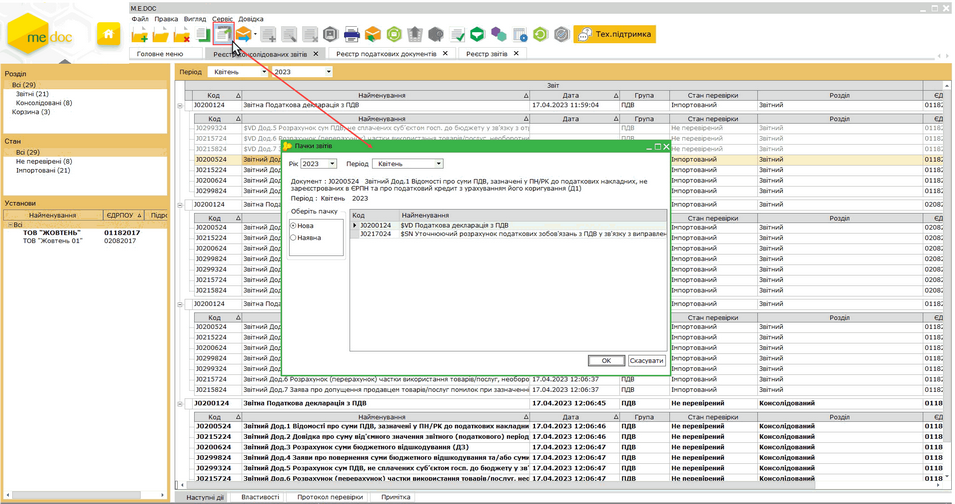

Натисніть на картинку, щоб збільшити її

3. Оберіть рік та місяць звітного періоду, в який необхідно виконати переміщення додатку до основного документа.

4. Наступним кроком система спитає користувача чи додати в один з існуючих пакетів чи створити новий пакет звітних документів.
В разі вибору варіанту Існуючу система надає перелік доступних пакетів в обраному періоді, в які можливо виконати переміщення з врахуванням можливих дублів додатків в обраному пакеті звітних документів.
Оберіть необхідний Вам варіант та натисніть кнопку ОК.

5. Звіт переміщено.

[До початку](#ucincrst-rdocs_paket_corp)

Видалення звітів з пакета

Послідовність дій для видалення звітів в пакеті документів повністю відповідає видаленню звичайних документів - див. розділ [Видалення помилкового документа](UCDocRstByPer5.html#ucdocrstbyper5-rdoc_robota_function).

Особливості видалення звітів пакета документів:

При видаленні пакета звітних документів, який готується (не підписаний):

При видаленні додатку до основного документа - видаляється тільки виділений файл (або група, якщо виділено групу файлів).

Якщо видаляється основний документ - в Корзину видаляється весь пакет документів.

Видалені в Корзину звіти пакета втрачають зв'язок між собою та з основним документом.

При відновленні з Корзини основного документа створюється новий пакет звітних документів.

При відновленні з Корзини додатку до основного документа система спитає користувача чи додати звіт в один з існуючих пакетів чи створити новий пакет звітних документів.

При видаленні пакета звітних документів, який підписаний (заблокований від змін):

При видаленні додатку до основного документа або основного документа - видаляється весь пакет звітних документів.

Видалені в Корзину звіти пакета зберігають зв'язок між собою та з основним документом.

При відновленні з Корзини основного документа або додатку до основного документа відновлюється весь пакет звітних документів.

[До початку](#ucincrst-rdocs_paket_corp)


