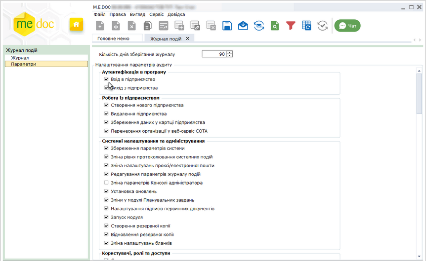
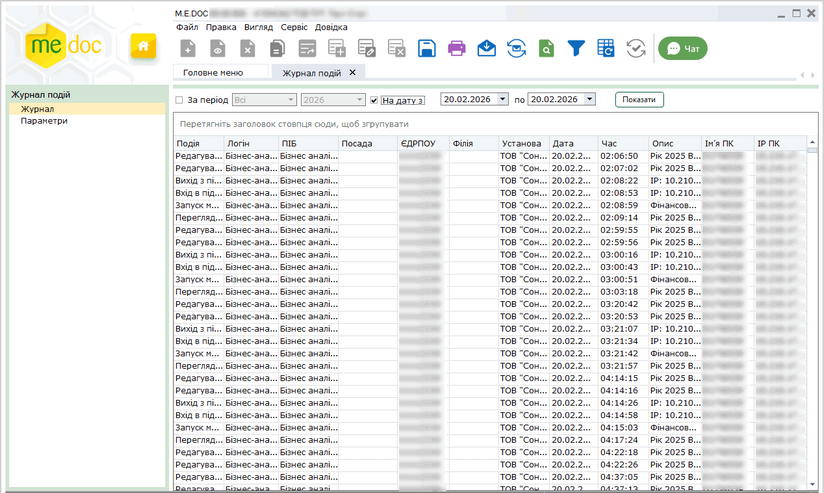
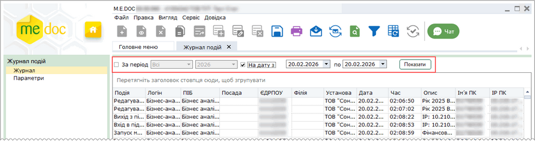
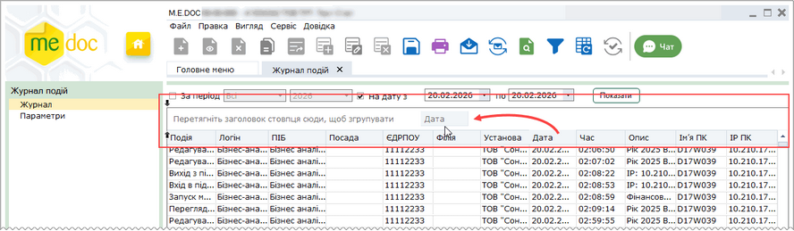
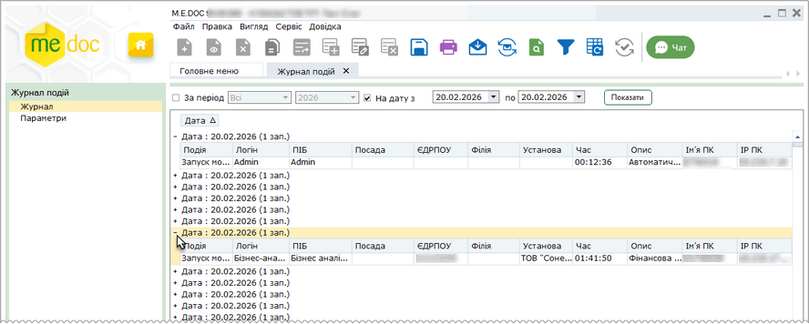
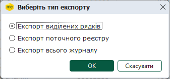

[← Зміст довідки](../)


# Журнал подій

## Журнал подій

_Шлях у довідці: Розділи програми › Адміністрування › Журнал подій_

Журнал подій призначений для збереження історії подій в системі з метою контролю дій користувачів.

Вкладка Журнал подій містить два розділи: [Параметри](#uclogs-admlogs) та [Журнал](#uclogs-admlogs). Для того, щоб перейти до розділу, натисніть лівою кнопкою миші на його назві у лівій частині вікна.

Розділ Параметри призначений для налаштування переліку подій, які будуть зберігатись у Журналі подій. Для налаштування журналу виконайте дії:

1. Оберіть події, які необхідно зберігати у журналі. Для цього встановіть позначки в рядках, що відповідають подіям.

Натисніть, щоб збільшити малюнок

2. У полі Кількість днів збереження журналу вкажіть кількість днів, протягом яких журнал буде накопичувати та зберігати історію здійснених в системі операцій. По закінченню вказаного періоду журнал очищується, відлік подій починається спочатку.

У розділі Журнал відображається вміст журналу подій.

Натисніть, щоб збільшити малюнок

По замовчуванню у Журналі відображено події у вигляді списку. Події  відображено у хронологічному порядку - на початку списку розташовані події, що відбулись першими. Для кожної події у окремих стовбцях зберігаються наступні дані:

- Подія - назва події;
- Логін - логін під яким користувач був зареєстрований у системі;
- ПІБ - прізвище, ім'я та по батькові користувача;
- Посада - посада користувача;
- ЄДРПОУ - код ЄДРПОУ установи;
- Філія - код філії, за наявності;
- Установа - установа, з якою пов'язана подія;
- Дата - дата, на яку відбулася подія;
- Час - час події;
- Опис - опис події;
- Ім'я ПК - назва ПК, з якого здійснювалася операція;
- ІР ПК - ІР-адреса комп'ютера, з якого здійснювалася операція.

Для того, щоб посортувати записи у списку, натисніть лівою кнопкою миші на назві колонки. Записи буде посортовано у алфавітному порядку (для текстових значень), або по зростанню чи зменшенню (для числових даних).

За допомогою кнопок панелі інструментів для даних, збережених у Журналі подій, можливо виконати операції:

|  |  |
| --- | --- |
|  | Роздрукувати дані Журналу. |
|  | Встановити фільтр для перегляду даних. Якщо фільтр встановлено, кнопка змінює вигляд на . Щоб відмінити фільтр, натисніть кнопку ще раз. |
|  | Оновити дані Журналу. |

Налаштування відображення подій

Для налаштування відображення подій по датам оберіть спосіб вибору даних, встановивши відповідну відмітку:

- За період - відображення даних за заданий період часу, оберіть тип періоду: всі або певний місяць, оберіть рік для відображення даних;
- На дату - встановіть дату початку та закінчення періоду часу.

Для відображення записів за обраними параметрами натисніть кнопку Показати.

За замовчуванням у фільтрі встановлено відображення даних на поточну дату.

Натисніть, щоб збільшити малюнок

Можливо налаштувати перегляд Журналу у розрізі певних даних, наприклад, згрупувати події по установам, або по датам чи посаді користувача.

Для цього встановіть курсор миші на заголовку колонки, по даним якої необхідно згрупувати події. Натисніть та утримуйте ліву кнопку миші, перетягніть заголовок колонки на область, що містить напис Перетягніть заголовок стовпця сюди, щоб згрупувати.

Натисніть, щоб збільшити малюнок

Відображення даних розділу Журнал набуде вигляду (на прикладі групування по Даті):

Натисніть, щоб збільшити малюнок

Щоб переглянути дані для певної дати, натисніть на позначку "+". Відкриється список подій, що відбулися на обрану дату. Групування даних по іншим параметрам виконується аналогічно.

Таким чином можливо побудувати ієрархічний список перегляду даних, тобто, згрупувати дані за декількома параметрами.

Для того, щоб видалити гілки ієрархічного списку, або повернутися до відображення даних загальним списком, перетягніть назву колонки, за якою згруповано дані, до таблиці подій.

Налаштування відображення даних, виконані користувачем у Журналі, зберігаються. При наступному запуску програми дані у Журналі буде відображено у тому ж вигляді, який був налаштований на момент завершення роботи програми.

Збереження даних Журналу у файл Excel

1. Виконайте команду головного меню Файл - Експорт реєстру - Експорт таблиці в Excel.

2. У вікні, що відкриється, оберіть режим збереження даних:

- Експорт виділених рядків - зберегти дані обраних рядків, попередньо необхідно виділити рядки журналу ліівою кнопкою миші, натиснувши та утримуючи клавішу <Ctrl> або <Shift>;
- Експорт поточного реєстру - зберегти дані журналу за обраний період часу;
- Експорт всього журналу - зберегти всі дані, що містяться у журналі за весь період використання програми.

3. Натисніть кнопку ОК.

4. Відкриється вікно Збереження файлу оберіть каталог для збереження даних, ведіть ім'я файлу та натисніть кнопку Зберегти.

5. Система повідомить про результати експорту даних. Файл збережено у обраному каталозі.


