[← Зміст довідки](../)


# Управління ролями

## Управління ролями

_Шлях у довідці: Розділи програми › Адміністрування › Управління ролями_

В цьому розділі:

[Як додати нову роль та налаштувати права доступу](#ucmanageroles-ucmanageroles)

[Як додати користувача до ролі](#ucmanageroles-ucmanageroles)

[Як додати установу, до якої користувач має доступ в межах призначеної ролі](#ucmanageroles-ucmanageroles)

[Налаштування доступу до операцій створення документів за допомогою команди Створити на основі](#ucmanageroles-ucmanageroles)

[Як налаштувати доступ до підсистем програми](#ucmanageroles-ucmanageroles)

[Як налаштувати доступ до документів за кодом та найменуванням отримувача](#ucmanageroles-ucmanageroles)

[Як налаштувати доступ до бланків](#ucmanageroles-ucmanageroles)

[Експорт та імпорт ролі](#ucmanageroles-ucmanageroles)

Роль - сукупність прав доступу, необхідних для виконання конкретних функцій, та одночасно - підмножина користувачів, які повинні мати ці права. Ролі застосовуються для полегшення управління доступом, замість призначення окремих прав персонально кожному користувачу.

Модуль Управління ролями зберігає інформацію про ролі, дозволяє додавати нові, редагувати та видаляти ролі, налаштовувати права доступу для ролей, редагувати списки користувачів певної ролі в залежності від вимог підприємства, а також надавати права доступу до певної установи або переліку установ (за умови, що в програмному комплексі ведеться облік декількох установ).

Система прав доступу в програмному комплексі реалізовано таким чином, що обов'язково має бути чіткий взаємозв'язок між об'єктами системи РОЛЬ - КОРИСТУВАЧ - УСТАНОВА. Тобто, до ролі неможливо додати користувача не призначивши доступ до установи (групи установ) в межах цієї ролі. Виняток становить лише роль "Адміністратор".

Модуль побудований у вигляді таблиці: у лівій частині розташована навігаційна панель Ролі, праворуч у верхній частині - перелік доданих до ролі користувачів, а в нижній частині - список установ для вибраного у верхній частині користувача.

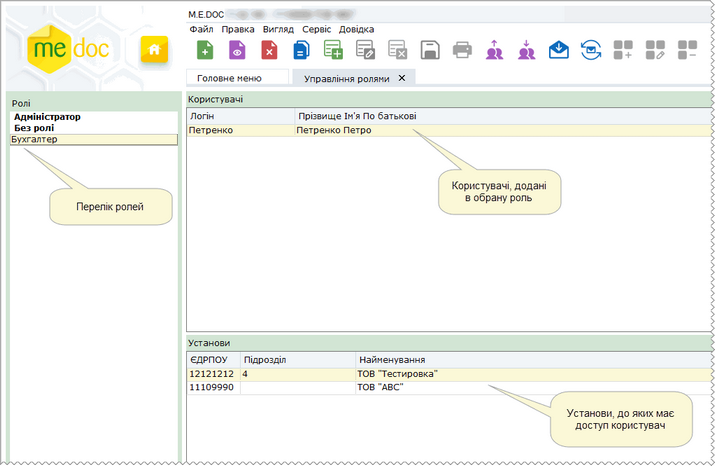

Натисніть, щоб збільшити малюнок

- Подвійний клік по запису РОЛІ, КОРИСТУВАЧА, УСТАНОВИ відкриває у окремій вкладці картку відповідно ролі, користувача, установи для редагування.
- Якщо в межах ролі виділити одночасно двох або більше користувачів, то на панелі Установи відобразяться лише ті установи, які присутні в усіх виділених користувачів.
- При першому запуску програми таблиця містить лише роль Адміністратор.
- Користувач із присвоєною роллю Адміністратор за замовчанням має повний доступ до всіх модулів та функцій програми. Ця роль із програми не видаляється та не коректується. Відповідно, для користувачів з роллю Адміністратор відсутній функціонал призначення установи.
- Для того, щоб змінити пароль Адміністратора в меню Сервіс оберіть команду Змінити пароль користувача.

Як додати нову роль та налаштувати права доступу

Для того, щоб додати нову роль скористайтесь одним із наступних способів:

- у меню Файл оберіть команду Додати роль;
- у контекстному меню оберіть команду Додати роль;
- натисніть кнопку Додати роль на панелі інструментів;
- натисніть комбінацію клавіш Ctrl+N.

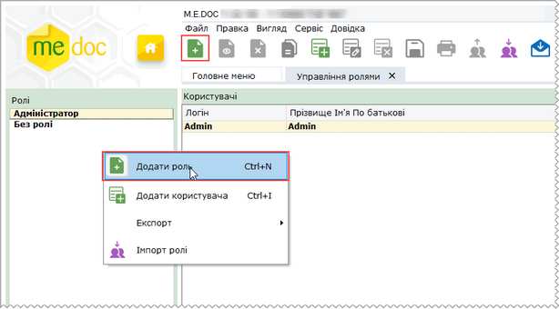

Натисніть, щоб збільшити малюнок

Відкриється окрема вкладка Роль. Вкладка містить розділи:

- Доступ до підсистем - засоби для налаштування прав доступу користувачів до окремих підсистем та функцій;
- Доступ до бланків - надання прав для створення документів за певними бланками.

Заповніть поля:

- Назва ролі - найменування ролі. Вводиться вручну з клавіатури, може містити не більше 50 символів;
- Опис - коротка характеристика вмісту ролі для полегшення пошуку потрібних прав доступу. Вводиться вручну з клавіатури (заповнюється у разі потреби).

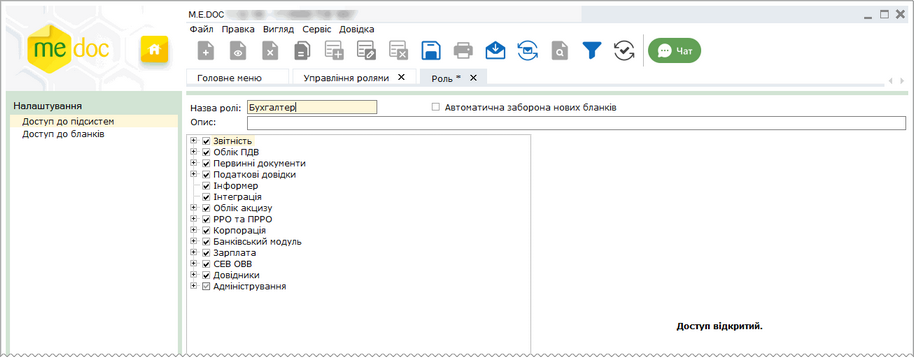

Натисніть, щоб збільшити малюнок

Для збереження ролі натисніть кнопку  на панелі інструментів.

При виборі назви ролі у переліку стають доступними функції:

|  |  |
| --- | --- |
| Видалити | Дозволяє безповоротно вилучити запис обраної ролі. |
| Редагувати | Редагування даних ролі в разі необхідності. |

[До початку](#ucmanageroles-ucmanageroles)

Як додати користувача до ролі

Для того, щоб додати користувачу до ролі виконайте дії в наступній послідовності:

1. На панелі Ролі оберіть роль, до якої потрібно додати користувача.

2. Скористайтесь одним із наступних способів:

- у меню Файл оберіть команду Додати користувача;
- у контекстному меню оберіть команду Додати користувача;
- натисніть кнопку Додати користувача на панелі інструментів;
- натисніть комбінацію клавіш Ctrl+I.

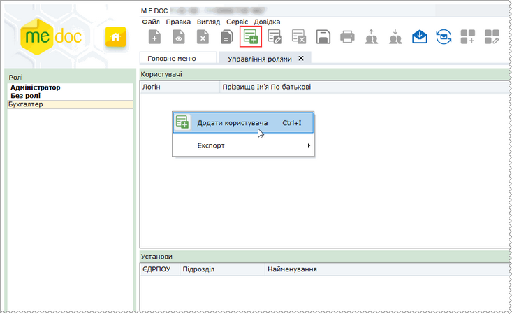

Натисніть, щоб збільшити малюнок

Відкриється вікно Користувачі. Оберіть потрібного користувача та натисніть кнопку Ок.

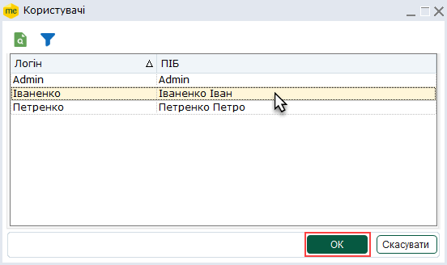

Користувача буде додано в перелік користувачів обраної ролі. За необхідності, користувача можна видалити з переліку, натиснувши на кнопку  панелі інструментів.

Після того, як до ролі будо додано користувача, обов'язково потрібно [додати установу](#ucmanageroles-ucmanageroles), інакше запис користувача буде видалено.

[До початку](#ucmanageroles-ucmanageroles)

Як додати установу, до якої користувач має доступ в межах призначеної ролі

Для того, щоб додати установу користувачу в межах обраної ролі виконайте дії в наступній послідовності:

1. Оберіть роль, в межах якої необхідно додати установу користувачу. Окрім Адміністратор та Без ролі, так як в цих розділах функція додання установи заблокована.

2. Оберіть користувача, якому потрібно додати установу.

Неможливо додати установу, якщо не обрано жодного користувача або в Ролі немає жодного запису. Якщо в Ролі немає жодного запису користувача, спочатку [додайте користувача у Роль](#ucmanageroles-ucmanageroles).

3. Скористайтесь одним із наступних способів:

- у меню Правка оберіть команду Додати установу;
- у контекстному меню оберіть команду Додати установу;
- натисніть кнопку Додати установу на панелі інструментів;
- натисніть функціональну клавішу F7.

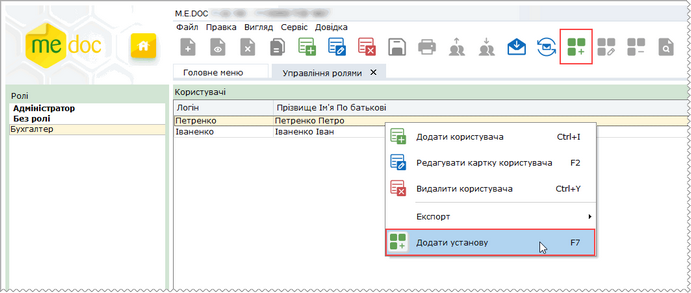

Натисніть, щоб збільшити малюнок

Відкриється вікно Установи. Оберіть потрібну установу та натисніть кнопку ОК. Щоб швидко обрати всі установи, встановіть відмітку у заголовку таблиці.

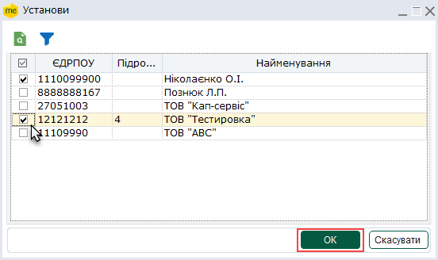

Установу буде додано в перелік установ, до яких користувач має доступ. За необхідності, установу можна видалити з переліку, натиснувши на кнопку  панелі інструментів.

[До початку](#ucmanageroles-ucmanageroles)

Налаштування доступу до підсистем

1. Натисніть 2 рази лівою кнопкою миші на назві ролі.

2. Для налаштування прав використання окремих компонентів системи, а також функцій обраних компонентів, встановіть відмітки напроти тих модулів програми, до яких дозволено доступ.

Розгорніть модуль для перегляду його вмісту та оберіть компонент, до якого необхідно налаштувати права доступу. Справа на панелі відобразиться перелік доступних дій по даному модулю. За замовчанням всі відмітки встановлено, тобто в межах даної ролі надано доступ до всіх дій.

3. Для того, щоб заборонити використання якоїсь дії, зніміть галочку напроти цієї опції.

Модулі та розділи програми, для яких налаштовано доступ не до всіх наявних функцій, позначаються відмітками сірого кольору.

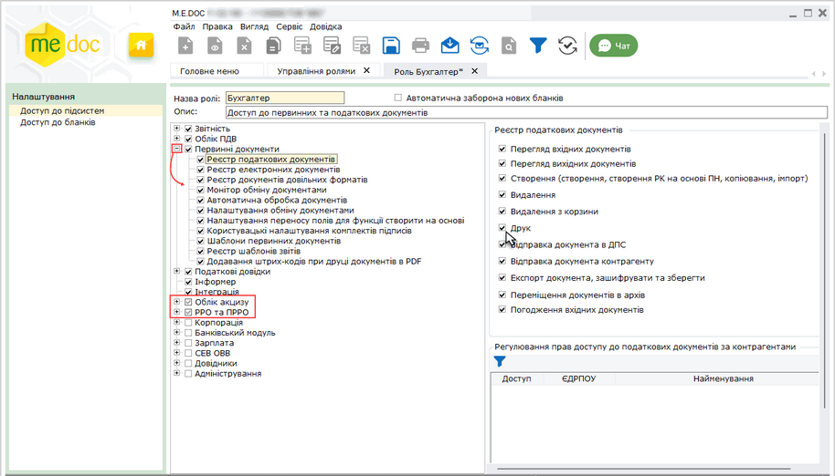

Натисніть, щоб збільшити малюнок

Налаштування доступу до первинних документів за контрагентами

Можливо налаштувати доступ до первинних документів за контрагентами.

Налаштування виконується окремо для податкових документів та окремо для електронних документів у відповідних підрозділах.

Встановіть галочки напроти тих контрагентів, до яких дозволено доступ:

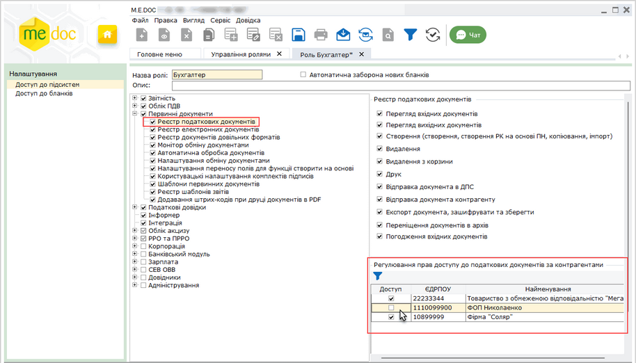

Натисніть, щоб збільшити малюнок

Зверніть увагу: щоб налаштувати доступ до первинних документів за контрагентами, до обраної ролі повинна бути [додана хоча б одна установа](#ucmanageroles-ucmanageroles). У доданій установі повинні буди збережені дані контрагентів у довіднику [Контрагенти](UCPartnerRst.html#ucpartnerrst-sprpartner).

Якщо для модуля Адміністрування встановлено опцію Резервне копіювання та створення організації , для користувача доступна кнопка Створити підприємство у вікні вибору підприємства під час запуску програми. У вікні Майстра заповнення даних про підприємство для користувача доступні функції Реєстрація нового підприємства та Відновлення резервної копії.

Для збереження внесених даних, натисніть кнопку .

[До початку](#ucmanageroles-ucmanageroles)

Налаштування доступу до документів за кодом та найменуванням отримувача

Для налаштування доступу до документів за кодом та найменуванням отримувача:

1. У розділі налаштувань Первинні документи – Реєстр податкових документів (Первинні документи – Реєстр електронних документів), у блоці Регулювання доступу за кодом та найменуванням отримувача, залишить відмітки біля тих отримувачів, до документів яких потрібно надати доступ:

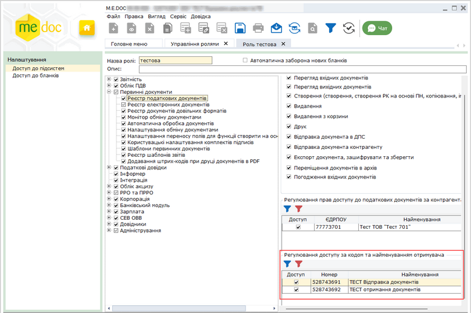

Натисніть, щоб збільшити малюнок

2. У відповідних модулях Реєстр податкових документів та/або Реєстр електронних документів користувачу будуть доступні лише ті вхідні документи, що містять зазначені код та найменування отримувача.

Дані у блоці Регулювання доступу за кодом та найменуванням отримувача відображаються лише у випадку, якщо для даної організації існують вхідні первинні документи, в яких присутні та заповнені поля Код отримувача та Найменування отримувача.

Зверніть увагу! Попередньо у шаблонах первинних документів, для яких передбачається налаштування доступу за отримувачем, за допомогою [Конструктора шаблонів](UCRtfDocTemplate.html#ucrtfdoctemplate-pdocs_shablon_constructor) необхідно додати поля: Код отримувача та Найменування отримувача (блок Основні поля):

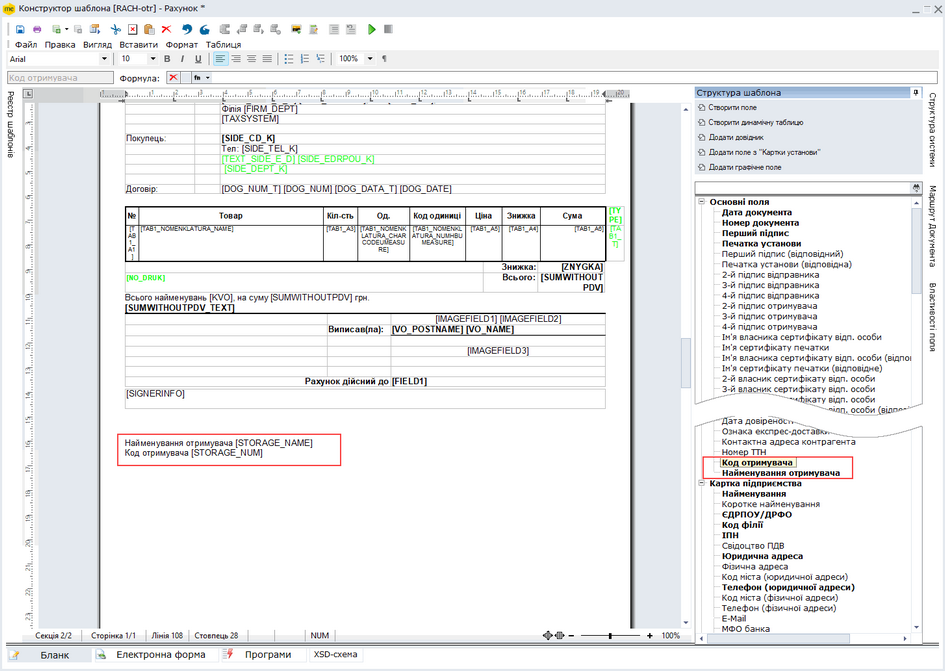

Натисніть, щоб збільшити малюнок

У таблиці Реєстру первинних документів найменування та код отримувача (якщо такі поля присутні у документі та заповнені) відображаються у колонках: Код отримувача та Найменування отримувача. Щоб відобразити/приховати поля скористайтеся Конфігуратором таблиці, натиснувши на панелі інструментів додано кнопку .

[До початку](#ucmanageroles-ucmanageroles)

Налаштування доступу до бланків

Містить перелік всіх доступних бланків (згідно обраного комплекту бланків звітності), а також надані розробником і самостійно створені шаблони первинних документів.

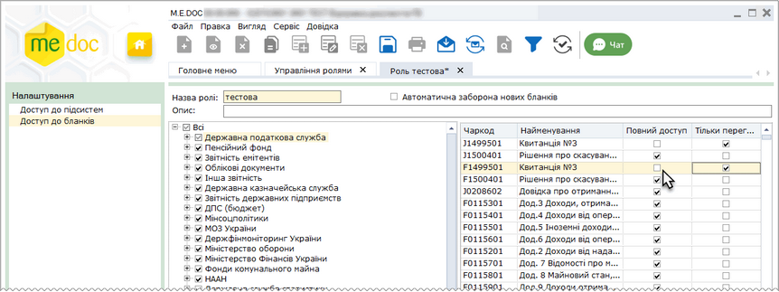

Натисніть, щоб збільшити малюнок

За замовчанням відображаються тільки актуальні бланки документів. Для відображення всіх існуючих у програмному комплексі бланків зніміть  позначку Актуальні бланки в меню Вигляд.

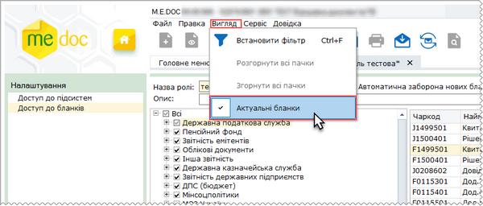

Натисніть, щоб збільшити малюнок

Записи, що позначені червоним кольором - бланки недійсних документів.

За замовчуванням доступ до всіх актуальних бланків надано (відмічено поле Повний доступ). Для того, щоб обмежити можливість створення звітів за певними бланками (чи групи бланків за призначенням/одержувачем), зніміть галочки напроти цих бланків. Встановлена позначка в полі Тільки перегляд вмикає режим «тільки для перегляду».

Встановити режим «тільки для перегляду» можна одразу для всіх бланків групи.

Для цього оберіть в меню Правка або контекстному меню пункт Відмітити "Тільки перегляд". Для всіх бланків обраної групи буде становлено режим «тільки для перегляду».

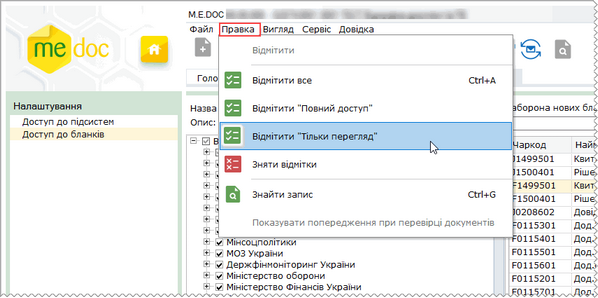

Натисніть, щоб збільшити малюнок

Для того, щоб обмежити можливість створення звітів за новими бланками, встановіть позначку Автоматична заборона нових бланків. Надалі при появі нових бланків доступ до них не буде надаватись автоматично.

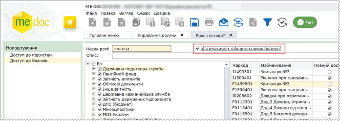

Натисніть, щоб збільшити малюнок

- Нові ролі за замовчуванням створюються із забороненими неактуальними бланками.
- Якщо знімаються/проставляються доступи в бланках, що мають зв'язані форми, то автоматично галочки знімаються/проставляються в усій групі зв'язаних форм.
- Якщо обмежено доступ до бланків, що мають прямі функції створення (наприклад: Додаток 2 до Податкової накладної - функція Створити Додаток 2 на основі ПН або Податкова декларація з ПДВ - однойменний модуль), то, відповідно, функції створення будуть також заблоковані.

Для збереження внесених даних, натисніть кнопку

[До початку](#ucmanageroles-ucmanageroles)

Налаштування доступу до операцій створення документів за допомогою команди Створити на основі

Документи, створені на [основі існуючих](Creat_doc_.html#creat_doc_-creat_doc_), зберігаються у відповідних реєстрах: Податкова накладна та Додаток 2 - у Реєстрі податкових документів, інші електронні первинні документи - у Реєстрі електронних документів.

Для надання доступу користувачам до створення електронних документів на основі податкових документів та/або створення податкових документів на основі електронних документів необхідно виконати налаштування у відповідних підрозділах:

- у підрозділі Реєстр податкових документів:
- встановлена опція Створення (створення, створення РК на основі ПН, копіювання, імпорт), означає, що при створенні електронних документів за допомогою функції Створити на основі – [Власні налаштування](UCRtfFromDocSettings.html#ucrtffromdocsettings-ucrtffromdocsettings) для ролі перевірятиметься доступність опції Реєстр електронних документів – Створення (створення електронних документів, копіювання, імпорт), якщо створення електронних документів заборонено, то відповідні документи не відображатимуться в переліку доступних для створення.

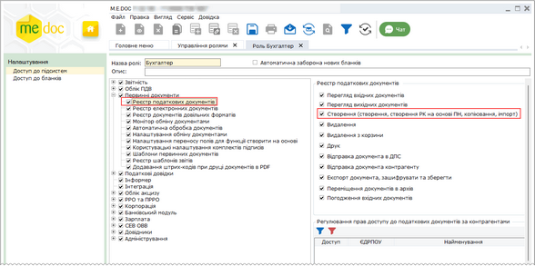

Натисніть, щоб збільшити малюнок

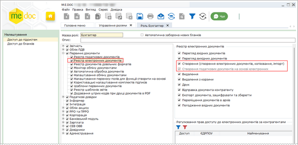

Натисніть, щоб збільшити малюнок

- у підрозділі Реєстр електронних документів:
- опція Створення податкових документів на основі електронних недоступна для редагування, встановлення/видалення опції відбувається шляхом встановлення/видалення опції Реєстр податкових документів – Створення (створення, створення РК на основі ПН, копіювання, імпорт). Якщо опцію не встановлено, для користувача недоступні підпункти створення податкових документів у меню функції Створити на основі та функції Створити на основі - Власні налаштування.

[До початку](#ucmanageroles-ucmanageroles)

Експорт та імпорт ролі

Експорт ролі

Для того, щоб експортувати дані ролі виконайте дії в наступній послідовності:

1. На панелі Ролі оберіть роль, до яку потрібно експортувати.

2. Натисніть кнопку  на панелі інструментів:

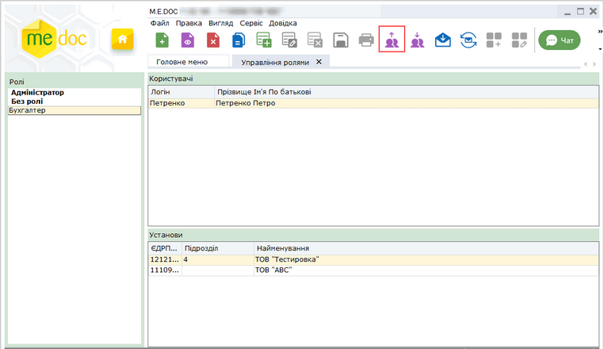

Натисніть, щоб збільшити малюнок

3. У вікні, що відкриється оберіть шлях для збереження файлу з налаштуваннями ролі, натисніть ОК:

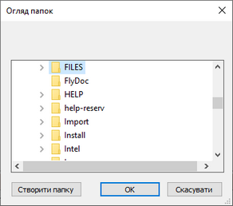

Натисніть, щоб збільшити малюнок

4. Налаштування ролі будуть збережені у файл формату JSON, ім’я файлу відповідає назві імпортованої ролі. У файлі зберігається інформація про налаштування доступу до підсистем, налаштування доступу до операцій у підсистемі та доступу до бланків документів.

Зверніть увагу, перелік підключених до ролі користувачів та установ не експортується.

Для підсистем Реєстр податкових документів, Реєстр електронних документів та Фінансова звітність за МСФЗ не експортуються налаштування прав доступу до документів за ЄДРПОУ контрагентів.

Імпорт ролі

Для того, щоб імпортувати налаштування ролі у програму виконайте дії в наступній послідовності:

1. Натисніть кнопку  на панелі інструментів:

Натисніть, щоб збільшити малюнок

2. У вікні, що відкриється, оберіть файл, у якому збережені налаштування ролі, натисніть ОК:

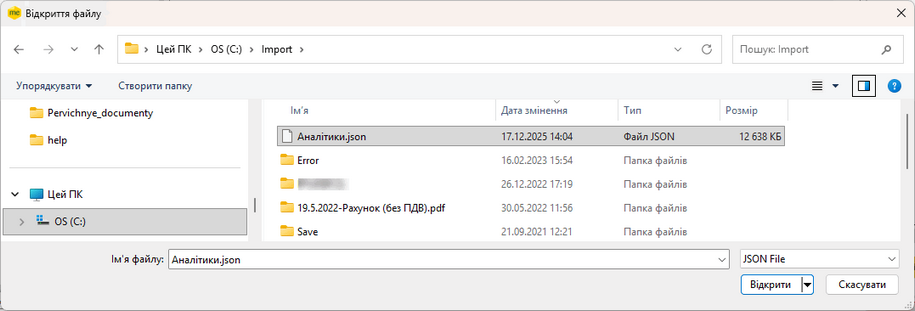

Натисніть, щоб збільшити малюнок

3. Назва імпортованої ролі з'явиться на панелі Ролі:

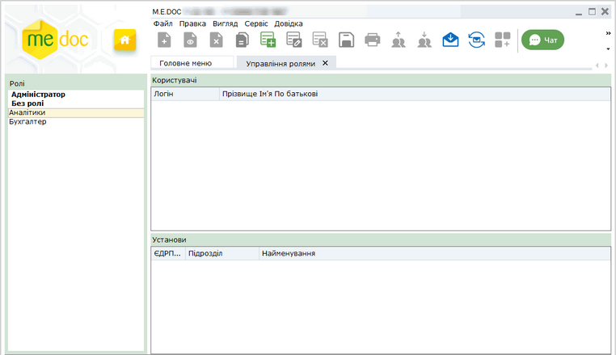

Натисніть, щоб збільшити малюнок

Зверніть увагу, імпортована у програму роль не містить користувачів та установи.

4. Якщо у програмі вже присутня роль з такою ж назвою, як та, що імпортується, програма запропонує обрати як саме слід імпортувати роль:

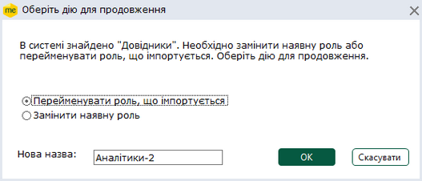

Натисніть, щоб збільшити малюнок

Встановіть позначку, що відповідають потрібному способу імпорту:

- Перейменувати роль, що імпортується - створити у програмі нову роль з новою назвою, при виборі цієї опції стає доступним поле Нова назва, у якому введіть назву ролі, що імпортується, для збереження її у програмі. При такому способі імпорту налаштування ролі, що вже існує у програмі, не змінюються, а роль, що імпортується, зберігається під новою назвою без налаштованих користувачів та підприємств. Цей спосіб використовується за замовчуванням;
- Замінити наявну роль - оновити налаштування доступу до підсистем та бланків у ролі, що вже існує у програмі, відповідно до даних ролі, що імпортується. Дані користувачів та підприємств, залишаються без змін.

[До початку](#ucmanageroles-ucmanageroles)


