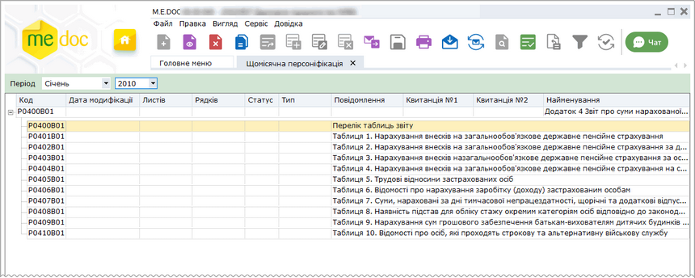

[← Зміст довідки](../)


# Щомісячна персоніфікація

## Щомісячна персоніфікація

_Шлях у довідці: Розділи програми › Звітність › Щомісячна персоніфікація_

Щомісячна персоніфікація подається тільки за 2010 р.

З 1 січня 2011 р. страхувальники формують та подають звіт по єдиному соціальному внеску.

Модуль Щомісячна персоніфікація призначений для створення та підготовки до подання в ПФУ щомісячної персоніфікованої звітності.

Натисніть, щоб збільшити малюнок

Всі перевірки, які діють у модулі, створені на основі вказаних нормативних документів, погоджені з ПФУ та проходять попередню перевірку в цій установі.


