[← Зміст довідки](../)


# Податкові накладні та Розрахунки коригування

## Податкові накладні та Розрахунки коригування

_Шлях у довідці: Розділи програми › Первинні документи › Реєстр податкових документів › Податкові накладні та Розрахунки коригування_

В цьому розділі:

[Створення податкової накладної](#ucnaklexchangerst-ucnaklexchangerst_)

[Створення Розрахунку коригування](#ucnaklexchangerst-ucnaklexchangerst_)

[Створення податкової накладної (експортне забезпечення)](#ucnaklexchangerst-ucnaklexchangerst_)

[Створення Розрахунку коригування (експортне забезпечення)](#ucnaklexchangerst-ucnaklexchangerst_)

[Реєстрація Розрахунку коригування, якщо передбачається зменшення суми компенсації вартості товарів/послуг їх постачальнику](#ucnaklexchangerst-ucnaklexchangerst_)

- [Процедура реєстрації Розрахунку коригування у випадку, коли Ви є постачальником (продавцем)](#ucnaklexchangerst-ucnaklexchangerst_)
- [Процедура реєстрації Розрахунку коригування у випадку, коли Ви є отримувачем (покупцем)](#ucnaklexchangerst-ucnaklexchangerst_)
- [Відкликання від'ємного Розрахунку коригування, який був відправлений контрагенту-покупцю для здійснення реєстрації](#ucnaklexchangerst-ucnaklexchangerst_)

[Відправлення податкових документів електронною поштою](#ucnaklexchangerst-ucnaklexchangerst_)

[Реєстрація податкових накладних та Розрахунків коригування у Єдиному реєстрі](#ucnaklexchangerst-ucnaklexchangerst_)

[Прийом податкових документів](#ucnaklexchangerst-ucnaklexchangerst_)

[Імпорт електронних податкових накладних](#ucnaklexchangerst-ucnaklexchangerst_)

[Друк податкових документів](#ucnaklexchangerst-ucnaklexchangerst_)

У модулі Первинні документи - Реєстр податкових документів можливо виконати створення, імпорт-експорт та збереження податкових накладних та розрахунків коригування з метою обміну даними документами з контрагентами та контролюючими органами. Електронні податкові накладні використовуються також при формуванні [Реєстру виданих та отриманих податкових накладних](UCDocNaklRstMain5.html#ucdocnaklrstmain5-docnaklrst). Ви можете обмінюватись податковими документами з вашими контрагентами за допомогою електронної пошти (з використанням ЕП). Для цього Вам потрібно мати сертифікат ЕП печатки цих контрагентів.

Податкові документи представлені у таблиці модуля окремими рядками. Рядок відображає коротку основну інформацію документа. Переглянути документ більш детальніше можна у окремому вікні, яке відкривається подвійним кліком по потрібному запису.

Всі податкові документи, що містяться у даному розділі, умовно поділені за напрямком на Видані та Отримані.

Видані - видані документи. Також передбачений  імпорт документів, створених в інших бухгалтерських системах.

Отримані - це отримані від контрагентів документи електронною поштою (або передані на електронному носієві), які можна імпортувати у таблицю.

Всі податкові накладні (видані/отримані) додаються у [Реєстр виданих та отриманих податкових накладних](UCDocNaklRstMain5.html#ucdocnaklrstmain5-docnaklrst).

У разі, якщо є необхідність порівняти вміст кількох документів, можна відкрити ці документи у [окремих вікнах програми](UCPravila.html#ucpravila-pravyla). Щоб відкрити документ у окремому вікні, виділіть документ у таблиці реєстру та скористайтеся одним із способів:

- у головному меню програми виконайте команду Вигляд – Перегляд у вікні;
- виконайте команду контекстного меню Перегляд у вікні.

Створення податкової накладної

Створений документ Податкова накладна отримує статус Вихідний.

1. Оберіть один із способів створення документа:

- На панелі інструментів виберіть команду Створити та далі оберіть документ потрібного типу: Податкова накладна;

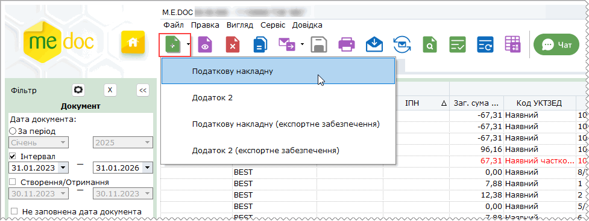

- Виберіть команду меню Файл - Створити та оберіть документ потрібного типу: Податкова накладна;
- Оберіть команду контекстного меню Створити та виберіть документ потрібного типу.

2. У окремому вікні відкриється бланк документа, який потрібно заповнити.

Доступні для заповнення та редагування поля підсвічені жовтим кольором.

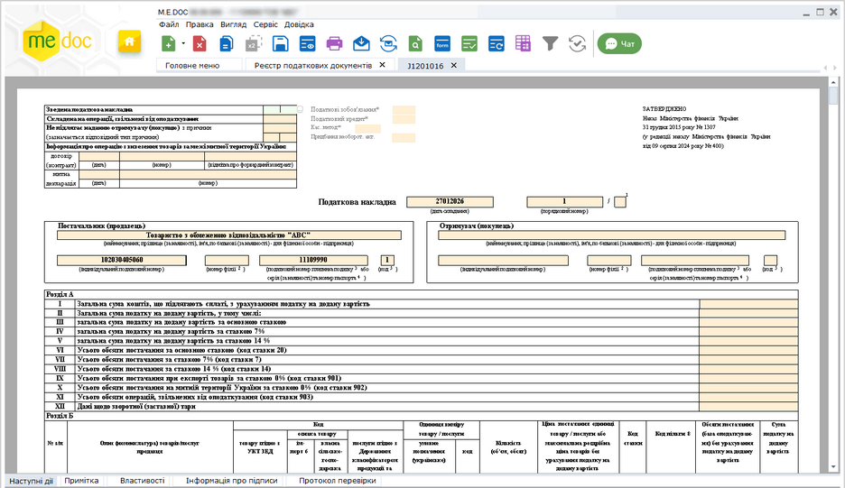

Натисніть, щоб збільшити малюнок

В ПН присутні [поля розробника](UCPravila.html#ucpravila-pravyla):

- поля Податкові зобов'язання, Податковий кредит, Касовий метод, Придбання необорот. акт. — потрібні для коректного рознесення даних в поля Декларації;

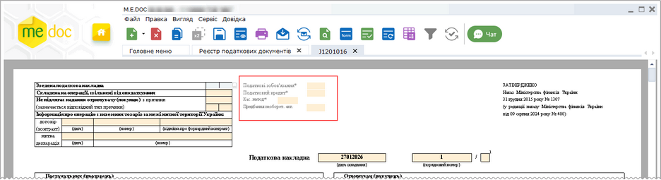

Натисніть, щоб збільшити малюнок

- поле Згідно рахунку-фактури — використовується платниками, які ведуть облік у розрізі рахунків-фактур та/або Договорів;
- поле Вид цивільно-правового договору — використовується для відображення зв'язаних документів.

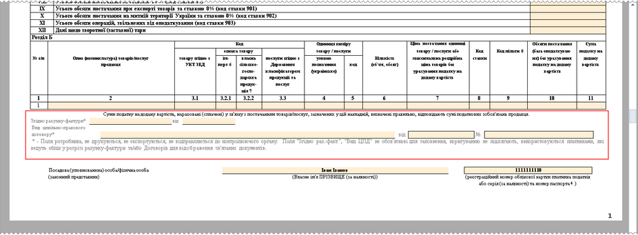

Натисніть, щоб збільшити малюнок

У разі складання ПН за операціями з постачання послуг отримувачу (покупцю) нерезиденту, місце постачання яких розташоване на митній території України, у графі Не підлягає наданню отримувачу (покупцю) з причини обирається тип причин 21 «Складена на постачання послуг отримувачу (покупцю) нерезиденту, місце постачання яких розташоване на митній території України», такі ПН не підлягають наданню отримувачу (покупцю). У графі Отримувач (покупець) зазначають:

- найменування (П.І.Б.) нерезидента та через кому країну, в якій зареєстровано покупця (нерезидента);
- у графі індивідуальний податковий номер отримувача (покупця) проставляють умовний ІПН «500000000000»;
- графу податковий номер платника податку або серія (за наявності) та номер паспорта не заповнюють.

3. На панелі стану документа виберіть закладку Наступні дії і натисніть Перевірити документ.

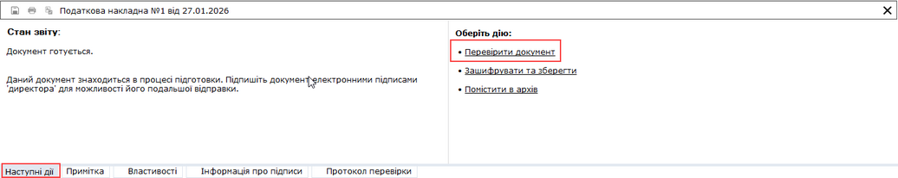

Натисніть, щоб збільшити малюнок

Перевіряється наявність заповнення обов’язкових полів у документі і у випадку відсутності обов’язкових даних, система підсвітить червоним кольором поля, що необхідно заповнити.

Виправте помилки та знову виконайте перевірку.

6. Збережіть документ, натиснувши кнопку  або комбінацію клавіш Ctrl+S.

[До початку](#ucnaklexchangerst-ucnaklexchangerst_)

Створення Розрахунку коригування

Створений документ Податкова накладна або Додаток 2 отримує статус Вихідний.

1. Оберіть один із способів створення документа:

- На панелі інструментів виберіть команду Створити та далі оберіть документ потрібного типу: Додаток 2;

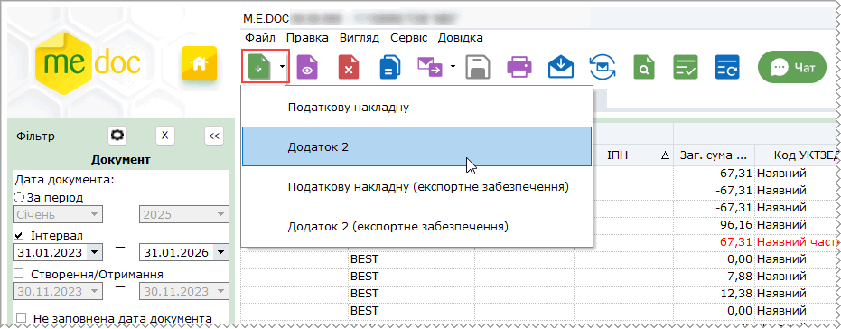

- Виберіть команду меню Файл - Створити та оберіть документ потрібного типу: Податкова накладна або Додаток 2;
- Оберіть команду контекстного меню Створити та виберіть документ потрібного типу.

2. У окремому вікні відкриється бланк документа, який потрібно заповнити.

Доступні для заповнення та редагування поля підсвічені жовтим кольором.

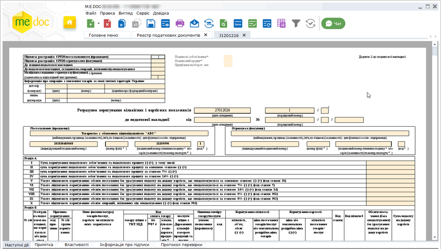

Натисніть, щоб збільшити малюнок

В РК присутні [поля розробника](UCPravila.html#ucpravila-pravyla):

- поля Податкові зобов'язання, Податковий кредит, Придбання необорот. акт. — потрібні для коректного рознесення даних в поля Декларації;

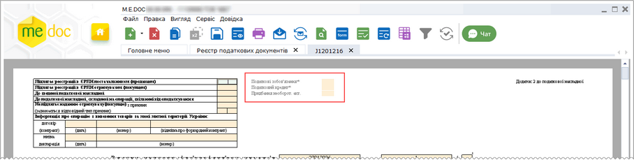

Натисніть, щоб збільшити малюнок

- поле Згідно рахунку-фактури — використовується платниками, які ведуть облік у розрізі рахунків-фактур та/або Договорів;
- поле Вид цивільно-правового договору — використовується для відображення зв'язаних документів.

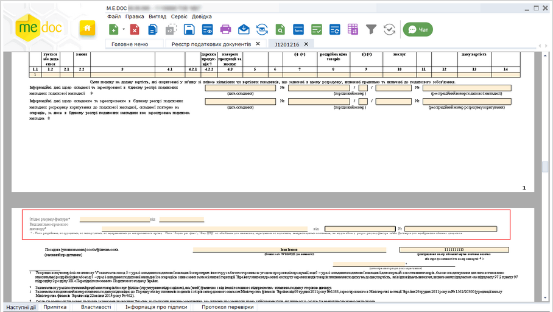

Натисніть, щоб збільшити малюнок

3. На панелі стану документа виберіть закладку Наступні дії і натисніть Перевірити документ.

Перевіряється наявність заповнення обов’язкових полів у документі і у випадку відсутності обов’язкових даних, система підсвітить червоним кольором поля, що необхідно заповнити.

Виправте помилки та знову виконайте перевірку.

6. Збережіть документ, натиснувши кнопку  або комбінацію клавіш Ctrl+S.

[До початку](#ucnaklexchangerst-ucnaklexchangerst_)

Створення податкової накладної (експортне забезпечення)

Створений документ Податкова накладна (експортне забезпечення) отримує статус Вихідний.

1. Оберіть один із способів створення документа:

- На панелі інструментів виберіть команду Створити та далі оберіть документ потрібного типу: Податкова накладна (експортне забезпечення);

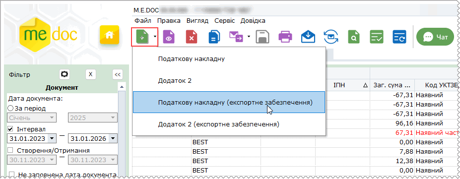

- Виберіть команду меню Файл - Створити та оберіть документ потрібного типу: Податкова накладна (експортне забезпечення);
- Оберіть команду контекстного меню Створити та виберіть документ потрібного типу.

2. У окремому вікні відкриється бланк документа, який потрібно заповнити.

- Доступні для заповнення та редагування поля підсвічені жовтим кольором.
- Значення поля Не підлягає наданню отримувачу (покупцю) з причини заповнюється автоматично кодом 22 – «Складена на операції з вивезення за межі митної території України у митному режимі експорту окремих видів товарів». Значення поля не можна змінити.
- Поле індивідуальний податковий номер за замовчуванням заповнюється умовними ІПН - 300000000000. Значення поля не можна змінити.

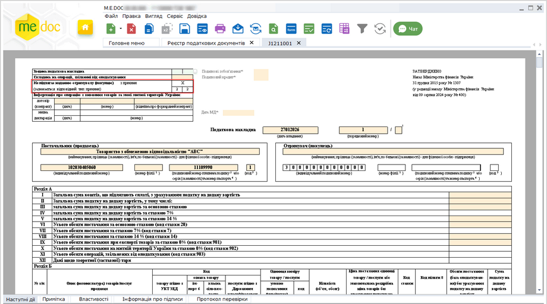

Натисніть, щоб збільшити малюнок

В ПН присутні [поля розробника](UCPravila.html#ucpravila-pravyla):

- поля Податкові зобов'язання, Податковий кредит, Касовий метод, Придбання необорот. акт. — потрібні для коректного рознесення даних в поля Декларації;

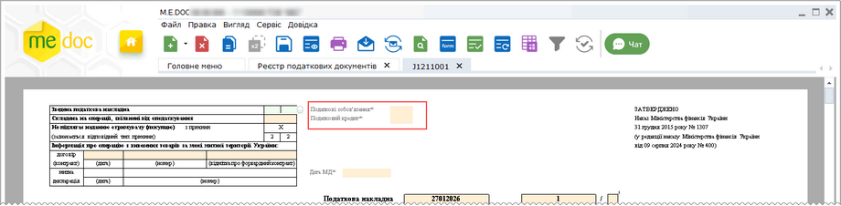

Натисніть, щоб збільшити малюнок

- поле Згідно рахунку-фактури — використовується платниками, які ведуть облік у розрізі рахунків-фактур та/або Договорів;
- поле Вид цивільно-правового договору — використовується для відображення зв'язаних документів.

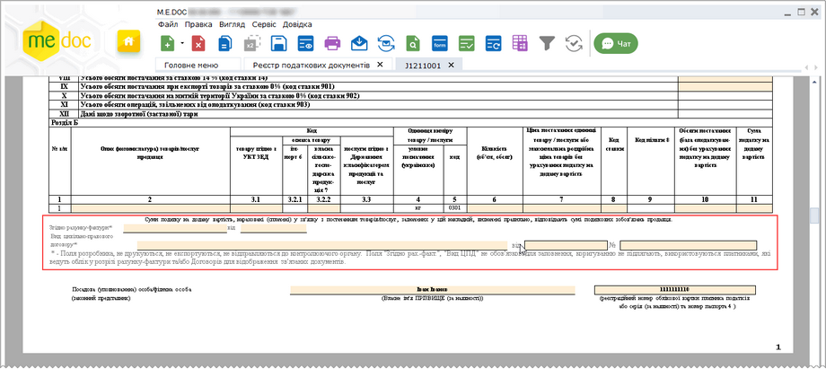

Натисніть, щоб збільшити малюнок

3. На панелі стану документа виберіть закладку Наступні дії і натисніть Перевірити документ.

Перевіряється наявність заповнення обов’язкових полів у документі і у випадку відсутності обов’язкових даних, система підсвітить червоним кольором поля, що необхідно заповнити.

Виправте помилки та знову виконайте перевірку.

6. Збережіть документ, натиснувши кнопку  або комбінацію клавіш Ctrl+S.

[До початку](#ucnaklexchangerst-ucnaklexchangerst_)

Створення Розрахунку коригування (експортне забезпечення)

Створений документ Додаток 2 (експортне забезпечення) отримує статус Вихідний.

1. Оберіть один із способів створення документа:

- На панелі інструментів виберіть команду Створити та далі оберіть документ потрібного типу: Додаток 2 (експортне забезпечення);

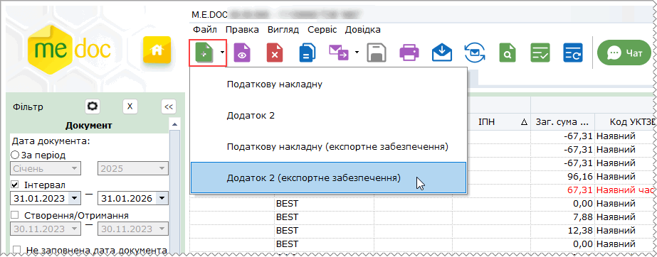

- Виберіть команду меню Файл - Створити та оберіть документ потрібного типу: Додаток 2 (експортне забезпечення);
- Оберіть команду контекстного меню Створити та виберіть документ потрібного типу.

2. У окремому вікні відкриється бланк документа, який потрібно заповнити.

- Доступні для заповнення та редагування поля підсвічені жовтим кольором.
- Значення поля Не підлягає наданню отримувачу (покупцю) з причини заповнюється автоматично кодом 22 – «Складена на операції з вивезення за межі митної території України у митному режимі експорту окремих видів товарів». Значення поля не можна змінити.
- Поле індивідуальний податковий номер за замовчуванням заповнюється умовними ІПН - 300000000000. Значення поля не можна змінити.

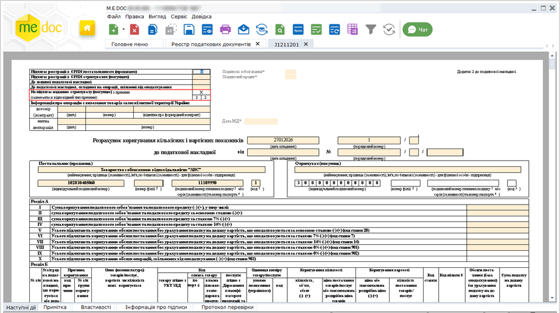

Натисніть, щоб збільшити малюнок

В РК присутні [поля розробника](UCPravila.html#ucpravila-pravyla):

- поля Податкові зобов'язання, Податковий кредит, Придбання необорот. акт. — потрібні для коректного рознесення даних в поля Декларації;

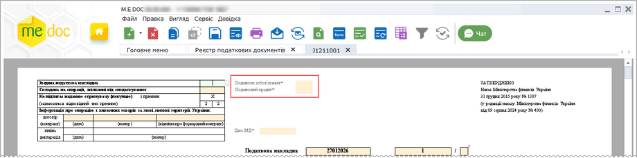

Натисніть, щоб збільшити малюнок

- поле Згідно рахунку-фактури — використовується платниками, які ведуть облік у розрізі рахунків-фактур та/або Договорів;
- поле Вид цивільно-правового договору — використовується для відображення зв'язаних документів.

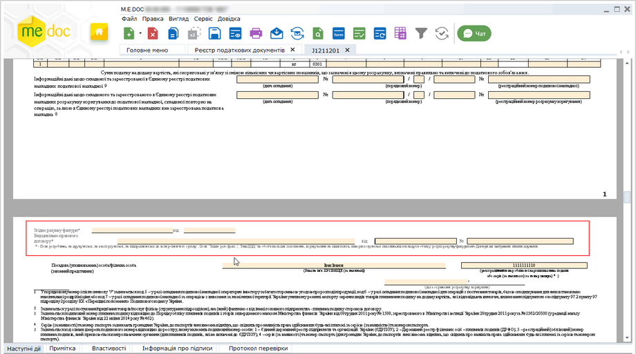

Натисніть, щоб збільшити малюнок

3. На панелі стану документа виберіть закладку Наступні дії і натисніть Перевірити документ.

Перевіряється наявність заповнення обов’язкових полів у документі і у випадку відсутності обов’язкових даних, система підсвітить червоним кольором поля, що необхідно заповнити.

Виправте помилки та знову виконайте перевірку.

6. Збережіть документ, натиснувши кнопку  або комбінацію клавіш Ctrl+S.

[До початку](#ucnaklexchangerst-ucnaklexchangerst_)

Реєстрація Розрахунку коригування, якщо передбачається зменшення суми компенсації вартості товарів/послуг їх постачальнику

Згідно Наказу Міністерства фінансів України 22.09.2014  № 957 (у редакції наказу Міністерства фінансів України 14.11.2014  № 1129ст. Розрахунок коригування, складений постачальником (продавцем) товарів (послуг) до податкової накладної, яка видана їх отримувачу - платнику податку, підлягає реєстрації в Реєстрі:

постачальником (продавцем) товарів/послуг, якщо передбачається збільшення суми компенсації їх вартості на користь такого постачальника (продавця) або якщо коригування кількісних та вартісних показників у підсумку не змінює суму компенсації;

отримувачем (покупцем) товарів/послуг, якщо передбачається зменшення суми компенсації вартості товарів/послуг їх постачальнику (продавцю), для чого постачальник (продавець) надсилає складений розрахунок коригування отримувачу (покупцю). З цією метою постачальник (продавець) складає у загальному порядку розрахунок коригування, у верхній лівій частині якого робить відповідну помітку „Х”, та надсилає його отримувачу (покупцю). Накладання електронних підписів посадових осіб постачальника (продавця) та отримувача (покупця) на такий розрахунок коригування здійснюється у порядку, визначеному законодавством.

У відповідності до цих вимог у програмному комплексі реалізовано функцію реєстрації Розрахунку коригування у Єдиному реєстрі для покупців.

Процедура реєстрації Розрахунку коригування у випадку, коли Ви є постачальником (продавцем)

1. На панелі стану документа виберіть закладку Наступні дії і натисніть Відправити контрагенту. (Зверніть увагу, пункт Відправити в ДПС відсутній, незалежно від обраного маршруту обробки документів).

Бланк документа, що відправляється, має бути перевіреним та збереженим.

2. На виконання команди автоматично розпочнеться стандартна процедура підпису документа ЕП, після чого Розрахунок коригування автоматично буде відправлений контрагенту.

3. Контрагент, отримавши від Вас Розрахунок коригування, виконує реєстрацію документа у Єдиному реєстрі.

Під час відправки Розрахунку коригування на реєстрацію, контрагент виконує накладання своїх підписів на документ.

4. Після того як контрагент отримав Квитанцію №1 з результатами обробки документа у ДПС, він повертає Вам Розрахунок коригування з отриманою квитанцією.

5. Якщо Ви отримали від контрагента Розрахунок коригування, який був відхилений у ДПС, необхідно відкоригувати документ, після чого повторити процедуру реєстрації документа контрагентом.

Процедура реєстрації Розрахунку коригування у випадку, коли Ви є отримувачем (покупцем)

1. Отримавши Розрахунок коригування, що містить від'ємне значення ПДВ виконайте його реєстрацію у Єдиному реєстрі: на панелі стану документа виберіть закладку Наступні дії і натисніть Відправити в ДПС. (Зверніть увагу, пункт Відправити контрагенту відсутній, незалежно від обраного маршруту обробки документів).

2. На виконання команди автоматично розпочнеться стандартна процедура підпису документа ЕП, після чого Розрахунок коригування буде відправлений в ДПС.

3. Після того як Ви отримаєте Квитанцію №1 з результатами обробки документа у ДПС, надішліть документ контрагенту. Для цього виберіть закладку Наступні дії і натисніть Відправити контрагенту.

4. Якщо Розрахунок коригування був відхилений у ДПС, контрагент виконає необхідні правки і надішле Вам документ ще раз. У такому випадку повторіть реєстрацію, як описано вище.

Відкликання від'ємного Розрахунку коригування, який був відправлений контрагенту-покупцю для здійснення реєстрації

Функція доступна для від’ємних РК, відправка яких здійснювалася через Платформу ПТАХ. Налаштувати відправку документів можна у розділі [Адміністрування - Параметри системи - Документообіг](FormCompanyParams.html#formcompanyparams-admcompanyparams_sdo).

Відкликання можливо для документів на боці підприємства продавця за умови, що одержувач від’ємних РК не здійснив їх реєстрацію у ЄРПН. У документі РК обов'язкова встановлена ознака Підлягає реєстрації в ЄРПН отримувачем (покупцем).

1. У таблиці модуля Реєстр податкових документів оберіть відправлений контрагенту Розрахунок коригування, який необхідно відкликати.

2. На панелі стану документа оберіть закладку Наступні дії і натисніть Відкликати документ.

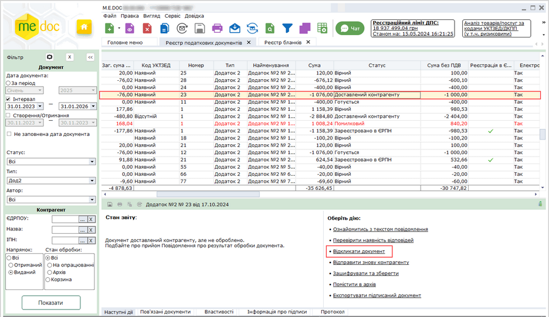

Натисніть, щоб збільшити малюнок

3. У вікні, що відкриється вкажіть причину відкликання Розрахунку коригування та натисніть ОК.

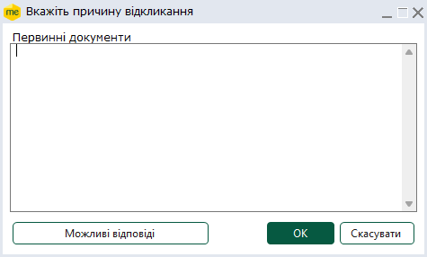

Ви можете ввести пояснення вручну або обрати його з довідника, натиснувши кнопку Можливі відповіді. Причина відкликання доступна на вкладці Протокол відкликаного РК.

4. Після успішного виконання операції для контрагента-покупця функція відправки РК на реєстрацію у ЄРПН буде заблокована.

Документ набуває статусу Відкликаний.

Якщо покупець вже виконав відправку отриманого від’ємного РК на реєстрацію, при спробі відкликання відправник отримає повідомлення про неможливість виконати операцію.

[До початку](#ucnaklexchangerst-ucnaklexchangerst_)

Відправлення податкових документів електронною поштою

Вихідні документи електронною поштою відправляються в [ДПС](#ucnaklexchangerst-ucnaklexchangerst_) та контрагентам.

ПН/РК з умовними ІПН 100000000000, 200000000000, 300000000000, 400000000000, 500000000000 та 600000000000 відправляються тільки на реєстрацію в ДПС.

РК з від’ємними сумами та ІПН контрагента відправляються тільки контрагенту.

1. Відправте документ, обравши один із способів:

- з бланка відкритого документа або із таблиці первинних документів на панелі стану документа виберіть закладку Наступні дії і натисніть Відправити в ДПС або Відправити контрагенту:

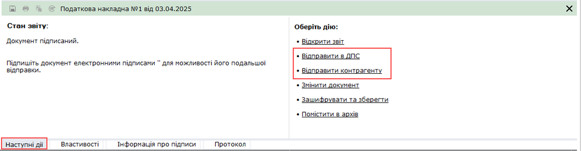

Натисніть, щоб збільшити малюнок

Бланк документа, що відправляється, має бути перевіреним та збереженим.

- у таблиці первинних документів виберіть потрібний документ (або декілька документів) та у меню Файл оберіть команду Відправити - Відправити контрагенту або Відправити в ДПС:

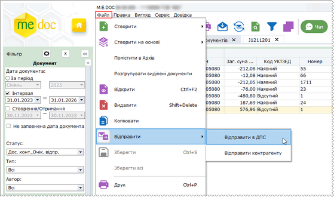

Натисніть, щоб збільшити малюнок

Функція відправки документів доступна також на панелі інструментів - кнопка  або із контекстного меню - однойменна опція.

Зверніть увагу! Для документів, відправлених електронною поштою, функція видалення заблокована.

2. На виконання команди автоматично розпочнеться стандартна процедура підпису документа ЕП, після чого податкові накладні автоматично будуть відправлені отримувачу. Після отримання контрагентом накладних надійде повідомлення про доставку.

[До початку](#ucnaklexchangerst-ucnaklexchangerst_)

Реєстрація Податкових накладних та Розрахунків коригування у Єдиному реєстрі

1. Реєстрація податкових накладних у Єдиному реєстрі відбувається шляхом відправлення документів електронною поштою:

- у вікні відкритого документа, виберіть закладку Наступні дії і натисніть Відправити в ДПС

Натисніть, щоб збільшити малюнок

- або у таблиці документів виділіть потрібний документ (або декілька документів) та у меню Файл оберіть команду Відправити в ДПС.

2. На виконання команди автоматично розпочнеться стандартна процедура підпису документа ЕП, після чого документи автоматично будуть відправлені отримувачу.

3. Як тільки в органах ДПС був прийнятий звіт, генерується Повідомлення про прийом документа та Квитанція з результатами обробки документа, які надсилаються відправникові.

[До початку](#ucnaklexchangerst-ucnaklexchangerst_)

Прийом податкових документів

Обмін податковими документами у програмному комплексі реалізовано у форматі XML.

Зверніть увагу! Для документів, відправлених електронною поштою, функція видалення заблокована.

Відправлені контрагентом електронною поштою податкові накладні (Додаток 2) надходять як звичайна вхідна кореспонденція.

Отримані податкові документи поміщаються у групі Вхідні, стан Отримані. Як тільки документи отримано, відправнику надійде повідомлення про доставку.

Користувач може переглянути отримані накладні та прийняти рішення: погодити документ або відхилити.

Для цього на панелі стану документа, виберіть закладку Наступні дії і натисніть Погодити документ або Відхилити документ.

Якщо обрано Погодити документ, документ набуде статусу Затверджено. При цьому відправнику документа буде надіслано повідомлення про прийняття документа, затверджене Вашим ЕП. У відправника після отримання цього повідомлення накладні набувають статусу Затверджено контрагентом.

Прийняті податкові документи можуть бути використані для формування Реєстру виданих та отриманих податкових накладних. Для цього потрібно виконати процедуру завантаження накладних до реєстру.

Якщо обрано Відхилити документ, потрібно вказати причину відмови у вікні, що відкриється.

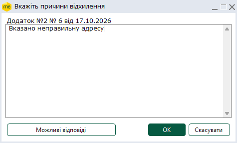

При цьому документ набуде статусу Відхилено. Відправнику документа також надійде повідомлення про відхилення та накладні перейдуть у статус Відхилено контрагентом.

Відхилені податкові документи не використовуються при формуванні Реєстру виданих та отриманих податкових накладних.

Можливо скористатися довідником уживаних причин відхилення документів. Щоб обрати відповідь з довідника натисніть кнопку Можливі відповіді, та у вікні, що відкрилось, оберіть потрібний текст.

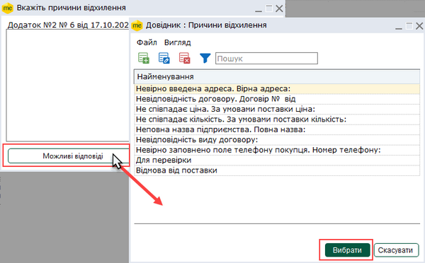

Натисніть, щоб збільшити малюнок

За допомогою кнопок панелі інструментів вікна Довідник: Причини відхилення можливо:

|  |  |  |
| --- | --- | --- |
|  | Додати | Додати нове значення довідника |
|  | Видалити | Вилучити значення з довідника |
|  | Редагувати | Змінити обране значення |

[До початку](#ucnaklexchangerst-ucnaklexchangerst_)

Імпорт податкових документів

Обмін податковими документами у програмному комплексі реалізовано у форматі XML.

Проімпортовані документи можливо видалити із списку накладних, якщо це необхідно.

Для того, щоб імпортувати електронні податкові документи виконайте дії у наступній послідовності:

1. У меню Файл оберіть команду Імпорт - Імпорт звітів.

2. Вкажіть шлях де розміщено документи у форматі XML.

3. Розпочнеться процес імпорту, про успішне виконання якого буде повідомлено користувача.

Документи, що були додані у програмний комплекс таким чином, також використовуються для формування Реєстру виданих та отриманих податкових накладних.

[До початку](#ucnaklexchangerst-ucnaklexchangerst_)

Друк податкових документів

Для друку однієї або декількох податкових документів виконайте такі дії:

1. В Реєстрі податкових документів виділіть документи, які потрібні роздрукувати.

2. Оберіть один із наступних способів:

- на панелі інструментів натисніть кнопку  Друк;
- виберіть команду Файл - Друк;
- у контекстному меню оберіть команду Друк;
- натисніть комбінацію клавіш Ctrl+P.

3. Відкриється вікно Друк.

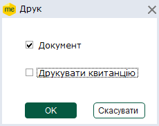

4. Встановіть позначки напроти потрібних опцій.

5. Натисніть кнопку ОК.

6. Відкриється стандартне вікно Друк. Встановіть потрібні параметри згідно налаштувань вашого принтера та натисніть кнопку Друк.

Також функція друку доступна у вікні відкритого документа. Для цього оберіть один із наступних способів:

- на панелі інструментів натисніть кнопку  Друк;
- виберіть команду Файл - Друк;
- натисніть комбінацію клавіш Ctrl+P.

[До початку](#ucnaklexchangerst-ucnaklexchangerst_)


