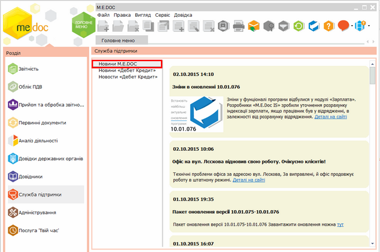
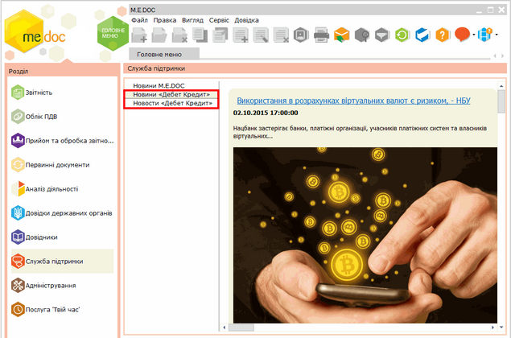

[← Зміст довідки](../)


# Новини

## Новини

_Шлях у довідці: Додатково: UCNewsMain › Новини_

З метою інформування користувачів про останні новини від розробника програмного комплексу, а також останні бухгалтерські новини в модулі Служба підтримки розміщено Новини.

В розділі Новини M.E.DOC представлена стрічка новин від розробника програмного комплексу.

Новини в даному розділі дублюють інформацію з сайту розробника  [http://me-doc.com.ua/pages/news.php](http://me-doc.com.ua/pages/news.php).

Натисніть, щоб збільшити малюнок

Непрочитані новини відображаються в системі оповіщень  на панелі інструментів.

В даний модуль інтегровано стрічку новин від інформаційного порталу "Дебет-Кредит".
Новини представлені українською та російською мовами.

Для більш детального ознайомлення з опублікованою статтею, натисніть на заголовок статті. В браузері відкриється сторінка зі статтею на інтернет-порталі "Дебет-Кредит".

Натисніть, щоб збільшити малюнок


