[← Зміст довідки](../)


# Картка підприємства

## Картка підприємства

_Шлях у довідці: Розділи програми › Довідники › Картка підприємства_

Картка підприємства містить реквізити установи - реєстраційні та інформаційні дані організації. Цими даними автоматично заповнюються "шапки" та інші стандартні поля створюваних користувачем звітних документів. Всі дані картки використовуються в тих чи інших документах, тому слід відразу заповнити всі її поля.

Деякі поля картки обов'язкові для заповнення і виділяються кольором. Якщо таке поле в картці залишиться незаповненим, то при переході на іншу закладку або збереженні запису на екрані з'явиться попередження про необхідність внесення значення.

Картка містить поля декількох типів, дані до яких вносяться різними способами.
Поля з кнопками мають підключені довідники і мають бути заповнені шляхом вибору значень із цих довідників. Ліва кнопка  відкриває відповідний довідник для вибору запису, права  - видаляє занесений запис. У полях, які повинні містити дату, кнопка  відкриває календар. Інші поля заповнюються вручну із клавіатури.

Більшість полів картки підприємства заповнюється при [створенні підприємства](Connect_org.html#connect_org-connect_org).

Модуль містить такі розділи:

- [Підприємство](#ucorg-sprorg_org). Основні реєстраційні дані поточного підприємства.
- [Пенсійний фонд](#ucorg-sprorg_pf). Дані, що стосуються Пенсійного Фонду.
- [Адреси](#ucorg-sprorg_adr). Перелік адрес установи.
- [Рахунки](#ucorg-sprorg_rah). Перелік рахунків установи.
- [Керівництво](#ucorg-sprorg_ruk). Дані керівників установи.
- [Засновники](#ucorg-sprorg_osn). Дані про засновників установи, їх внесок у грошовому еквіваленті у статутному фонді, адреси та телефони.
- [Додатково](#ucorg-sprorg_dop). Додаткові дані, що стосуються реєстрації установи в фонді соціального страхування, фонді по безробіттю, в територіальному органі ДКЦПФР, тощо.
- [Зразки підписів](#ucorg-sprorg_podp). Завантаження сканкопій зразків підписів та печатки установи.
- [Первинні документи](#ucorg-sprorg_perv). Дані, що використовуються при створенні первинних документів.
- [Історія в ЄДК](#ucorg-sprorg_edk). У розділі ведеться історія змін даних картки підприємства та оновлення цих даних в ЄДК.
- [Логотип](#ucorg-logo). У розділі здійснюється завантаження логотипа підприємства. Звантажений логотип, відображається на документах формату iXBRL при створенні звітності за міжнародними стандартами МСФЗ

### Підприємство

_Шлях у довідці: Розділи програми › Довідники › Картка підприємства › Підприємство_

На даній закладці містяться основні дані поточного підприємства, а саме: назва підприємства, код ЄДРПОУ (ІПН), дані про державну та податкову реєстрацію тощо.
Більшість полів цієї форми заповнюється при [створенні підприємства](Connect_org.html#connect_org-connect_org).
Даними із основних полів цієї форми заповнюються всі звітні документи.

Поля, що підсвічені жовтим кольором, є обов'язковими для заповнення.

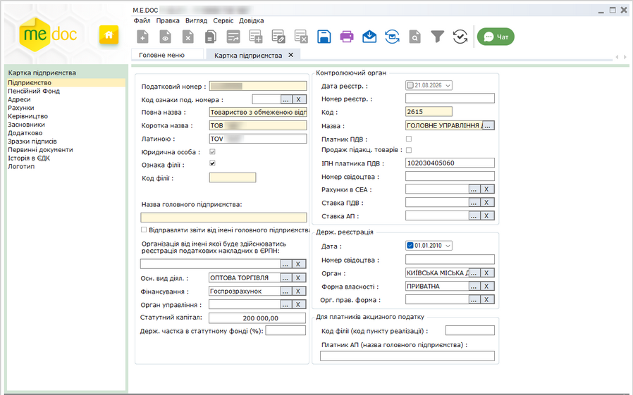

Натисніть, щоб збільшити малюнок

|  |  |
| --- | --- |
| - Податковий номер  Код установи за Єдиним державним реєстром підприємств та організацій України. Для фізичних осіб-підприємців дане поле містить його індивідуальний податковий номер платника податку (ІПН).  Числовий запис у це поле заповнюється вручну із клавіатури починаючи з першої позиції поля вводу.  - Код ознаки под. номера  У полі зазначається код ознаки джерела податкового номера. Значення обирається із підключеного довідника.  - Повна назва  Повне найменування установи.   Заповнюється вручну із клавіатури.  - Коротка назва  Скорочене найменування установи.   Заповнюється вручну із клавіатури.  - Латиною  Дане поле заповнюється автоматично. Транслітерується текст із поля [Коротка назва], тобто заповнюється латинськими літерами.  - Юридична особа  Наявність галочки в цьому полі визначає, що поточна установа є юридичною особою.  Дана відмітка не редагується, відображається тільки як признак юридичної особи. Вибір типу установи відбувається при [створенні підприємства](Connect_org.html#connect_org-connect_org) .  - Ознака філії  Наявність галочки в цьому полі визначає, що поточна установа є філією.  При встановленні галочки стають доступними для заповнення та редагування поля "Код філії" та "Назва головного підприємства".  - Код філії  Якщо поточне підприємство є філією, введіть код цієї філії у дане поле. Заповнюється вручну із клавіатури. Поле доступне для заповнення тільки за наявності позначки в полі "Ознака філії".  - Назва головного підприємства  Назва підприємства, яке для даної філії виступає Головним. Поле доступне для заповнення тільки за наявності позначки в полі "Ознака філії". Заповнюється вручну із клавіатури.  - Відправляти звіти від імені головного підприємства  Поле доступне для заповнення тільки за наявності позначки в полі "Ознака філії".   Ознака проставляється, якщо філія подає звітність від імені головного підприємства. У звітах буде відображатись назва головного підприємства, а не філії.  - Осн. вид діял.  Найменування основного виду діяльності господарювання підприємства. Виберіть із підключеного довідника "Види діяльності".  - Фінансування  В даному полі вказується джерело фінансування установи. Виберіть із підключеного довідника "Джерела фінансування".  - Орган управління   Найменування органу державного управління, що уповноважений управляти підприємством, як об'єктом, у системі ведення ЄДРПОУ.  Виберіть із підключеного довідника Органи управління (СКОДУ). Зверніть увагу! Поле є обов'язковим до заповнення для бюджетних організацій. Дані цього поля переносяться у поле за КОДУ фінансових звітів (Форма №1-дс Баланс та Форма №2-дс Звіт про фінансові результати). Якщо Орган управління не вказано, відповідно поле звіту за КОДУ залишається незаповненим.  - Статутний капітал   Розмір статутного фонду підприємства у національній валюті. Числовий запис у це поле заповнюється вручну із клавіатури.  - Держ. частка в статутному фонді (%)   Розмір державної частки у статутному фонді установи у відсотках. Числовий запис у це поле заповнюється вручну із клавіатури. | Контролюючий орган  - Дата реєстр.  Дата проведення реєстрації в контролюючому органі (територіальному органі Міністерства доходів і зборів). Виберіть з вбудованого календаря або заповніть поле власноруч з клавіатури.  - Номер реєстр.  Реєстраційний номер платника податку. Числовий запис у це поле заповнюється власноруч із клавіатури.  - Код  Код територіального органу Міністерства доходів і зборів. Заповнюється автоматично після вибору з довідника назви територіального органу.  - Назва  Найменування територіального органу Міністерства доходів і зборів, що зареєстрував платника податку. Виберіть потрібне значення із вбудованого довідника "Податкові інспекції".  - ІПН платника ПДВ   Якщо особа (юридична чи фізична) є платником податку на додану вартість, ведіть у це поле вручну з клавіатури індивідуальний податковий номер платника ПДВ.  Для осіб, що з релігійних причин відмовились від присвоєння ІНН, у це поле вводиться серія та номер паспорту. Данні вводяться без пропусків, наприклад: CЕ123456.  - Номер свідоцтва   За умови, що особа є платником ПДВ, введіть у це поле вручну з клавіатури номер свідоцтва про реєстрацію платника податку на додану вартість.  - Рахунки в СЕА  - поле призначене для внесення номера одного з рахунків установи в системах електронного адміністрування.  Номер рахунка обирається з довідника, що редагується користувачем.  Номер рахунку з цього ж довідника обирається при створенні "Запита щодо отримання відомостей про стан рахунку в системі електронного адміністрування ПДВ", що спрощує його заповнення.  Якщо дане поле в картці не заповнене, в Запиті… ви можете внести його вручну. |
| Держ. реєстрація  - Дата  Дата проведення державної реєстрації особи. Виберіть з вбудованого календаря або заповніть поле вручну з клавіатури.  - Номер свідоцтва  Номер свідоцтва про державну реєстрацію. Числовий запис у це поле заповнюється вручну із клавіатури.  - Орган  Найменування державного реєстратора, що зареєстрував підприємство. Виберіть потрібне значення із вбудованого довідника "Органи держреєстрації".  - Форма власності  Найменування форми власності підприємства. Виберіть потрібне значення для Вашого підприємства із вбудованого довідника "Форма власності (КФВ)".  - Орг. прав. форма  Найменування організаційно-правової форми господарювання підприємства. Виберіть потрібне значення для Вашого підприємства із вбудованого довідника "ОПФ (КОПФГ)". Зверніть увагу! Поле є обов'язковим до заповнення для бюджетних організацій. Дані цього поля переносяться у поле за КОПФГ фінансових звітів (Форма №1-дс Баланс та Форма №2-дс Звіт про фінансові результати). Якщо значення у полі не обране, відповідно поле звіту за КОПФГ залишається незаповненим. |
|  | Для платників акцизного податку  - Код філії (код пункту реалізації)  Код філії, що виписує та реєструє акцизні накладні.  - Платник АП (назва головного підприємства)  Назва головного підприємства.  Якщо поля заповнені, при формуванні Акцизних накладних та Розрахунків до акцизної накладної здійснюватиметься автоматичне заповнення полів документів код філії та Особа, що реалізує пальне.  Зверніть увагу! Автоматичне заповнення відповідних полів  акцизних документів відбуватиметься лише при заповненні полів Код філії (код пункту реалізації) та Платник АП (назва головного підприємства) у Картці підприємства. |

По закінченню внесення даних, збережіть, натиснувши на кнопку  або натисніть комбінацію клавіш Ctrl+S.

### Пенсійний фонд

_Шлях у довідці: Розділи програми › Довідники › Картка підприємства › Пенсійний фонд_

У цій формі містяться поля, що стосуються Пенсійного Фонду.

Даними із полів цієї закладки заповнюються документи, що надаються до органу державної податкової служби (персоніфікована звітність та звіти про доходи).

Поля, що підсвічені жовтим кольором, є обов'язковими для заповнення.

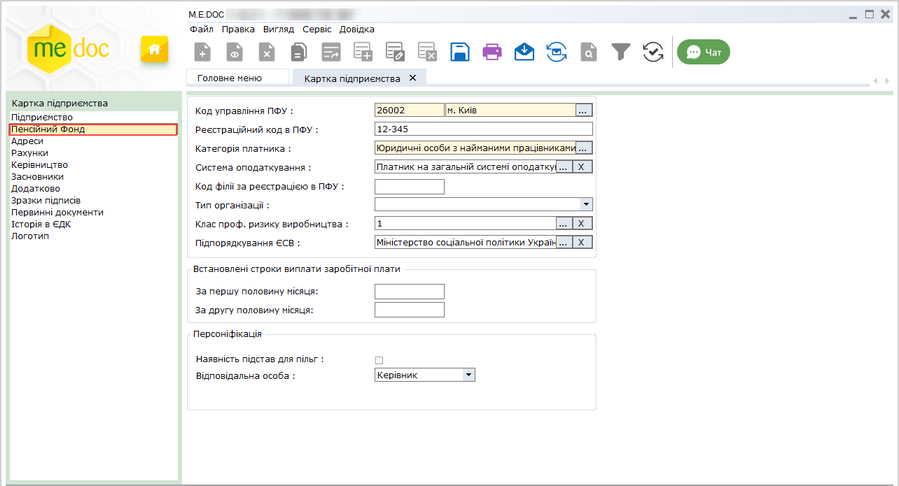

Натисніть, щоб збільшити малюнок

- Код управління ПФУ
Код і найменування управління пенсійного фонду, в якому зареєстроване підприємство.
Виберіть найменування управління із підключеного довідника Органи ПФУ, при цьому значення коду заповниться автоматично.
Дане поле обов'язкове для заповнення.
Увага! Якщо на момент заповнення Картки підприємства відсутній код управління ПФУ, оберіть із довідника код 28000 "Пенсійний фонд України".

- Реєстраційний код в ПФУ
Значення реєстраційного коду пенсійного фонду. Числовий запис у це поле заповнюється вручну із клавіатури.

- Категорія платника
Виберіть найменування категорії платника із однойменного довідника (Категорія платника).

- Система оподаткування
У цьому полі із підключеного довідника обирається система оподаткування підприємства.
Дані із цього поля автоматично переносяться у відповідне поле у Таблицю 1 звіту з єдиного внеску.

- Код філії за реєстрацією в ПФУ
Значення коду філії за реєстрацією в ПФУ вводиться вручну із клавіатури.

- Тип організації
Оберіть значення цього поля із списку.

Якщо тип установи не відповідає ні одному із наведених варіантів, обирається пустий рядок, тобто поле може бути незаповненим.

Поле використовується при формуванні та розрахунку Таблиці 1 звіту з єдиного внеску.

- Клас проф. ризику виробництва
Виберіть із довідника значення класу професійного ризику виробництва.
Поле використовується при формуванні Таблиці 1 звіту з єдиного внеску.

- Встановлені строки виплати заробітної плати
Ведіть терміни виплати заробітної плати вручну з клавіатури.

Персоніфікація

- Наявність підстав для пільг
Наявність галочки в цьому полі визначає, що в установі існують підстави для застосування пільг.
Використовується при створенні документів персоніфікованої звітності.

- Відповідальна особа
у цьому полі із списку обирається посадова особа (директор чи бухгалтер), відповідальна за формування документів персоніфікованої звітності.

Також можливий вибір іншої особи, яка відповідальна за подання персоніфікованої звітності.

Для цього потрібно обрати запис Інша особа.

З’являться нові поля з назвою ІПН та ПІБ відповідальної особи, в яке вносяться дані з довідника Співробітники.

По закінченню внесення даних, збережіть, натиснувши на кнопку  або натисніть комбінацію клавіш Ctrl+S.

### Адреси

_Шлях у довідці: Розділи програми › Довідники › Картка підприємства › Адреси_

Кожна установа може мати декілька адрес: юридичну та фізичні. Дана закладка призначена для збереження та відображення інформації про всі адреси підприємства.

У таблиці підрозділу відображається перелік існуючих адрес установи, кожний рядок містить основні дані адреси установи. Переглянути більш повну інформацію щодо адреси можна у окремому вікні Адреса, яке відкривається подвійним кліком по потрібному запису.

Дозволяє додавати нові адреси, редагувати та видаляти існуючі.

При [створенні нового підприємства](Connect_org.html#connect_org-danoaoe3_iiaiai_i3aeieinoaa) в системі обов'язково вказується юридична адреса підприємства, а фактична - за бажанням (в разі, якщо фактична адреса співпадає з юридичною адресою, проставляється відмітка, тобто, адреса копіюється). Таким чином, при першому відкритті картки підприємства, в даному розділі міститься запис юридичної адреси (та фактичної, якщо, вона була вказана при створенні).

В таблиці підрозділу юридична адреса відмічається позначкою в стовпчику Юр. адреса.

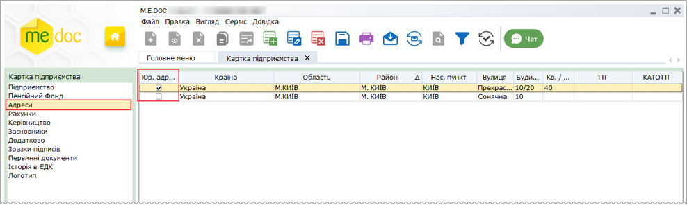

Натисніть, щоб збільшити малюнок

При цьому, при додаванні нової адреси підприємства, поле Юридична адреса буде заблоковано від редагування.

Додавання нової адреси

1. Для того, щоб додати нову адресу установи, на панелі інструментів виберіть команду Створити запис, або натисніть комбінацію клавіш Ctrl+I.

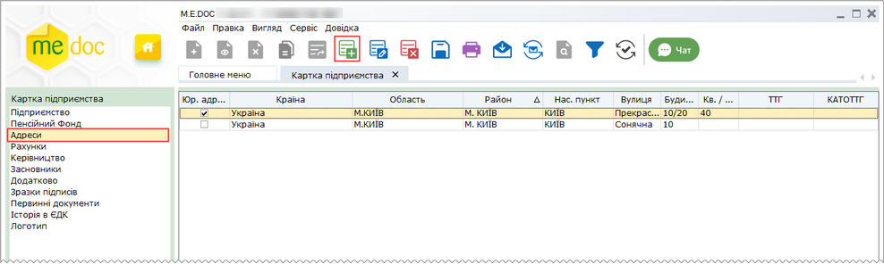

Натисніть, щоб збільшити малюнок

В реєстрі адрес також доступні наступні функції:

|  |  |
| --- | --- |
| Видалити | Дозволяє безповоротно вилучити запис обраної адреси. |
| Редагувати | Редагування даних адреси в разі необхідності. |

2. Відкриється вікно Адреса. Заповніть запропоновані поля форми.

Поля, що підсвічені жовтим кольором, є обов'язковими для заповнення.

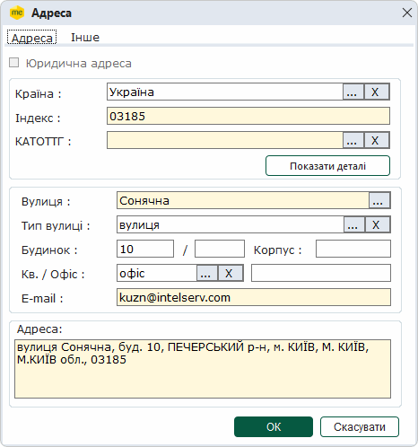

2.1. Відмітка Юридична адреса може бути встановлена лише для однієї адреси у картці. Якщо у картці вже присутня адреса з ознакою Юридична адреса, при створенні інших адрес опція недоступна. У разі якщо юридична адреса установи змінюється, потрібно попередньо зняти відмітку Юридична адреса для старої адреси, після чого додати нову адресу, для якої встановити відмітку Юридична адреса.

2.2. У полі Країна, Вулиця, Тип вулиці, КАТОТТГ, Кв./Офіс виберіть значення із підключених довідників, скориставшись кнопкою .

Зверніть увагу, після заповнення поля КАТОТТГ автоматично заповнюється інформація про повну адресу у полі Адреса.

2.3. Поля Індекс, Будинок, Корпус, номер Кв./Офіс  заповніть вручну з клавіатури.

2.4. Поле E-mail для введення електронної адреси установи заповніть вручну з клавіатури

2.5. Для перегляду детальної інформації про адресу натисніть кнопку Показати деталі:

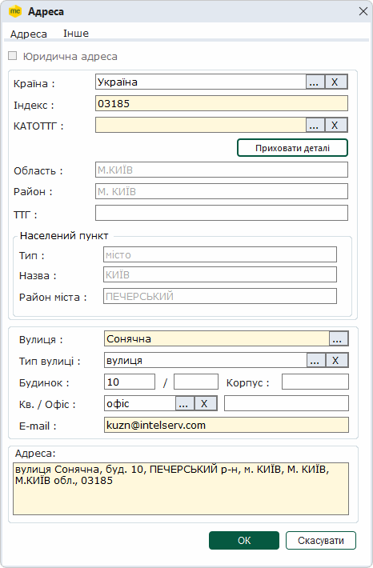

Стануть доступними для поля: Область, Район, ТТГ, у області Населений пункт: Тип, Назва та Район міста.

Значення полів Область, Район, ТТГ, Населений пункт - Тип, Населений пункт - Назва, Населений пункт - Район міста заповнюються автоматично після вибору значення у полі КАТОТТГ.

2.6. Перейдіть на вкладку Інше для введення адреси вебсайту установи - WWW, що заповнюються з клавіатури.

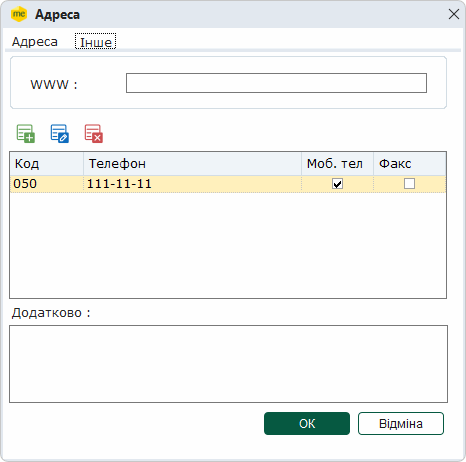

2.7. Також на вкладці Інше передбачено можливість внесення переліку номерів телефонів. Щоб додати новий номер телефону, натисніть кнопку .

У вікні, що відкрилось, введіть код міста та номер телефону з клавіатури. Якщо введений телефон є факсом чи мобільним, встановіть галочку у відповідному полі. Натисніть кнопку ОК для внесення даних (або Відміна для скасування). Вказаний мобільний номер автоматично переноситься у відповідні поля форм звітності.

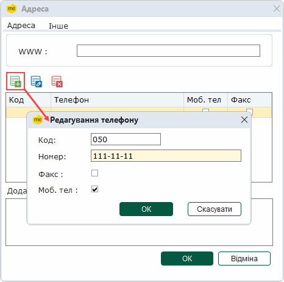

Щоб редагувати номер телефону, оберіть його у списку та натисніть кнопку . Для видалення номеру натисніть на кнопку .

3. Для збереження даних натисніть кнопку ОК. Для відміни внесених даних натисніть Відміна.

По закінченню внесення даних, збережіть, натиснувши на кнопку  або натисніть комбінацію клавіш Ctrl+S.

### Рахунки

_Шлях у довідці: Розділи програми › Довідники › Картка підприємства › Рахунки_

Закладка Рахунки призначена для збереження та відображення інформації про банківські рахунки установи.

Установа може мати декілька рахунків, один із яких повинен бути позначений як основний.

У таблиці підрозділу відображається перелік існуючих рахунків установи, кожний рядок містить основні дані про рахунки установи. Переглянути більш повну інформацію про рахунок можна у окремому вікні Банківський рахунок, яке відкривається подвійним кліком по потрібному запису.

Дозволяє додавати нові рахунки, редагувати та видаляти існуючі.

Додавання рахунку

1. Для того, щоб додати новий рахунок, на панелі інструментів виберіть команду Створити запис, або натисніть комбінацію клавіш Ctrl+I.

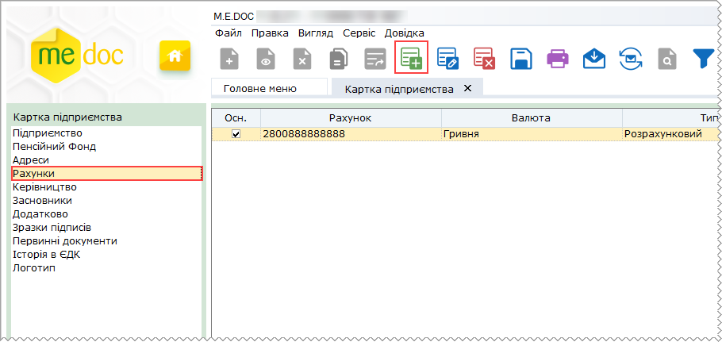

2. Відкриється вікно Банківський рахунок. Заповніть запропоновані поля форми.

Поля, що підсвічені жовтим кольором, є обов'язковими для заповнення.

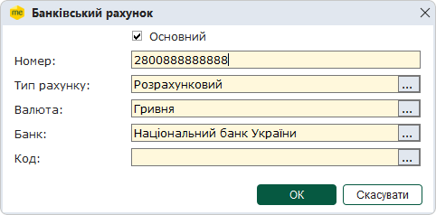

2.1. В поле Номер вводиться номер рахунку безпосередньо з клавіатури, в інших полях записи обираються із підключених довідників.

2.2. Для основного рахунку обов'язково треба проставити відмітку в полі Основний.

3. Для збереження даних натисніть кнопку ОК. Для відміни внесених даних натисніть Відміна.

В реєстрі рахунків також доступні наступні функції:

|  |  |
| --- | --- |
| Видалити | Дозволяє безповоротно вилучити запис обраного рахунку. |
| Редагувати | Редагування даних рахунку в разі необхідності. |

По закінченню внесення даних, збережіть, натиснувши на кнопку  або натисніть комбінацію клавіш Ctrl+S.

### Керівництво

_Шлях у довідці: Розділи програми › Довідники › Картка підприємства › Керівництво_

Закладка містить дані керівників установи. Дані керівника та бухгалтера вносяться у відповідні поля для підпису звітних форм.

Поля, що підсвічені жовтим кольором, є обов'язковими для заповнення.

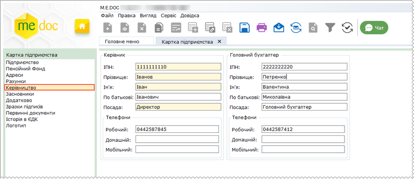

Натисніть, щоб збільшити малюнок

У випадку, якщо керівник установи офіційно виконує обов'язки бухгалтера, блок Головний бухгалтер заповнюється даними керівника установи.

Якщо на підприємстві посада бухгалтера відсутня - дані у відповідне поле не вносяться.

При прийманні електронних ПОДАТКОВИХ звітів виконується контроль на заповнення системних полів, в тому числі поля Головний бухгалтер, тому у формах звітності це поле повинно бути обов'язково заповненим.

Якщо бухгалтер в установі відсутній (розділ Головний бухгалтер в картці установи не заповнено), це поле у формах податкової звітності також не заповнюється.

По закінченню внесення даних, збережіть, натиснувши на кнопку  або натисніть комбінацію клавіш Ctrl+S.

### Засновники

_Шлях у довідці: Розділи програми › Довідники › Картка підприємства › Засновники_

Закладка містить інформацію про засновників установи, їх внесок у грошовому еквіваленті у статутному фонді, адреси та телефони засновників. Дані цієї закладки носять інформаційний характер та не обов'язкові для заповнювання.

У таблиці підрозділу відображається перелік засновників установи, кожний рядок містить основні дані засновників. Переглянути більш повну інформацію про засновників можна у окремому вікні Інформація про засновника, яке відкривається подвійним кліком по потрібному запису.

Дозволяє додавати засновників, редагувати та видаляти існуючі.

Заповнення інформації про засновників

1. Для того, щоб додати засновника установи, на панелі інструментів виберіть команду  (Створити запис), або натисніть комбінацію клавіш Ctrl+I.

2. Відкриється вікно Інформація про засновника. Заповніть запропоновані поля форми.

Поля, що підсвічені жовтим кольором, є обов'язковими для заповнення.

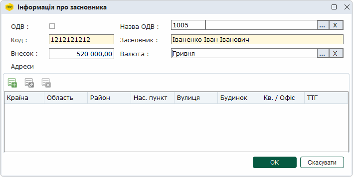

2.1. Адреси засновників додаються та редагуються у окремому вікні Адреса. Заповнення картки адрес засновників відбувається аналогічно заповненню [адрес установи](#ucorg-sprorg_adr).

3. Для збереження даних натисніть кнопку ОК. Для відміни внесених даних натисніть Відміна.

В реєстрі засновників також доступні наступні функції:

|  |  |
| --- | --- |
| Видалити | Дозволяє безповоротно вилучити запис обраного рахунку. |
| Редагувати | Редагування даних рахунку в разі необхідності. |

По закінченню внесення даних, збережіть, натиснувши на кнопку  або натисніть комбінацію клавіш Ctrl+S.

### Додатково

_Шлях у довідці: Розділи програми › Довідники › Картка підприємства › Додатково_

Закладка містить додаткові дані, що стосуються реєстрації установи в фонді соціального страхування, фонді по безробіттю, в територіальному органі ДКЦПФР, тощо.

Рекомендується заповнити всі поля цієї закладки, оскільки дані із закладки використовуються при формуванні документів у різні контролюючі органи.

Поля, що підсвічені жовтим кольором, є обов'язковими для заповнення.

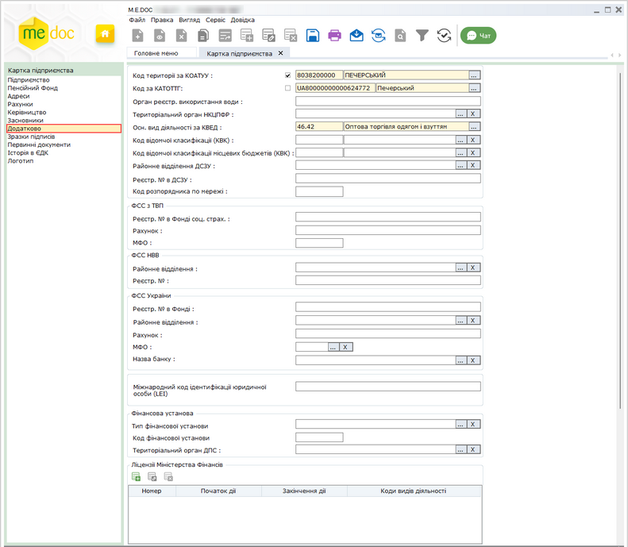

Натисніть, щоб збільшити малюнок

- У зв’язку із зміною адміністративно-територіального устрою України, наказом Міністерства розвитку громад та територій України № 290 від 26.11.2020 р. «Про затвердження Кодифікатора адміністративно-територіальних одиниць та територій територіальних громад» (зі змінами, внесеними наказом від 12.01.2021 р. № 3) затверджено Кодифікатор адміністративно-територіальних одиниць та територій територіальних громад (КАТОТТГ).
- У програмі можливе використання як довідника КОАТУУ, так і довідника КАТОТТГ. Для вибору довідника, значення якого слід використовувати при створенні звітності, встановіть відмітку біля назви потрібного довідника. За замовчуванням використовується довідник КОАТУУ.
- При виборі коду у одному з полів Код території за КОАТУУ або Код за КАТОТТГ друге поле автоматично заповнюється значенням, що відповідає вже обраному коду.
- Код території за КОАТУУ
Код і найменування території, де розташована установа за Державним класифікатором об'єктів адміністративно-територіального устрою України (КОАТУУ).

Для використання довідника КОАТУУ встановіть відмітку у рядку  Код території за КОАТУУ.
Виберіть найменування з підключеного довідника Коди території (КОАТУУ/КАТОТТГ), при цьому значення коду заповниться автоматично.
При виборі назви населеного пункту у підрозділі [Адреси](#ucorg-sprorg_adr), значення Коду території за КОАТУУ заповниться автоматично. За необхідності, значення коду можна змінити вручну.

- Код за КАТОТТГ
Код і найменування території, де розташована установа за Кодифікатором адміністративно-територіальних одиниць та територій територіальних громад (КАТОТТГ).
Виберіть найменування з підключеного довідника Коди території (КОАТУУ/КАТОТТГ), при цьому значення коду заповниться автоматично.

Для використання довідника КАТОТТГ встановіть відмітку у рядку  Код за КАТОТТГ.
При виборі назви населеного пункту у підрозділі [Адреси](#ucorg-sprorg_adr), значення Коду території за КАТОТТГ заповниться автоматично. За необхідності, значення коду можна змінити вручну.

- Орган реєстр. використання води
Найменування державного органу (Міністерство екології та природних ресурсів України), що видав дозвіл на спеціальне водокористування. Заповнюється вручну з клавіатури.

- Територіальний орган НКЦПФР
Найменування територіального органу Державної Комісії з цінних паперів та фондового ринку. Виберіть із підключеного довідника Територіальні органи НКЦПФР.

- Осн. вид діяльн. за КВЕД
Найменування основного виду діяльності установи відповідно до Державного класифікатора України "Класифікація видів економічної Діяльності".
Виберіть найменування виду діяльності з підключеного довідника Довідник КВЕД, при цьому значення коду заповниться автоматично.

- Код відомчої класифікації (КВК)
Найменування та код відомчої класифікації видатків місцевих бюджетів.
Виберіть найменування виду діяльності з підключеного довідника Коди відомчої класифікації видатків (КВК), при цьому значення коду заповниться автоматично.

- Код відомчої класифікації місцевих бюджетів (КВК)
Найменування та код типової відомчої класифікації видатків місцевих бюджетів.
Виберіть найменування виду діяльності з підключеного довідника Коди відомчої класифікації видатків для місцевих бюджетів, при цьому значення коду заповниться автоматично.

Поля Код відомчої класифікації (КВК) та Код відомчої класифікації місцевих бюджетів (КВК) не обов'язкові для заповнення. Рекомендується заповнювати одне із полів залежно від фінансування, і дані з цього поля переноситимуться у відповідні поля звітів.

- Районне відділення ДСЗУ
Найменування регіонального відділення Державної служби зайнятості України, послугами якого користується установа. Виберіть із підключеного довідника Центр зайнятості.

- Реєстр. № в ДСЗУ
Реєстраційний номер роботодавця  в Державній службі зайнятості України. Числовий запис у це поле заповнюється вручну із клавіатури.

- Код розпорядника по мережі
Вказується код розпорядника бюджетних коштів по мережі, присвоєний відповідно до Єдиного реєстру розпорядників та одержувачів бюджетних коштів. Числовий запис у це поле заповнюється вручну із клавіатури.

- ФСС з ТВП:
- Реєстр. № в Фонді соц. страхування - реєстраційний номер страхувальника в фонді соціального страхування. Числовий запис у це поле заповнюється вручну із клавіатури;
- у полях Рахунок та МФО введіть відповідно номер рахунку та МФО Фонду соціального страхування, у якому зареєстровано підприємство.
-  ФСС НВВ:
- Районне відділення - найменування районного відділення Фонду соціального страхування від нещасних випадків на виробництві. Виберіть із підключеного довідника Відділи ФСС з НВВ;
- Реєстр. № - реєстраційний номер роботодавця у Фонді соціального страхування від нещасних випадків на виробництві. Числовий запис у це поле заповнюється вручну із клавіатури.
-  ФСС України:

Ця група параметрів додана після об'єднання фондів соціального страхування.

- Реєстр. № в Фонді - реєстраційний номер роботодавця у ФСС, заповнюється вручну із клавіатури;
- Районне відділення - найменування районного відділення ФСС. Виберіть із підключеного довідника Відділення ФСС України;
- Рахунок - номер рахунку у Фонді соціального страхування;
- МФО - МФО рахунку у Фонді соціального страхування. Виберіть із підключеного довідника Банки. Назва банку у відповідному полі заповниться автоматично;
- Назва банку - назва банку, в якому відкрито рахунок. Виберіть із підключеного довідника Банки. МФО у відповідному полі заповниться автоматично.
- Міжнародний код ідентифікації юридичної особи (LEI)
Унікальний міжнародний код ідентифікації, що присвоюється юридичній особі у відповідності до міжнародного стандарту та використовується при здійсненні операцій та звітності на фінансових ринках. Поле заповнюється вручну, повинно містити 20 цифрових символів.

-  Фінансова установа - не обов'язкові для заповнення, поля призначені для внесення даних підприємств, які надають фінансові послуги:
- Тип фінансової установи - найменування типу фінансової установи. Виберіть із підключеного довідника Типи фінансових установ;
- Код фінансової установи - код фінансової установи, зазначений у Свідоцтві про реєстрацію фінансової установи. Числовий запис у це поле заповнюється вручну із клавіатури.
- Територіальний орган ДПС - найменування територіального органу оберіть із підключеного довідника Податкові інспекції.
- Ліцензії Міністерства Фінансів
Перелік виданих Міністерством фінансів ліцензій на провадження певних видів господарської діяльності.
Для того, щоб додати ліцензію, натисніть кнопку . Відкриється вікно Ліцензія.

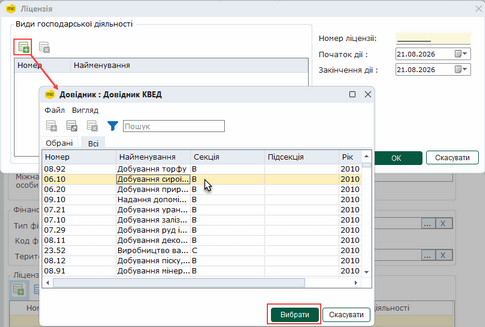

Натисніть, щоб збільшити малюнок

- Види господарської діяльності - перелік дозволених видів діяльності.
Щоб додати вид діяльності, натисніть кнопку Додати . Оберіть із довідника потрібний запис та натисніть кнопку Вибрати.

- Номер ліцензії - введіть номер ліцензії у форматі: NNXXXXXX - дві літери та шість цифр.
- Початок дії - дата, починаючи з якої дана ліцензія є дійсною, тобто, особа має право провадити діяльність в межах даної ліцензії. Виберіть з вбудованого календаря.
- Закінчення дії - дата, до якої дана ліцензія є дійсною. Виберіть з вбудованого календаря.

По закінченню внесення даних, збережіть, натиснувши на кнопку  або натисніть комбінацію клавіш Ctrl+S.

### Зразки підписів

_Шлях у довідці: Розділи програми › Довідники › Картка підприємства › Зразки підписів_

При підписанні документів комплектом електронних підписів, у відповідних місцях бланку документів встановлюється позначка ЕП, що свідчить про накладений підпис/печатку. Для більшої наочності, у програмі створена можливість налаштування зразків підписів директора та бухгалтера, а також зразка печатки установи. Завантажені у програму сканкопії зразків, при підписані документів, відображаються у відповідних місцях бланку документів.

Передбачена можливість додавати зразок підписубезпосередньо в картці співробітника

Процес налаштування відбувається за допомогою Майстра налаштування зразків підписів. Для його здійснення треба мати відскановані підписи та печатку.

1. У робочому вікні закладки Зразки підписів натисніть кнопку Налаштування.

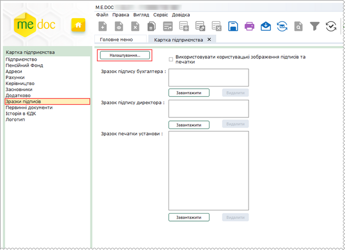

Натисніть, щоб збільшити малюнок

- Відображення факсиміле підписів та печаток, завантажених користувачем, відбувається за умови встановленої опції Використовувати користувацькі зображення підписів та печатки. При завантаженні користувацьких факсиміле опція встановлюється автоматично.
- Якщо опцію встановлено, на підписаних ЕП документах відображатимуться зображення підписів директора, бухгалтера, а також печатки установи, завантажені користувачем. Якщо опцію не встановлено, на документах відображаються зображення підписів та печаток, встановлених у програмі за замовчуванням.

2. Відкриється Майстер налаштування зразків підписів. Оберіть опцію Сканувати або завантажити зображення зразків підписів та натисніть кнопку Далі.

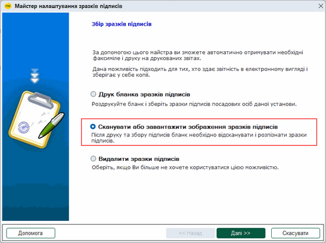

Натисніть, щоб збільшити малюнок

3. На другому кроці Майстра запропоновано обрати опції:

- Отримати зображення зі сканеру - у разі, якщо до комп'ютера підключений сканер;
- Завантажити зображення з диска - якщо відсканований файл зображення збережений на диску.
У цьому випадку вкажіть шлях до каталогу.

Натисніть кнопку Далі.

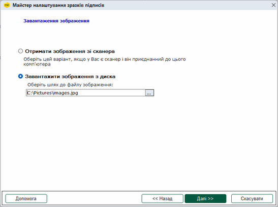

Натисніть, щоб збільшити малюнок

4. На наступному кроці Майстра відкриється вбудований графічний редактор. В довільному місці зображення розташовані три рамки, які призначенні для виділення фрагментів зображення, що відповідають зразкам підписів бухгалтера, директора та печатки.

Вкажіть межі кожного зразка - перемістіть рамки в потрібне місце за допомогою курсора миші.

Для продовження натисніть кнопку ОК.

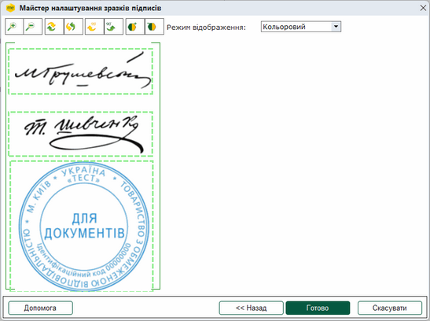

Натисніть, щоб збільшити малюнок

5. В результаті зображення підписів з'являться у вікні налаштування зразків підписів. Саме у такому вигляді підписи та печатка будуть відображені на документах після процедури підписання.

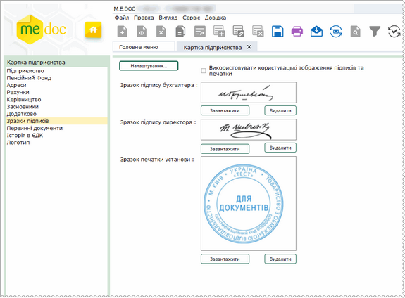

Натисніть, щоб збільшити малюнок

Можна завантажити кожен вид сканкопії зразків окремо, для цього натисніть кнопку Завантажити у відповідному розділі.

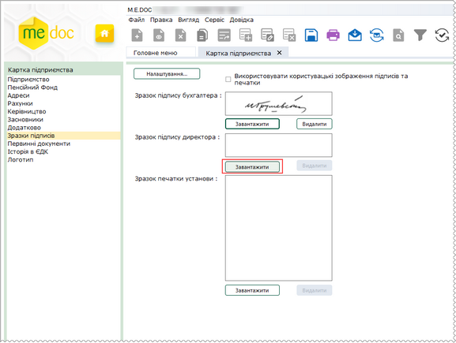

Натисніть, щоб збільшити малюнок

У вікні Оберіть файл зображення для імпорту ... оберіть файл, що містить потрібне зображення.

Відкриється вбудований графічний редактор. За допомогою рамки виділіть фрагмент зображення, що відповідає потрібному зразку.

Для продовження натисніть кнопку ОК.

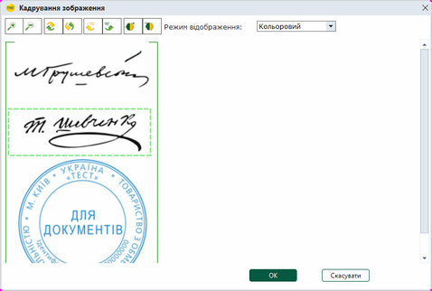

Натисніть, щоб збільшити малюнок

Обраний зразок з'явиться у вікні налаштування зразків підписів.

Для видалення зразків підпису або печатки натисніть кнопку Видалити у відповідному розділі. У вікні, що відкриється, підтвердьте видалення, натиснувши кнопку Так.

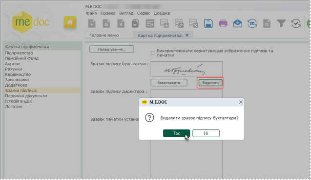

Натисніть, щоб збільшити малюнок

По закінченню внесення даних, збережіть, натиснувши на кнопку  або натисніть комбінацію клавіш Ctrl+S.

### Первинні документи

_Шлях у довідці: Розділи програми › Довідники › Картка підприємства › Первинні документи_

У полях закладки вказуються:

- Система оподаткування - система оподаткування, на якій перебуває підприємство;
- Місце складання - місце складання документів;
- Діє на підставі - якщо поле заповнено, при створенні первинних документів значення поля буде автоматично переноситися у відповідне поле документа.

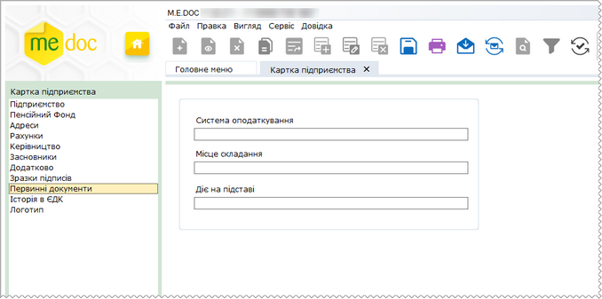

Натисніть, щоб збільшити малюнок

Рекомендується заповнити поля цієї закладки, оскільки дані із закладки автоматично переносяться у відповідні поля первинних документів.

### Історія в ЄДК

_Шлях у довідці: Розділи програми › Довідники › Картка підприємства › Історія в ЄДК_

У розділі відображаються всі відправлені записи про організацію в ЄДК, тобто ведеться історія змін даних картки підприємства та оновлення цих даних в ЄДК.

Оновлення даних можливе як по прямому з'єднанню, так і електронною поштою.

Записи можливо редагувати та робити неактуальними (блокувати). Тобто, історія в ЄДК стала редагованою для свого підприємства.

Редагування чи блокування записів використовується у випадку, якщо наприклад, користувач вручну вніс помилкові зміни у вікні оновлення даних в ЄДК та відправив їх на СДО. Тобто, реквізити підприємства у програмі та в ЄДК не співпадають.

У таблиці в колонках відображається:

- Дата початку дії - дата, з якої діють вказані реквізити в картці установи,
- Дата оновлення - дата редагування запису, який був відправлений в ЄДК.

У таблиці контрагентів за допомогою відповідних символів відображається актуальність/не актуальність даних в колонці Актуальність даних:

-  - дані актуальні. Реквізити актуальні від попередньої до наступної дати.
- - дані НЕ актуальні.

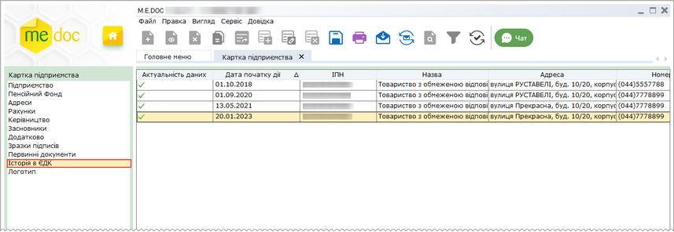

Натисніть, щоб збільшити малюнок

- Записи відкриваються для перегляду та редагування подвійним кліком лівої кнопки миші.
- У відкритій картці Редагування запису історії картки підприємства містяться реквізити, які були відправлені в ЄДК: Дата початку дії, ІПН, Назва, Адреса, Телефон. Всі реквізити дозволено редагувати.
- В картці присутня ознака Дані актуальні, що дозволяє вказати  актуальність/неактуальність даних організації на СДО.

Якщо дані не актуальні, Ваші контрагенти не матимуть доступу до цих даних.

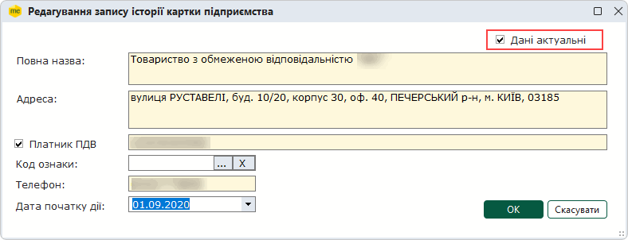

Змініть потрібні реквізити та відправте їх в ЄДК.

Відправлення даних в ЄДК може виконуватись автоматично за пропозицією програми чи вручну користувачем після змін будь яких реквізитів у картці Редагування запису історії картки підприємства.

- Програма запропонує оновити дані в ЄДК при переході до іншого модуля чи закритті картки установи.
- Відправка вручну користувачем запускається кнопкою Оновити дані в ЄДК (розташована внизу розділу). Відредагований запис буде відправлений на СДО та запишеться в історію змін.
- Якщо дані в історії не змінювалися, тобто є актуальними, функція недоступна.

Виконується перевірка статусу записів у розділі Історія в ЄДК. Не можна заблокувати всі записи, повинен бути хоча б один актуальний.

### Логотип

_Шлях у довідці: Розділи програми › Довідники › Картка підприємства › Логотип_

У програмі реалізована можливість завантаження логотипа підприємства. Звантажений логотип, відображається на документах формату iXBRL при створенні звітності за міжнародними стандартами у модулі Фінансова звітність за МСФЗ (формат iXBRL).

Для завантаження логотипа:

1. У вікні закладки Логотип натисніть кнопку Завантажити.

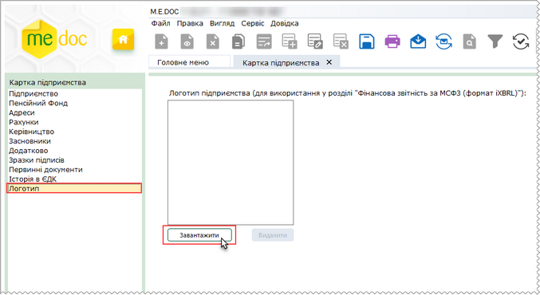

Натисніть, щоб збільшити малюнок

2. Відкриється вікно Оберіть файл зображення для імпорту.

Оберіть файл з зображенням логотипа та натисніть Відкрити.

Рекомендований розмір зображення: 120 х 60 пікселів. Зображення автоматично стискаються до вказаного розміру.

3. Відкриється вікно Кадрування зображення. Вікно містить вбудований графічний редактор. У полі зображення розташована рамка, за допомогою якої можна виділити фрагмент зображення, що буде відображатися у якості логотипа на документах.

Вкажіть межі логотипа - перемістіть рамку в потрібне місце за допомогою курсору миші.

Для продовження натисніть кнопку ОК.

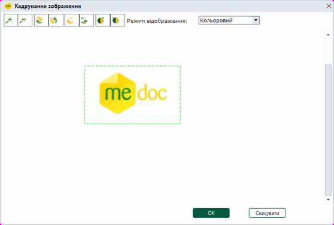

Натисніть, щоб збільшити малюнок

За допомогою панелі інструментів вікна Кадрування зображення можна повернути зображення, збільшити або зменшити масштаб зображення для перегляду, налаштувати контраст та режим відображення (кольорову схему).

4. Зображення логотипа з'явиться у вікні закладки Логотип.

Для видалення завантаженого зображення скористайтеся кнопкою Видалити.

По закінченню внесення даних, збережіть, натиснувши на кнопку  або натисніть комбінацію клавіш Ctrl+S.


