[← Зміст довідки](../)


# Сценарії підписання первинних документів

## Сценарії підписання первинних документів

_Шлях у довідці: Розділи програми › Первинні документи › Сценарії підписання первинних документів_

В цьому розділі:

[Основні елементи інтерфейсу](#ucpdocsignsettings-ucpdocsignsettings)

[Створення користувацького комплекту підписів](#ucpdocsignsettings-ucpdocsignsettings)

[Редагування та видалення налаштувань комплектів підписів](#ucpdocsignsettings-ucpdocsignsettings)

[Визначення пріоритету налаштувань комплекту підписів](#ucpdocsignsettings-ucpdocsignsettings)

[Налаштування візування документів](#ucpdocsignsettings-ucpdocsignsettings)

[Налаштування підписання документів за посиланням](#ucpdocsignsettings-ucpdocsignsettings)

Модуль призначений для налаштування користувацьких сценаріїв підписання первинних документів.

У користувацьких сценаріях підписання первинних документів можна створити користувацькі комплекти підписів, визначити їх пріоритети при підписанні первинних документів, забезпечити наявність підпису на документі тієї чи іншої посадової особи, визначити умови застосування комплекту підписів відповідно до  внутрішніх положень підприємства.

За замовчуванням для всіх типів первинних документів, для яких не налаштовано комплект підписів у розділі Сценарії підписання первинних документів застосовується комплект підписів із розділу [Адміністрування – Параметри системи – Підпис - Первинні документи](FormCompanyParams.html#formcompanyparams-admcomanyparams_pen). Налаштування для комплекту підписів Первинні документи встановлюються автоматично та можуть бути змінені користувачем.

Основні елементи інтерфейсу

Вікно модуля містить:

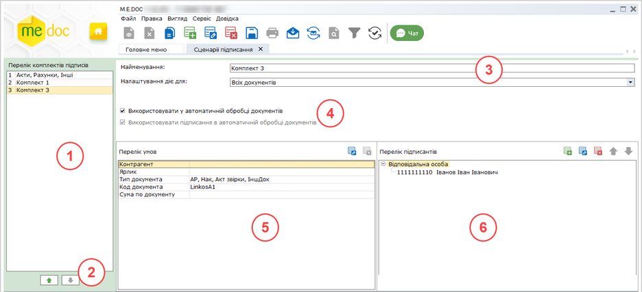

Натисніть, щоб збільшити малюнок

1. Панель Перелік комплектів підписів - містить список всіх створених налаштувань. Порядок налаштування у списку визначає його пріоритет. Чим вище знаходиться налаштування комплекту підписів у списку, тим вищий пріоритет він має.

2. Кнопки для визначення пріоритету комплектів підписів (порядок у списку).

Користувацький комплект підписів застосовується у відповідності до встановленого пріоритету. Якщо певний документа підпадає під налаштування кількох комплектів підписів, для підписання документа використовується той комплект, що має вищий пріоритет.

3. Поля для визначення назви створюваного налаштування комплекту підписів та напрямку обробки первинних документів, для яких створюється комплект підписів (вхідні, вихідні або всі).

4. Область містить опцію Використовувати у автоматичній обробці документів. Якщо опцію встановлено, для документів, що відповідають визначеним умовам, при автоматичній обробці застосовується користувацький комплект підписів.

Після активації опції Використовувати у автоматичній обробці документів стають доступні додаткові налаштування:

- Використовувати підписання в автоматичній обробці документів – якщо опція встановлена, для документів, що відповідають визначеним умовам, при автоматичній обробці застосовується користувацький комплект підписів при автоматичному підписанні та погодженні;
- Використовувати візування в автоматичній обробці документів – доступна після налаштування підпису з типом [Візування](#ucpdocsignsettings-ucpdocsignsettings) та встановлюється за замовчуванням. Якщо опція встановлена, для визначених типів документів при автоматичній обробці здійснюється візування документів, відповідно до налаштувань комплекту підписів Візування.

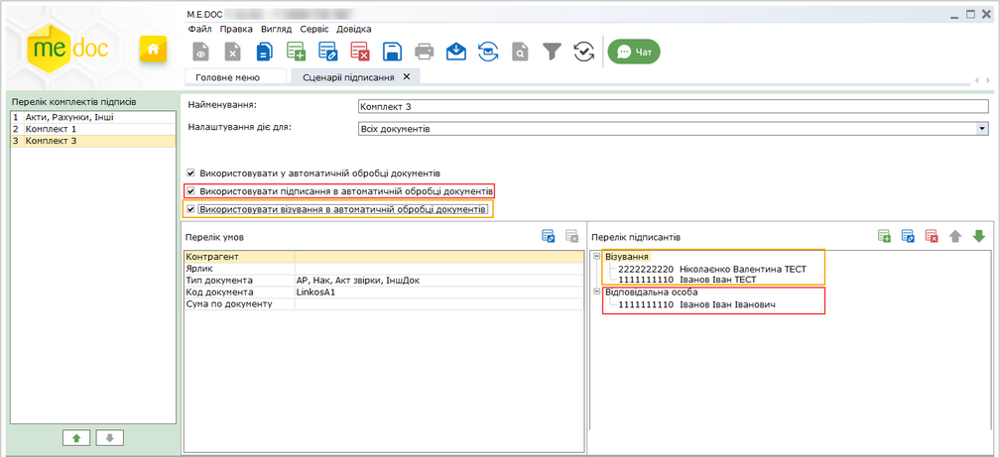

Натисніть, щоб збільшити малюнок

Також автоматичну обробку документів з використанням користувацьких комплектів підписів можна налаштувати у [Сервісі універсальної автоматичної обробки документів](AP.html#ap-uao_func).

Зверніть увагу! Документи, для яких у підписі не обрано підписанта, не будуть оброблятись сервісом Автоматичної обробка документів та Універсальної автоматичної обробки документів.

5. Область Перелік умов -  умови, при виконанні яких застосовується комплект підписів. У полі можна задати: ЄДРПОУ контрагентів, ярлики документів, коди та типи документів, суми по документам.

Користувацький комплект підписів застосовується при виконанні всіх зазначених умов. Якщо для певного документа не виконується хоча б одна з умов, застосовується інший користувацький комплект з переліку налаштувань, умови якого виконуються (якщо такий існує).

У полях області Перелік умов можливо задати декілька значень одночасно.

6. Область Перелік підписантів - містить типи підписів та перелік осіб, що повинні підписувати документ.

На виконання команди Передати на підпис або Підписати для первинного документа перевіряється наявність налаштувань користувацьких комплектів підписів. На кожному етапі підписання перевіряється відповідність особи, що підписує документ, підписанту, вказаному у комплекті підписів. Підказки про послідовність підписантів виводяться на вкладці Наступні дії.

Якщо для первинного документа не знайдено жодного користувацького комплекту підписів (або не виконуються умови жодного з користувацьких комплектів), здійснюється підписання комплектом Первинні документи, що встановлений у розділі Адміністрування – Параметри системи – Підпис.

[До початку](#ucpdocsignsettings-ucpdocsignsettings)

Створення користувацького комплекту підписів

1. Оберіть один із способів:

- натисніть кнопку  на панелі інструментів;
- виконайте команду головного меню Файл - Створити запис;
- натисніть праву кнопку миші на панелі Перелік комплектів підписів та у контекстному меню оберіть Створити запис.

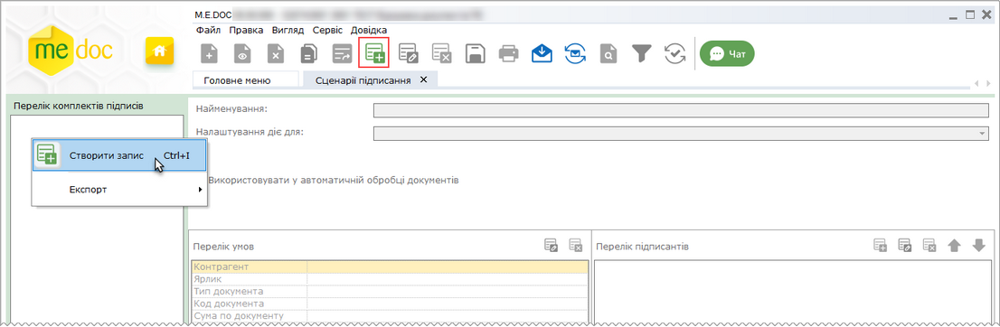

Натисніть, щоб збільшити малюнок

2. У полі Найменування введіть назву нового комплекту.

У полі Налаштування дії для із списку, що відкривається оберіть напрямок документа, для якого застосовується користувацький комплект підписів: вхідні документи, вихідні або всі документи:

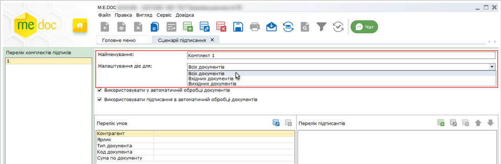

Натисніть, щоб збільшити малюнок

У разі потреби, встановіть опції:

- Використовувати у автоматичній обробці документів - визначає, чи може цей комплект підписів брати участь в автоматичних процесах - це дозвіл для комплекту використовуватись у автоматичній обробці документів;
- Використовувати підписання у автоматичній обробці документів - визначає, чи буде цей комплект застосовуватись саме для автоматичного накладання підписів на документи.

3. У області Перелік умов налаштуйте умови застосування користувацького комплекту підписів.

Увага! користувацький комплект підписів застосовується лише при виконанні всіх зазначених умов. У полях можливо обрати як одне значення, так і декілька значень одночасно.

- Контрагент

У полі вказується ЄДРПОУ контрагента від якого отримано/якому призначено документ.

Натисніть два рази лівою кнопкою миші на рядку Контрагент, або виділіть поле та натисніть кнопку  на панелі інструментів області Перелік умов. Відкриється вікно Контрагенти:

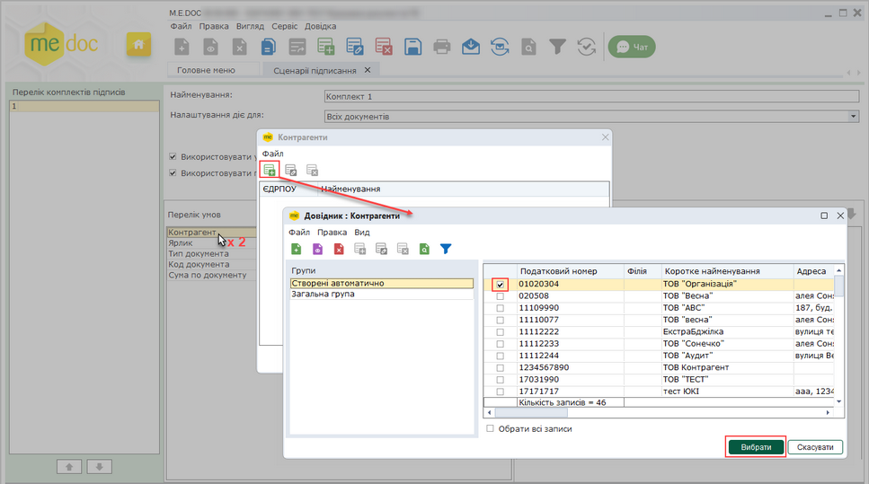

Натисніть, щоб збільшити малюнок

Щоб додати контрагента (список контрагентів), натисніть кнопку .  У вікні довідника Контрагенти встановіть позначки у рядках контрагентів, для яких призначається створюваний комплект підписів. Натисніть кнопку Вибрати.

Назви обраних контрагентів з'являться у вікні Контрагенти:

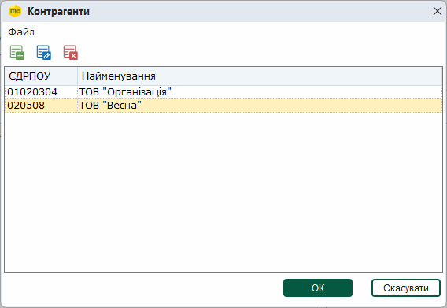

Натисніть кнопку ОК. ЄДРПОУ обраних контрагентів відобразяться у полі Контрагент області Перелік умов:

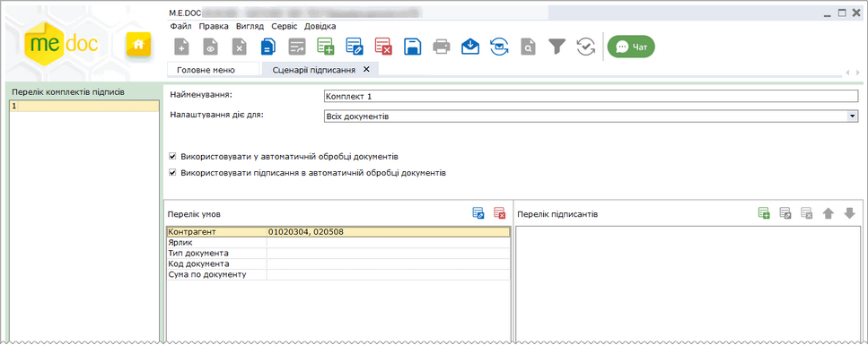

Натисніть, щоб збільшити малюнок

- Ярлик

Містить значення ярлика, що встановлений для первинного документа.

Натисніть два рази лівою кнопкою миші на рядку Ярлик, або виділіть поле та натисніть кнопку  на панелі інструментів області Перелік умов. Відкриється вікно Ярлик. Якщо у програмі для первинних документів існують ярлики, список доступних ярликів буде відображений у вікні. Встановіть позначки у рядках зі значеннями ярликів, для яких буде застосовуватись створюваний комплект підписів. Натисніть кнопку ОК.

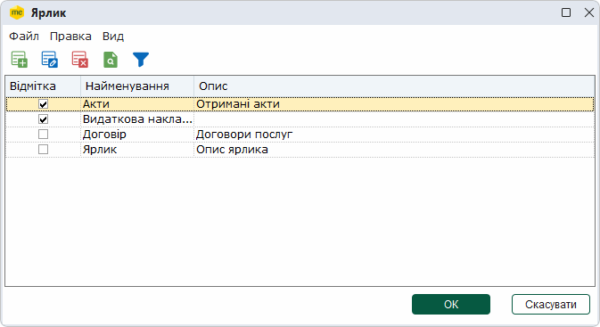

Щоб додати новий ярлик, натисніть кнопку . У вікні, що відкриється введіть значення ярлика. Відповідно кнопки  та  дозволяють змінити та видалити ярлик.

Обрані ярлики відобразяться у полі Ярлик області Перелік умов:

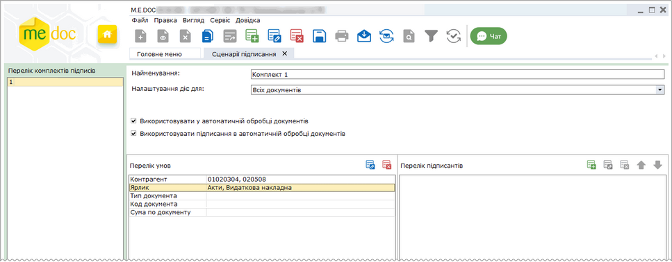

Натисніть, щоб збільшити малюнок

- Тип документа

Тип первинного документа (рахунок, акт, договір тощо).

Натисніть два рази лівою кнопкою миші на рядку Тип документа, або виділіть поле та натисніть кнопку  на панелі інструментів області Перелік умов. Відкриється вікно Тип документа:

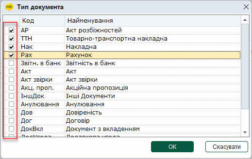

Встановіть позначки у рядках типів документів, для яких буде застосовуватись створюваний комплект підписів. Натисніть кнопку ОК.

Обрані типи первинних документів з'являться у полі Тип документа області Перелік умов:

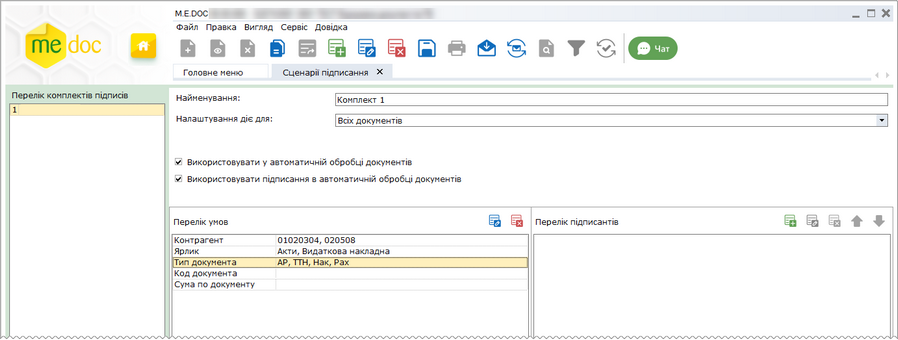

Натисніть, щоб збільшити малюнок

- Код документа

Поле містить код документа, для якого застосовується комплект підписів.

Натисніть два рази лівою кнопкою миші на рядку Код документа, або виділіть поле та натисніть кнопку  на панелі інструментів області Перелік умов. Відкриється вікно Код документа:

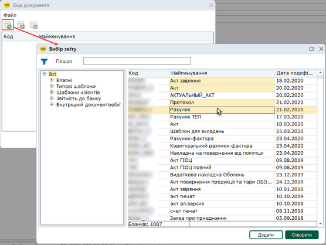

Натисніть, щоб збільшити малюнок

Щоб додати код документа (документів), натисніть кнопку .  У вікні Створення звіту оберіть код документа (або, натиснувши та утримуючі клавіші <Shift> або <Ctrl>, декілька кодів документів), для яких призначається створюваний комплект підписів. Натисніть кнопку Створити.

Коди та назви обраних документів з'являться у вікні Код документа.

Натисніть кнопку ОК. Обрані коди документів відобразяться у полі Код документа області Перелік умов:

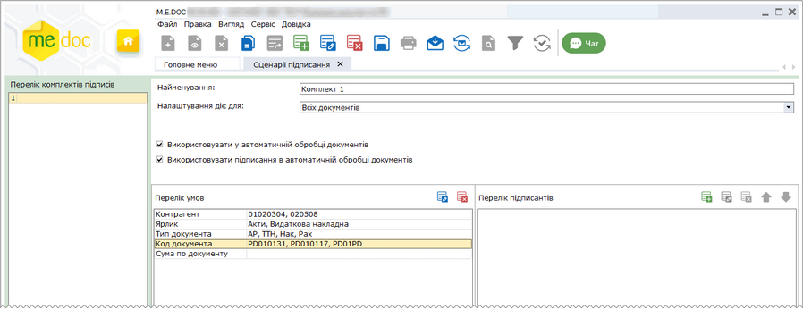

Натисніть, щоб збільшити малюнок

- Сума по документу

Сума документа, при якій застосовується комплект підписів, у відповідних полях задається мінімальна та максимальна допустима сума документа.

Натисніть два рази лівою кнопкою миші на рядку Сума по документу, або виділіть поле та натисніть кнопку  на панелі інструментів області Перелік умов. Відкриється вікно Сума по документу:

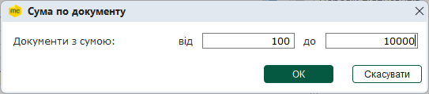

Введіть мінімальну та максимальну допустиму суму документа. Натисніть кнопку ОК.

Задані суми з'являться у полі Сума по документу області Перелік умов:

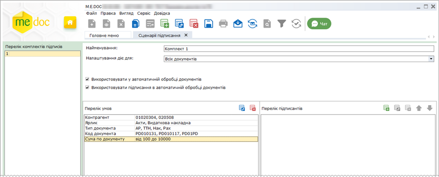

Натисніть, щоб збільшити малюнок

4. У області Перелік підписантів вкажіть дані підписантів, які повинні підписувати документ згідно створюваного комплекту підписів.

Натисніть кнопку  у області налаштувань Перелік підписантів.

5. У вікні, Підписант у полі Тип підпису оберіть тип сертифіката, яким повинно здійснюватися підписання документа:

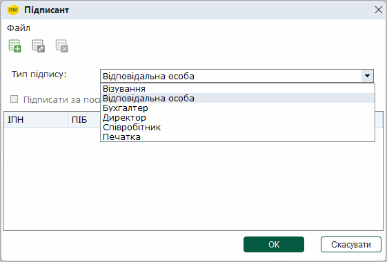

6. Додайте співробітника, що буде виконувати підписання. Натисніть кнопку . У  вікні Підписант з'явиться новий рядок. введіть ІПН та ПІБ підписанта вручну.

Або натисніть кнопку  та оберіть дані з довідника Співробітники:

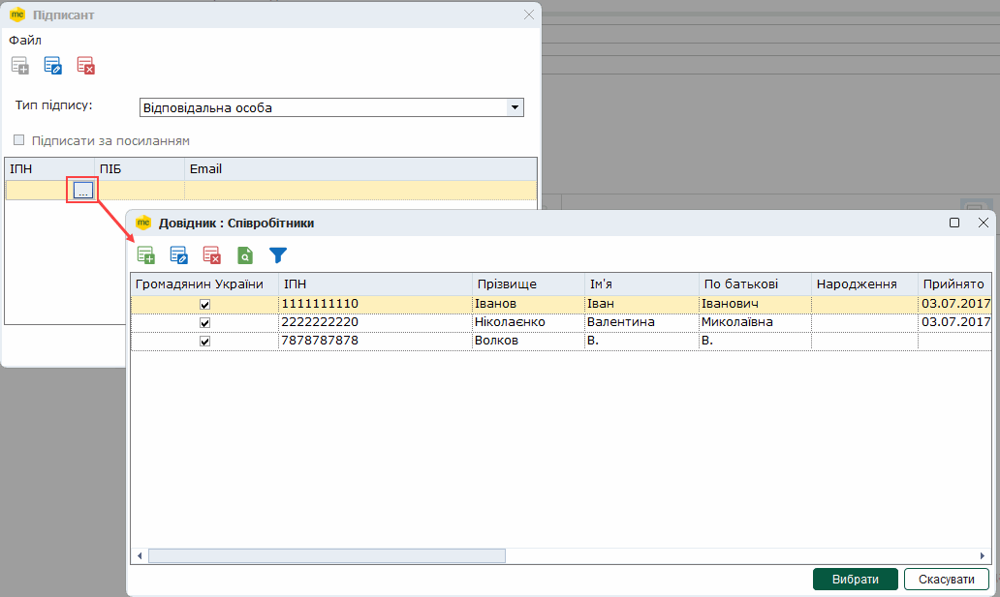

- При налаштуванні типу підпису Печатка, Директор та Бухгалтер вибір підписантів здійснюється із Реєстру сертифікатів.
- Для всіх типів підпису можна обрати кілька осіб, виділивши потрібні записи курсором при натиснутих клавішах <Ctrl> або <Shift>. Зверніть увагу, підписання документів здійснюється лише однією особою із визначеного переліку - співробітником, який першим підписує документ.
- Якщо документи повинні бути підписані кількома співробітниками, необхідно для кожного співробітника налаштувати окремий підпис.

7. Дані співробітника з'являться у вікні Підписант. Натисніть кнопку ОК.

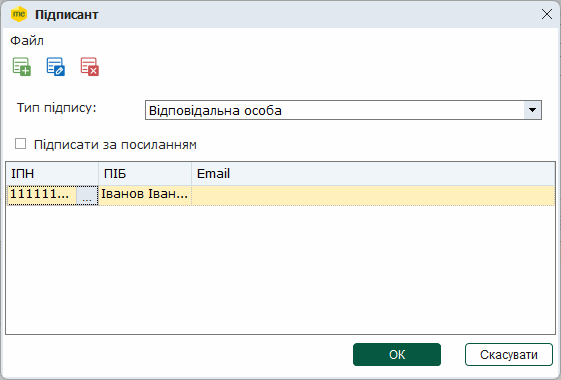

- Можна додати декілька підписантів для одного типу підпису. Кнопки  та  , відповідно, дозволяють змінити та видалити дані підписанта.
- У полі E-mail відображається електронна адреса, на яку буде відправлено посилання. У полі за замовчуванням для типів підписів Директор, Бухгалтер, Співробітник, Відповідальна особа, зазначається адреса, збережена у довіднику Співробітники. Змінити або вказати електронну адресу для відправки посилання можна безпосередньо у полі E-mail вікна Підписант.
- При налаштуванні комплекту з типом підпису Печатка, за замовчуванням поле E-mail не заповнене.
- Введена у полі E-mail адреса зберігається лише для налаштувань певного комплекту підписів та не змінює електронну адресу, зазначену у довіднику Співробітники. Для одного й того ж підписанта можна вказати різні електроні адреси у різних комплектах підписів.

Якщо для певного типу підпису не задані підписанти, підписання документа буде виконуватись всіма встановленими сертифікатами даного типу.

8. Дані співробітника з'являться у області налаштувань Перелік підписантів. Повторіть дії, описані у пунктах [4 - 7](#ucpdocsignsettings-ucpdocsignsettings), щоб додати всіх необхідних підписантів у створюваний комплект підписів.

9. У разі потреби, змініть порядок підписів. Оберіть тип підпису у списку та натискайте кнопки зі стрілками, поки підпис не займе потрібну позицію у списку. Порядок підписів у списку визначає, у якому порядку підписи накладатимуться на документ.

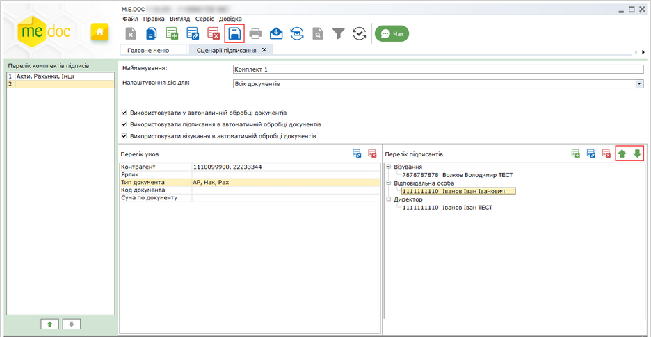

Натисніть, щоб збільшити малюнок

10. Збережіть налаштований комплект підписів: натисніть кнопку  панелі інструментів, або виконайте команду головного меню Файл - Зберегти. Ім'я комплекту підписів з'явиться на панелі Перелік комплектів підписів.

За замовчуванням пропонується ім'я комплекту підписів - Найменування <порядковий номер>.

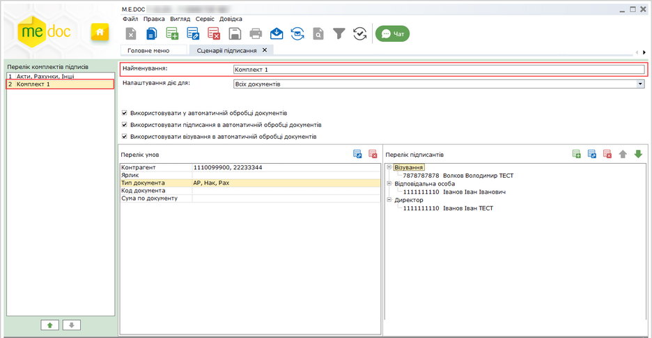

Натисніть, щоб збільшити малюнок

[До початку](#ucpdocsignsettings-ucpdocsignsettings)

Редагування та видалення налаштувань комплектів підписів

Щоб змінити або видалити комплект підписів, оберіть назву комплекту на панелі Перелік комплектів підписів та скористайтеся одним із способів:

- на панелі інструментів модуля натисніть відповідну кнопку   - редагувати комплект підписів або  - видалити комплект підписів;
- оберіть відповідну команду меню Файл - Редагувати запис або Файл - Видалити запис.

[До початку](#ucpdocsignsettings-ucpdocsignsettings)

Визначення пріоритету налаштувань комплекту підписів

Користувацький комплект підписів застосовується у відповідності до встановленого пріоритету. Якщо певному документу відповідає кілька комплектів підписів, для підписання документів використовується той комплект, що має вищий пріоритет.

Комплект підписів застосовується при виконанні всіх умов, зазначених у області Перелік умов. Якщо для певного документа не виконується хоча б одна з умов, застосовується інший користувацький комплект, що має нижчий пріоритет та умови якого виконуються (якщо такий існує).

Пріоритет комплекту підписів визначається його положенням у списку на панелі Перелік комплектів підписів. Чим вище знаходиться комплект у списку, тим більший пріоритет він має.

Щоб налаштувати пріоритети комплектів підписів:

1. Виділіть потрібний комплект у списку Перелік комплектів підписів.

2. Натискайте кнопки у нижній частині області, поки комплект підписів не займе потрібну позицію у списку:

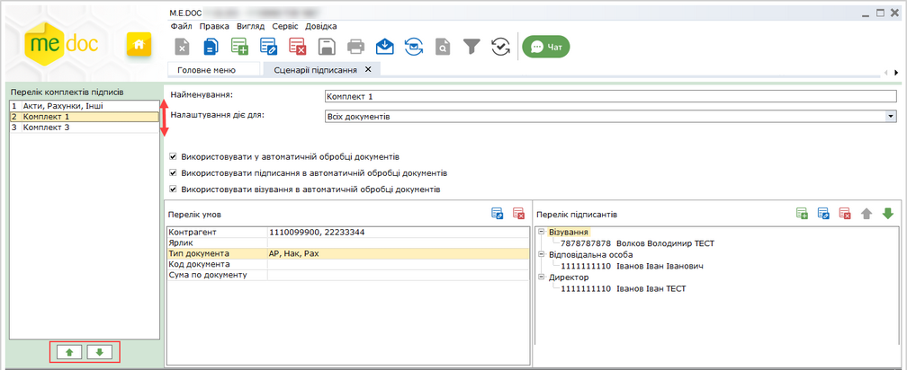

Натисніть, щоб збільшити малюнок

- перемістити налаштування комплекту підписів на позицію вище;
- перемістити налаштування комплекту підписів на позицію нижче;

[До початку](#ucpdocsignsettings-ucpdocsignsettings)

Налаштування візування документів

Функція Візування документів призначена для внутрішнього погодження вхідних та вихідних документів відповідальними особами.

Операція візування доступна, якщо для документів налаштовано підпис з типом Візування.

Візування документів здійснюється співробітниками, зазначеними підписі типу Візування, у межах організації.

Для налаштування підписів Візування:

У користувацькому комплекті підписів обов'язково повинен бути присутній підпис, що застосовується для безпосереднього підписання документа (підписи з типом Директор, Бухгалтер, Відповідальна особа тощо).

1. Заповніть область налаштувань Перелік умов та додайте підписантів, як описано у розділі [Створення користувацького комплекту підписів](#ucpdocsignsettings-ucpdocsignsettings).

2. У вікні, Підписант, у полі Тип підпису, оберіть Візування:

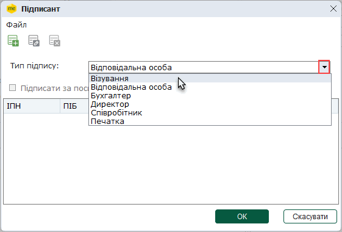

3. Якщо необхідно забезпечити можливість візування первинних документів за посиланням, встановіть опцію Підписати за посиланням та виконайте налаштування, як описано у розділі [Налаштування підписання документів за посиланням](#ucpdocsignsettings-ucpdocsignsettings).

4. У разі потреби, створіть перелік осіб, що можуть візувати документи. У підписі Візування можна додати кілька відповідальних осіб. Але, зверніть увагу, візування документів здійснюється лише однією особою із визначеного переліку - співробітником, який першим завізує документ.

5. Якщо візування документів повинно виконуватися кількома співробітниками у визначеній послідовності, створіть кілька підписів з типом Візування та розташуйте їх у необхідній послідовності у області Перелік підписантів за допомогою кнопок  та/або :

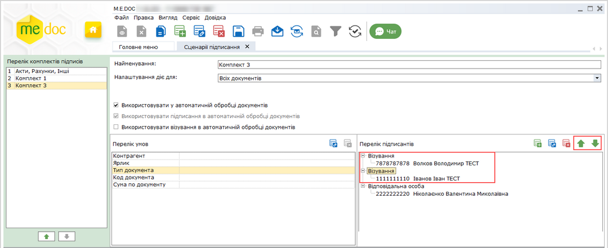

Натисніть, щоб збільшити малюнок

Порядок підписів у списку визначає, у якому порядку співробітники візуватимуть документи.

У Підписи з типом Візування мають найвищий пріоритет та не можуть бути розташовані після підписів підписання документів (Директор, Печатка тощо). Подальша обробка документа можлива лише після візування документа.

6. Візування документів підтримується у сервісах Автоматичної обробки документів та Універсальної автоматичної обробки.

Для застосування автоматичного візування документів у налаштуваннях комплекту підписів Візування необхідно встановити опцію Використовувати у автоматичній обробці документів - Використовувати візування в автоматичній обробці документів. Якщо опція встановлена, для визначених документів при автоматичній обробці здійснюється візування, відповідно до комплекту підписів Візування.

Якщо у комплекті присутній підпис з типом Візування при увімкненні опції Використовувати у автоматичній обробці документів відмітки Використовувати візування в автоматичній обробці документів та Використовувати підписання в автоматичній обробці документів встановлюються автоматично.

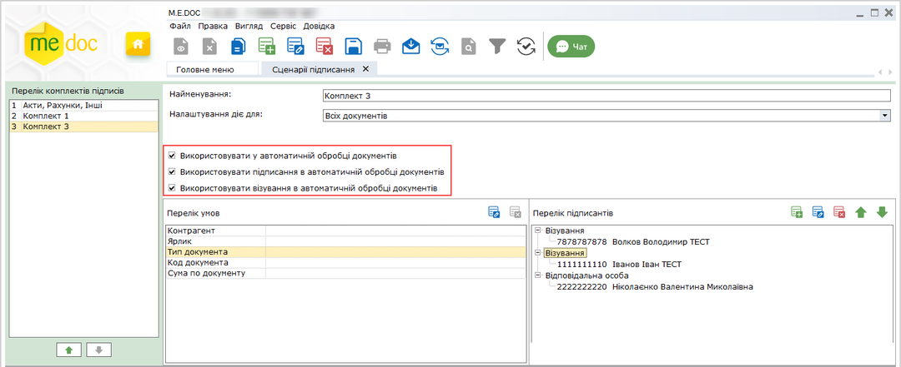

Натисніть, щоб збільшити малюнок

Зверніть увагу, для увімкнення автоматичного візування документів необхідно:

- для вхідних документів у розділі [Первинні документи – Автоматична обробка документів](UCGlobalAutoProcJournalFunc.html#ucglobalautoprocjournalfunc-pdocs_avto_func) активувати розділ [Обробка вхідних документів – Автоматичне погодження первинних документів](UCGlobalAutoProcJournalFunc.html#ucglobalautoprocjournalfunc-pdocs_avto_func) та у комплекті підписів Візування обрати напрямок документа, для якого застосовується комплект підписів: вхідні документи або всі документи;
- для вихідних документів у розділі Первинні документи – Автоматична обробка документів активувати розділ [Відправка первинних документів автообробником контрагенту](UCGlobalAutoProcJournalFunc.html#ucglobalautoprocjournalfunc-pdocs_avto_func) та у комплекті підписів Візування обрати напрямок документа, для якого застосовується комплект підписів: вихідні документи або всі документи.

Також автоматичну обробку документів з використанням користувацьких комплектів підписів можна налаштувати у [Сервісі універсальної автоматичної обробки документів](AP.html#ap-uao_func).

7.  У вікні Підписант натисніть кнопку ОК, щоб зберегти налаштування.

8.  Збережіть комплект підписів - натисніть кнопку  панелі інструментів, або виконайте команду головного меню Файл - Зберегти.

[До початку](#ucpdocsignsettings-ucpdocsignsettings)

Налаштування підписання документів за посиланням

Підписання документів за посиланням надає можливість здійснювати підписання документів користувачам, у яких на момент підписання документа відсутній доступ до програми, а також використовувати автоматичну обробку для відправки документів на підписання посадовим особам у послідовності, що визначена внутрішніми положеннями підприємства.

Підписання документів за посиланням здійснюється співробітниками, зазначеними у користувацькому комплекті підписів, у межах організації.

Підписання за посиланням можна налаштовувати для будь-якої кількості підписантів з користувацького комплекту підписів.

1. Заповніть область налаштувань Перелік умов та додайте підписантів, як описано у розділі [Створення користувацького комплекту підписів](#ucpdocsignsettings-ucpdocsignsettings).

2. У вікні, Підписант встановіть опцію Підписати за посиланням:

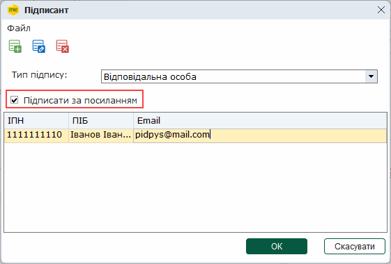

Для вже існуючих комплектів підпису оберіть підписанта у області Перелік підписантів та натисніть кнопку  .

Натисніть кнопку ОК. Якщо у довіднику [Співробітники](UCSharePers.html#ucsharepers-sprperson) для обраного підписанта вже вказано електронну адресу, перейдіть до [п. 6](#ucpdocsignsettings-ucpdocsignsettings).

3.  У полі E-mail відображається електронна адреса, на яку буде відправлено посилання. За замовчуванням вказана електронна адреса, зазначена у довіднику Співробітники, якщо адреса у довіднику не заповнена, вказується адреса, зазначена у сертифікаті. Вказати або змінити електронну адресу можна безпосередньо у полі E-mail вікна Підписант.

Введена у полі E-mail адреса зберігається лише для налаштувань комплекту підписів та не змінює електронну адресу, зазначену у довіднику Співробітники.

Якщо поле E-mail залишилось незаповненим, по натисканню кнопки ОК відкриється вікно повідомлення:

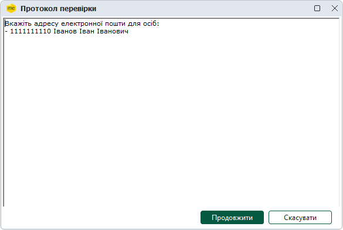

Натисніть кнопку Продовжити.

4.  Відкриється вікно довідника Співробітники. Оберіть співробітника у списку та натисніть кнопку Редагувати:

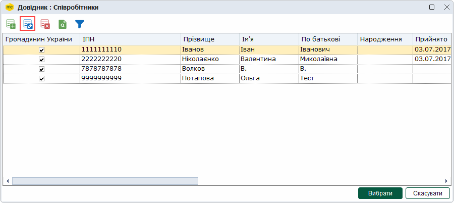

5.  У вікні картки співробітника у полі  введуть електронну адресу, на яку потрібно відправляти посилання на документ для підписання:

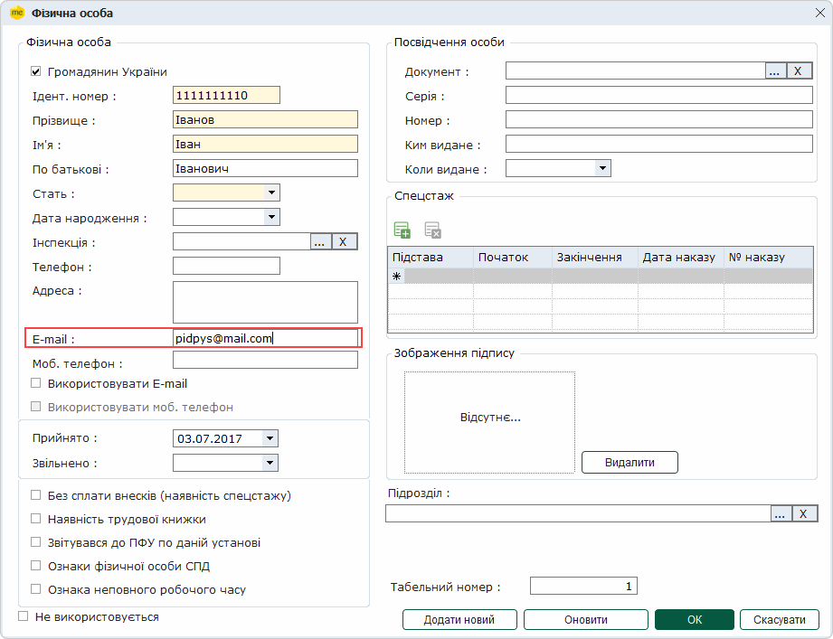

Збережіть зміни, натиснувши ОК.

6.  У вікні Підписант натисніть кнопку ОК, щоб зберегти налаштування.

7.   Збережіть комплект підписів - натисніть кнопку  панелі інструментів, або виконайте команду головного меню Файл - Зберегти.

Якщо підписання документа за посиланням налаштовано, при виконанні команди Підписати документ або Відправити документ буде відкрито вікно повідомлення з пропозицією відправити посилання на документ для підписання:

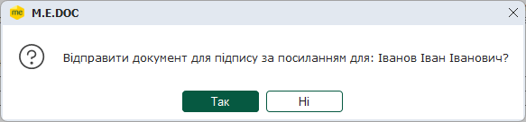

По натисканню кнопки Так, відбувається відправка посилання на адресу електронної пошти, яка вказана для підписанта у довіднику Співробітники. У разі натискання кнопки Ні, можна виконати підписання документа безпосередньо у програмі.

При обробці документів за допомогою сервісу Автоматичної обробки документів та Універсальної автоматичної обробки виконуватиметься автоматична відправка посилання на документів на вказану електронну адресу підписантів (у визначеному комплектом підписів порядку), подальша автоматична обробка документа продовжується після підписання документа всіма співробітниками з комплекту підписів, яким було надіслано посилання.

[До початку](#ucpdocsignsettings-ucpdocsignsettings)


