[← Зміст довідки](../)


# Контрагенти

## Контрагенти

_Шлях у довідці: Розділи програми › Довідники › Контрагенти_

В цьому розділі:

[Створення груп контрагентів](#ucpartnerrst-sprpartner)

[Створення та заповнення картки контрагента](#ucpartnerrst-sprpartner)

[Експорт реєстру контрагентів](#ucpartnerrst-sprpartner)

[Імпорт реєстру контрагентів з DBF файлу](#ucpartnerrst-sprpartner)

[Імпорт реєстру контрагентів з XML файлу](#ucpartnerrst-sprpartner)

[Редагування реєстру контрагентів](#ucpartnerrst-sprpartner)

[Додавання контрагентів в адресну книгу](#ucpartnerrst-sprpartner)

[Оновлення даних по контрагентів з ЄДК](#ucpartnerrst-sprpartner)

[Заборона відправки повідомлень](#ucpartnerrst-sprpartner)

В довіднику Контрагенти зберігається інформація про фізичних та юридичних осіб, з якими співпрацює установа. Ця інформація необхідна для здійснення документообігу між підприємствами і використовується, наприклад, для автоматичного заповнення при створенні первинних документів та звітів, які мають містити реєстраційні дані контрагентів (коди ЄДРПОУ, ІПН тощо).

Довідник Контрагенти має складну структуру, в якій реєстр контрагентів є залежним від груп Групи - категорії ділових відносин з підприємством, наприклад, "Постачальники", "Покупці". Саме тому довідник умовно складається із двох частин: Групи та Контрагенти.

Зліва у Групах відображається список груп контрагентів, справа у Контрагентах - список контактів вибраної групи При обранні певної групи у вікні справа відображається список контрагентів, які входять до обраної групи.

Модуль побудований у вигляді таблиці, окремий рядок якої відображає коротку інформацію про кожного контрагента. Внизу таблиці відображається кількість записів обраної групи. Переглянути більш повну інформацію про контрагента можна у окремому вікні Картка контрагента, яке відкривається подвійним кліком по потрібному запису.

Дані кожного контрагента заповнюються у картці контрагента безпосередньо користувачем програмного комплексу. Передбачено імпорт даних із відповідних файлів, створених у інших бухгалтерських системах, а також експорт реєстру контрагентів у спеціальний файл.

Основні реквізити у  картці контрагента у програмі можуть бути заповнені одним із способів:

- внесені вручну користувачем;
- завантажені із Єдиного довідника контрагентів;
- завантажені із бази платників ДПС;
- завантажені із сертифікатів контрагента.

Створення груп контрагентів

Перш ніж створити нового контрагента, необхідно створити групу, якій він буде підпорядкований.

1. Для того, щоб створити нову групу, на панелі інструментів виберіть команду Створити, або натисніть комбінацію клавіш Ctrl+N.

При [додаванні нової організації](Connect_org.html#connect_org-connect_org) у довіднику Контрагенти автоматично створюється група контрагентів – Загальна група.

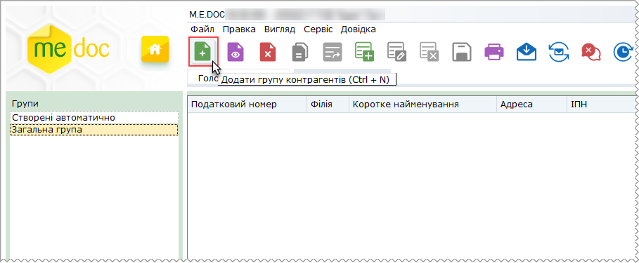

2. Відкриється вікно Група. Заповніть запропоновані поля форми та натисніть кнопку ОК.

Поля, що підсвічені жовтим кольором, є обов'язковими для заповнення.

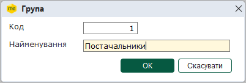

- Код - унікальний набір цифр для ідентифікації групи;
- Найменування - умовна назва групи контрагентів.

3. Натисніть кнопку ОК. Нова група з'явиться у переліку груп.

В списку груп контрагентів також доступні наступні функції:

|  |  |  |
| --- | --- | --- |
|  | Видалити групу Контрагентів  (Shift+Del) | Дозволяє безповоротно вилучити запис.  УВАГА!   При видаленні групи безповоротно видаляється увесь її вміст - всі підпорядковані їй записи контрагентів. |
|  | Редагувати групу Контрагентів  (Ctrl+F2) | Редагування даних в разі необхідності. |

[До початку](#ucpartnerrst-sprpartner)

Створення та заповнення картки контрагента

1. Для того, щоб додати нового контрагента, на панелі інструментів виберіть команду Створити запис, або натисніть комбінацію клавіш Ctrl+I.

Функція стає активною, якщо клікнути лівою кнопкою миші у будь-якому місці поля Контрагенти.

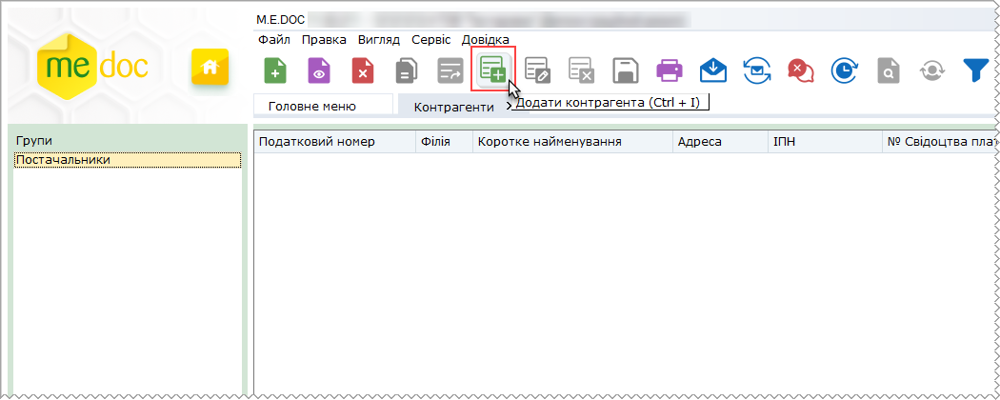

2. Відкриється вікно Картка контрагента. Картка включає наступні розділи: Загальні дані, Рахунки, Адреси, Історія, Додатково, Історія оновлень в ЄДК. Заповніть запропоновані поля форми.

Можливо завантажити сертифікати контрагента з серверу КНЕДП "Україна", за умові наявності  сертифікату. Для завантаження даних натисніть кнопку .

Загальні дані

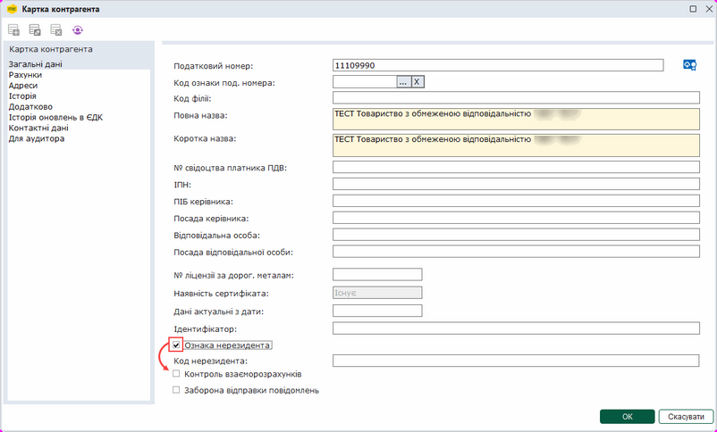

Натисніть, щоб збільшити малюнок

- Податковий номер - код контрагента за Єдиним державним реєстром підприємств та організацій України. Для фізичних осіб-підприємців дане поле містить його індивідуальний податковий номер платника податку (ІПН).
- Код ознаки под. номера - код ознаки джерела податкового номера, значення обирається з підключеного довідника Код ознаки джерела податкового номера.
- Код філії - якщо контрагент є філією, введіть код цієї філії у дане поле.
- Повна назва - повне найменування контрагента.
- Коротка назва - скорочене найменування контрагента.
- № свідоцтва платника ПДВ - за умови, що контрагент є платником ПДВ, введіть у це поле його номер свідоцтва про реєстрацію платника податку на додану вартість. Поле не обов'язкове для заповнення.
- ІПН - якщо контрагент є платником податку на додану вартість, ведіть у це поле його індивідуальний податковий номер платника ПДВ. Для осіб, що з релігійних причин відмовились від присвоєння ІНН, у це поле вводиться серія та номер паспорту.
- ПІБ керівника - прізвище, ім'я та по батькові керівника контрагента.
- Посада керівника - вкажіть посаду керівника.
- Відповідальна особа - прізвище, ім'я та по батькові відповідальної особи.
- Посада відповідальної особи - вкажіть посаду відповідальної особи.
- № ліцензії за дорог. метали - номер ліцензії у форматі: NNXXXXXX - дві літери та шість цифр.
- Наявність сертифіката - наявність сертифікату КНЕДП "Україна" у контрагента.
- Дані актуальні з дати - у полі відображається дата, з якої актуальні реквізити контрагента. Дане поле заповнюється програмою автоматично після синхронізації даних контрагента з Єдиним довідником контрагентів (ЄДК) на сервері документообігу.
- Ідентифікатор - введіть ідентифікатор контрагент у обліковій системі (якщо використовується).
- Ознака нерезидента - якщо контрагент є нерезидентом, встановіть опцію для введення коду нерезидента.
- Код нерезидента - введіть код нерезидента, поле доступне для введення даних при встановленій опції Ознака нерезидента.
- Ознака нерезидента - галочка встановлюється, якщо контрагент не є громадянином України.
- Контроль взаєморозрахунків - встановлена галочка означає ведення контролю за взаєморозрахунками з даним контрагентом.
- Заборона відправки повідомлень - встановлена галочка означає , що даному контрагенту не потрібно відправляти первинні документи.

Рахунки

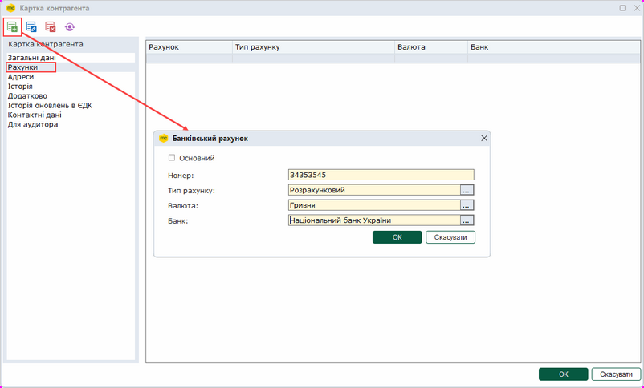

Натисніть, щоб збільшити малюнок

Додавання рахунків контрагента відбувається аналогічно [додаванню рахунків у картці підприємства](UCOrg.html#ucorg-sprorg_rah).

Адреси

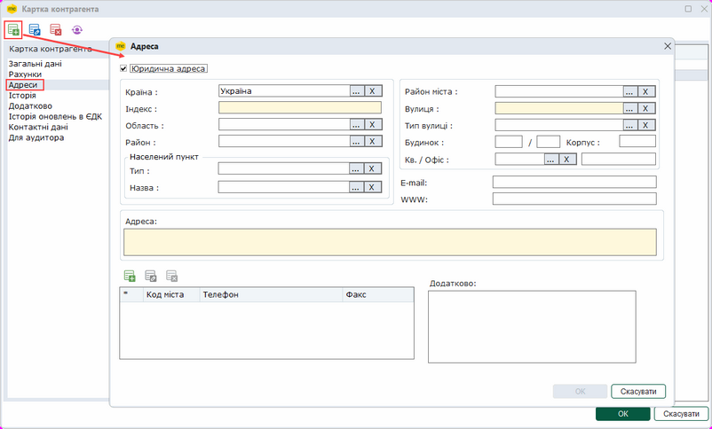

Натисніть, щоб збільшити малюнок

Додавання адрес контрагента відбувається аналогічно [додаванню адрес у картці підприємства](UCOrg.html#ucorg-sprorg_adr).

Історія

У цій закладці зберігається довільна інформація, пов'язана з даним контрагентом.

Для того, щоб додати історію контрагента, на панелі інструментів виберіть команду Створити запис, або натисніть комбінацію клавіш Ctrl+I.

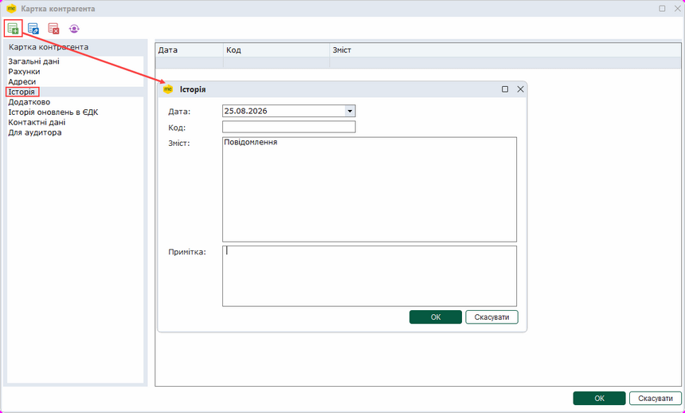

Натисніть, щоб збільшити малюнок

Відкриється вікно Історія, де можна ввести будь-яку інформацію, що стосується контрагента.

Додатково

У розділі Додатково містяться дані договорів з контрагентом. Під час створення Первинних документів, поля, що містять дані про договір, буде автоматично заповнено даними з Картки контрагента.

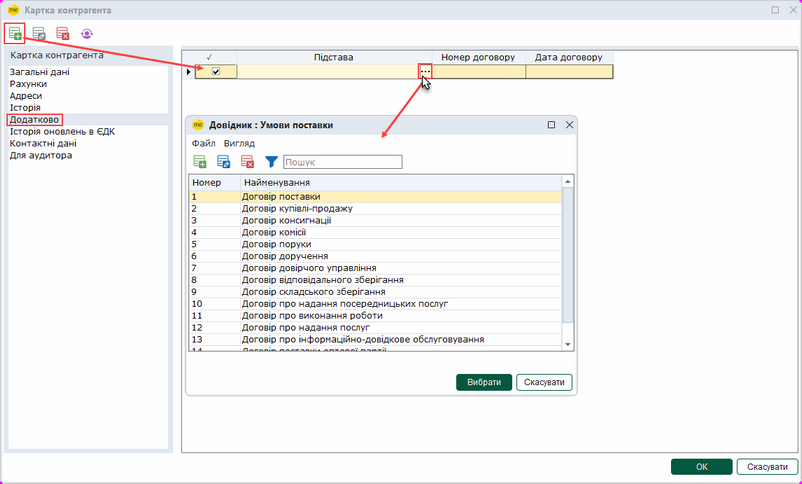

Натисніть, щоб збільшити малюнок

Для додавання Договору натисніть кнопку .

У колонці Підстава, оберіть тип договору. Значення обирається з Довідника Умови поставки.

У полі Номер договору введіть значення за допомогою клавіатури.

У полі Дата договору введіть значення за допомогою клавіатури або оберіть потрібну дату у вікні календаря.

Щоб обрати договір, який потрібно використовувати при створенні документів, встановіть "галочку" у рядку договору.

Історія оновлень в ЄДК

Розділ відображає інформацію щодо оновлення даних контрагента і дати, з якої вони актуальні. Ця інформація завантажується з ЄДК.

Записи можливо тільки переглянути, відкривши їх подвійним кліком лівої кнопки миші. Редагувати записи контрагента, звірені з ЄДК, неможливо.

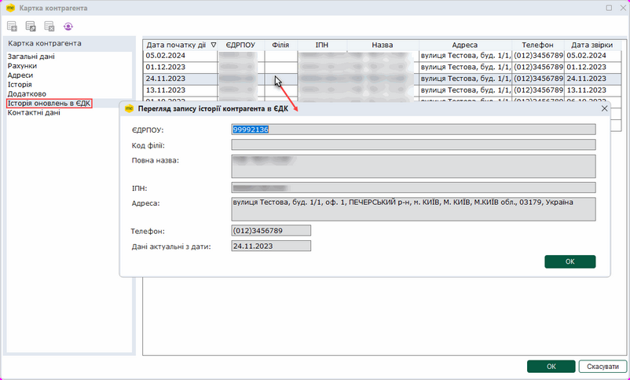

Натисніть, щоб збільшити малюнок

Контактні дані

Розділ призначений для зберігання списку контактних осіб контрагента.

Адреси зазначених осіб використовуються для забезпечення електронного документообігу з контрагентами, що за певних причин не можуть скористатися програмою M.E.Doc. На вказані електронні адреси відправлятимуться посилання, за якими контрагент може переглянути та опрацювати документи.

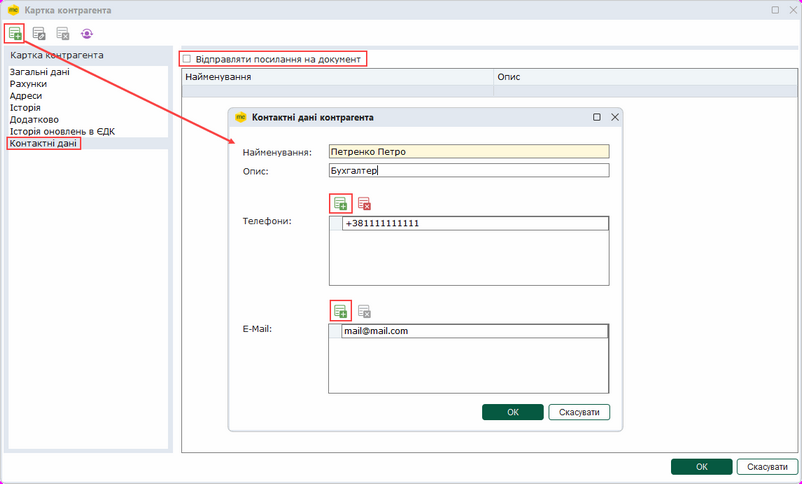

Натисніть, щоб збільшити малюнок

Щоб додати контактну особу, у розділ Контактні дані натисніть кнопку на панелі інструментів. У вікні Контактні дані контрагента введіть інформацію:

- Найменування – контактна особа;
- Опис – додаткова інформація про контактну особу;
- Телефон – телефон контактної особи;
- Е-Mail – електронна адреса, на яку будуть відправлятися посилання на первинні документи.

Можливо додати довільну кількість номерів телефонів та електронних адрес, натискаючи кнопку  над відповідним полем.

Обов’язково необхідно вказати хоча б одну електронну адресу!

При встановленій опції Відправляти посилання на документ під час відправки первинного документа контрагенту буде автоматично сформовано посилання на документ, яке надсилається всім контактним особам контрагента (зазначеним у розділі Контактні дані).

Для швидкого встановлення опції Відправляти посилання на документ скористайтеся командою головного меню Правка - Встановити ознаку відправки посилання на документ або командою контекстного меню Встановити ознаку відправки посилання на документ.

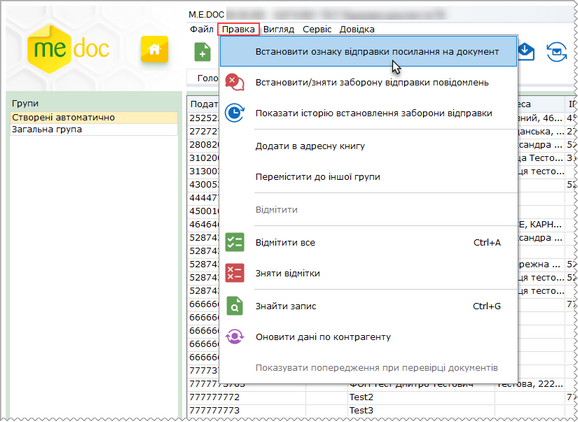

Натисніть, щоб збільшити малюнок

У вікні, що відкриється, оберіть спосіб встановлення опції:

- Для обраних записів - встановити опцію Відправляти посилання на документ для обраних записів довідника, попередньо необхідно виділити потрібні записи контрагентів у таблиці довідника, можна обрати кілька контрагентів одночасно;
- Для всіх записів - встановити опцію Відправляти посилання на документ для всіх записів довідника Контрагенти.

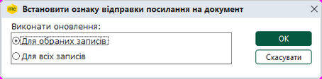

Натисніть, щоб збільшити малюнок

Для продовження натисніть кнопку ОК. Програма повідомить про результати виконання операції.

Зверніть увагу! Встановити опцію Відправляти посилання на документ можна лише для контрагентів, у картці яких вказано хоча б одну електронну адресу у розділі [Контактні дані](#ucpartnerrst-sprpartner).

В списку контрагентів підприємства також доступні наступні функції:

|  |  |
| --- | --- |
| Видалити | Дозволяє безповоротно вилучити запис. |
| Редагувати | Редагування даних в разі необхідності. |

[До початку](#ucpartnerrst-sprpartner)

Експорт реєстру контрагентів

Функція експорту реєстру контрагентів призначена для вивантаження та збереження файлів із даними довідника в каталог поза програмним комплексом.

Вивантажені данні зберігаються у форматі \*.dbf та/або \*.xml.

1. Для того щоб експортувати реєстр контрагентів, в меню Файл оберіть команду Експорт і далі формат, у який виконати вивантаження: Експорт в DBF або Експорт в XML.

2. Якщо обрано Експорт в XML, відкриється вікно Директорія, в якому оберіть шлях для збереження файлу:

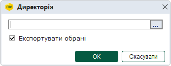

Якщо обрано Експорт в DBF, відкриється вікно Параметри експорту в DVF, в якому оберіть формат DBF-файлу, встановивши відповідну опцію (рекомендовано DBF VI) та шлях для збереження файлу:

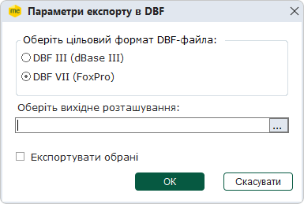

Якщо опцію Експортувати обрані встановлено, будуть експортуватись контакти обраної групи. У разі, якщо позначка відсутня, виконується експорт всіх записів довідника Контрагенти.

3. Натисніть ОК для підтвердження вибору та початку експорту.

При експорті в DBF дані розбиваються на групи файлів:

- PARTNER.DBF - перелік контрагентів;
- PARTNADR.DBF - адреси контрагентів;
- PARTNTEL.DBF - телефони контрагентів;
- PARTNBNK.DBF - банки контрагентів;
- PHISTORY.DBF - історія контрагентів;
- PEXT.DBF - договори контрагентів;
- PARTNCONTACT.DBF - контактні дані;
- PARTNCONTACTEMAIL.DBF - контактні дані - e-mail;
- PARTNCONTACTTEL.DBF - контактні дані - телефони.

При експорті в XML створюється файл PARTNER\_NNNNNNNN\_YYYYMMDDXXXXXX.XML, де NNNNNNNN\_YYYYMMDDXXXXXX відповідно ЄДРПОУ підприємства, рік, місяць, день, час створення файлу.

4. По закінченні процедури, система виведе результати експорту, де буде вказано шлях до розміщення файлів експорту та їх назву.

[До початку](#ucpartnerrst-sprpartner)

Імпорт реєстру контрагентів з DBF файлу

Довідник контрагентів може бути створений автоматично шляхом перенесення даних із файлу з розширенням \*.dbf. Для цього призначена функція імпорту.

Детальний опис структури DBF для імпорту реєстру у програму міститься у документі з назвою "Структура файлів DBF для довідника Контрагенти.pdf", який знаходиться у каталозі ...\Medoc\help\manuals.

Для коректного перенесення даних по контрагентам, перед початком вивантаження реєстру контрагентів із сторонньої програми, потрібно впевнитись, що поле "ЄДРПОУ" контрагента заповнено унікальним значенням.

1. Для того щоб імпортувати реєстр контрагентів з DBF у програму, в меню Файл оберіть команду Імпорт - Імпорт з DBF.

2. Відкривається вікно Імпорт контрагентів. У полі Оберіть каталог для імпорту вкажіть шлях до каталогу розміщення dbf-файлів.

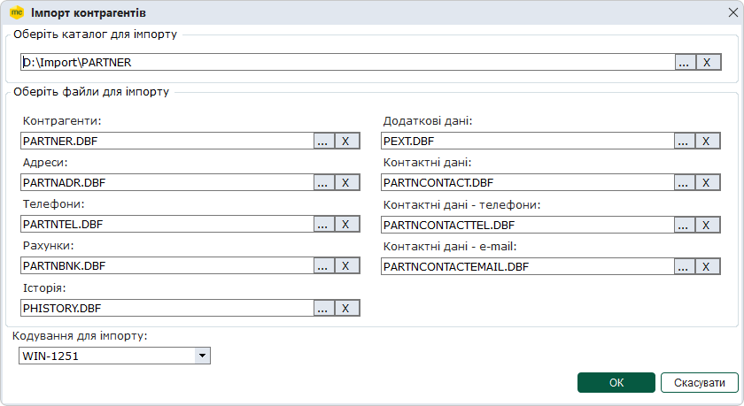

3. Поля  Контрагенти, Адреси, Телефони, Рахунки, Історія, Додаткові дані, Контактні дані, Контактні дані - телефони та Контактні дані - e-mail заповнюються автоматично, виходячи із наявності файлів в указаному каталозі. Можливо обрати інший файл для імпорту, натиснувши кнопку  у відповідному полі.

4. Натисніть ОК для початку імпорту.

5. По закінченні процедури система виведе протокол імпорту даних.

6. При імпорті записи контрагентів не розподіляються по групам, вони додаються в першу по списку групу. Якщо список груп порожній, автоматично створюється однойменна група (Створені автоматично), в яку додаються імпортовані записи.

Відредагуйте реєстр контрагентів відповідно до ваших потреб.

Разом із довідником реалізовано вивантаження даних поля Стан ліцензії, Документообіг, Наявність сертифіката в \*.dbf. Проте при імпорті дані цих полів не імпортуються, проставляються значення Невідомо.

[До початку](#ucpartnerrst-sprpartner)

Імпорт реєстру контрагентів з XML файлу

Довідник контрагентів може бути створений автоматично шляхом перенесення даних із файлу з розширенням \*.xml.

1. У меню Файл оберіть команду Імпорт - Імпорт з XML.

2. Відкриється вікно Відкриття файлу. Звичайним для операційної системи Windows способом оберіть каталог, де розташовано файл з розширенням \*.xml та оберіть цей файл.

3. Розпочнеться процес імпорту, по закінченні якого система виведе протокол імпорту даних.

[До початку](#ucpartnerrst-sprpartner)

Редагування реєстру контрагентів

У випадках, коли при імпорті записи контрагентів додаються всі в одну групу, або запис контрагента був випадково створений в іншій групі, використовується функція переміщення записів до іншої групи.

1. Виділіть у реєстрі записи контрагентів, що потрібно перемістити. Оберіть команду Перемістити до іншої групи у контекстному меню (або Правка/Перемістити до іншої групи).

2. Відкриється модальне вікно, що містить перелік груп довідника. Виберіть потрібну групу та натисніть кнопку Вибрати.

[До початку](#ucpartnerrst-sprpartner)

Додавання контрагентів в адресну книгу

В процесі взаємодії з контрагентом виникає необхідність обміну електронними документами. В допомогу користувачу була реалізована функція додавання даних контрагента в адресну книгу.

1. Виділіть у реєстрі записи контрагентів, які потрібно додати в адресну книгу. Оберіть команду Додати в адресну книгу у контекстному меню (або Правка/Додати в адресну книгу).

2. Відкриється вікно [Запис адресної книги](UCAddrBook.html#ucaddrbook-spraddrbook). Заповніть запропоновані поля форми та натисніть кнопку ОК.

Записи будуть додані в адресну книгу, у закладку Контрагенти.

[До початку](#ucpartnerrst-sprpartner)

Оновлення даних контрагентів з ЄДК

Змінений принцип оновлення даних по контрагентах – виконується оновлення з ЄДК. Але якщо дані контрагента відсутні у ЄДК, оновлення виконується за попереднім варіантом - з базою даних платників ДПС.

Оновлення даних може виконуватися для окремих контрагентів із їх карток, та групове оновлення вибраних записів - із Реєстру контрагентів.

Із довідника контрагентів оновлення даних запускається вручну користувачем, і тому може виконуватися багато разів за день.

Для оновлення даних по контрагентах із довідника виконайте дії у наступній послідовності:

1. У таблиці модулю у групі виділіть запис (або декілька) контрагента, дані якого потрібно перевірити.

2. Скористайтесь одним із наступних способів:

- у меню Правка оберіть команду Оновити дані по контрагенту;
- у контекстному меню оберіть команду Оновити дані по контрагенту.
- натисніть кнопку  на панелі інструментів модуля.

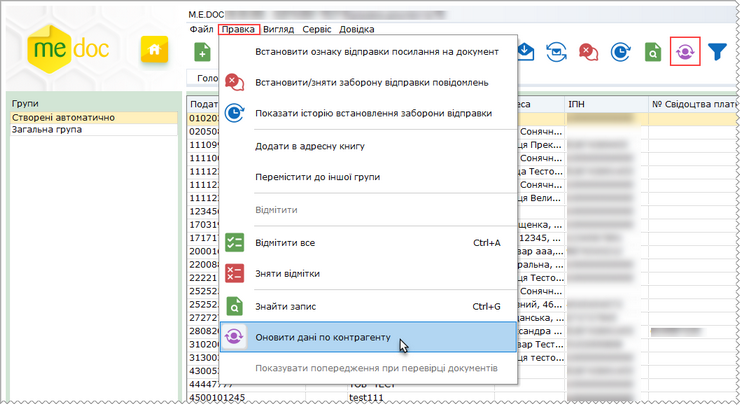

Натисніть, щоб збільшити малюнок

3. Відкриється вікно Оновлення даних по контрагенту. Оберіть потрібний варіант оновлення: для обраних записів або для всіх записів. Натисніть кнопку ОК.

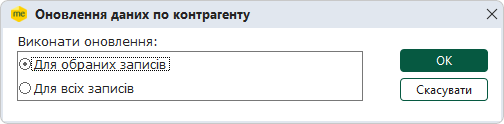

4.  Сервіс виконає звірку даних з ЄДК та повідомить про результат.

Зверніть увагу!

При оновленні даних контрагентів першим кроком є звірення з ЄДК.

Якщо ж у реєстрі присутні контрагенти, яких немає в ЄДК, наступним кроком програма звірить ІПН та № Свідоцтва платника ПДВ контрагентів з базою платників ДПС та оновить їх у разі розбіжностей.

Якщо контрагент відсутній і у базі платників ДПС, дані звіряються з внесеними у сертифікаті контрагента.

5. Після оновлення даних у таблиці контрагентів в колонках Наявність в ЄДК та Запит за допомогою відповідних символів відображається результат операції оновлення:

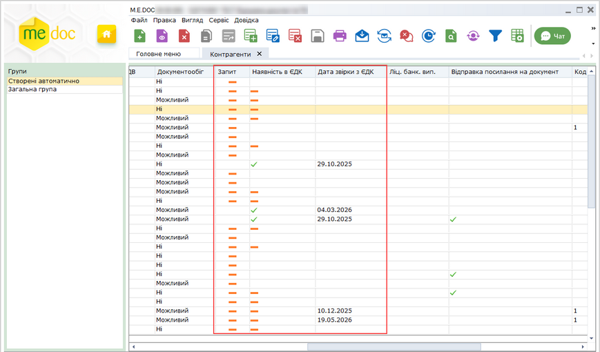

Натисніть, щоб збільшити малюнок

- «» - дані оновлено успішно;
- «» - немає даних для оновлення;

6. Результати оновлення даних з ЄДК будуть внесені в картки контрагентів. Оновлені дані недоступні для редагування.

Для оновлення даних окремого контрагента, у картці контрагента натисніть кнопку Оновити дані по контрагенту.

Сервіс з'єднається з СДО, виконає оновлення даних з ЄДК та відобразить результат:

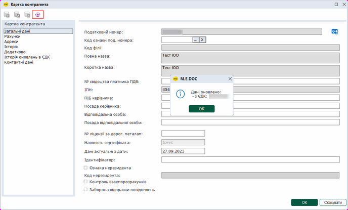

Натисніть, щоб збільшити малюнок

Зверніть увагу! Дані в картках контрагента, які були синхронізовані з ЄДК, недоступні для редагування.

Дата завантаження даних з ЄДК відображається у полі Дані актуальні з дати на вкладці Загальні дані.

Щоб здійснювати обмін документами, у контрагентів повинні бути наявні сертифікати шифрування. Завантажити сертифікат Контрагента можна з Картки контрагента за допомогою функції Завантажити сертифікат, або ж за допомогою оновлення даних контрагента.

Також завантаження сертифікатів Контрагента виконується під час будь-якої операції з ЄДК або сервісом ДПС. Після виконання звірки з ЄДК або завантаження даних по контрагенту, перевіряється наявність його сертифікатів у базі програми. Якщо у Контрагента наявні сертифікати, але вони відсутні у базі програми, виконується завантаження сертифікатів, яких бракує у базі.

Можливість документообігу з Контрагентами відображається у колонці Документообіг: якщо у контрагента є сертифікат шифрування у колонці відображено ознаку Можливий, якщо ж у Контрагента нема сертифікату шифрування (або його не вдалося завантажити), у колонці відображено ознаку Ні.

[До початку](#ucpartnerrst-sprpartner)

Заборона відправки повідомлень

Для випадків, коли за будь-яких причин контрагенту примусово не потрібно відправляти первинні документи передбачено функцію Заборона відправки повідомлень.

Якщо встановлена заборона, при відправці документів з Реєстру первинних документів, відміченим контрагентам повідомлення не будуть надіслані, про що програма зазначить в повідомленні.

Для того, щоб встановити заборону відправки повідомлень контрагенту, відкрийте картку потрібного контрагента та на вкладці Загальні дані встановіть опцію Заборона відправки повідомлень.

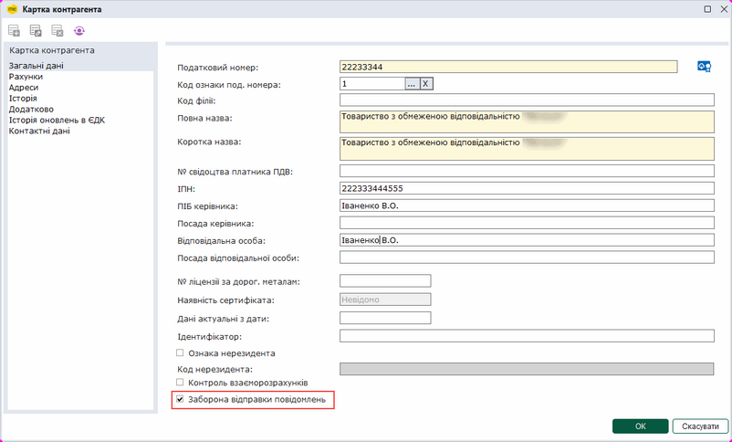

Натисніть, щоб збільшити малюнок

Якщо опцію встановлено, в таблиці реєстру, у колонці Заборона відправки, для контрагентів, яким встановлено заборону, відображатиметься ознака Так.

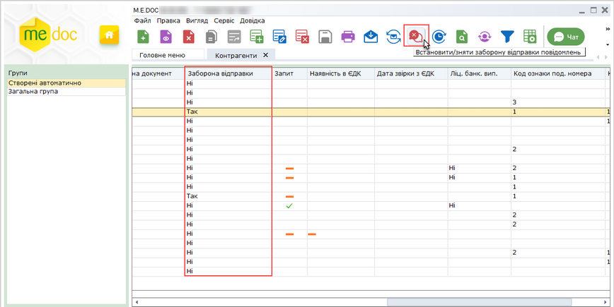

Натисніть, щоб збільшити малюнок

Для швидкого встановлення/зняття опції для кількох контрагентів одночасно виділіть в реєстрі контрагентів потрібні записи (утримуючі клавішу <Ctrl> або <Shift>) та натисніть кнопку Встановити/зняти заборону відправки повідомлень на панелі інструментів.

У програмі зберігається історія та ведеться протокол заборони/дозволу можливості відправки повідомлень контрагентам.

Для відображення протоколу натисніть кнопку Показати історію встановлення заборони відправки на панелі інструментів.

Вкажіть період відображення протоколу.

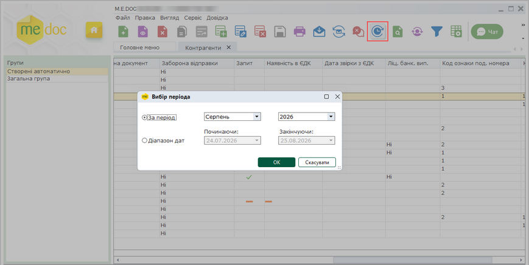

Натисніть, щоб збільшити малюнок

Протокол відкриється у окремій вкладці програми.

Протокол можна роздрукувати та вивантажити в Excel та RFT за допомогою команди головного меню Файл - Експорт.

[До початку](#ucpartnerrst-sprpartner)


