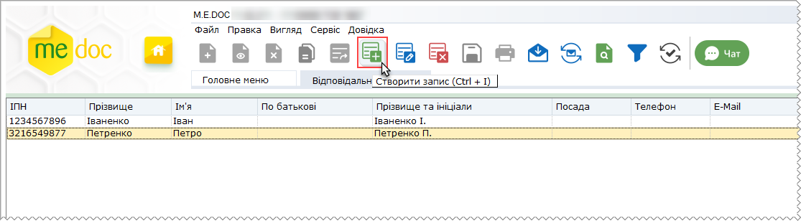
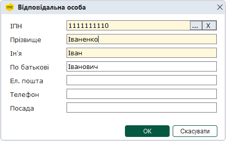
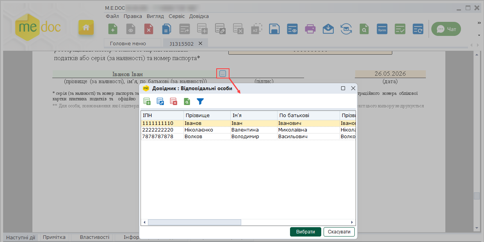

[← Зміст довідки](../)


# Відповідальні особи

## Відповідальні особи

_Шлях у довідці: Розділи програми › Довідники › Відповідальні особи_

В цьому розділі:

[Створення та заповнення картки відповідальної особи](#ucpersonspr-sprpersonvo)

[Використання довідника Відповідальні особи](#ucpersonspr-sprpersonvo)

Довідник Відповідальні особи містить інформацію про працівників підприємства, якім делеговано право підписувати звіти.

Модуль побудований у вигляді таблиці, окремий рядок якої відображає коротку інформацію про особу. Переглянути детальну інформацію про співробітника можна у окремому вікні Відповідальна особа, яке відкривається подвійним кліком по потрібному запису.

Створення та заповнення картки відповідальної особи

1. Для того, щоб додати відповідальну особу, на панелі інструментів виберіть команду Створити запис, або натисніть комбінацію клавіш Ctrl+I.

2. Відкриється вікно Відповідальна особа. Заповніть запропоновані поля форми.

Поля, що підсвічені жовтим кольором, є обов'язковими для заповнення.

Ви можете обрати відповідальну особу з довідника Співробітники. Натисніть кнопку  у полі ІПН. Відкриється вікно Довідник: Співробітники. Оберіть потрібну особу та натисніть кнопку Вибрати.

Дані обраної особі буде перенесено у поля вікна Відповідальна особа.

3. Для збереження даних у вікні Відповідальна особа натисніть кнопку ОК. Для відміни внесених даних натисніть Відміна.

В списку співробітників підприємства також доступні наступні функції:

|  |  |  |
| --- | --- | --- |
|  | Видалити запис  (Ctrl+Y) | Дозволяє безповоротно вилучити запис. |
|  | Редагувати запис  (F2) | Редагування даних в разі необхідності. |

[До початку](#ucpersonspr-sprpersonvo)

Використання довідника Відповідальні особи

Довідник використовується при створенні звітів, що можуть бути підписані відповідальними особами.

У місці підпису відповідальної особи натисніть кнопку . Відкриється довідник Відповідальні особи.

Оберіть потрібного співробітника у довіднику та натисніть кнопку Вибрати. Дані з довідника буде перенесено у форму звіту.

[До початку](#ucpersonspr-sprpersonvo)


