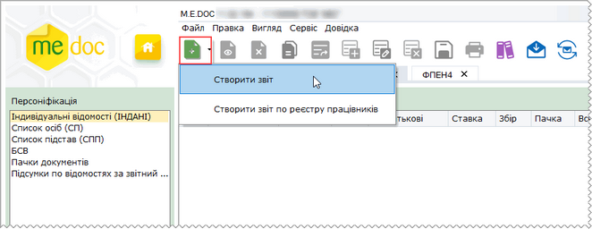
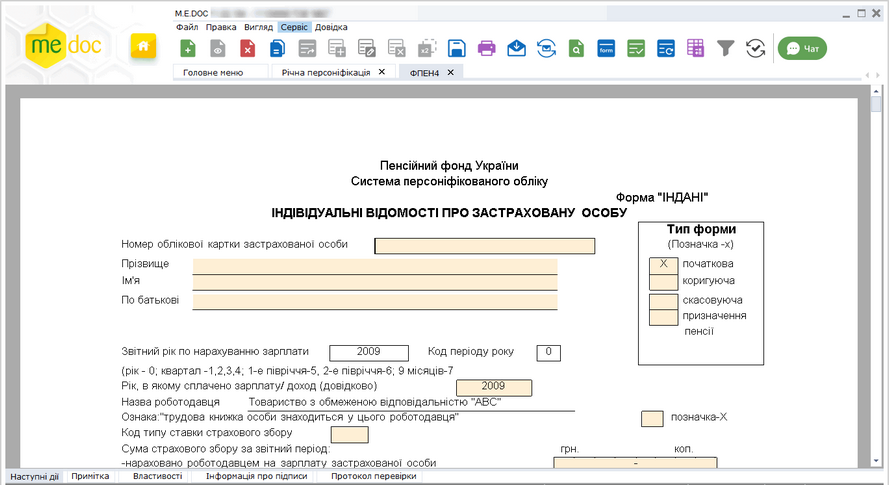
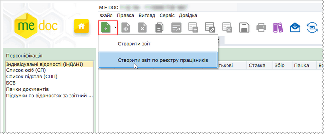
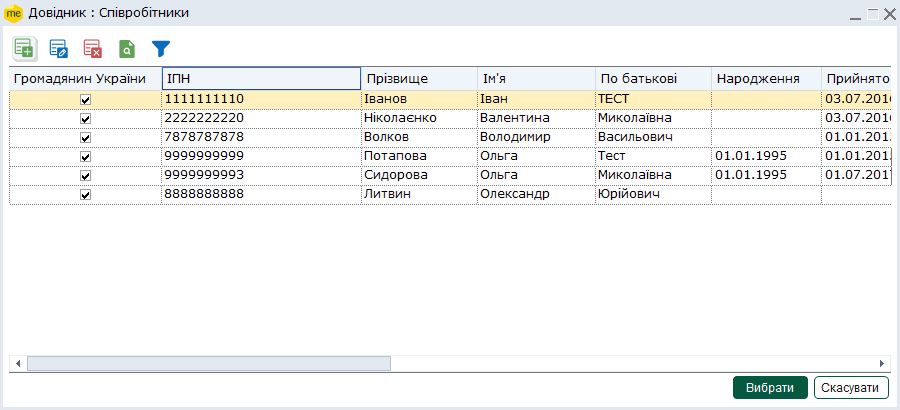
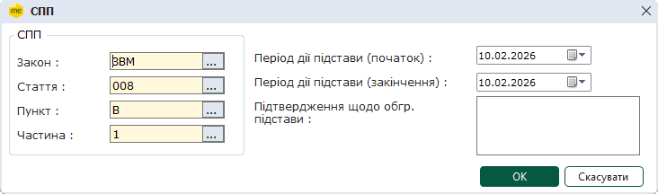
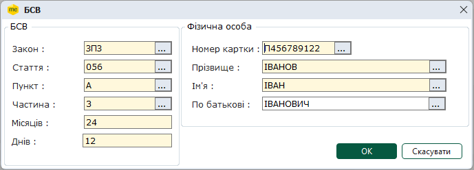
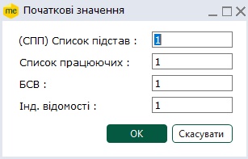
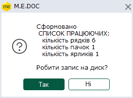
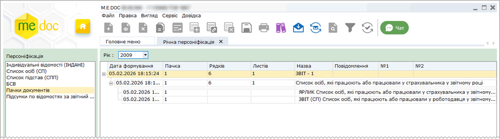
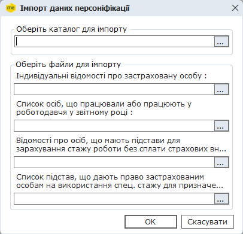

[← Зміст довідки](../)


# Річна персоніфікація

## Річна персоніфікація

_Шлях у довідці: Розділи програми › Звітність › Річна персоніфікація_

Модуль Річна персоніфікація призначений для обліку документів персоніфікованої звітності до ПФУ. В модулі передбачені наступні операції з документами: створення, системне зберігання, імпорт із інших бухгалтерських систем та експорт для подання в ПФУ.

Звіти за попередні роки можуть бути перенесені в даний модуль у відповідний звітний період.

Модуль побудований у вигляді таблиці, окремий рядок якої відображає коротку інформацію про кожний документ. Переглянути більш повну інформацію можна у окремій вкладці, яка відкривається подвійним кліком по потрібному запису.

На панелі інструментів розташовані групи кнопок для виклику основних функцій та панель вибору звітного періоду – за замовчанням встановлений період, за який подається персоніфікована звітність: Рік.

Призначення закладок модуля

- У закладці [Індивідуальні відомості (ІНДАНІ)](#ucpersonification-personification_indani) у таблиці містяться створені чи імпортовані форми ІНДАНІ, у відповідних рядках таблиці відображаються дані із цієї форми.
- У таблицю закладки [Список осіб (СП)](#ucpersonification-personification_sp) автоматично вносяться записи про нових співробітників та тих, у яких у поточному році змінились реєстраційні дані, (тобто ті, у яких в довіднику Співробітники відсутня позначка Звітувався до ПФУ). Із даних у цієї таблиці формується документ СП "Список осіб, які працюють або працювали у страхувальника у звітному році".
- У таблицю закладки [Список підстав (СПП)](#ucpersonification-personification_spp) заносяться відомості про наявність у роботодавця робочих місць, умови праці на яких відповідно до законодавства зумовлюють право на врахування спеціального стажу при розрахунку пенсії застрахованим особам. У цій закладці заповнюються пільги, які будуть використовуватися у 2-х формах: Індані та БСВ. Із даних цієї закладки формується документ СПП "Список підстав, що дають право на застосування пільг робітникам підприємства при визначенні пенсії".
- У таблиці закладки [БСВ](#ucpersonification-personification_bsv) вносяться відомості про осіб, що мають підстави для зарахування стажу роботи без сплати страхових внесків. Із даних цієї закладки формується документ БСВ "Відомості про осіб, що мають підстави для зарахування стажу роботи без сплати страхових внесків".
- У закладці [Пачки документів](#ucpersonification-personification_pak) формуються пачки документів у відповідності з вимогами ПФУ. Із цієї закладки модуля відбувається друк документів, збереження на електронному носії та відправлення електронною поштою.
- У таблицю закладки [Підсумки по відомостях за звітний рік](#ucpersonification-personification_year) автоматично вносяться відповідні суми, страхові внески та формуються підсумкові дані по мірі заповнення форм Індані для співробітників. У цій закладці можна лише переглянути дані, надрукувати та зберегти їх можна із [Пачки документів](#ucpersonification-personification_pak), яка формується із даних закладки та відкривається після збереження документів на диску чи відправленні електронною поштою.

### Послідовність роботи при створенні документів

_Шлях у довідці: Розділи програми › Звітність › Річна персоніфікація › Послідовність роботи при створенні документів_

При роботі з документами персоніфікованої звітності рекомендується дотримуватись наступної послідовності:

1. Перед початком створення документів, попередньо переконайтесь у правильних налаштуваннях стосовно персоніфікованої звітності, для коректного відображення даних:

- Відкрийте Довідники > Картка підприємства > закладка Пенсійний фонд. У полі Наявність підстав для пільг встановіть прапорець, якщо такі підстави існують.

Примітка:

За наявності пільг, але без встановленої відмітки неможливе заповнення Таблиці 2 Інданих (відомості про спецстаж).

- У випадку, якщо реєстр співробітників не заповнений, ввести дані про співробітників у довідник "Співробітники", шляхом заповнення картки Фізична особа (включаючи дати прийняття на роботу та звільнення).
- Встановити позначки "Звітувався до ПФУ по даній установі" у картці Фізична особа чи із контекстного меню в Реєстрі співробітників для тих працівників, дані по яких вже надавались до ПФУ у попередньому звітному році.

Примітка:

Ознака "Звітувався до ПФУ" обов'язково має бути встановлена для правильного формування звіту (СП) Список осіб. Дані у закладку (СП) Список осіб у цьому випадку будуть внесені автоматично.

2. Заповнити закладки [Список підстав](#ucpersonification-personification_spp) та [БСВ](#ucpersonification-personification_bsv)

Обов'язково заповніть спочатку закладку Список підстав, тому що в ній формується перелік пільг на підприємстві для врахування спеціального стажу. Цей перелік використовується при заповненні Таблиці 2 у формі ІНДАНІ.

3. [Створити форми ІНДАНІ](#ucpersonification-personification_indani) для всіх співробітників установи у закладці ІНДАНІ

4. [Сформувати пачки документів](#ucpersonification-personification_pak) для подання до ПФУ у закладці Пачки документів

5. [Зберегти на диск](#ucpersonification-personification_save) та [роздрукувати документи](#ucpersonification-personification_print) чи [підписати ЕП та відправити електронною поштою](#ucpersonification-personification_poste).

#### Створення документів ІНДАНІ

_Шлях у довідці: Розділи програми › Звітність › Річна персоніфікація › Послідовність роботи при створенні документів › Створення документів ІНДАНІ_

В цьому розділі:

[Створення звіту по одній особі](#ucpersonification-personification_indani)

[Створення звітів для обраних працівників, внесених до реєстру співробітників](#ucpersonification-personification_indani)

[Заповнення форми ІНДАНІ](#ucpersonification-personification_indani)

Можна створити звіт по одній особі або звітів для всіх працівників, внесених до реєстру співробітників.

Створення звіту по одній особі

Для створення звіту по одній особі оберіть один із способів:

- виконайте команду меню Файл - Створити - Створити звіт;
- натисніть кнопку  на панелі інструментів на оберіть команду Створити звіт.

Натисніть, щоб збільшити малюнок

Відкриється вкладка звіту:

Натисніть, щоб збільшити малюнок

У відкритому вікні форми заповніть поля позначені жовтим кольором.

Значення у полях з основними відомостями про застраховану особу (Номер облікової картки, Прізвище, Ім’я, По батькові) обираються із підключеного довідника Фізичні особи.

Збережіть заповнену форму, натиснувши іконку .

[До початку](#ucpersonification-personification_indani)

Створення звітів для обраних працівників, внесених до реєстру співробітників

Для створення звітів для обраних працівників, внесених до реєстру співробітників оберіть один із способів:

- виконайте команду меню Файл - Створити - Створити звіт по реєстру працівників;
- натисніть кнопку  на панелі інструментів на оберіть команду Створити звіт по реєстру працівників.

Натисніть, щоб збільшити малюнок

Відкриється вікно із списком всіх співробітників установи, в якому оберіть працівників, для яких потрібно створити звіт. Для цього виділяйте рядки лівою кнопкою миші, утримуючі клавіші Ctrl або Shift.

Натисніть на кнопку Вибрати.

Всі створені документи поміщаються у таблицю розділу.

Почергово відкрийте створені звіти та заповніть їх. Полях з основними відомостями про застраховану особу (Номер облікової картки, Прізвище, Ім’я, По батькові) заповнюються автоматично.

Після заповнення та збереження форми дані переносяться у таблицю модуля та у відповідні рядки підсумкової відомості (розділ [Підсумки по відомостях за звітний рік](#ucpersonification-personification_year)).

У розділі ІНДАНІ різні типи форм Індані будуть мати різні позначки в колонці Тип:

- Початкова;
- Коригуюча;
- Скасовуюча;
- Призначення пенсії.

[До початку](#ucpersonification-personification_indani)

Заповнення форми ІНДАНІ

- При внесенні даних про заробіток у таблицю форми ІНДАНІ можна використовувати вбудовані програми: Виконати копіювання сум помісячно чи Виконати копіювання з 1 по 12 місяць. Викликаються ці програми із вкладки Наступні дії - команда Виконати додаткову програму обробки.
- Якщо заповнені всі поля картки Фізична особа (обов'язково Прийнято та Звільнено), дані у полях про початок і кінець трудових відносин та стаж заповнюються автоматично при внесенні даних про доходи у відповідних рядках.
Із підключеного довідника також потрібно обрати код типу ставки страхового збору.

- Дані у другу таблицю (Відомості про загальний стаж....) заносяться у випадку, якщо працівник має підстави для обліку спеціального стражу, код підстави обирається із підключеного довідника Список підстав для застосування пільг, інші колонки заповнюються внесенням даних із клавіатури.
Програма дозволить обрати дані із довідника лише у тому випадку, якщо встановлена відповідна позначка у закладці Пенсійний фонд у Картці підприємства.

- Є можливість групового оновлення полів у звітах ІНДАНІ (дати, керівника та бухгалтера). Для цього із переліку документів ІНДАНІ потрібно виділити звіти для оновлення і обрати команду Оновити поля із меню Правка (або натиснути клавіша F5 чи кнопку на панелі інструментів ). Про завершення операції буде виведене повідомлення. В результаті оновляться поля:
- дата - на поточну;
- прізвище керівника та бухгалтера – на внесені в картку підприємства.

Примітка:

Оновити поля у документах та у рядку закладки ІНДАНІ також можна із картки Фізичної особи, для чого в шаблоні картки  передбачена кнопка Оновити ІНДАНІ.

Після заповнення форми необхідно обов’язково перевірити її (F4), оновити дані (F5) та зберегти (Ctrl+S).

[До початку](#ucpersonification-personification_indani)

#### Формування документа Список осіб (СП)

_Шлях у довідці: Розділи програми › Звітність › Річна персоніфікація › Послідовність роботи при створенні документів › Формування документа Список осіб (СП)_

Документ за формою СП призначений для реєстрації застрахованих осіб в СПОВ.

Цей документ формується у закладці Список осіб (СП).

- При першому звітуванні страхувальника до ПФУ документ Список осіб, які працюють або працювали у роботодавця у звітному році (далі – список працюючих) повинен включати всіх осіб, які працюють або працювали у страхувальника впродовж звітного року.
- В звіті за кожний наступний звітний рік список працюючих повинен включати відомості лише про нових осіб та осіб, у яких упродовж звітного року змінились прізвище, ім’я, по батькові або ідентифікаційний номер. Якщо жодних змін не було, подавати цей звіт не потрібно.

Якщо Реєстр співробітників установи заповнений та правильно встановлені позначки "Звітувався до ПФУ", дані у закладку Список осіб будуть внесені автоматично, тобто у таблиці будуть записи лише нових співробітників та тих, у яких змінились дані в поточному звітному періоді.

- Із цієї закладки також існує можливість додати новий запис в довідник Співробітники. Для цього треба заповнити картку Фізична особа, яка відкривається кнопкою . Після збереження картки запис нового співробітника автоматично додається в довідник Співробітники.
- Також при редагуванні даних співробітника у рядках цієї закладки, зміни вносяться одразу і в довідник співробітників. Редагування даних у рядку відбувається звичайними засобами Windows.

#### Формування документа СПП

_Шлях у довідці: Розділи програми › Звітність › Річна персоніфікація › Послідовність роботи при створенні документів › Формування документа СПП_

Форма СПП призначена для щорічного підтвердження страхувальником наявності у нього робочих місць, умови праці на яких відповідно до законодавства зумовлюють право на врахування спеціального стажу при розрахунку пенсії застрахованим особам. Цей документ формується у закладці Список підстав (СПП).

При додаванні нового запису (кнопка ) відкривається вікно шаблону для заповнення. До поля Закон підключений довідник Підстави для пільг страхувальника, в якому необхідно обрати потрібну пільгу та натиснути ОК для підтвердження вибору. В результаті перенесення даних заповняться колонки таблиці, де розшифровується восьмирозрядний код пільги - шифр закону, який надає право на пільгу.

- Довідник Підстави для пільг страхувальника впорядкований за категоріями пільг: за умовами праці, за вислугою років та без сплати внесків (БСВ) – це відображено у колонці Найменування довідника.
- Інші колонки у рядку заповнюються самостійно: початок та кінець дії підстави у відповідних колонках може обиратися із підключеного календаря чи вводитись вручну із клавіатури, починаючи з першої позиції вводу у форматі дати ДДММРРРР (день, місяць, рік).
- В останнє поле вноситься інформація-підтвердження підстави (нормативний акт, наказ по підприємству, посвідчення   тощо). Якщо інформація в цю колонку не внесена - збереження запису СПП неможливе.
- Для збереження даних натисніть ОК

Таким чином треба внести пільги, які будуть використовуватися у 2-х формах: Індані та БСВ.

Видалити рядок таблиці можна за допомогою команди Видалити в меню Правка, відповідної кнопки панелі інструментів .

#### Формування документа БСВ

_Шлях у довідці: Розділи програми › Звітність › Річна персоніфікація › Послідовність роботи при створенні документів › Формування документа БСВ_

На закладці БСВ формується документ, призначений для обліку періодів стажу застрахованих осіб, протягом яких страхові внески до Пенсійного фонду не сплачувались (БСВ - Без Сплати Внесків).

При додаванні нового запису (кнопка ) відкривається вікно шаблону для заповнення. До шаблону підключені довідники – Підстави для пільг страхувальника (який заповнювався у закладці Список підстав) та Співробітники.

- Довідник Підстави для пільг страхувальника викликається у всіх перших 4-х полях, в яких розшифровується восьмирозрядний код підстави. У цьому довіднику відображаються ті підстави, які були обрані в [документі СПП](#ucpersonification-personification_spp) для пільги БСВ (містять БСВ у колонці Найменування). Для перенесення даних у ці колонки потрібно із довідника обрати потрібну пільгу та натиснути на кнопку ОК.
- Довідник Співробітники викликається у всіх 4-х наступних полях, у які заносяться дані працівників (Номер картки, Прізвище, Ім’я, По-батькові). Для перенесення даних у ці колонки необхідно обрати запис про співробітника у довіднику та натиснути на кнопку ОК.
- Дані у колонках Місяців, Днів необхідно заповнити самостійно.
- Для збереження даних натисніть ОК.

Видалити рядок таблиці можна за допомогою команди Видалити в меню Правка або відповідної кнопки панелі інструментів .

#### Формування пачок документів

_Шлях у довідці: Розділи програми › Звітність › Річна персоніфікація › Послідовність роботи при створенні документів › Формування пачок документів_

Після створення всіх документів персоніфікованої звітності необхідно сформувати пачки документів в однойменній групі звітів.

Формування пачок відповідає вимогам Постанови правління Пенсійного фонду України від 10 червня 2004 року N 7-6 "Про затвердження Порядку формування та подання органам Пенсійного фонду України відомостей про застраховану особу, що використовуються в системі загальнообов'язкового державного пенсійного страхування".

Формування пачок відбувається запуском команди Сформувати пачки меню Файл або викликається за допомогою кнопки  на панелі інструментів. Одразу після запуску функції відкривається вікно, в якому за замовчанням вказані початкові номери пачок. Але поля доступні для редагування, і користувач за потреби може їх змінити.

При формуванні пачок документів створюються ярлики-розписки. Про закінчення формування буде інформовано повідомленням, із якого є можливість здійснити запис на диск.

Записи про сформовані пачки і документи, які входять до цих пачок, та ярлики поміщаються в таблицю закладки і мають вигляд ієрархічного списку. Розкриваються записи звичайним чином.

Натисніть, щоб збільшити малюнок

Крім того, подвійним натисканням лівою кнопкою миші по обраному документові або кнопкою  (Редагувати) на панелі інструментів відкривається його печатний (паперовий) вигляд.

Після формування пачок можна обрати спосіб подання звітності в ПФУ - зберегти на диск, відправити електронною поштою та роздрукувати.

Примітка:

Всі документи сформованих пачок відкриваються для перегляду подвійним натисканням лівою кнопкою миші на їх назві, але вони недоступні для редагування.

Після внесення змін в будь який документ вже переданої пачки необхідно створювати нову. Нова пачка міститиме лише відкориговані документи.

Скасування пачок (до відправлення в ПФУ)

За наявності помилок (при внесенні даних у розділи Річна персоніфікація, із яких формуються документи) потрібно скасувати створені пачки та після виправлення помилок створити їх знову.

Документи із закладок при скасуванні пачок НЕ ВИДАЛЯЮТЬСЯ!

1. Для скасування створених пачок необхідно виділити маркером обрану та натиснути кнопку Видалити  (аналогічна команда із меню Файл, або клавіша Del, або із контекстного меню.

2. Після видалення пачок оновлюється інформація у розділах модуля.

- У відповідних колонках розділів скасовуються номери пачок та змінюється статус із Переданий на Перевірений.
- У формах Індані також скасовуються номери пачок у полі Реєстраційний номер пачки документів у роботодавця.

3. Дані у довіднику співробітників також оновлюються - інформація у ньому повертається до початкової, коли були виставлені позначки: для тих осіб, дані яких подавались в ПФУ у попередньому звітному році буде присутня позначка "Звітувався в ПФУ", для нових – вона знімається після скасування пачок.

#### Підсумки по відомостях за звітний рік

_Шлях у довідці: Розділи програми › Звітність › Річна персоніфікація › Послідовність роботи при створенні документів › Підсумки по відомостях за звітний рік_

Підсумкова відомість із загальними підсумками у звітному періоді відкривається одразу після:

- збереження на електронному носії документів персоніфікації;
- відправленні їх електронною поштою.

Цей документ формується із даних закладки Підсумки по відомостях за звітний рік. У електронну таблицю цієї закладки переносяться дані про заробіток та суми внесків із заповнених форм ІНДАНІ. Підсумкова відомість містить підсумкові дані по всіх застрахованих особах.

### Імпорт документів персоніфікації

_Шлях у довідці: Розділи програми › Звітність › Річна персоніфікація › Імпорт документів персоніфікації_

В програмі передбачений імпорт документів звітності до Пенсійного фонду, сформованих в інших бухгалтерських системах. Формат імпортованих даних - .dbf, .xml, .ZDI, .txt тощо).

[Процедура імпорту](#ucpersonification-personification_import_1)

[Послідовність роботи після імпорту](#ucpersonification-personification_import_2)

#### Процедура імпорту

_Шлях у довідці: Розділи програми › Звітність › Річна персоніфікація › Імпорт документів персоніфікації › Процедура імпорту_

Для імпорту даних оберіть команду Імпорт в меню Файл. У вікні, що відкриється, оберіть каталог, в якому знаходяться файли для імпорту. Натисніть кнопку ОК.

- Якщо всі файли для імпорту (ІНДАНІ, Список осіб, Список підстав і та ін.) знаходяться у одному каталозі, їх назва відобразиться у відповідних полях вікна. В протилежному випадку необхідно повторити процедуру вибору каталогу з імпортованими файлами.
- Натисніть на кнопку ОК для початку імпорту даних. В процесі імпорту виконується автоматична перевірка правильності заповнення та наявності помилок в імпортованих файлах.
- По закінченні імпорту відкривається Протокол імпорту даних, у якому відображаються результати імпорту - інформація про імпортовані документи, виявлені помилки, неповні дані.

Імпортовані документи поміщаються у відповідні розділи модуля Річна персоніфікація.

У формах Індані також скасовуються номери пачок у полі Реєстраційний номер пачки документів у роботодавця.

- Форми ІНДАНІ без помилок матимуть статус Перевірений, а форми з помилками - статус Помилковий та будуть виділені червоним кольором.
- У розділ Підсумки по відомостях за звітний рік переносяться відповідні суми із форм ІНДАНІ.
- Дані про співробітників  імпортуються також в довідник Співробітники.

#### Послідовність роботи після імпорту

_Шлях у довідці: Розділи програми › Звітність › Річна персоніфікація › Імпорт документів персоніфікації › Послідовність роботи після імпорту_

1. Якщо імпортуються всі документи персоніфікованої звітності, необхідно почергово відкрити, перевірити, виправити і зберегти форми ІНДАНІ, які при імпорті мають статус Помилковий, записи на інших закладках, із яких формуються відповідні документи.

2. У випадку, якщо імпортовані лише ІНДАНІ, відсутні документи створюються у модулі Річна персоніфікація.

При імпорті документів персоніфікованої звітності у закладку (СП) Список осіб будуть перенесені дані одразу про всіх співробітників, а не нових, як потрібно.

Для правильного формування документів у цій закладці потрібно:

2.1. Модуль Річна персоніфікація по закінченні імпорту закрити.

2.2. Відкрити довідник Співробітники (меню Довідники - Співробітники).

2.3. Встановити позначку Звітувався до ПФУ у записах тих співробітників, дані яких надавались до ПФУ в минулому звітному році. Також заповнити дати прийняття та звільнення з роботи у картці Фізична особа.

2.4. Знову відкрити модуль Річна персоніфікація - дані про нових співробітників у закладку (СП) Список осіб будуть перенесені автоматично.

2.5. Відкрити картку установи, закладка Пенсійний Фонд. В полі Наявність підстав для пільг встановити прапорець за наявності підстав.

Без встановленої відмітки неможливо заповнити Таблицю 2 у Інданих (відомості про спецстаж).

2.6. Інші закладки (БСВ та Список підстав) заповніть для формування відповідних документів.

2.7. Для групового оновлення полів у звітах Індані (дати, керівника та бухгалтера) потрібно у розділі Індані, не відкриваючи звіти, обрати Оновити поля документів із контекстного меню або меню Правка модуля Річна персоніфікація.

Ці поля будуть оновлені (дата - зміниться на поточну, прізвище керівника та бухгалтера – на ті, які внесені в Картці установи).

3. Сформуйте пачки звітності. Всі документи сформованих пачок, включаючи ярлики, відкриваються для перегляду подвійним натисканням лівою кнопкою миші на їх назві, але вони недоступні для редагування.

4. Після цього можна обрати [спосіб подання звітності до ПФУ](#ucpersonification-personification_sand).

### Подання документів персоніфікованої звітності

_Шлях у довідці: Розділи програми › Звітність › Річна персоніфікація › Подання документів персоніфікованої звітності_

В ліцензійній версії програмного комплексу забезпечене відправлення документів персоніфікації, підписаних сертифікатами ЕП всіх КНЕДП, електронною поштою.

[Збереження на електронному носії](#ucpersonification-personification_save)

[Відправлення електронною поштою](#ucpersonification-personification_poste)

#### Збереження на електронному носії

_Шлях у довідці: Розділи програми › Звітність › Річна персоніфікація › Подання документів персоніфікованої звітності › Збереження на електронному носії_

Збереження звітів персоніфікації відбувається із розділу Пачки документів.

Для збереження даних необхідно:

- виділити маркером обрані пачки та обрати команду Експорт в меню Файл чи із контекстного меню.
- у відкритому вікні обрати диск чи каталог, в якому буде збережений файл, та натиснути ОК.

Документи персоніфікованої звітності будуть збережені у обраному каталозі (це файл з розширенням .pfz та заархівовані файли з ІНДАНими).

#### Відправлення річної персоніфікації електронною поштою

_Шлях у довідці: Розділи програми › Звітність › Річна персоніфікація › Подання документів персоніфікованої звітності › Відправлення річної персоніфікації електронною поштою_

Відправлення звітів персоніфікації електронною поштою відбувається із закладки Пачки документів.

До моменту відправлення електронною поштою потрібно:

1. Отримати сертифікати відкритих ключів у КНЕДП

2. Завантажити їх у програму

3. Налаштувати комплект підписів

4. Здійснити налаштування електронного з'єднання

Підпис та відправлення звітів персоніфікації

1. Для відправлення даних необхідно виділити готові для відправлення пачки та натиснути кнопку  на панелі інструментів закладки (або команда Відправити в меню Файл чи із контекстного меню).

2. Далі запускається стандартна процедура підписання ЕП. Першим накладається підпис бухгалтера (за наявності цієї посади в установі), потім директора, останнім - печаткою установи.

3. Після накладення всіх ЕП відкривається вікно з назвою Вибір адресата, в якому обирається одержувач – Пенсійний фонд.

4. Після цього відкривається поштовий клієнт програми та запускається режим відправлення пошти. Про завершення операції буде надіслане повідомлення. Відправлений файл документів матиме розширення .pfz.

Отримання електронних квитанцій

На відправлені звіти до Пенсійного фонду мають надійти Повідомлення про отримання звітності та дві квитанції.

Перша квитанція із ІЦ СПОВ містить результат перевірки коректності сформованого файлу звіту та легітимності підписів.

Друга квитанція - інформацію від інспектора про прийняття чи не прийняття звіту до бази даних ПФУ.

Квитанції відображаються на закладці Пачки документів у рядку із назвою пачки, що відправлялась, в колонках Повідомлення, №1, №2.

### Друк звітів персоніфікації

_Шлях у довідці: Розділи програми › Звітність › Річна персоніфікація › Друк звітів персоніфікації_

Створені чи імпортовані звіти персоніфікації можна роздрукувати із закладки Пачки документів.

- Для друку окремих звітів або ярликів треба розгорнути ієрархічний список, обрати документ для друку та натиснути кнопку  на панелі інструментів.
- Всі документи сформованих пачок, включаючи ярлики, відкриваються подвійним натисканням лівою кнопкою миші на їх назві у закладці Пачки документів.
- Для групового друку документів персоніфікації потрібно виділити всі пачки документів у закладці та натиснути на кнопку  на панелі інструментів (або однойменна команда із контекстного меню та із меню Файл/Друк).
- Також можна роздрукувати [підсумкову відомість](#ucpersonification-personification_year), яка відкривається після експорту персоніфікації на диск чи відправлення електронною поштою.


