[← Зміст довідки](../)


# Планувальник завдань

## Планувальник завдань

_Шлях у довідці: Розділи програми › Адміністрування › Планувальник завдань_

За допомогою Планувальника завдань Ви можете запланувати виконання таких завдань у зручний час:

- [створення архіву програми](#ucplanner-ucplanner_bkz) (автоматичне резервне копіювання всіх бібліотек і бази програмного комплексу M.E.Doc);
- [створення резервної копії програми](#ucplanner-ucplanner_zbk) (включаючи всі налаштування, виконані користувачами);
- [оновлення програмного комплексу](#ucplanner-ucplanner_upd) у заданий час та із заданою періодичністю;
- [оновлення довідника контрагентів](#ucplanner-ucplanner_edk) згідно з ЄДК.

У даному розділі розглянуті такі теми:

- [Опис основних функціональних елементів інтерфейсу Планувальника](#ucplanner-ucplanner_int)
- [Завдання на створення архіву програми](#ucplanner-ucplanner_bkz)
- [Завдання на оновлення програми](#ucplanner-ucplanner_upd)
- [Завдання на створення резервної копії програми](#ucplanner-ucplanner_zbk)
- [Завдання на оновлення довідника контрагентів згідно з ЄДК](#ucplanner-ucplanner_edk)
- [Запуск роботи Планувальника завдань](#ucplanner-ucplanner_start)

### Опис основних функціональних елементів інтерфейсу Планувальника

_Шлях у довідці: Розділи програми › Адміністрування › Планувальник завдань › Опис основних функціональних елементів інтерфейсу Планувальника_

Режим роботи модуля визначається налаштуваннями:

- Модуль планування (активація) - встановіть опція для активації модуля;
- Відправка помилок на пошту - встановіть опцію для відправки повідомлень про помилки під час роботи планувальника:
- Пошта - вказується одна або декілька електронних адрес, на які на які буде відправлено повідомлення в разі виникнення помилок. Адреси вводяться через ";". Максимальна довжина поля - 200 символів;
- Супровідний лист - у полі можна ввести текст, який буде виводитися у темі листа. Максимальна довжина поля 50 символів;
- Не виконувати задачі з вичерпаним терміном запуску, більше ніж: \_\_\_ (хв)  - якщо опція встановлена, при обробці завдань, які за будь-яких причин не були виконані за розкладом, виконується перевірка встановленого терміну запуску та запланованого часу запуску завдання. Якщо завдання було протерміноване на вказане у параметрі значення (або більше), йому присвоюється статус "помилка", завдання не виконується, для протермінованих періодичних завдань наступне завдання буде виконуватись згідно зі створеним розкладом. У полі можна вказати значення від 1 до 1380 хвилин (23 години).

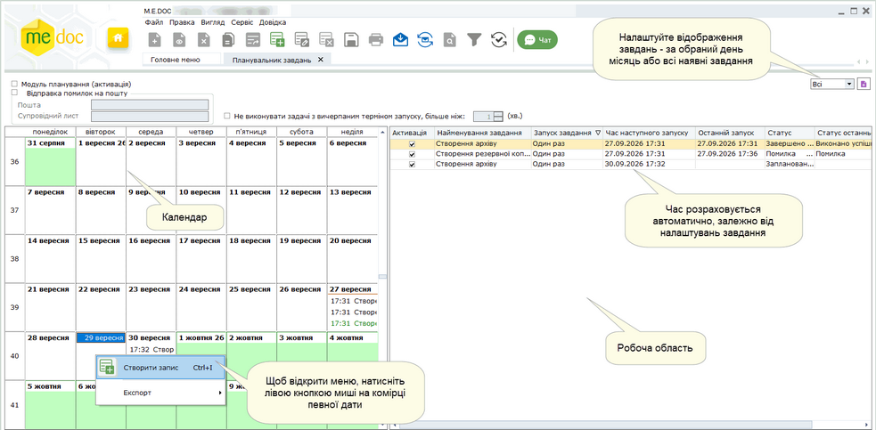

Натисніть, щоб збільшити малюнок

Планувальник завдань умовно розділений на дві частини: Календар та Робоча область.

Календар

Відображає розклад завдань у вигляді календаря. Якщо на якусь дату заплановано завдання, у комірці цього дня чорним кольором відображається час та коротка назва завдання.

Запис успішно виконаного завдання відображається зеленим кольором.

Якщо під час виконання завдання сталася помилка, запис відображається червоним кольором.

Робоча область

Містить перелік завдань, що створені в програмному комплексі.

За замовчуванням, відображаються всі завдання, але у разі потреби можна відобразити завдання обраного дня або обраного місяця.

У колонці Статус відображається інформація про поточний стан кожного завдання.

Кнопка Переглянути журнал подій  - в правому верхньому кутку модуля призначена для перегляду протоколу виконання завдання. Дана функція доступна лише на серверній частині програмного комплексу (для мережевого варіанту програми). По натисканню кнопки відкривається файл - журнал подій, що містить детальний протокол ходу виконання завдань планувальника.

При виділенні завдань Створення резервної копії внизу вікна з'являється панель вибору каталогу копій, де користувач може, за потреби, змінити обраний раніше каталог. Дана функція доступна лише на серверній частині програмного комплексу (для мережевого варіанту програми).

### Завдання на створення архіву програми

_Шлях у довідці: Розділи програми › Адміністрування › Планувальник завдань › Завдання на створення архіву програми_

В цьому розділі:

[Як створити завдання на створення архіву](#ucplanner-ucplanner_bkz)

[Відновлення з архіву, створеного Планувальником](#ucplanner-ucplanner_bkz)

Призначено для планування створення архіву програми, тобто повного резервного копіювання всіх бібліотек та бази ПК M.E.Doc одноразово або із заданою періодичністю.

За замовчуванням, файл архіву має розширення \*.BKZ: YYYY-MM-DD-XX-XX\_VV.VV.VVV.BKZ.
де YYYY-MM-DD-XX-XX\_VV.VV.VVV - відповідно рік, місяць, день, час створення архіву та версія програми.

Як створити завдання на створення архіву

1. Скористайтесь одним із способів:

- на панелі інструментів натисніть кнопку Створити запис - ;
- виберіть команду Файл - Створити запис;
- у контекстному меню оберіть команду Створити запис;
- натисніть комбінацію клавіш Ctrl+I.

2. Відкриється окреме вікно створення завдання.

Для локальної версії програми:

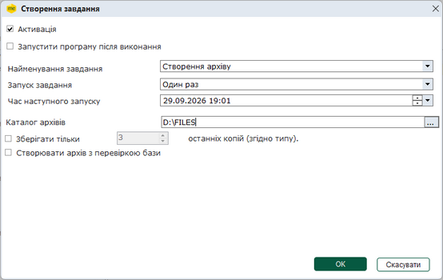

Натисніть, щоб збільшити малюнок

Для мережевої версії:

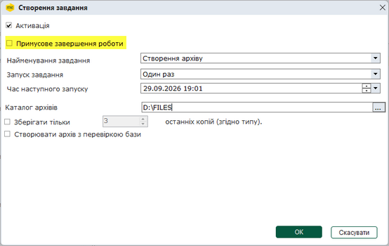

Натисніть, щоб збільшити малюнок

- Активація - встановлена галочка означає, що після запуску Планувальника завдання почне виконуватись в заданий час. Якщо галочка не встановлена, створене завдання виконуватись не буде.

При встановленні цього параметру автоматично проставляється галочка Модуль планування (активація) в головному вікні і Планувальник запускається в роботу.

- Запустити програму після виконання - опція відображається лише у локальній версії програми. Під час створення архіву програмний комплекс закриється автоматично. Встановлена галочка в цьому полі означає, що після створення архіву програма автоматично запуститься.
- Примусове завершення роботи - опція відображається лише у мережевій версії програми. Встановлена галочка в цьому полі означає, що клієнтські станції будуть примусово відключені через вказаний у повідомленні  час. Служба ZvitGrp також буде зупинена.
- Найменування завдання - оберіть Створення архіву.
- Запуск завдання - встановіть періодичність запуску завдання:
- Один раз - використовується для разового створення архіву;
- Щодня - використовується для створення архіву кожного дня у заданий користувачем час;
- Щотижня - використовується для створення архіву на тиждень в заданий користувачем день та час.
- Час наступного запуску - оберіть у календарі дату та час початку створення архіву.
В разі вибору запуску завдання щодня, використовуватиметься встановлений час, якщо щотижня - встановлений день тижня та час.

- Каталог архівів - дозволяє змінити каталог розташування резервної копії.
- Зберігати тільки \_\_ останніх копії (згідно типу) - якщо опція встановлена зберігатиметься вказана кількість останніх резервних архівів програми. Можливо налаштувати збереження не менше ніж 3-х останніх архівів. Файли архівів, що були створені раніше, видалятимуться.
- Створювати архів з перевіркою бази - встановлена галочка означає, що в процесі створення архіву буде перевірена база даних програми (на наявність помилок) та включена в архів.

Результат перевірки бази СКБД Firebird міститься у файлі checkFB.log, результат створення архіву - у файлі createFB.log. В загальний файл Planner.log записуються всі виконані операції. Log-файли додаються у папку LOG кореневого каталогу програми.

3. Натисніть кнопку ОК.

4. Створене завдання з'явиться у переліку завдань Планувальника.

За умови, що [Планувальник завдань запущено](#ucplanner-ucplanner_start) в указаний час розпочнеться створення архіву програмного комплексу.

Також доступні наступні функції:

|  |  |  |
| --- | --- | --- |
|  | Ctrl+Y | Видалення завдання. |
|  | F2 | Редагування завдання. |

[До початку](#ucplanner-ucplanner_bkz)

Відновлення з архіву, створеного Планувальником

Відновлення програмного комплексу з архіву, створеного Планувальником завдань, відбувається за допомогою програми BackupManager.exe.

1.  Відкрийте каталог, в якому встановлено програмний комплекс.

2. Знайдіть програму BackupManager.exe, натисніть двічі лівою клавішею миші.

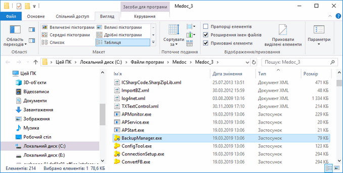

Натисніть, щоб збільшити малюнок

3. Запуститься Менеджер архіву програми. Вкажіть ім'я та пароль.

4. Відкриється вікно Менеджер архіву програми. Оберіть варіант Відновити з архіву.

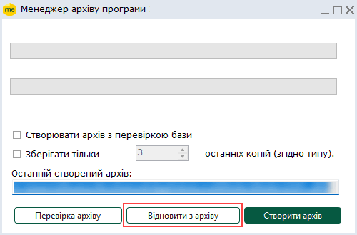

4. Оберіть каталог, в якому збережено архіви. Оберіть потрібний архів та натисніть кнопку ОК.

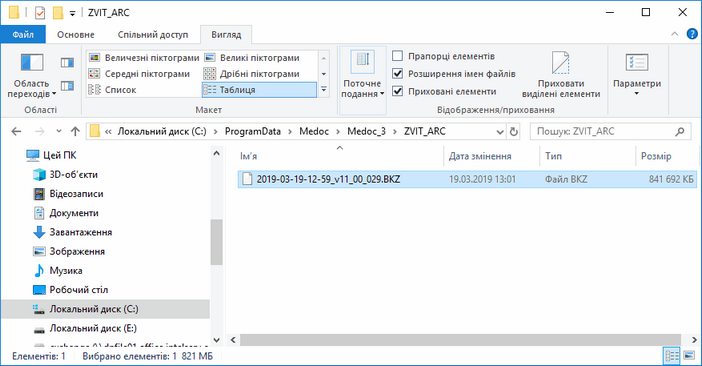

Натисніть, щоб збільшити малюнок

5. Розпочнеться процес відновлення даних із архіву. Дочекайтесь закінчення процедури.

6. Система повідомить у окремому вікні про успішне закінчення відновлення з архіву. Після закриття вікна Менеджера архіву програми автоматично запуститься програмний комплекс.

7. Результат відновлення програми з архіву міститься у файлі restoreFB.log, що додається у папку LOG кореневого каталогу програми.

[До початку](#ucplanner-ucplanner_bkz)

### Завдання на оновлення програми

_Шлях у довідці: Розділи програми › Адміністрування › Планувальник завдань › Завдання на оновлення програми_

Призначено для створення завдання автоматичної перевірки наявності оновлень програмного комплексу та встановлення оновлень, якщо вони є.

1. Для того, щоб створити завдання на оновлення програми скористайтесь одним із наступних способів:

- на панелі інструментів натисніть кнопку Створити запис - ;
- виберіть команду Файл - Створити запис;
- у контекстному меню оберіть команду Створити запис;
- натисніть комбінацію клавіш Ctrl+I.

2. Відкриється окреме вікно створення завдання.

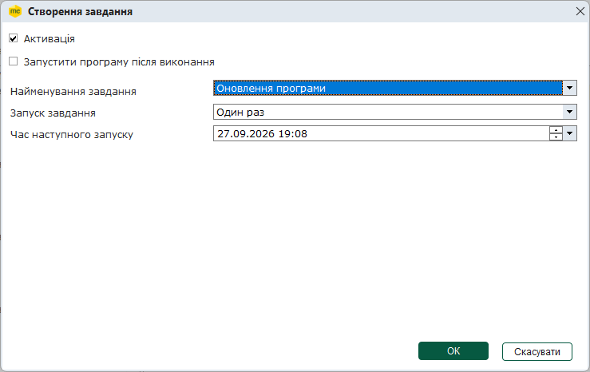

- Активація - встановлена галочка означає, що після запуску Планувальника завдання буде виконане у заданий час. Якщо галочка не встановлена, створене завдання виконуватись не буде.

При встановленні цього параметру автоматично проставляється галочка Модуль планування (активація) в головному вікні і Планувальник запускається в роботу.

- Запустити програму після виконання - опція відображається лише у локальній версії програми. Під час встановлення оновлення програмний комплекс закриється автоматично. Встановлена галочка в цьому полі означає, що після встановлення оновлення програма автоматично запуститься.
- Примусове завершення роботи - опція відображається лише у мережевій версії програми. Встановлена галочка в цьому полі означає, що клієнтські станції будуть примусово відключені через вказаний у повідомленні  час. Служба ZvitGrp також буде зупинена.
- Найменування завдання - оберіть Оновлення програми.
- Запуск завдання - встановіть періодичність запуску завдання:

Один раз - використовується для разової перевірки наявності оновлення програми та в становлення його, якщо є;

Щодня - використовується для встановлення оновлення (за наявності) кожного дня у заданий користувачем час;

Щотижня - використовується для встановлення оновлення (за наявності) раз на тиждень в заданий користувачем день та час.

- Час наступного запуску - оберіть у календарі дату та час початку виконання завдання.
В разі вибору запуску завдання щодня, використовуватиметься встановлений час, якщо щотижня - встановлений день тижня та час.

3. Натисніть кнопку ОК.

4. Створене завдання додається у перелік завдань Планувальника.

За умови, що [Планувальник завдань запущено](#ucplanner-ucplanner_start), у вказаний час розпочнеться перевірка наявності оновлень програми і, в разі їх присутності - встановлення оновлень програмного комплексу.

Додано ведення детального протоколу автоматичного оновлення програми виконаного планувальником завдань. Файл протоколу UpdateLog.txt розташований в кореневому каталозі програми M.E.Doc.

Для завдання, також, доступні наступні функції:

|  |  |  |
| --- | --- | --- |
|  | Ctrl+Y | Видалення завдання. |
|  | F2 | Редагування завдання. |

### Завдання на створення резервної копії програми

_Шлях у довідці: Розділи програми › Адміністрування › Планувальник завдань › Завдання на створення резервної копії програми_

Призначено для створення завдання резервного копіювання інформації із бази даних програми по вибраним організаціям.

- Інформація, що зберігається у резервній копії залежить від типу резервного копіювання: Резервна копія всієї бази або Резервна копія обраних підприємств.
- До Резервної копії обраних підприємств не зберігаються налаштування [користувачів](UCAdminUsers.html#ucadminusers-admusr) та [ролей користувачів](UCManageRoles.html#ucmanageroles-ucmanageroles), а при використанні конфігурації M.E.Doc. Корпорація - не зберігаються [налаштування підпорядкованості підприємств](UCIncRst.html#ucincrst-m_e_doc-corp_pidzvitni).
- Також в резервну копію (чи архів програми) не потрапляють документи, які переміщені у архів, незалежно від того підключений архів чи відключений.
- Для збереження всієї інформації бази даних та бібліотек програми станом на певну дату скористайтесь функціоналом [Менеджер архіву програми](BackupManager.html#backupmanager-backupmanager).

За замовчуванням файл копії Резервна копія обраних підприємств містить у своїй назві дату та час збереження та версію ПО і має розширення .ZBK - YYYY-MM-DD-XX-XX\_VV.VV.VVV\_NNNNNNNN.ZBK:

де YYYY-MM-DD-XX-XX\_VV.VV.VVV\_NNNNNNNN - відповідно рік, місяць, день, час створення архіву, версія ПО, у якому було створено копію, та ЄДРПОУ підприємства (ЄДРПОУ підприємства вказується за умови створення резервної копії поточного підприємства).

Копія Резервна копія всієї бази має назву - YYYY-MM-DD-XX-XX\_VV.VV.VVV.ZBF.

1. Скористайтесь одним із способів:

- на панелі інструментів натисніть кнопку Створити запис - ;
- виберіть команду Файл - Створити запис;
- у контекстному меню оберіть команду Створити запис;
- натисніть комбінацію клавіш Ctrl+I.

2. Відкриється вікно створення завдання, у якому оберіть тип резервної копії у полі Найменування завдання:

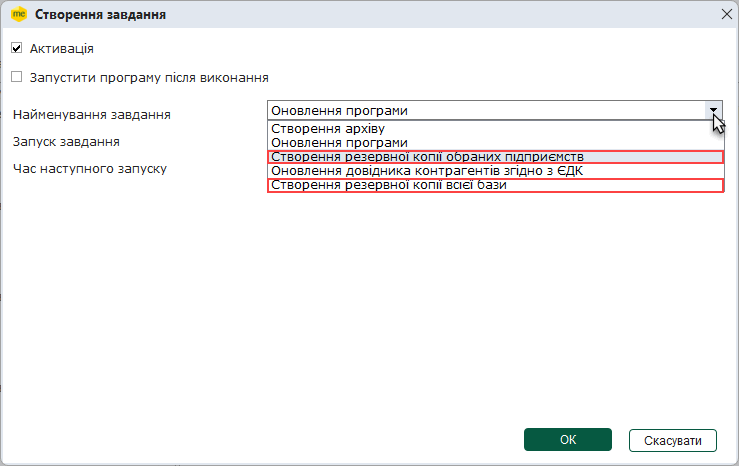

3. Якщо обрано Створення резервної копії обраних підприємств, вікно набуде вигляду:

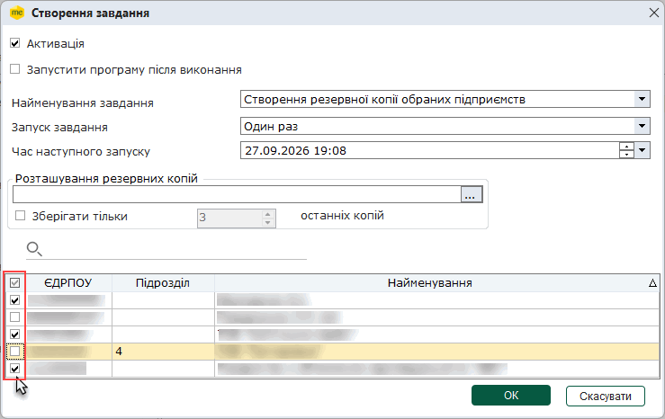

- Активація - встановлена галочка означає, що після запуску Планувальника завдання почне виконуватись в заданий час.

При встановленні цього параметру автоматично проставляється галочка Модуль планування (активація) в головному вікні і Планувальник запускається в роботу.

- Запустити програму після виконання - опція відображається лише у локальній версії програми. Під час виконання завдання на мережевій версії програми на станціях відображається запит на завершення роботи.
- Примусове завершення роботи - опція відображається лише у мережевій версії програми. Встановлена галочка в цьому полі означає, що клієнтські станції будуть примусово відключені через вказаний у повідомленні  час. Служба ZvitGrp також буде зупинена.
- Запуск завдання - встановіть періодичність запуску завдання:

Один раз - використовується для разового створення резервної копії програми;

Щодня - використовується для створення резервної копії кожного дня у заданий користувачем час;

Щотижня - використовується для створення резервної копії раз на тиждень в заданий користувачем день та час.

- Час наступного запуску - оберіть у календарі дату та час початку виконання завдання.
В разі вибору запуску завдання щодня, використовуватиметься встановлений час, якщо щотижня - встановлений день тижня та час.

- Розташування резервних копій - оберіть каталог, у якому зберігатимуться створені резервні копії.
- Зберігати тільки \_\_ останніх копії - якщо опція встановлена зберігатиметься вказана кількість останніх резервних копій програми, за замовчуванням визначено збереження не менше ніж 3-х останніх копій. Файли резервних копій, що були створені раніше, видалятимуться.
- У нижній частині вікна відображається перелік установ програми.

За замовчуванням, у створювану резервну копію будуть додані всі установи (навпроти усіх установ встановлені відмітки, щоб швидко встановити/видалити всі відмітки встановіть/видаліть відмітку у заголовку таблиці). Якщо потрібно створити резервну копію певної установи (чи декількох установ), встановіть галочку напроти потрібного підприємства (або декількох).

Щоб знайти потрібне підприємство у списку, введіть ЄДРПОУ, назву або код філії  підприємства у полі пошуку над таблицею. У списку будуть відображені лише ті підприємства, що відповідають введеним значенням.

4. Якщо обрано Створення резервної копії всієї бази, вікно набуде вигляду:

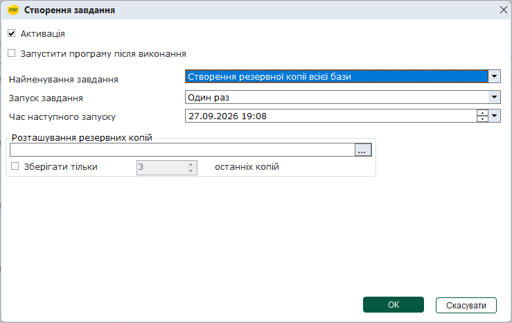

Для налаштування резервної копії всієї бази доступні параметри:

- Розташування резервних копій - оберіть каталог, у якому зберігатимуться створені резервні копії.
- Зберігати тільки \_\_ останніх копії - якщо опція встановлена зберігатиметься вказана кількість останніх резервних копій програми, за замовчуванням визначено збереження не менше ніж 3-х останніх копій. Файли резервних копій, що були створені раніше, видалятимуться.

5. Для продовження натисніть кнопку Ок.

6. Створене завдання з'явиться у переліку завдань Планувальника.

7. За умови, що [Планувальник завдань запущено](#ucplanner-ucplanner_start) в указаний час розпочнеться створення резервної копії.

Для завдання, також, доступні наступні функції:

|  |  |  |
| --- | --- | --- |
|  | Ctrl+Y | Видалення завдання. |
|  | F2 | Редагування завдання. |

### Завдання на оновлення довідника контрагентів згідно з ЄДК

_Шлях у довідці: Розділи програми › Адміністрування › Планувальник завдань › Завдання на оновлення довідника контрагентів згідно з ЄДК_

Призначено для створення завдання автоматичного оновлення довідника контрагентів згідно з ЄДК.

Створення завдання Оновлення довідника контрагентів згідно з ЄДК можливе, якщо у вас наявна відповідна ліцензія, та картка вашого підприємства [відправлена у Єдиний довідник контрагентів](ServisEDK.html#servisedk-servisedk). Якщо ці умови не виконані, відкриється повідомлення про неможливість використання функції.

1. Скористайтесь одним із способів:

- на панелі інструментів натисніть кнопку Створити запис - ;
- виберіть команду Файл/Створити запис;
- у контекстному меню оберіть команду Створити запис;
- натисніть комбінацію клавіш Ctrl+I.

2. Відкриється вікно створення завдання, у якому вкажіть:

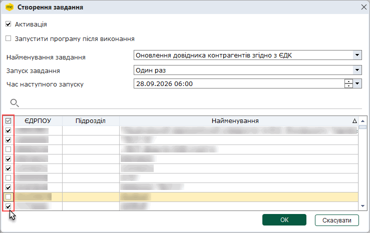

- Активація - встановлена галочка означає, що після запуску Планувальника завдання почне виконуватись в заданий час.

При встановленні цього параметру автоматично проставляється галочка Модуль планування (активація) в головному вікні і Планувальник запускається в роботу.

- Запустити програму після виконання - опція відображається лише у локальній версії програми.
- Примусове завершення роботи - опція відображається лише у мережевій версії програми.

Функція оновлення довідника контрагентів не потребує закриття програми, виконується у "фоновому" режимі і не залежить від обраних параметрів у полях Запустити програму після виконання та Примусове завершення роботи.

- Найменування завдання - оберіть Оновлення довідника контрагентів згідно з ЄДК.
- Запуск завдання - встановіть періодичність запуску завдання:

Один раз - використовується для разового створення резервної копії програми;

Щодня - використовується для створення резервної копії кожного дня у заданий користувачем час;

Щотижня - використовується для створення резервної копії раз на тиждень в заданий користувачем день та час.

- Час наступного запуску - оберіть у календарі дату та час початку виконання завдання.
В разі вибору запуску завдання щодня, використовуватиметься встановлений час, якщо щотижня - встановлений день тижня та час.

- Оберіть підприємства, для яких необхідно виконувати оновлення довідника контрагентів, встановіть відмітку на початку рядка, що відповідає підприємству, налаштувати виконання завдання можна для підприємств, що доступні авторизованому користувачу відповідно [до його ролі](UCManageRoles.html#ucmanageroles-ucmanageroles).
- Рекомендується запускати звірку з ЄДК щодня перед початком роботи користувачів у програмі.
- Це заощадить час та ресурси програми при роботі з великою кількістю податкових накладних: перевірці, відправленні їх на реєстрацію в ЄРПН та контрагентам, при автоматичній обробці документів, оскільки будуть використовуватися дані звірки, виконаної планувальником.

3. Для продовження натисніть кнопку Ок.

4. Створене завдання з'явиться у переліку завдань Планувальника.

5. За умови, що [Планувальник завдань запущено](#ucplanner-ucplanner_start) у вказаний час, розпочнеться процес звірки.

За замовчуванням, під час виконання завдання буде виконуватися оновлення для всіх записів, які присутні у довіднику контрагентів програми.

Результати оновлення відображаються в таблиці Довідника контрагентів та заносяться у їхні картки.

### Запуск роботи Планувальника завдань

_Шлях у довідці: Розділи програми › Адміністрування › Планувальник завдань › Запуск роботи Планувальника завдань_

Для запуску роботи Планувальника встановіть галочку в полі Модуль планування (активація). Справа відображатиметься дата/час та поточний стан планувальника.

Параметр Модуль планування (активація) встановлюється автоматично при активації окремого завдання.

Нижче розглянуто роботу Планувальника на прикладі завдання Створення архіву:

1. Завдання запускається у заданий у налаштуваннях час. Процес створення відображається у окремому вікні. По закінченню процесу з'явиться повідомлення про результат виконання операції.

2. При Створенні архіву з перевіркою бази у програмі, що працює на базі СКБД Firebird, виконується логування операцій. Файли checkFB.log та createFB.log додаються у папку LOG кореневого каталогу програми. В загальний файл Planner.log записуються всі виконані операції.

3. За результатами виконання завдання, у таблиці модуля заповнюється колонка Статус останньої операції, наприклад:

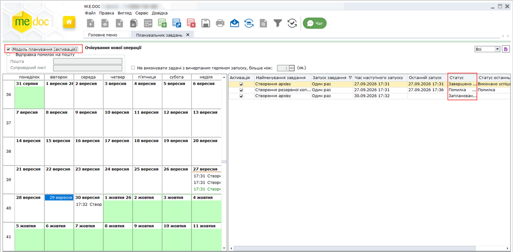

Натисніть, щоб збільшити малюнок

Зверніть увагу!

В локальній версії програми, в час запуску завдання, система самостійно завершить роботу програмного комплексу та виконає завдання.

Якщо при створенні завдання була встановлена опція Запустити програму після виконання, то після виконання завдання програма автоматично запуститься.

В мережевій версії програми система оповістить всіх користувачів про потребу завершення роботи робочих станцій, з можливістю варіанту вибору Так або Ні. Якщо користувач натисне Ні, система через певний проміжок часу знову запитає користувача про можливість закриття робочої станції. Резервне копіювання, створення архіву та оновлення програми виконується на сервері та розпочнеться після закриття всіх робочий станцій.

Під час виконання завдань Планувальник самостійно зупиняє службу ZvitGrp, та після завершення процедури, автоматично запускає її знову.

Серверна частина програми та клієнтські робочі станції запускаються користувачем.

Виключенням із цих правил є завдання на Оновлення даних контрагентів згідно з ЄДК. Звірка даних з ЄДК виконується у "фоновому" режимі, програмний комплекс не закривається, а працює у штатному режимі.


