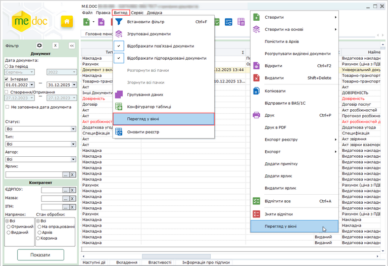
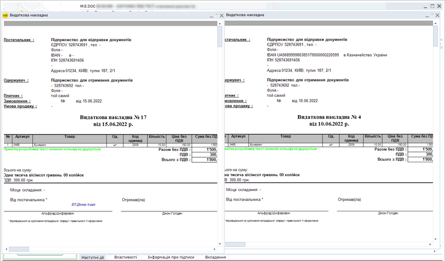
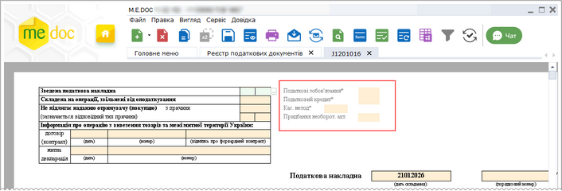

[← Зміст довідки](../)


# Правила заповнення та редагування документів

## Правила заповнення та редагування документів

_Шлях у довідці: Основні робочі процедури › Робота з документами › Правила заповнення та редагування документів_

В цьому розділі:

[Основні кроки подання електронної звітності](#ucpravila-pravyla)

[Відображення документів у програмі](#ucpravila-pravyla)

[Перегляд документів у окремих вікнах](#ucpravila-pravyla)

[Правила заповнення документів](#ucpravila-pravyla)

[Правила редагування документів](#ucpravila-pravyla)

[Поля розробника](#ucpravila-pravyla)

Основні кроки подання електронної звітності

Основні кроки подання електронної звітності:

1. Створити у відповідному розділі програми новий звіт у затвердженому контролюючим органом форматі.

2. Підписати документ згідно налаштованого комплекту підписів для даного типу документів (наприклад, бухгалтера,  директора та підписом електронної печатки, якщо вона є в наявності).

3. Здійснити шифрування документа. У програмному комплексі це здійснюється автоматично разом з накладанням ЕП шифрування.

4. Надіслати створений, підписаний та зашифрований звіт до контролюючого органу.

Наступні дії в обробці звітів не залежать від суб’єктів господарювання, їх здійснює контролюючий орган та надсилає результати власнику звіту:

1. Контролюючим органом здійснюється автоматична перевірка отриманого звіту, про результати якої суб’єкту господарювання надсилається Квитанція №1. (Автоматична перевірка включає перевірку електронних підписів, загального формату файлу, наявність приєднання до Договору, наявність обов’язкових реквізитів).

Зазвичай така квитанція надходить протягом 2-х годин з часу отримання звіту ДПС або протягом перших 2-х годин наступного операційного дня. Якщо не отримали Квитанцію № 1 – електронна звітність вважається не прийнятою контролюючим органом.

2. Якщо звіт пройшов первинну автоматичну перевірку, контролюючим органом перевіряється вміст звіту, після чого автору звіту надсилається Квитанція №2. Квитанція №2 містить або підтвердження про прийняття, або відмову із зазначенням відповідних причин.

Квитанція № 2 формується не пізніше наступного робочого дня з моменту формування Квитанції № 1 (при прийнятті електронної звітності). За наявності Квитанції № 2 датою та часом реєстрації електронної звітності вважається дата та час, зафіксовані у Квитанції № 1.

Після відправлення звітності ви повинні отримати Квитанцію № 1 та Квитанцію № 2. Переглянути квитанції у програмі М.E.Doc можна на панелі вкладок, після отримання відповідної квитанції з'являються вкладки Квитанція №1 та Квитанція №2. Про стан звіту можна дізнатися на вкладці Наступні дії, а також у таблиці реєстру - колонка Стан.

[До початку](#ucpravila-pravyla)

Відображення документів у програмі

Більшість модулів програми побудовані у вигляді таблиці - реєстру, окремий рядок якої відображає коротку інформацію про кожний документ.

Кожен новий створений документ відкривається у окремій вкладці та виглядає відповідно бланка, затвердженому контролюючими органами (для звітності), або ж відповідно бланка ([шаблона](UCRtfDocTemplate.html#ucrtfdoctemplate-pdocs_shablon)), створеного користувачем (первинні документи: акти, договори тощо).

Щоб переглянути документ або редагувати документ, його необхідно відкрити подвійним кліком лівої кнопки миші по потрібному запису. Документ буде відкрито у окремій вкладці, назва якої містить код документа.

У програмі можна працювати одразу з декількома документами, проте активним є тільки один. Активний документ (вкладка) виділяється сірим кольором.

[До початку](#ucpravila-pravyla)

Перегляд документів у окремих вікнах

У разі, якщо є необхідність порівняти вміст кількох документів, можна відкрити ці документи у окремих вікнах програми.

Щоб відкрити документ у окремому вікні, виділіть документ у таблиці реєстру та скористайтеся одним із способів:

- у головному меню програми виконайте команду Вигляд – Перегляд у вікні;
- виконайте команду контекстного меню Перегляд у вікні.

Натисніть, щоб збільшити малюнок

Кожен обраний документ буде відкрито у окремому вікні:

Натисніть, щоб збільшити малюнок

Функція доступна у реєстрах:

- [Реєстр звітів](UCDocRstByPer5.html#ucdocrstbyper5-rdocs);
- [Об'єднана звітність ПДФО та ЄСВ](UCEsv1DfRST.html#ucesv1dfrst-ucesv1dfrst);
- [Фінансова звітність за МСФЗ (формат iXBRL)](UCIFRSTgrRst.html#ucifrstgrrst-ucifrstgrrst);
- [Реєстр електронних документів](UCDFDocsRstNew.html#ucdfdocsrstnew-ucdfdocsrstnew)
- [Реєстр податкових документів](UCDFDocsRst.html#ucdfdocsrst-pdocs_reestr).

[До початку](#ucpravila-pravyla)

Правила заповнення документів

При роботі з усіма видами документів в програмному комплексі діють наступні правила заповнення полів документів:

- Поля, доступні для заповнення, виділені жовтим кольором.
- У деяких полях документів передбачена можливість вибору значення із підключеного довідника. Якщо встановити курсор у такому полі, у правій частині поля з'явиться кнопка .
Натисніть на кнопку для відкриття довідника. Оберіть потрібне значення та натисніть кнопку Вибрати. Поле документа заповниться обраним у довіднику значенням.

- Для переміщення по полям документа можливо використовувати клавішу Tab, стрілки клавіатури Вверх, Вниз, Вправо, Вліво та ліву кнопку миші.
- У деяких формах є динамічні таблиці, у які можна додавати рядки, наприклад, у документі Податкова накладна.

Додавання нового рядка під обраним відбувається одним із наступних способів:

- за допомогою кнопки  зліва від обраного рядка у таблиці;
- натисканням комбінації клавіш Ctrl+I.

Вилучення обраного рядка відбувається одним із наступних способів:

- за допомогою кнопки  зліва від обраного рядка у таблиці;
- натисканням комбінації клавіш Ctrl+Y.
- При внесенні або редагуванні значень у полях, що заповнюються, доступні операції – відмінити (Ctrl+Z), вирізати (Ctrl+X), копіювати (Ctrl+C) та вставити (Ctrl+V). Ці операції також можна виконати за допомогою контекстного меню, що відкривається по натисканню правої кнопки миші.
- Для оперативної допомоги при заповненні числових полів бланка чи додаткових розрахунків використовується стандартний калькулятор ОС Windows - викликається за допомогою пункту головного меню Сервіс - Калькулятор.
- В процесі відкриття, заповнення, збереження та закриття документа в ньому виконуються створені розробником вбудовані програми , які відслідковують дії користувача та повідомляють про помилки чи внесення некоректних даних.

[До початку](#ucpravila-pravyla)

Правила редагування документів

- Імпортовані або створені раніше звіти, які не підписані ЕП та не відіслані електронними засобами зв'язку, доступні для редагування.
- Підписані ЕП, але не відправлені електронними засобами зв'язку звіти доступні для редагування, але лише після видалення з документа підписів. При спробі змінити підписаний, але не відправлений документ, програма автоматично запропонує видалити підписи.
- Звіти, які були відправлені електронними засобами зв'язку, НЕМОЖЛИВО РЕДАГУВАТИ. Такі звіти відкриваються лише для перегляду!
- Для помилкових звітів, які заблоковані від редагування (підписані ЕП або відправлені електронним каналом зв’язку) реалізовано можливість перегляду помилок. У відкритому документі, поля, що містять помилки підсвічуються червоним кольором та при позиціонуванні на полі, що містить помилку, відображається підказка, в чому саме полягає помилка.
- При обранні помилкового документа в [Реєстрі звітів](UCDocRstByPer5.html#ucdocrstbyper5-rdocs) також можна подивитись перелік помилок у вкладці Протокол перевірки. Подвійний клік лівою кнопкою миші на рядку помилкового документа відкриває цей документ у окремій вкладці з позиціонуванням курсору на полі, що містить помилку.
- Для редагування та повторного відправлення необхідно [створити копію](UCDocRstByPer5.html#ucdocrstbyper5-rdoc_robota_function) звіту в даному звітному періоді.
- Для раніше створених звітів, що відкрились для редагування, потрібно [виконати програму](UCProgramy.html#ucprogramy-programy) перерахунку, модифікації, перевірити їх та зберегти.
- Імпортовані звіти обов'язково потрібно відкрити, [виконати програму](UCProgramy.html#ucprogramy-programy) перерахунку, модифікації, перевірити їх та зберегти, оскільки в деяких бухгалтерських програмах структури XML файлів включають не всі реквізити документа, необхідні для проходження контролів (валідації) при прийманні в ДПС.

[До початку](#ucpravila-pravyla)

Поля розробника

Для зручності роботи в програмі у деякі форми звітності додані додаткові поля — поля розробника, які призначені для автоматизації деяких трудомістких процесів. Наприклад, такі поля додані в ПН/РК.

- Назви полів розробника відображаються сірим кольором та відмічені зірочкою \*.

Натисніть, щоб збільшити малюнок

- Поля розробника не є обов'язковими для заповнення та не підлягають коригуванню у разі невірного заповнення.
- Поля розробника не друкуються, не експортуються, не відправляються в ДПС.

[До початку](#ucpravila-pravyla)


