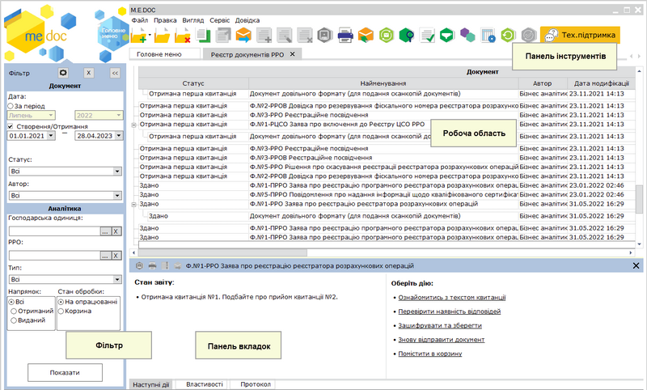
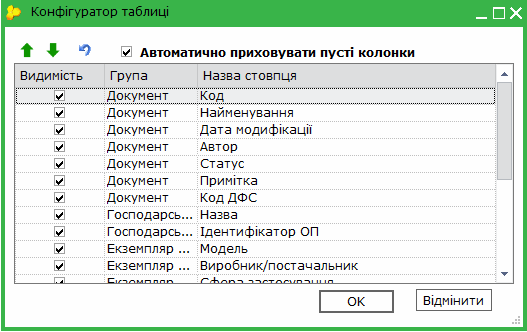

[← Зміст довідки](../)


# Реєстр документів РРО та ПРРО

## Реєстр документів РРО та ПРРО

_Шлях у довідці: Розділи програми › Реєстр документів РРО та ПРРО_

Реєстр документів РРО призначений для створення, редагування та збереження документів, щодо застосування екземплярів реєстраторів розрахункових операцій, з метою їх реєстрації в ДПС.

Опрацювання документів у розділі здійснюється згідно з порядком, що затверджений наказом Міністерства фінансів України від 13.02.2019 р. № 64 «Про затвердження порядків ведення реєстру екземплярів реєстраторів розрахункових операцій та реєстру центрів сервісного обслуговування реєстраторів розрахункових операцій», та порядками, що затверджені наказом Міністерства фінансів України від 14.06.2016 р. № 547 «Про затвердження порядків щодо реєстрації реєстраторів розрахункових операцій та книг обліку розрахункових операцій» (у редакції від 01.10.2018 р.).

У даному розділі довідки розглянуто наступне:

- [Опис основних функціональних елементів інтерфейсу](#ucrrorst-ucrrorst_interface)
- [Робота з документами РРО](RRORstFunkc.html#rrorstfunkc-rrorstfunkc)
- [Робота з довідниками](UCRRO_dovidnyky.html#ucrro_dovidnyky-ucrro_dovidnyky)
- [Господарські одиниці/Акцизні склади/Земельні ділянки](UCEconomicUnits.html#uceconomicunits-uceconomicunits)
- [Сертифікати РРО](UCAsignCert.html#ucasigncert-admcert_cert_rro)

### Основні елементи інтерфейсу

_Шлях у довідці: Розділи програми › Реєстр документів РРО та ПРРО › Основні елементи інтерфейсу_

Реєстр складається з 4 частин:

Натисніть, щоб збільшити малюнок

Фільтр

Робота з Реєстром РРО розпочинається з Фільтру - інструменту відбору потрібних документів.

У Фільтрі представлені атрибути документів, за якими здійснюється пошук та сортування:

Блок фільтру Документ:

Дата - встановіть позначку для вибору певного періоду:

- За період - вкажіть місяць та рік, в межах якого були створені потрібні первинні документи;
- Створення/Отримання - вкажіть дату початку та закінчення довільного інтервалу, в межах якого були створенні або отриманні потрібні первинні документи.

Статус - оберіть зі списку, що відкривається, назву статусу, що відповідає. За замовчанням встановлено значення Всі, тобто пошук відбувається за заданими параметрами серед усіх документів РРО.

Автор – у списку, що відкривається, оберіть користувачів, якими створювались документи;

Блок фільтру Аналітика:

Господарська одиниця – натисніть кнопку   та у вікні довідника Господарська одиниця оберіть господарську одиницю, що використовує РРО;

РРО – натисніть кнопку   та у вікні довідника Перелік РРО оберіть екземпляри РРО, що використовуються у господарських одиницях користувача;

Тип – у списку, що відкривається, оберіть тип документів РРО;

Напрямок - встановіть позначку, що відповідає напрямку документа:

- Всі - всі документи РРО, які знаходяться в роботі;
- Отриманий - отримані документи;
- Виданий - документи, створені користувачем.

Стан обробки - встановіть позначку, що відповідає стану обробки документа:

- На опрацюванні - документи, які знаходяться безпосередньо в роботі;
- Корзина - документи, які були видалені з реєстру.

Після встановлення параметрів фільтрації натисніть на кнопку Показати. В робочій області відобразиться перелік документів згідно заданих параметрів пошуку.

Для того, щоб очистити Фільтр від даних, натисніть на кнопку .

Якщо Фільтр не потрібен та/або заважає, його можна згорнути. Для цього натисніть на кнопку . Щоб розгорнути Фільтр, натисніть на згорнуту панель.

Робоча область

Містить безпосередньо записи Реєстру документів РРО: відображає записи, що відповідають заданим умовам фільтрації та сортування.

Документи, що містять помилки відображаються червоним кольором. [Імпортовані](RRORstFunkc.html#rrorstfunkc-rrorstfunkc_imp) документи - синім кольором.

Набором колонок у таблиці Реєстру та порядком їх розміщення можна керувати. Для цього натисніть на кнопку  на панелі інструментів.

Відкриється вікно Конфігуратор таблиці. Встановіть відповідні галочки для відображення колонок.

Скористайтесь кнопками  для встановлення довільного порядку за власним бажанням, або  для встановлення порядку колонок за замовчанням.

Якщо встановлено опцію Автоматично приховувати пусті колонки, колонки, що не містять даних, не відображаються у Робочій області.

Для зручності роботи у реєстрі, реалізована функція ГРУПУВАННЯ записів реєстру по колонкам таблиці реєстру.
Для активації цієї функції необхідно вибрати в меню Вигляд - Групування даних або натиснути на кнопку  на панелі інструментів. Над реєстром з'явиться додаткова панель. Перетягніть на цю панель потрібні колонки таблиці.

Щоб відкрити документ, оберіть його у списку та скористайтеся одним із способів:

- натисніть 2 рази лівою кнопкою миші на документі у списку;
- виконайте команду меню Файл - Відкрити;
- оберіть команду Відкрити у контекстному меню;
- натисніть кнопку Відкрити  на панелі інструментів;
- скористайтесь комбінацією клавіш Ctrl+F2.

Можливо відкрити декілька документів одночасно, для цього виділіть потрібні документи у списку та скористайтеся одним із способів, що вказані вище.

Панель вкладок

Містить службову інформацію щодо обраного документа. Панель доступна як у відкритому документі, так і з Реєстру документів РРО (за умови виділення потрібного документа).

- Наступні дії – містить інформацію щодо поточного стану документа, а також перелік можливих дій з документом у цьому стані. Слугує підказкою користувачу про доступні дії, які можна виконати з документом у поточному стані;
- Властивості – у режимі читання містить всю службову інформацію про документ, таку як: стан, період створення, дата та час останньої модифікації, інформація про сертифікати, якими підписано документ тощо. Інформація на цій вкладці постійно оновлюється та доповнюється при будь-яких змінах документа;
- Протокол – містить перелік подій, що відбулись з документом під час його обробки в хронологічному порядку. При виборі події справа на панелі відображається її детальний опис.

Панель інструментів.

Містить кнопки, що надають швидкий доступ до найбільш часто використовуваних функцій. Наведіть покажчик миші на інструмент і чекайте протягом секунди, для відображення короткої підказки, що описує його призначення.


