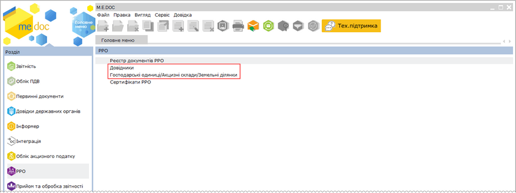
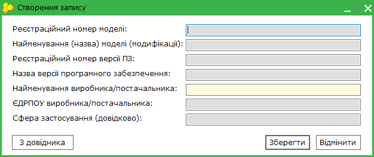
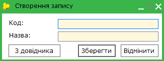
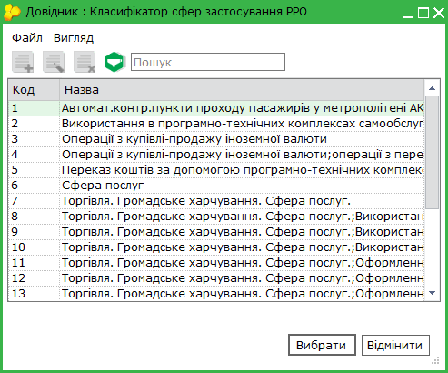
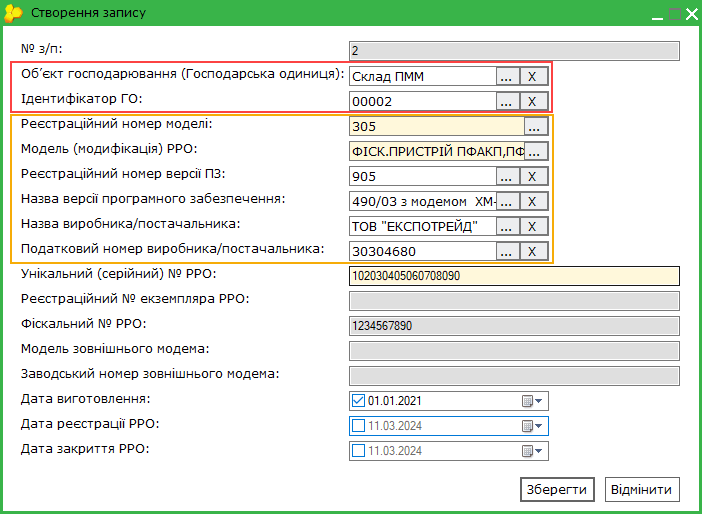
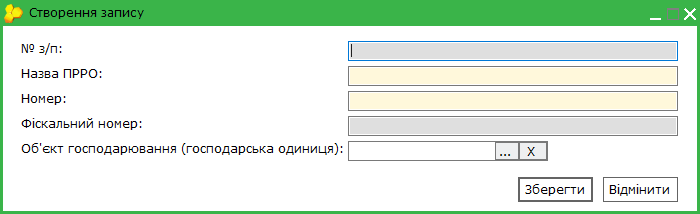

[← Зміст довідки](../)


# Довідники РРО

## Довідники РРО

_Шлях у довідці: Розділи програми › Реєстр документів РРО та ПРРО › Довідники РРО_

Модуль призначений для створення та редагування довідників, які використовуються при заповненні [Документів РРО](UCRRORst.html#ucrrorst-ucrrorst). Довідники модуля призначені полегшити та прискорити заповнення відповідних форм.

Всі довідники є довідниками користувача з можливістю редагування та додавання записів. Таким чином, створюються персональні довідники РРО, що містять інформацію про типи та сфери застосування РРО, необхідні для певного підприємства.

Користувачі мають можливість змінювати та доповнювати довідники за власними потребами. При першому відкритті довідники не містять записів!

Натисніть, щоб збільшити малюнок

Довідники

При виборі пункту Довідники відкривається модуль програми Довідника - Загальні - РРО, що містить довідники:

- Перелік РРО - призначений для зберігання переліку екземплярів РРО, що використовуються у господарських одиницях користувача.
- Довідник моделей РРО - перелік моделей РРО, що використовуються у господарських одиницях користувача (підключений до довідника Перелік РРО).
- Класифікатор сфер застосування РРО - перелік сфер застосування РРО, що використовуються у господарських одиницях користувача.

Для додавання записів у довідник:

1. На панелі ліворуч оберіть довідник, до якого необхідно додати інформацію.

2. Додавання даних записів у довідник виконується одним із способів:

- на панелі інструментів модуля натисніть кнопку  ,
- оберіть команду в меню Файл - Створити запис;
- оберіть із контекстного меню  Створити запис;
- сполученням клавіш <Ctrl+I>.

Можливо додати новий запис, скопіювавши існуючий запис. Для копіювання оберіть запис довідника та натисніть кнопку  на панелі інструментів або оберіть команду в меню Файл - Копіювати. Буде відкрито вікно створення нового запису, що містить скопійовані значення.

3. У вікні, що відкриється, введіть необхідні параметри та натисніть кнопку Зберегти. Вигляд вікна, та дані, що необхідно заповнити, залежать від довідника, який редагується:

Поля, підсвічені жовтим, обов'язкові для заповнення.

- Довідник моделей РРО

Введіть дані РРО що використовуються для розрахункових операцій:

- Реєстраційний номер моделі – реєстраційний номер моделі у державному реєстрі РРО;
- Найменування (назва) моделі (модифікації) - назва моделі РРО;
- Реєстраційний номер версії ПЗ – номер версії ПЗ моделі РРО у державному реєстрі РРО;
- Назва версії програмного забезпечення – версія внутрішнього програмного забезпечення, зазначена у державному реєстрі РРО;
- Найменування виробника/постачальника - назва виробника або постачальника РРО;
- ЄДРПОУ виробника/постачальника - реєстраційний номер виробника або постачальника РРО;
- Сфера застосування (довідково) - зазначається сфера застосування РРО відповідно до Державного реєстру реєстраторів розрахункових операцій.

Всі дані вводяться безпосередньо користувачем з клавіатури. (Використовується при заповненні довідника Перелік РРО.)

- Класифікатор сфер застосування РРО

Введіть дані щодо сфери застосування РРО:

- Код - код сфери застосування, містить цифрове значення;
- Назва - назва сфери застосування РРО.

Дані можуть буті введені вручну, у такому випадку переконайтеся у коректності введеної інформації.

Також дані можуть бути обрані з рекомендованого системного довідника. Для цього натисніть кнопку З довідника. У вікні, що відкриється, оберіть потрібне значення та натисніть Вибрати:

- Перелік РРО

Введіть дані щодо моделі РРО:

- № з/п - порядковий номер РРО, повинен містити цифрове значення;
- Об'єкт господарювання (Господарська одиниця) - назва господарської одиниці, що використовує РРО, значення обирається з довідника [Господарські одиниці/Акцизні склади/Земельні ділянки](UCEconomicUnits.html#uceconomicunits-uceconomicunits). Для вибору значення з довідника натисніть кнопку , у вікні довідника, що відкриється, оберіть потрібне значення;
- Ідентифікатор ГО - унікальний внутрішній ідентифікатор господарської одиниці, значення обирається з довідника Господарські одиниці/Акцизні склади;

Заповнення полів з довідника Господарські одиниці/Акцизні склади здійснюється одночасно при виборі значення у будь-якому з полів, до якого підключено цей довідник.

- Реєстраційний номер моделі - реєстраційний номер моделі РРО, обирається з [Довідника моделей РРО](#ucrro_dovidnyky-ucrro_dovidnyky). Для вибору значення з довідника натисніть кнопку ;
- Модель (модифікація) РРО - назва моделі РРО, обирається з Довідника моделей РРО;
- Реєстраційний номер версії ПЗ - реєстраційний номер версії програмного забезпечення РРО, обирається з Довідника моделей РРО;
- Назва версії програмного забезпечення - назва версії програмного забезпечення РРО, обирається з Довідника моделей РРО;
- Назва виробника/постачальника - назва виробника або постачальника РРО, обирається з Довідника моделей РРО;
- Податковий номер виробника/постачальника - податковій номер (ЄДРПОУ) виробника або постачальника РРО, обирається з Довідника моделей РРО;

Заповнення полів з Довідника моделей РРО здійснюється одночасно при виборі значення у будь-якому з полів, до якого підключено цей довідник.

- Унікальний (серійний) № РРО - серійний номер РРО;
- Дата виготовлення - дата виготовлення РРО;
- Реєстраційний № екземпляра РРО - реєстраційний номер РРО у реєстрі екземплярів РРО;
- Фіскальний № РРО - номер реєстрації РРО у фіскальному органі;
- Модель зовнішнього модема - модель зовнішнього модема РРО;
- Заводський номер зовнішнього модема - заводський номер зовнішнього модема РРО;
- Дата виготовлення - дата виготовлення РРО;
- Дата реєстрації РРО - дата реєстрації РРО у фіскальному органі;
- Дата закриття РРО - дата скасування реєстрації РРО, наприклад, з причини закінчення строку служби РРО.

Для застосування дати у відповідному полі повинна бути встановлена відмітка. Відмітка встановлюється автоматично після обрання дати. Якщо відмітка видалена, значення поля не застосовується та не відображається у таблиці довідника.

- Перелік ПРРО

Введіть дані щодо програмного РРО:

- № з/п - порядковий номер ПРРО, повинен містити цифрове значення;
- Назва ПРРО - назва програмного РРО, під якою від використовується у ГО;
- Номер - номер програмного РРО, під яким від використовується у ГО;
- Фіскальний № РРО - номер реєстрації ПРРО у фіскальному органі;
- Об'єкт господарювання (Господарська одиниця) - назва господарської одиниці, що використовує ПРРО, значення обирається з довідника [Господарські одиниці/Акцизні склади/Земельні ділянки](UCEconomicUnits.html#uceconomicunits-uceconomicunits). Для вибору значення з довідника натисніть кнопку , у вікні довідника, що відкриється, оберіть потрібне значення.

4.  Доданий запис буде відображено у таблиці довідника.

Зверніть увагу

У довіднику Господарські одиниці/Акцизні склади/Земельні ділянки зберігається інформація щодо господарських одиниць користувача, у яких використовуються реєстратори розрахункових операцій. Довідник заповнюється користувачем та підключений до форм документів РРО. При виборі цього пункту відриється вікно довідника Господарські одиниці/Акцизні склади/Земельні ділянки  розділу програми Довідники.

Докладно про заповнення довідника дивіться модуль [Довідники - Господарські одиниці/Акцизні склади/Земельні ділянки](UCEconomicUnits.html#uceconomicunits-uceconomicunits).

По натисканню на Сертифікати РРO відкривається розділ програми [Управління сертифікатами - Встановлені сертифікати РРО](UCAsignCert.html#ucasigncert-admcert_cert_rro), призначений для управління даними сертифікатів електронних підписів та/або печаток, що використовуються у роботі з програмними реєстраторами розрахункових операцій (ПРРО).

### Довідники РРО

_Шлях у довідці: Розділи програми › Довідники › Загальні довідники › Довідники РРО_

_Див. [Довідники РРО](UCRRO_dovidnyky.html#ucrro_dovidnyky-ucrro_dovidnyky)_


