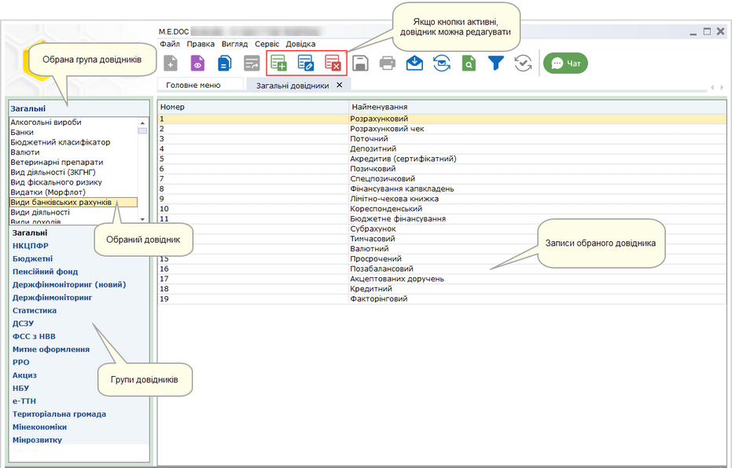
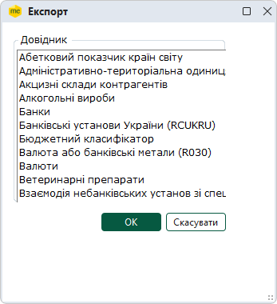
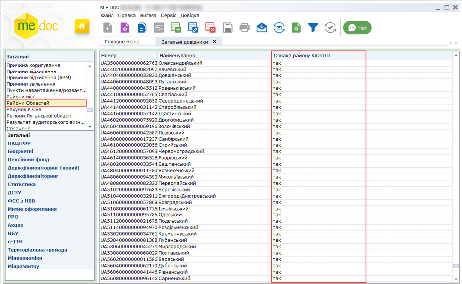

[← Зміст довідки](../)


# Загальні довідники

## Загальні довідники

_Шлях у довідці: Розділи програми › Довідники › Загальні довідники_

Програмний комплекс містить багато вбудованих довідників. При додаванні нових або редагуванні існуючих записів, вибір даних із довідників полегшує заповнення полів. Користуючись довідниками, значно прискорюється заповнення багатьох документів, в які заноситься стандартизована та класифікована інформація.

Всі довідники програмного комплексу розміщені у модулі Загальні довідники. Для зручності, довідники згруповані за видами зібраної в них інформації: загальні, бюджетні, пов’язаної з пенсійним фондом та фінансовим моніторингом.

Довідники також умовно поділяються на системні та редаговані.

У системних довідниках ЗАБОРОНЕНО вносити дані та редагувати їх.

В інші довідники можна вносити та редагувати дані. В таких довідниках активні кнопки , , та .

Натисніть, щоб збільшити малюнок

Перелік системних довідників

У всіх системних довідниках ЗАБОРОНЕНО вносити та редагувати дані. Кнопки Створити запис, Видалити запис та Редагувати запис у таких довідниках неактивні.

Це довідники:

- КОАТУУ
- Інспекції
- Районні відділення Держкомстату
- Центри зайнятості
- Управління ФСС НВВ
- Органи управління....
- всі довідники, які використовуються:
- в бюджетній конфігурації;
- підключені до форм Пенсійної звітності;
- підключені до форм звітності до управлінь статистики (розділи Держкомстат та Інша звітність);
- підключені до форм звітності в ДЦЗ.

Експорт довідників у формат DBF

Для експорту довідника в dbf-файл потрібно:

1. У меню Файл оберіть команду Експорт - Експорт.

2. У вікні, що відкрилось, вкажіть, який саме довідник необхідно експортувати та натисніть кнопку ОК.

3. Вкажіть шлях до каталогу, де зберегти файл.

4. Система повідомить про успішне виконання процедури експорту.

Експорт довідників у формат XML

Для експорту довідника в xml-файл потрібно:

1. У меню Файл оберіть команду Експорт - Експорт в XML.

2. У вікні, що відкрилось, вкажіть шлях до каталогу, де зберегти файл. Натисніть кнопку ОК.

3. Система повідомить про успішне виконання процедури експорту.

### Довідник Районів Областей

_Шлях у довідці: Розділи програми › Довідники › Загальні довідники › Довідник Районів Областей_

Довідник містить назви та коди території за КОАТУУ - Державним класифікатором об'єктів адміністративно-територіального устрою України, а також коди та назви територій за КАТОТТГ - за Кодифікатором адміністративно-територіальних одиниць та територій територіальних громад, відповідно до оновленого територіального устрою України.

Записи довідника за КАТОТТГ містять позначку Так у колонці Ознака району за КАТОТТГ:

Натисніть, щоб збільшити малюнок


