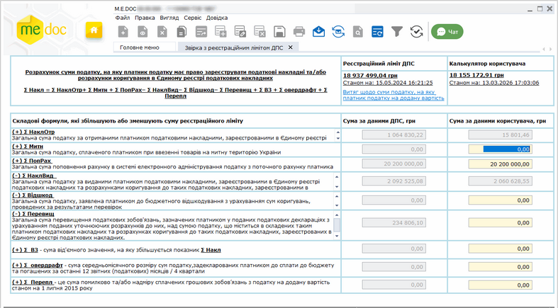
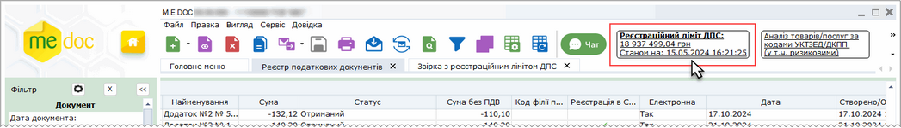
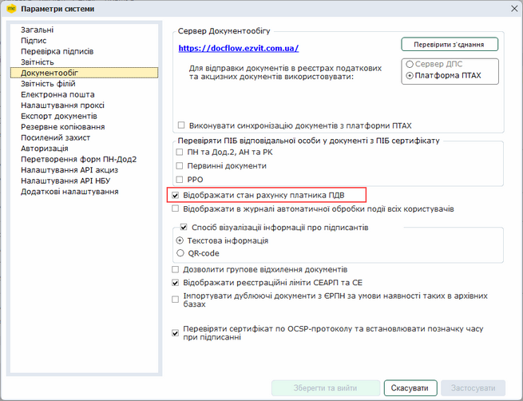
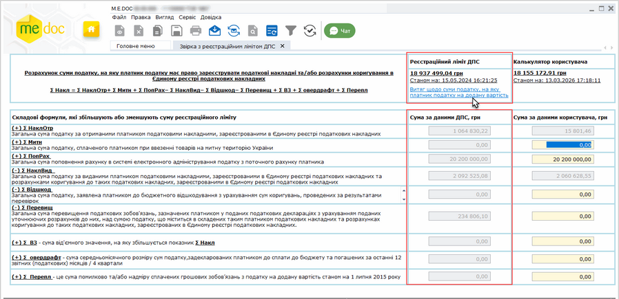

[← Зміст довідки](../)


# Звірка з реєстраційним лімітом ДПС

## Звірка з реєстраційним лімітом ДПС

_Шлях у довідці: Розділи програми › Облік ПДВ › Звірка з реєстраційним лімітом ДПС_

В цьому розділі:

[Реєстраційний ліміт ДПС](#ucregndslimit-ucregndslimit)

[Калькулятор користувача](#ucregndslimit-ucregndslimit)

[Експорт документів, що формують ліміт](#ucregndslimit-ucregndslimit)

Модуль Звірка з реєстраційним лімітом ДПС призначений для контролю ліміту платниками ПДВ. Відкривається з головного меню або за допомогою пункту меню Сервіс - Звірка з реєстраційним лімітом ДПС.

Модуль побудований у вигляді таблиці:

- Реєстраційний ліміт ДПС – ліміт з останнього Витягу з системи електронного адміністрування ПДВ;
- Калькулятор користувача – ліміт розраховується за зареєстрованими Податковими накладними та Додатками 2, наявними в програмі.

Натисніть, щоб збільшити малюнок

За наявності в програмі Витягів з системи електронного адміністрування ПДВ (форми JF1401206) реєстраційний ліміт відображається в Реєстрі податкових документів. При натисканні на посилання відкривається вікно модуля Звірка з реєстраційним лімітом ДПС.

Натисніть, щоб збільшити малюнок

Якщо в програмі немає Витягу з системи електронного адміністрування ПДВ (форми FJ1401206), то в Реєстрі первинних документів замість реєстраційного ліміту ДПС буде відображено повідомлення Запит не відсилався.

Оновлення відображення суми реєстраційного ліміту ДПС виконується автоматично при отриманні нового Витягу з системи електронного адміністрування ПДВ.

Відображення ліміту в Реєстрі податкових документів налаштовується в параметрах системи Адміністрування - Параметри системи - Документообіг, параметр Відображати стан рахунку платника ПДВ. За замовчуванням параметр відмічено та відображення ліміту ввімкнено.

Натисніть, щоб збільшити малюнок

[До початку](#ucregndslimit-ucregndslimit)

Реєстраційний ліміт ДПС

Реєстраційний ліміт ДПС отримується з останнього Витягу з системи електронного адміністрування ПДВ.

В колонці Реєстраційний ліміт ДПС відображаються такі дані:

- Сума з останнього Витягу з системи електронного адміністрування ПДВ;
- Станом на – дата отримання останнього Витягу з системи електронного адміністрування ПДВ;
- Посилання на останній Витяг з системи електронного адміністрування ПДВ. При натисканні на посилання відкривається цей Витяг.

Якщо в програмі немає Витягу з системи електронного адміністрування ПДВ (форми JF1401206), то в колонці буде відображено повідомлення "Увага! Для отримання інформації необхідно відправити Запит щодо отримання відомостей про стан рахунку (JF1301206). Відправити запит".

При натисканні на посилання "Відправити запит" буде виконано автоматичне формування запиту.

Запит щодо отримання відомостей про стан рахунку для отримання Витягу може відправлятись необмежену кількість разів на день.

В колонці Сума за даними ДПС відображаються показники з останнього Витягу з системи електронного адміністрування ПДВ. Ці показники можна порівняти з даними програми.

Натисніть, щоб збільшити малюнок

Оновлення відображення суми за даними ДПС виконується автоматично при отриманні нового Витягу з системи електронного адміністрування ПДВ.

[До початку](#ucregndslimit-ucregndslimit)

Калькулятор користувача

В розрахунку суми ліміту за даними користувача приймають участь показники, наведені в таблиці.

Автоматично розраховуються показники:

- ∑ НаклОтр Загальна сума податку за отриманими платником податковими накладними, зареєстрованими в Єдиному реєстрі податкових накладних;
- ∑ НаклВид Загальна сума податку за виданими платником податковими накладними, зареєстрованими в Єдиному реєстрі податкових накладних та розрахунками коригування до таких податкових накладних, зареєстрованими в Єдиному реєстрі податкових накладних.

Ці показники розраховуються за наявними Податковими накладними (із датою виписки >=01.07.2015) та Додатками 2 (із датою виписки >=01.07.2015), зареєстрованими в програмі.

Інші показники вводяться вручну.

|  |  |
| --- | --- |
| ∑ НаклОтр Загальна сума податку за отриманими платником податковими накладними, зареєстрованими в Єдиному реєстрі податкових накладних | розраховується автоматично за даними Реєстру первинних документів |
| ∑ Митн Загальна сума податку, сплаченого платником при ввезенні товарів на митну територію України | вводиться вручну |
| ∑ ПопРах Загальна сума поповнення рахунку в системі електронного адміністрування податку з поточного рахунку платника | вводиться вручну |
| ∑ НаклВид Загальна сума податку за виданими платником податковими накладними, зареєстрованими в Єдиному реєстрі податкових накладних та розрахунками коригування до таких податкових накладних, зареєстрованими в Єдиному реєстрі податкових накладних | розраховується автоматично за даними Реєстру первинних документів |
| ∑ Відшкод Загальна сума податку, заявлена платником до бюджетного відшкодування з урахуванням сум коригувань, проведених за результатами перевірок | вводиться вручну |
| ∑ Перевищ Загальна сума перевищення податкових зобов'язань, зазначених платником у поданих податкових деклараціях з урахуванням поданих уточнюючих розрахунків до них, над сумою податку, що міститься в складених таким платником податкових накладних та розрахунках коригування до таких податкових накладних, зареєстрованих в Єдиному реєстрі податкових накладних | вводиться вручну |
| ∑ ВЗ - сума від'ємного значення, на яку збільшується показник ∑ Накл | вводиться вручну |
| ∑ овердрафт - сума середньомісячного розміру сум податку, задекларованих платником до сплати до бюджету та погашених за останні 12 звітних (податкових) місяців / 4 квартали | вводиться вручну |
| ∑ Перепл - це сума помилково та/або надміру сплачених грошових зобов’язань з податку на додану вартість станом на 1 липня 2015 року | вводиться вручну |

При вході в модуль відбувається автоматичний перерахунок суми за наявними Податковими накладними та Додатками 2, зареєстрованими в програмі.

Якщо модуль залишається відкритим протягом тривалого часу, то для перерахунку суми потрібно натиснути на кнопку  на панелі інструментів. Відбудеться перерахунок з урахуванням:

- реєстрації виданих документів;
- отримання вхідних документів від контрагентів;
- імпорту документів з ЄРПН;
- імпорту документів із квитанціями (XML, DBF).

Після  зміни сум, які вводяться вручну, потрібно натиснути на кнопку  на панелі інструментів для збереження перерахованої суми.

Ручне оновлення суми ліміту реєструється в [журналі подій](UCLogs.html#uclogs-admlogs). За необхідності збереження події в журналі можна відключити.

[До початку](#ucregndslimit-ucregndslimit)

Експорт документів, що формують ліміт

Існує можливість виконати експорт переліку документів, що формують ліміт (∑НаклОтр, ∑НаклВид), до xls-файлів. Експортується перелік наявних Податкових накладних та Додатків 2, що враховуються у підрахунку ліміту в калькуляторі користувача.

Для експорту документів виконайте такі дії:

1. У меню Файл оберіть команду Експорт реєстру - Експорт таблиці в Excel.
Відкриється вікно Огляд папок.

2. Вкажіть каталог, де зберегти файли, та натисніть ОК.

3. Система повідомить про закінчення процесу експорту.

В результаті експорту в обраному каталозі буде створено два файли:

- incoming.xlsx - перелік вхідних документів;
- outgoing.xlsx - перелік вихідних документів.

В кожному файлі відображається загальна кількість записів та такі дані для кожного документа:

- Тип документу;
- Номер;
- Дата складання;
- Дата ПН у Дод.2;
- Дата реєстрації.

[До початку](#ucregndslimit-ucregndslimit)


