[← Зміст довідки](../)


# Шаблони первинних документів

## Шаблони первинних документів

_Шлях у довідці: Розділи програми › Первинні документи › Шаблони первинних документів_

Модуль слугує для формування, редагування та зберігання шаблонів первинних документів, як наданих розробником, так і створених особисто користувачем.

Шаблон - це прототип документа, сполучна ланка між базою даних, у якій зберігаються значення полів документів, та графічним представленням документа. Саме шаблон визначає як повинен виглядати документ у друкованому вигляді та на екрані монітора.

За замовчанням модуль містить шаблони найбільш вживаних документів. Тут можна переглянути склад полів, з яких складається шаблон, а також властивості як кожного поля, так і всього шаблона.

Основне призначення даного модуля - забезпечити можливість створювати документи користувача за власним шаблоном. Модуль містить зручні та інтуїтивно зрозумілі засоби конструювання нових шаблонів документів. За допомогою вбудованого конструктора шаблонів користувач може самостійно створити шаблон "з нуля" або ж скопіювати існуючий шаблон та внести у нього необхідні зміни. Шаблони, створені користувачами, за замовчуванням, зберігаються локально у базі даних програмного комплексу.

Щоб мати можливість обмінюватись з контрагентами, шаблони, за якими створено документи, повинні бути опубліковані у Глобальному реєстрі шаблонів.

У сервісі Глобальний реєстр шаблонів передбачено 2 типи шаблонів:

- локальні шаблони – розміщенні у базі даних користувача.
- глобальні шаблони – розміщенні у глобальній базі шаблонів на сервері "ПТАХ".

Використання Глобального реєстру шаблонів надає можливість скоротити обсяг даних, які передаються контрагенту під час обміну документами, та пришвидшити роботу програми. Завдяки Глобальному реєстру необхідні бланки документів, ваші власні, системні або ж бланки ваших контрагентів, завжди будуть у вас під рукою.

Користувачі можуть переглядати, копіювати шаблони, створювати первинні документи за шаблонами, що доступні у Глобальному реєстрі шаблонів. Для цього під час створення документа у вікні Створення звіту потрібно обрати шаблон з розділів Власні - Публічні, Шаблони клієнтів  або Типові шаблони. Докладно про створення первинних документів дивіться у розділі [Як створити первинний документ](UCDFDocsRstNew.html#ucdfdocsrstnew-pdocs_reestr_funkc_stvor).

За замовчуванням у Глобальному реєстрі збережено типовий комплект шаблонів провідних програмних продуктів для бухгалтерського обліку та первинної документації.

Для публікації додаткових (власних) бланків у Глобальному реєстрі звертайтесь, будь ласка, до представника розробника. Опублікувати шаблон, який повинен бути доступним лише для ваших організацій, ви можете самостійно, за допомогою функції [Глобальний реєстр шаблонів](#ucrtfdoctemplate-pdocs_shablon_stvor).

У даному розділі розглянуті такі теми:

- [Опис основних функціональних елементів інтерфейсу](#ucrtfdoctemplate-pdocs_shablon_opys)
- [Як створити новий шаблон документа](#ucrtfdoctemplate-pdocs_shablon_stvor)
- [Конструктор шаблона документа](#ucrtfdoctemplate-pdocs_shablon_constructor)
- [Опис основних функціональних елементів інтерфейсу конструктору шаблона](#ucrtfdoctemplate-pdocs_shablon_constructor_opys)
- [Поля шаблона](#ucrtfdoctemplate-pdocs_shablon_constructor_func_2)
- [Функції конструктору шаблона](#ucrtfdoctemplate-pdocs_shablon_constructor_func)
- [Особливості написання програм модифікацій на вкладці "Програми"](#ucrtfdoctemplate-vb-script)
- [Імпорт та експорт шаблона](#ucrtfdoctemplate-pdocs_shablon_import)

### Опис основних функціональних елементів інтерфейсу

_Шлях у довідці: Розділи програми › Первинні документи › Шаблони первинних документів › Опис основних функціональних елементів інтерфейсу_

Модуль складається з 4 частин:

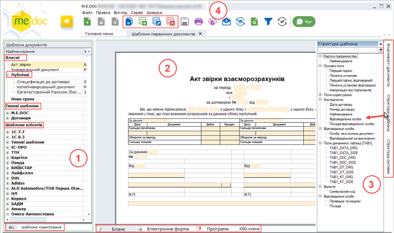

Натисніть на картинку, щоб збільшити її

1. Перелік шаблонів документів

У розділі Шаблони первинних документів всі шаблони розміщені в 3-х групах, що присутні у програмі за замовчуванням:

- Власні – основний робочий каталог, в якому містяться шаблони, створені користувачем, як локальні, так і опубліковані у Глобальному реєстрі шаблонів. В каталозі доступно створення власних шаблонів. Має структуру:
- шаблони користувача, які зберігаються локально у базі даних програми та не опубліковані у Глобальному реєстрі шаблонів. Для зберігання локальних шаблонів можливо створювати підкаталоги;
- підкаталог Публічні – містить глобальні шаблони користувача, що розміщені на сервері «ПТАХ» (опубліковані у Глобальному реєстрі шаблонів).

При відправці контрагенту первинного документа, створеного на основі власного локального шаблона, виконується автоматичне завантаження шаблона до Глобального реєстру шаблонів. Шаблон переміщується з каталогу локальних шаблонів Власні до підкаталогу опублікованих шаблонів Публічні. Шаблони, опубліковані таким чином, не доступні контрагентам для копіювання та створення документів та не відображаються у реєстрі шаблонів у програмі контрагента.

Щоб змінити власний опублікований шаблон, достатньо відправити контрагенту документ, створений за оновленим шаблоном (докладно дивіться у розділі [Створення та редагування шаблонів документів](#ucrtfdoctemplate-pdocs_shablon_stvor)).

- Шаблони клієнтів – каталог з глобальними шаблонами організацій-контрагентів (опубліковані у Глобальному реєстрі шаблонів). Містить підкаталоги, що мають коротку назву, за якою організація-контрагент надає свої послуги або продукти на ринку.

Для публікації власних шаблонів у каталозі Шаблони клієнтів необхідно звернутися до представника розробника. Після публікації ваші шаблони будуть доступні іншим організаціям для створення документів та копіювання (якщо для шаблона не встановлено атрибут [Заборона копіювання опублікованого шаблона](#ucrtfdoctemplate-pdocs_shablon_stvor)).

Для організації-власника шаблона опублікований шаблон відображатиметься у підкаталозі Власні - Публічні.

- Типові шаблони – каталог в якому надаються типові електронні версії шаблонів провідних програмних продуктів для бухгалтерського обліку та первинної документації. Типові шаблони додаються та змінюються лише розробником.

Всі шаблони, які відображені у переліку шаблонів, доступні для перегляду та створення документів.

Копії шаблонів розміщуються у групі Власні. Локальні шаблони у групі Власні (шаблони не опубліковані у Глобальному реєстрі шаблонів) доступні для редагування.

Приналежність шаблона організації визначається за кодом ЄГРПОУ організації без урахування філій.

У групі Власні є можливість створити підгрупи. Для створення нової підгрупи оберіть один із способів:

- на панелі інструментів оберіть команду Додати групу;
- натисніть комбінацію клавіш Ctrl+N;
- оберіть команду меню Файл -  Додати групу.

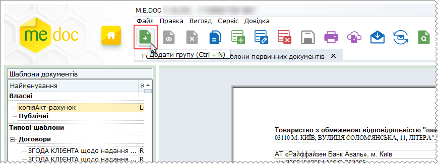

Відкриється вікно Додати групу, де задаються назва та розташування нової групи:

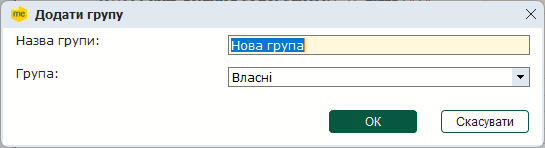

- Назва групи - назва створюваної групи документів;
- Група - назва групи, в яку буде додано новостворену групу.

При виділенні шаблона в переліку, можна переглянути його зовнішній вигляд та основні властивості у робочій області.

Панель містить вкладки, що призначені для полегшення пошуку шаблонів:

- Всі - загальний перелік всіх шаблонів первинних документів;
- Діючі - перелік актуальних шаблонів, тобто тих, що відмічені галочками в загальному переліку. Цей же самий список відображається і при створенні первинного документа в модулі Реєстр електронних документів;
- Шаблони користувача - містить шаблони, що були створені особисто поточним авторизованим в системі користувачем.

2. Робоча область

Відображає шаблон документа, на вкладках області наводиться інформація про шаблон:

- Бланк - представляє собою зовнішній вигляд документа. Жовтим кольором позначаються поля, що будуть заповнюватись при створенні документа (автоматично чи вручну). При наведенні на деякі системні поля відображається підказка - властивості даного поля;
- Електронна форма - містить перелік полів та таблиць, що містяться у даному шаблоні. При наведені на поле відображається підказка - властивості даного поля;
- Програми - призначена для відображення програм модифікації документа з використанням мови програмування VB-Script.

3. Панель властивостей

Представляє собою допоміжну висувну панель. Містить наступні вкладки:

- Структура системи - містить перелік всіх можливих полів, що є у системі. Реалізовано пошук полів за назвою.
- Структура шаблона - містить перелік полів, що використані у вибраному шаблоні. Реалізовано пошук полів за назвою.
При виділенні в робочій області поля шаблона, курсор позиціонується на назві цього поля на вкладці.

- Властивості  документа - відображає основні властивості документа. При виділенні поля відображає його властивості. Дані на панелі доступні тільки для перегляду.

Для того щоб зафіксувати панель, натисніть на кнопку  в кутку панелі, кнопка змінить вигляд на .

4. Панель інструментів

На панелі розташовані кнопки виклику таких функцій:

|  |  |  |
| --- | --- | --- |
|  | Створити | [Створення](#ucrtfdoctemplate-pdocs_shablon_stvor) нового шаблона користувача |
|  | Видалити | Вилучення обраного шаблона документа |
|  | Редагувати | [Редагування](#ucrtfdoctemplate-pdocs_shablon_stvor) обраного шаблона документа |
|  | Копіювати | [Створення копії](#ucrtfdoctemplate-pdocs_shablon_stvor) шаблона документа |

### Створення та редагування шаблонів документів

_Шлях у довідці: Розділи програми › Первинні документи › Шаблони первинних документів › Створення та редагування шаблонів документів_

В цьому розділі:

[Cтворення нового шаблона](#ucrtfdoctemplate-pdocs_shablon_stvor)

[Копіювання шаблона](#ucrtfdoctemplate-pdocs_shablon_stvor)

[Редагування шаблона](#ucrtfdoctemplate-pdocs_shablon_stvor)

[Створення шаблона Угоди про анулювання первинного документа](#ucrtfdoctemplate-pdocs_shablon_stvor)

[Налаштування шаблона Угоди про анулювання для первинного документа](#ucrtfdoctemplate-pdocs_shablon_stvor)

[Публікація шаблона у Глобальному реєстрі шаблонів  для власних організацій](#ucrtfdoctemplate-pdocs_shablon_stvor)

[Як змінити шаблон, опублікований у Глобальному реєстрі шаблонів](#ucrtfdoctemplate-pdocs_shablon_stvor)

Створення нового шаблона

Додавати нові шаблони можливо лише у групі Власні. Для зберігання шаблонів у групі Власні можливо створювати підкаталоги.

Додавати нові шаблони можливо лише у групі Власні. Для зберігання шаблонів у групі Власні можливо створювати підкаталоги.

1. Оберіть назву групи Власні або назву підкаталогу групи Власні, до якого необхідно додати новий шаблон.

2. Для створення нового шаблона оберіть один із способів:

- на панелі інструментів оберіть команду Створити запис;
- натисніть комбінацію клавіш Ctrl+I;
- оберіть команду меню Файл - Створити запис.

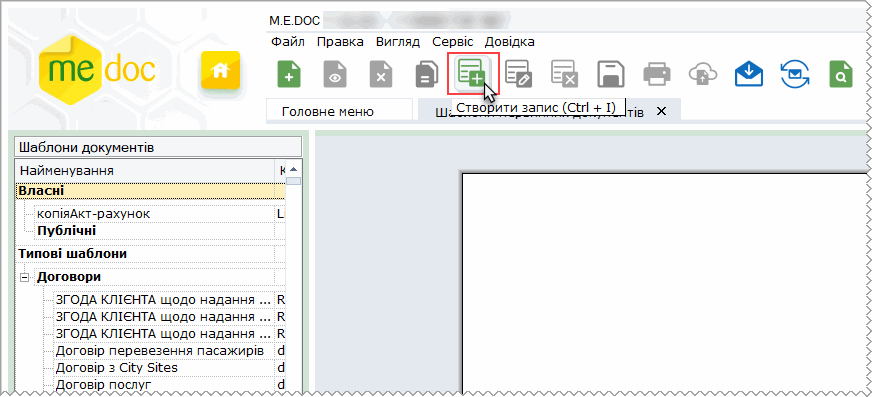

3. Відкриється вікно Новий шаблон, де задаються основні параметри для шаблона:

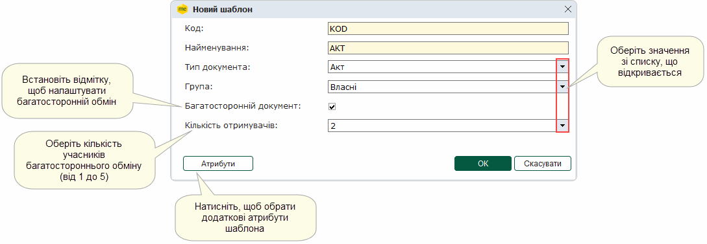

- Код - унікальний набір цифр та/або літер для ідентифікації шаблона документа. Заповнюється вручну із клавіатури;
- Найменування - назва шаблона документа. Заповнюється вручну із клавіатури. Радимо використовувати унікальне найменування;
- Тип документа - назва групи документів, що визначає їх тип. За обраним у даному полі типом групуються документи в реєстрі первинних документів (фільтр Тип документа). Обирається із списку, що випадає;
- Група - назва групи, в яку буде додано новостворений шаблон. Обирається із списку, що випадає. В переліку відображається користувацька група Власні та всі створені користувачем підгрупи;
- Багатосторонній документ - якщо опцію встановлено, для первинного документа, створеного за таким шаблоном, здійснюється [багатосторонній обмін](UCDFDocsRstNew.html#ucdfdocsrstnew-obmin_shema);

Зверніть увагу, опція Багатосторонній документ та атрибут Потребує заповнення з боку отримувача не можуть використовуватись одночасно. При встановленні опції Багатосторонній документ дія атрибуту Потребує заповнення з боку отримувача автоматично скасовується.

- Кількість отримувачів - поле доступне при встановленні опції Багатосторонній документ. У полі зазначається кількість учасників багатостороннього обміну. За замовчуванням встановлено значення 2, можливо обрати кількість учасників від 1 до 5. Кількість отримувачів може бути змінена при [створенні багатостороннього документа](UCDFDocsRstNew.html#ucdfdocsrstnew-obmin_shema) у модулі Реєстр електронних документів;
- Атрибути - по натисканню кнопки відкривається вікно із списком атрибутів, що можуть бути призначені шаблона. Атрибути також можливо додати під час копіювання або редагування шаблона.

Наразі, доступні атрибути:

- Перевіряти сертифікат по OCSP-протоколу та встановлювати позначку часу при підписанні. Атрибут встановлюється за замовчуванням для кожного нового шаблона, який створюється. Якщо атрибут встановлено, при підписанні документа, що створений за шаблоном, накладається позначка часу та виконується перевірка стану сертифікатів ЕП на сервері OCSP відповідного кваліфікованого надавача електронних довірчих послуг. Перевірка виконуватимуться незалежно від параметрів, встановлених у [налаштуваннях](FormCompanyParams.html#formcompanyparams-admcomanyparams_pp) програмного забезпечення. Якщо відповідь від OCSP-сервера не отримано, підписання документа не виконується.
- Заборона копіювання опублікованого шаблону. Якщо атрибут встановлено, після публікації такого шаблона операції копіювання та експорту шаблона будуть доступні лише для організації, що створила шаблон.
- Потребує заповнення з боку отримувача. Якщо атрибут встановлено, при відкритті первинного документа на боці отримувача автоматично створюватиметься редакція документа. У коментарі до редакції буде зазначено: "Створено автоматично у зв'язку з необхідністю заповнення з боку отримувача". Атрибут буде корисним для документів, що вимагають заповнення з боку отримувача, наприклад, таких як Акт звіряння.
- Заборонити редагування документа з боку отримувача. Якщо атрибут встановлено, для первинного документа на боці отримувача буде недоступною операція Наступні дії – Відредагувати документ. Отримувач зможе лише відхилити або затвердити документ. Зверніть увагу, атрибути Заборонити редагування документа з боку отримувача та Потребує заповнення з боку отримувача є взаємовиключними та не можуть використовуватись одночасно.
- Відправляти отримувачу перенос полів. Якщо атрибут встановлено, при відправці документа власником шаблона разом з первинним документом отримувачу будуть відправлені налаштування відповідності полів (за умови, що для документа [виконані такі налаштування](UCRtfFromDocSettings.html#ucrtffromdocsettings-ucrtffromdocsettings)). З свого боку контрагент-отримувач матиме можливість створювати власні документи на основі отриманих налаштувань за допомогою функції [Створити на основі – Власні налаштування](Creat_doc_.html#creat_doc_-creat_doc_). При створенні нових шаблонів атрибут встановлюється за замовчуванням.

3. Натисніть на кнопку ОК для продовження.

4. Відкриється вікно [Конструктор шаблона](#ucrtfdoctemplate-pdocs_shablon_constructor_opys).

[До початку](#ucrtfdoctemplate-pdocs_shablon_stvor)

Копіювання шаблона

1. Оберіть шаблон, який потрібно копіювати, та оберіть один із способів:

- на панелі інструментів оберіть команду Копіювати;
- оберіть команду меню Файл - Копіювати.

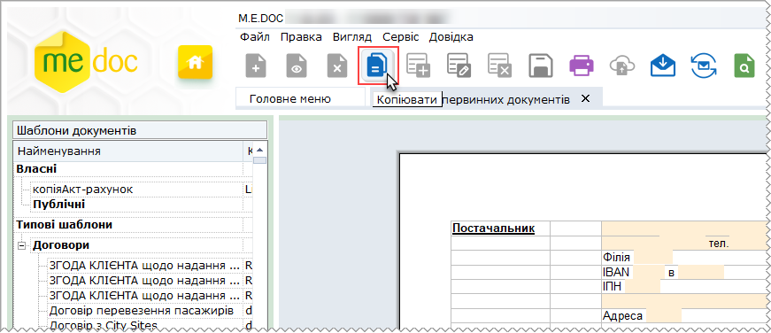

3. Відкриється вікно Копіювання шаблону. Задайте основні параметри для шаблона:

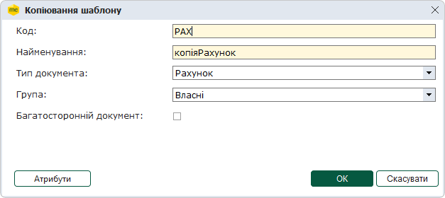

Значення у полі Код повинно бути унікальним для кожного шаблона у межах каталогу, до якого він копіюється.

Копії шаблонів розміщуються виключно у групі Власні та її підгрупах.

3. Натисніть на кнопку ОК для продовження.

4. Відкриється вікно [Конструктор шаблона](#ucrtfdoctemplate-pdocs_shablon_constructor_opys). Внесіть необхідні зміни та збережіть шаблон.

[До початку](#ucrtfdoctemplate-pdocs_shablon_stvor)

Редагування шаблона

Для редагування доступні лише локальні шаблони у групі Власні (тобто шаблони не опубліковані у Глобальному реєстрі).

Щоб редагувати параметри шаблона:

1. У групі Власні оберіть шаблон, який потрібно редагувати, та оберіть один із способів:

- на панелі інструментів оберіть команду Редагувати запис;
- натисніть клавішу F2;
- оберіть команду меню Файл - Редагувати запис.

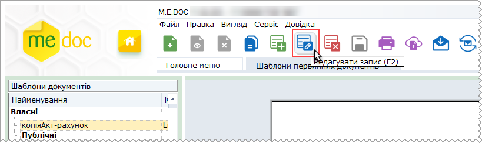

3. Відкриється вікно Редагування шаблону, у якому змініть необхідні параметри шаблона:

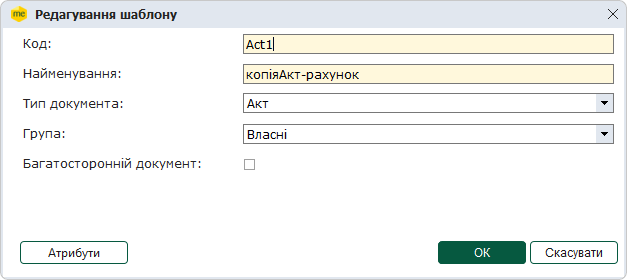

Значення у полі Код повинно бути унікальним для кожного шаблона, у межах каталогу, в якому зберігається шаблон.

3. Для збереження змін натисніть кнопку ОК.

Щоб редагувати поля шаблона:

1. У групі Власні оберіть назву шаблона, який потрібно редагувати, та два рази натисніть на ній лівою кнопкою миші.

2. Відкриється вікно [Конструктор шаблона](#ucrtfdoctemplate-pdocs_shablon_constructor_opys). Внесіть необхідні зміни та збережіть шаблон.

При спробі редагувати вміст шаблона, що опублікований у Глобальному реєстрі шаблонів, програма запропонує створити копію шаблона, у якій можливо буде виконати необхідні зміни.

[До початку](#ucrtfdoctemplate-pdocs_shablon_stvor)

Створення шаблона Угоди про анулювання первинного документа

За замовчуванням [Угода про анулювання первинного документа](UCDFDocsRstNew.html#ucdfdocsrstnew-pdocs_reestr_anulyuvannia) створюється за шаблоном, що пропонується у програмі. Шаблон доступний для перегляду та копіювання.

Також у розділі [Шаблони первинних документів](#ucrtfdoctemplate-pdocs_shablon_stvor) можна створити користувацькі шаблони документа Угода про анулювання первинного документа та налаштувати використання окремого шаблона Угоди про анулювання для різних типів первинних документів.

Щоб створити власний шаблон Угоди про анулювання:

1.  Для створення нового шаблона оберіть один із способів:

- на панелі інструментів оберіть команду Створити запис;
- натисніть комбінацію клавіш Ctrl+I;
- оберіть команду меню Файл - Створити запис.

2. У вікні Новий шаблон, у полі Тип документа оберіть значення Анулювання.

3. Заповніть необхідні поля:

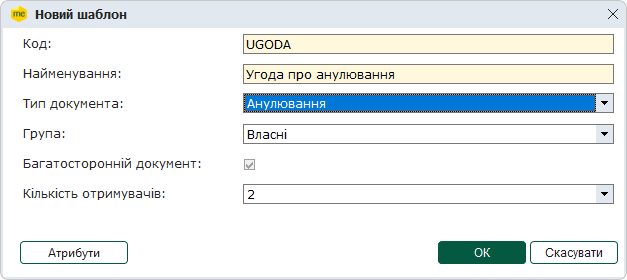

За замовчуванням для Угоди про анулювання передбачено [багатосторонній обмін](UCDFDocsRstNew.html#ucdfdocsrstnew-obmin_shema). Угода, створена за шаблоном, буде відправлятися за маршрутом обробки первинного документа, який анулюється, незалежно від кількості отримувачів, зазначених у шаблоні Угоди.

4. Якщо ви бажаєте використовувати шаблон за замовчуванням при анулюванні всіх типів первинних документів, натисніть кнопку Атрибути. У вікні із списком атрибутів встановіть опцію Використовувати за замовчуванням:

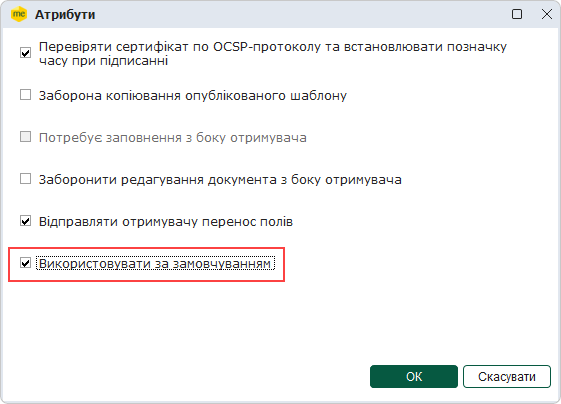

Натисніть ОК для збереження налаштувань.

За наявності встановленого атрибуту Використовувати за замовчуванням шаблон Угоди про анулювання використовується для всіх первинних документів (якщо для документа не [налаштовано окремий шаблон](#ucrtfdoctemplate-pdocs_shablon_stvor) Угоди).

5. У вікні [Конструктор шаблона](#ucrtfdoctemplate-pdocs_shablon_constructor_opys) додайте у шаблон необхідні поля, як описано у розділі [Конструктор шаблона документа](#ucrtfdoctemplate-pdocs_shablon_constructor). Для шаблонів з типом Анулювання доступні системні поля, що містять інформацію про документ, який анулюється. При створенні Угоди про анулювання у модулі [Реєстр електронних документів](UCDFDocsRstNew.html#ucdfdocsrstnew-pdocs_reestr_anulyuvannia) значення у цих полях заповнюються автоматично реквізитами документа, що анулюється, поля недоступні для редагування.

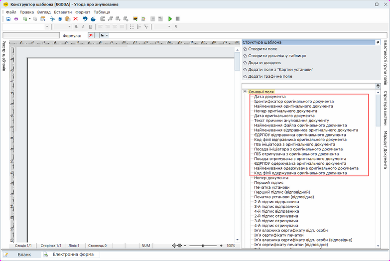

Натисніть, щоб збільшити малюнок

6. Збережіть шаблон та [опублікуйте його](#ucrtfdoctemplate-pdocs_shablon_stvor).

[До початку](#ucrtfdoctemplate-pdocs_shablon_stvor)

Налаштування шаблона Угоди про анулювання для первинного документа

У розділі [Шаблони первинних документів](#ucrtfdoctemplate-pdocs_shablon_stvor) для первинних документів можна налаштувати використання окремого шаблона Угоди про анулювання.

Залежно від наявних налаштувань шаблони Угоди про анулювання застосовуються за наступними правилами:

1. За наявності, використовується користувацькій шаблон, що налаштований для певного первинного документа (для шаблона первинного документа встановлено атрибут Використовувати користувацький шаблон анулювання, застосовується лише для документів, що створюються за певним шаблоном).

2. За наявності встановленого атрибуту [Використовувати за замовчуванням](#ucrtfdoctemplate-pdocs_shablon_stvor) шаблон Угоди про анулювання використовується для всіх первинних документів (якщо для документа не налаштовано окремий шаблон Угоди).

3. У разі відсутності будь-яких користувацьких налаштувань, за замовченням використовується типовий шаблон Угоди про анулювання первинних документів.

1. Виділіть шаблон первинного документа, для якого потрібно обрати шаблон Угоди про анулювання. Виконайте команду Редагувати:

- на панелі інструментів оберіть команду Редагувати запис;
- натисніть клавішу F2;
- оберіть команду меню Файл - Редагувати запис.

Функція також доступна при копіюванні шаблона та створенні нового шаблона.

2. У вікні Редагування шаблону натисніть кнопку Атрибути.

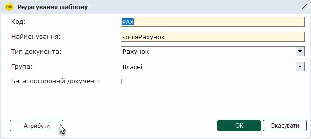

3. У вікні із списком атрибутів встановіть опцію Використовувати користувацький шаблон анулювання, у полі нижче натисніть :

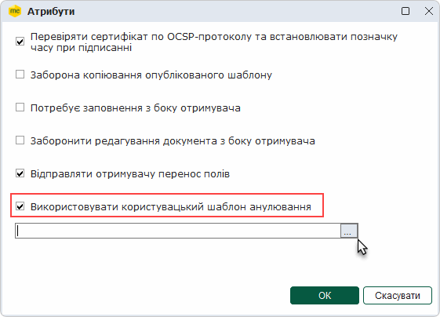

4. У вікні Вибір шаблону оберіть шаблон, який слід використовувати для створення Угоди про анулювання, та натисніть ОК:

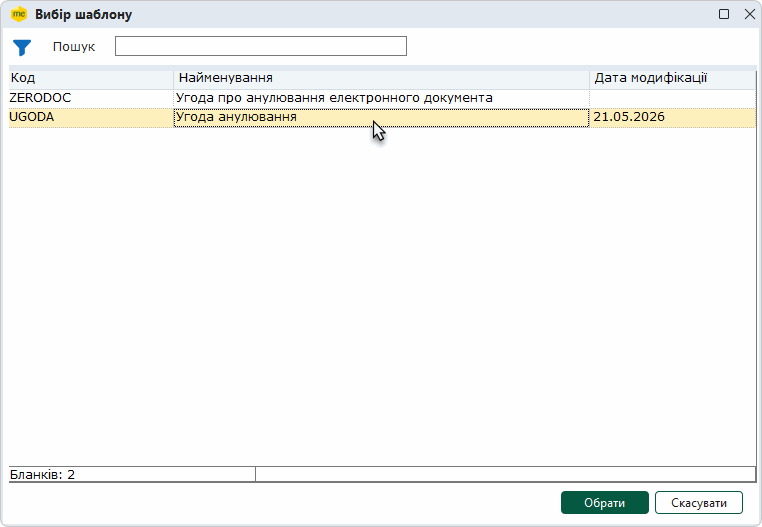

Шаблони Угоди про анулювання повинні бути попередньо [створені](#ucrtfdoctemplate-pdocs_shablon_stvor). За замовчуванням у програмі наявний шаблон Угоди з кодом ZERODOC.

5. Назва обраного шаблона з'явиться у вікні Атрибути. Збережіть налаштування, натиснувши ОК:

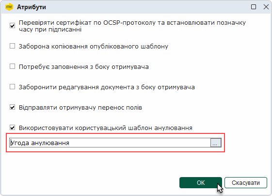

[До початку](#ucrtfdoctemplate-pdocs_shablon_stvor)

Публікація шаблона у Глобальному реєстрі шаблонів для власних організацій

Публікація шаблона у Глобальному реєстрі шаблонів

Опублікувати шаблон може лише організація, у якій він був створений.

Щоб опублікувати шаблон для власних організацій:

1. У групі Власні оберіть шаблон, який потрібно опублікувати.

2. На панелі інструментів натисніть кнопку . Кнопка активна лише, якщо обрано шаблон для публікації.

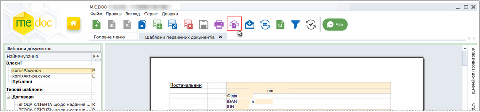

Натисніть на картинку, щоб збільшити її

3. Відкриється вікно Публікація шаблона.

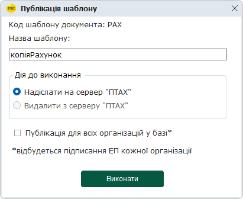

4. Встановіть параметри публікації:

Назва шаблону - у разі потреби відкоригуйте назву, під якою документ буде доступний у Глобальному реєстрі шаблонів;

Надіслати на сервер "ПТАХ" - опцію встановлено за замовчуванням (для неопублікованих шаблонів доступна лише ця опція);

Публікація для всіх організацій у базі - якщо опцію встановлено, публікація шаблона буде здійснюватися для всіх підприємств, що містяться у базі даних вашої програми.

Якщо ж опція не встановлена, шаблон буде публікуватись лише для організації, що є власником шаблона (організація, що створила шаблон).

У верхній частині вікна наводиться чар-код шаблона, який публікується, код задається під час створення шаблона. Змінити чар-код під час публікації неможливо.

5. Натисніть кнопку Виконати.

6. Відкриється вікно підписання ЕП. Оберіть тип підпису.

Важливо! Для публікації шаблонів необхідно використовувати сертифікат підписання.

Якщо обрано опцію Публікація для всіх організацій у базі, буде послідовно здійснюватися запит на підписання ЕП всіх організацій, що присутні у базі даних програми! Організації, ЕП яких здійснено підписання, автоматично стають власниками шаблона, для цих організацій шаблон буде опубліковано під їх ЄДРПОУ.

Шаблон буде доступним для перегляду, створення документів та копіювання, лише для тих організацій, ЕП яких було накладено під час публікації! Якщо якісь з ваших організації не повинні мати доступ до опублікованого шаблона, відмовтесь від накладання ЕП цих організації.

Виконайте процедуру накладання ЕП:

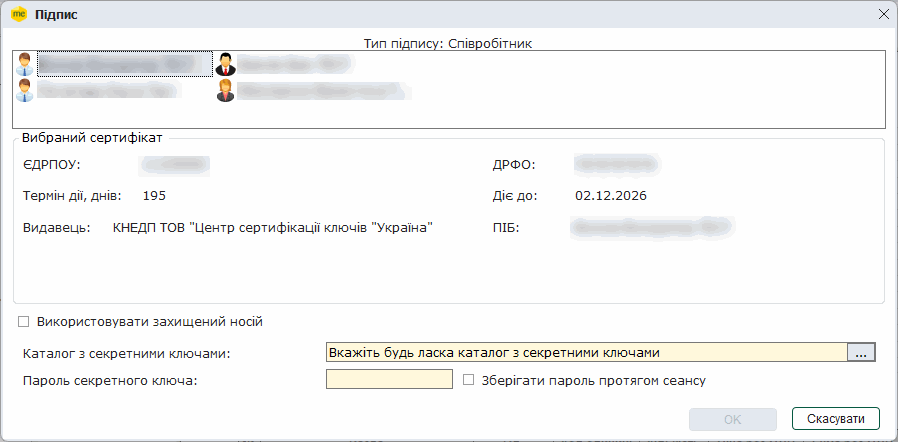

7. Після успішного підписання ЕП шаблон буде збережено у Глобальному реєстрі шаблонів.

У організаціях, для яких здійснено публікацію (було накладено ЕП організації під час публікації), опублікований шаблон стає доступними у групі Публічні.

Будьте уважні! Шаблон, опублікований з дублюючим чар-кодом, замінить вже існуючий шаблон!

Для сторонніх організацій шаблон, опублікований таким чином, недоступний!

[До початку](#ucrtfdoctemplate-pdocs_shablon_stvor)

Видалення шаблона з Глобального реєстру шаблонів

Організації-власники шаблона можуть видалити опублікований шаблон з Глобального реєстру шаблонів. Для цього:

1. Оберіть шаблон у групі Публічні та натисніть кнопку на панелі інструментів .

2. У вікні, що відкриється, опція Видалити з серверу "ПТАХ" встановлена за замовчуванням, натисніть кнопку Виконати.

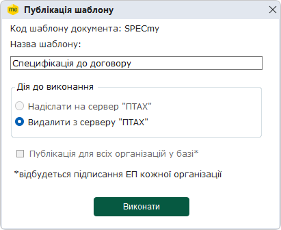

3. Виконайте процедуру накладання ЕП.

Зверніть увагу, видалений шаблон стає недоступним лише для організації, яка здійснила видалення, тобто видаляється шаблон, що був опублікований під ЄДРПОУ певної організації. У інших організаціях, для яких був опублікований цей шаблон (при встановленій опції Публікація для всіх організацій у базі), він залишається доступним у Глобальному реєстрі шаблонів.

[До початку](#ucrtfdoctemplate-pdocs_shablon_stvor)

Як змінити шаблон, опублікований у Глобальному реєстрі шаблонів

Редагування власного шаблона, що опублікований у Глобальному реєстрі

Щоб редагувати шаблон, опублікований у Глобальному реєстрі:

1. Натисніть два рази лівою кнопкою миші на рядку шаблона у розділі Власні – Публічні.

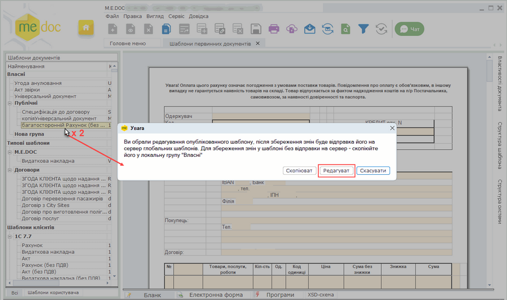

Натисніть на картинку, щоб збільшити її

2. У вікні повідомлення, що відкриється, натисніть кнопку Редагувати.

3. Шаблон буде відкрито у вікні [Конструктор шаблона](#ucrtfdoctemplate-pdocs_shablon_constructor_opys). Виконайте необхідні зміни та збережіть шаблон.

4. Відкриється вікно повідомлення:

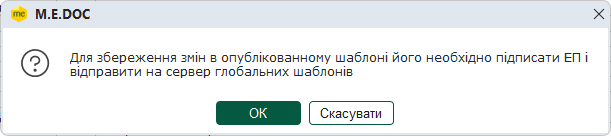

Щоб зберегти виконані зміни у Глобальному реєстрі шаблонів, необхідно підписати відредагований шаблон електронним підписом. Для цього у вікні повідомлення натисніть ОК.

5. У наступному вікні вкажіть шлях до каталогу з секретними ключами, введіть пароль та натисніть ОК:

6. Змінений шаблон буде збережено у Глобальному реєстрі шаблонів.

По натисканню кнопки Скопіювати у вікні повідомлення копія обраного шаблона буде збережена локально у базі програми. Після чого ви можете відредагувати створену (локальну) копію шаблона.

Замінення шаблона у Глобальному реєстрі при відправці документа

1. Оберіть опублікований шаблон у підкаталозі  Власні - Публічні.

2. Скопіюйте обраний шаблон, як описано [вище](#ucrtfdoctemplate-pdocs_shablon_stvor). ВАЖЛИВО! При копіюванні не змінюйте код шаблона!

Копія шаблона буде розташована у групі Власні.

3. Натисніть на імені нової версії шаблона два рази лівою кнопкою миші. Шаблон буде відкрито у Конструкторі шаблонів. Виконайте необхідні зміни, після чого збережіть шаблон.

4. У Реєстрі електронних документів створіть документ на основі нової версії шаблона та відправте цей документ контрагенту.

Документ разом із новою версією шаблона буде відправлено на сервер «ПТАХ». На сервері нова версія шаблона автоматично замінить існуючий шаблон (за умови, якщо коди шаблонів співпадають).

У програмі M.E.Doc нова версія шаблона переміститься з групи локальних шаблонів Власні до підкаталогу опублікованих шаблонів Власні - Публічні.

[До початку](#ucrtfdoctemplate-pdocs_shablon_stvor)

### Конструктор шаблона документа

_Шлях у довідці: Розділи програми › Первинні документи › Шаблони первинних документів › Конструктор шаблона документа_

У даному розділі розглянуті такі теми:

- [Опис основних функціональних елементів інтерфейсу конструктору шаблона](#ucrtfdoctemplate-pdocs_shablon_constructor_opys)
- [Поля шаблона](#ucrtfdoctemplate-pdocs_shablon_constructor_func_2)
- [Функції конструктору шаблона](#ucrtfdoctemplate-pdocs_shablon_constructor_func)
- [Особливості написання програм модифікацій на вкладці "Програми"](#ucrtfdoctemplate-vb-script)

#### Опис основних функціональних елементів інтерфейсу конструктору шаблона

_Шлях у довідці: Розділи програми › Первинні документи › Шаблони первинних документів › Конструктор шаблона документа › Опис основних функціональних елементів інтерфейсу конструктору шаблона_

Вікно конструктора шаблона складається з 5 основних частин:

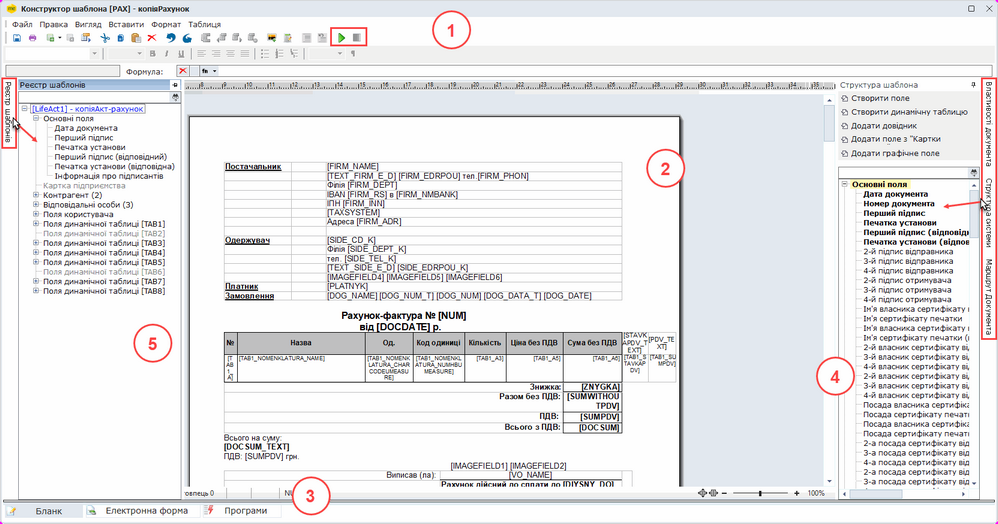

Натисніть, щоб збільшити малюнок

1. Панель інструментів

Панель інструментів містить в собі рядок меню та безпосередньо інструментальні панелі.

Рядок меню містить команди основного меню. Усі команди є ієрархічними: при виборі однієї з таких команд на екрані з'являється спадаючі меню.

Інструментальні панелі надають швидкий доступ до основних команд і процедур. Наведіть покажчик миші на інструмент і чекайте протягом секунди, щоб відобразити коротку підказку, що описує, для чого він призначений.

На панелі інструментів розташовані кнопки ввімкнення/вимкнення режиму відладки шаблона документа (за замовчанням шаблон відображається в режимі редагування):

- натисніть  (F5) для ввімкнення режиму відладки. Призначений для перегляду створеного шаблона. В цьому режимі екранне відображення документа повністю співпадає з відображенням бланка документа при його створенні;
- натисніть  (Shift + F5) для вимкнення режиму відладки та переходу в режим редагування.

2. Робоча область

Робоча область - вікно текстового редактору, призначено для створення, перегляду, редагування тексту шаблона.
Зверху і зліва області документа розташовані координатні лінійки, що дозволяють бачити розміри сторінки, розміри полів документа, положення будь-якого абзацу і його першого рядка.
У нижній частині вікна розташована рядок стану, де відображається інформація про поточний документ.

Текстовий курсор позначає позицію вводу символу. Розмір тексту на екрані залежить від вибраного масштабу.

Текст шаблона документа введіть вручну із клавіатури, відформатуйте, використовуючи команди панелі інструментів.

Шаблон, як правило, містити змінні поля, динамічні таблиці, формули та підключені довідники. Особливості створення та використання полів описано у наступному [розділі даної довідки](#ucrtfdoctemplate-pdocs_shablon_constructor_func).

3. Режими відображення шаблона на екрані

Містить вкладки, при переключенні між якими змінюється режим відображення шаблона документа на екрані:

- Бланк - представляє собою зовнішній вигляд документа. Цей режим призначений для створення, редагування тексту шаблона;
- Електронна форма - містить перелік полів та таблиць, що містяться у даному шаблоні. При наведені на полу відображається підказка - властивості даного поля;
- Програми - призначена для створення програм модифікації документа з використанням мови програмування VBScript.

4. Панель властивостей

Представляє собою допоміжну висувну панель. Містить наступні вкладки:

- Властивості  документа- відображає основні властивості документа. При виділенні певного поля, відображає його властивості.
- Структура системи - містить перелік всіх можливих полів, що є у системі. Реалізовано пошук полів за назвою.
- Маршрут документа - вкладка активна при встановлені значення атрибуту [Кількість отримувачів](#ucrtfdoctemplate-pdocs_shablon_stvor) більше 1. Вкладка містить блоки Отримувач для визначення [полів, у яких вводитимуться реквізити](#ucrtfdoctemplate-pdocs_shablon_constructor_func_2) учасників [багатостороннього обміну документами](UCDFDocsRstNew.html#ucdfdocsrstnew-obmin_shema).

Для того щоб зафіксувати панель, натисніть на кнопку  в кутку панелі, кнопка змінить вигляд на .

Додати поля з панелей Структура системи та Структура шаблона можливо, перетягнувши потрібне поле у робочу область шаблона за допомогою миші.

Панель Структура шаблона містить додаткові кнопки, що слугують для створення полів в шаблоні. Поля додаються у перелік полів шаблона, звідки їх можна перетягнути у робочу область.

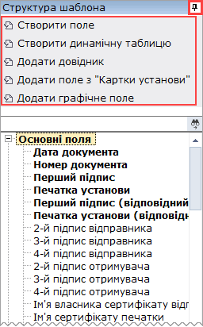

5. Реєстр шаблонів

Представляє собою допоміжну висувну панель. Містить список всіх шаблонів первинних документів, що створені у системі. При розгортанні запису, відображається перелік полів, що є у шаблоні. Додати у шаблон поле з цієї панелі можна, перетягнувши його у робочу область за допомогою миші.

Для того щоб зафіксувати панель, натисніть на кнопку  в кутку панелі, кнопка змінить вигляд на .

#### Поля шаблона

_Шлях у довідці: Розділи програми › Первинні документи › Шаблони первинних документів › Конструктор шаблона документа › Поля шаблона_

В цьому розділі:

[Як створити користувацьке поле](#ucrtfdoctemplate-pdocs_shablon_constructor_func_2)

[Як вставити поле в документ](#ucrtfdoctemplate-pdocs_shablon_constructor_func_2)

[Як додати довідник](#ucrtfdoctemplate-pdocs_shablon_constructor_func_2)

[Як дозволити вводити значення у поле документа лише з довідника](#ucrtfdoctemplate-pdocs_shablon_constructor_func_2)

[Як вставити в документ динамічну таблицю](#ucrtfdoctemplate-pdocs_shablon_constructor_func_2)

[Як додати поля реквізитів учасників багатостороннього обміну документами](#ucrtfdoctemplate-pdocs_shablon_constructor_func_2)

[Як налаштувати графічне відображення підписів та печаток на документі](#ucrtfdoctemplate-pdocs_shablon_constructor_func_2)

[Експорт опису полів шаблонів первинних документів](#ucrtfdoctemplate-pdocs_shablon_constructor_func_2)

Основною складовою шаблона є поле. При створенні шаблонів доступні 4 типи полів:

- Поля користувача - це поле, якому користувач може самостійно задавати атрибути, такі як найменування, ідентифікатор, тип даних тощо. У бланку таке поле доступне для заповнення власноруч з клавіатури. Може також містити формулу.
- Системні поля - містить задані властивості із картки поточного підприємства, картки контрагента та інших системних полів. Більшість полів заповнюються автоматично в момент створення документа даними із однойменних системних полів.
- Довідник - поле, до якого підключений заданий довідник із переліку довідників системи. Заповнюється обраними даними із довідника.
- Динамічна таблиця - дозволяє вставити у шаблон таблицю із заданою кількістю стовпчиків та рядків. В динамічній таблиці передбачена можливість додавати рядки в процесі заповнення документа створеного на основі шаблона.

Як створити користувацьке поле

Для того, щоб створити користувацьке поле скористайтесь одним із наступних способів:

- в меню Правка оберіть команду Створити - Створити поле;
- оберіть команду Створити поле на панелі Структура шаблона;
- оберіть кнопку Створити - Створити поле на панелі інструментів.

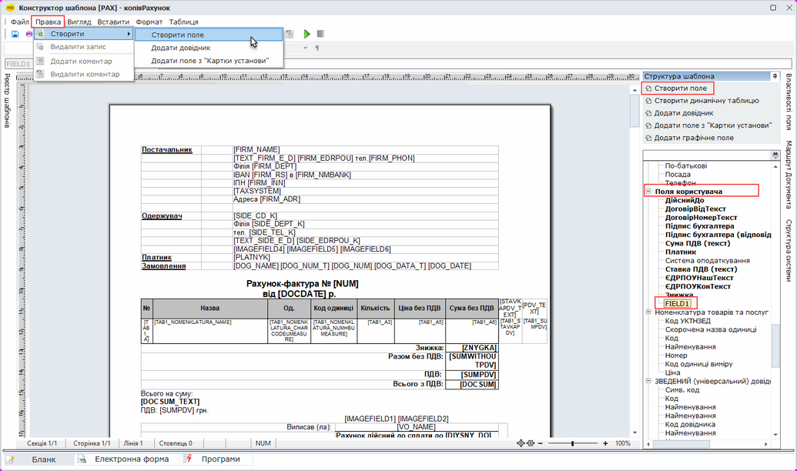

Натисніть, щоб збільшити малюнок

На панелі Структура шаблона з'явиться нова група Поля користувача, у яку додано щойно створене поле.
Для коректного використання полю необхідно задати правильні параметри і властивості.

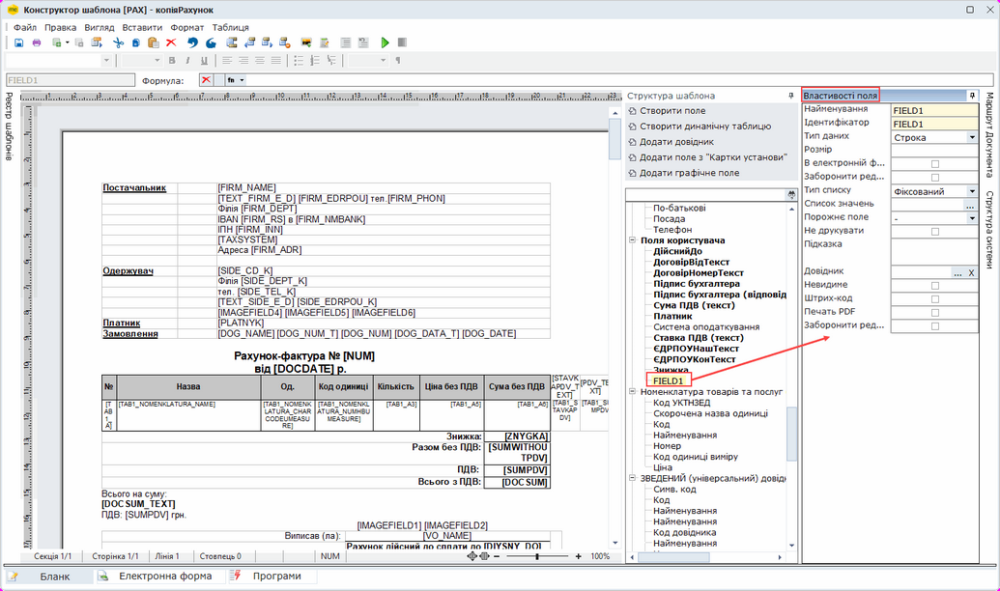

Натисніть, щоб збільшити малюнок

Виділіть поле і на панелі Властивості поля заповніть наступні параметри (доступні властивості залежать від типу даних, що міститиме поле - значення, обраного у полі властивості Тип даних):

- Найменування - назва користувацького поля. Заповнюється вручну із клавіатури. Радимо використовувати унікальне найменування.
- Ідентифікатор - унікальний набір цифр та/або літер для ідентифікації користувацького поля в шаблоні. Заповнюється вручну із клавіатури.
- Тип даних - задає формат користувацького поля. Передбачено наступний перелік типів:
- Строка - тип даних, значеннями якого є довільна послідовність символів (рядок). Наприклад: "вітаю усіх!"
Якщо використовується цей тип даних, з'являються додаткові властивості:
- Розмір - використовується для обмеження кількості символів в полі.
- Число з точкою - тип даних, який використовується для відображення чисел з виділенням дробової частини. Наприклад: 0,25; 2,00
Якщо використовується цей тип даних, з'являються додаткові властивості:
- Знаків після коми - кількість символів, які слід відображати після коми;
- Формат - відображення числа у вигляді цілої і дробової частини, тільки цілої або тільки дробової. В базі зберігається повне введене значення. За замовчанням округлення виконується до другого знака;
- Відділяти розряди - якщо встановлена дана ознака, в даному полі відображатиметься роздільник груп розрядів. Після встановлення ознаки з’явиться поле Роздільник розрядів, у якому обирається символ-роздільник: пробіл, штрих, апостроф або кома;
- Тип роздільника - надає можливість вибрати тип розділення дробової частини - кома, крапка або регіональні налаштування операційної системи;
- Відображати прописом - якщо встановлена дана ознака, числове значення в цьому полі відображається прописом. Після встановлення ознаки з’являються поля Мова пропису - обирається мова відображення суми прописом та Тип пропису -  обирається тип пропису;
- Дата - використовується для відображення значень дати. Наприклад: 01.02.2026.
Якщо використовується цей тип даних, з'являються додаткові властивості:
- Формат - перелік доступних для відображення форматів дати;
- Розбивати на ячейки - якщо встановлена ознака в цьому полі, кожний елемент дати поміщається в окрему клітинку. Властивість доступна лише для числового формату дати.
Також вмикається додатковий параметр - Вирівнювати по - правому чи лівому краю.

- Час - використовується для відображення часу. Наприклад: 14:05:00
- Ціле число - це будь-яке ціле число, що може бути додатнім чи від’ємним. Наприклад: 10, -74
Якщо використовується цей тип даних, з'являються додаткові властивості:
- Відображати прописом - якщо встановлена дана ознака, числове значення в цьому полі відображається прописом.
- Булеве значення - використовується для відображення значень двох станів, наприклад Так/Ні. Якщо використовується цей тип даних, з'являються додаткове поле Галочка – при встановленій відмітці поле відображається як чекбокс
- В електронній формі - якщо встановлена дана ознака, користувацьке поле буде доступне для заповнення в електронній формі документа (Вигляд - Електронна форма).
- Заборонити редагування - якщо встановлена дана ознака, поле заблоковане від редагування. Використовується, наприклад, для розрахункових полів.
- Фіксований список значень - даний атрибут використовується з метою створення жорсткого списку значень для вибору в полі.
- Порожнє поле - встановлюється, що саме відображати в порожньому полі документа. Оберіть із списку доступних значень.
- Не друкувати - якщо встановлена дана ознака, поле не друкуватиметься.
- Підказка - введіть підказку, яка буде відображатися при наведені курсора на поле під час заповнення документа;
- Довідник - можна обрати довідник, з якого буде обиратися значення у полі;
- Невидиме - якщо відмітка встановлена, поле не буде відображатися у бланку документа;
- Штрих-код - відобразити дані у вигляді штрих-коду. У додаткових полях, що відкриються після встановлення позначки, вкажіть параметри:
- Тип штрих-кода - оберіть тип зі списку: EAN13 (тільки для цифрових даних), CОDE128 (для цифрових та символьних даних), QR-Code (для матричних штрих-кодів);
- Ширина штрих-кода - вкажіть ширину поля у сантиметрах (для відображення у документі);
- Висота штрих-кода - вкажіть висоту поля у сантиметрах (для відображення у документі);
- ПІБ підписанта - значення поля буде перевірятися на відповідність імені у сертифікаті під час підписання документа (у разі встановлення опції Параметри системи – Документообіг – Перевіряти відповідність імені відповідальної особи до імені сертифіката в первинних документах). Якщо параметр встановлено, тип даних поля автоматично приймає значення Строка.
- ПІБ підписанта контрагента - значення поля буде перевірятися на відповідність імені у сертифікаті контрагента-підписанта під час підписання документа на стороні контрагента (незалежно від встановлення опції Параметри системи – Документообіг – Перевіряти відповідність імені відповідальної особи до імені сертифіката в первинних документах).
- Тип списку - можна встановлювати значення Редагований та Фіксований. При встановленні типу Редагований, під час заповнення документа користувач матиме можливість редагувати обране зі списку значення. Перелік значень списку задається у полі Список значень.
- Друк в PDF - використовується за умови встановленої відмітки Штрих-код, визначає, чи буде друкуватися штрихкод при збережені документа у форматі PDF;
- Розбивати на ячейки – якщо встановлена ознака в цьому полі, кожний елемент дати поміщається в окрему клітинку. Властивість доступна лише для числового формату дати. Також вмикається додатковий параметр Вирівнювати по – вирівнювати по правому чи лівому краю;
- Игнор. нули – (для типу даних Число з точкою) якщо встановити відмітку, то при введенні в поле значення нуль, буде відображено 0,00. В полі без відмітки нуль буде відображений тільки за умови, якщо на поле встановити курсор ;
- Заборонити редагування отримувачем - якщо опція встановлена, відповідне поле документа доступне для редагування відправником, але не доступне для редагування отримувачем. Якщо опція вимкнена – поле доступне для редагування як відправником, так і отримувачем. Властивість буде корисною для документів, що заповнюються, як відправником так і отримувачем, наприклад, таких як Акт звіряння, перша частина якого заповнюється відправником, а друга редагується отримувачем.

По закінченню внесення даних, збережіть шаблон, натиснувши кнопку .

Тепер налаштоване поле можна вставити в шаблон будь-яким зручним для Вас способом, описаним в наступному розділі.

[До початку](#ucrtfdoctemplate-pdocs_shablon_constructor_func_2)

Як вставити поле в документ

Всі поля вставляються у шаблон з панелей Структура шаблона, Структура системи та Реєстр шаблонів.

Вставити поле в шаблон можна одним із наступних способів:

- Шляхом перетягування потрібного поля з панелей. Виділить потрібне поле на одній із панелей, утримуючи ліву клавішу миші, перетягніть поле у потрібне місце шаблона.

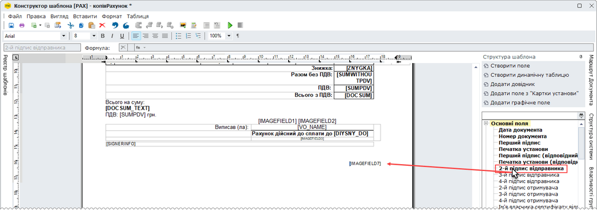

Натисніть, щоб збільшити малюнок

- Встановіть курсор там де потрібно вставити поле. Оберіть необхідне поле на одній із панелей та двічі натисніть на ньому лівою клавішею миші.

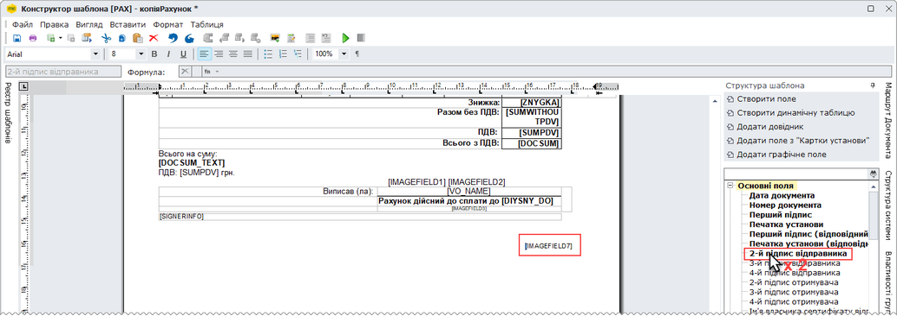

Натисніть, щоб збільшити малюнок

- Встановіть курсор там де потрібно вставити поле. Оберіть необхідне поле на одній із панелей та натисніть кнопку Поле на панелі інструментів:

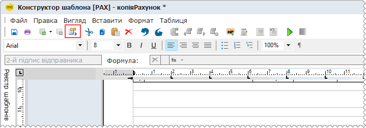

Порада №1

В деяких бланках користувач створює поля власноруч. Такі поля можуть бути в нагоді і в інших шаблонах документів. Поля користувача можна вставити у будь-який поточний шаблон. Для цього на панелі Реєстр шаблонів знайдіть бланк, в якому знаходиться потрібне поле, розгорніть його вміст і знайшовши поле вставте будь-яким зручним способом, описаним в даному розділі.

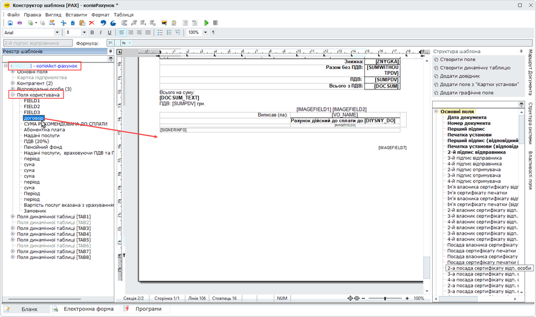

Натисніть, щоб збільшити малюнок

Порада №2

Поля Дата документа, Номер документа, Сума без ПДВ, Загальний ПДВ, Сума по документу, ЄДРПОУ (Контрагента), Найменування (Контрагента) - це поля, значення яких відображається в Реєстрі електронних документів. Радимо використовувати самі ці поля в шаблоні, а не створювати користувацькі поля власноруч.

Порада №3

Якщо документ, що створений на основі шаблона, буде відправлятись контрагенту електронним каналом зв'язку, в цьому шаблоні обов'язково мають бути поля ЄДРПОУ (Контрагента) та/або ІПН (Контрагента). На підставі даних з цих полів відбувається пошук контрагента в адресній книзі.
Для того, щоб ці поля в документі не було видно, встановіть ознаку Не друкувати та/або виділіть поле іншим кольором (Формат/Колір фону тексту).

Порада №4

Для відображення в документі зразків підписів та/або печатки на панелі Структура шаблона в групі Основні поля оберіть Підпис бухгалтера (відповідний), Підпис директора (відповідний) та Печатка установи (відповідна).

Порада №5

Для відображення інформації про підписантів на друкованій формі документа у шаблон необхідно додати поле SIGNERINFO. Інформація про підписантів відображається (за наявності відмітки у розділі [Адміністрування – Параметри системи – Документообіг – Спосіб візуалізації інформації про підписантів](FormCompanyParams.html#formcompanyparams-admcompanyparams_sdo)) при збереженні документа за допомогою функції [Друк в PDF](PDocs_reestr_funkc.html#pdocs_reestr_funkc-pdocs_reestr_print_pdf) або перегляді документа у [Реєстрі електронних документів](UCDFDocsRstNew.html#ucdfdocsrstnew-ucdfdocsrstnew).

При збереженні шаблона, якщо у шаблоні відсутні поле для відображення інформації про підписантів SIGNERINFO (Структура шаблона - Основні поля - Інформація про підписантів), буде відображене вікно повідомлення:

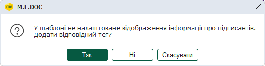

По натисканню на кнопку Так поле SIGNERINFO буде автоматично додано у шаблон.

Також зверніть увагу:

На панелі Структура шаблона представлені найбільш уживані основні поля, поля з Картки підприємства та поля з Картки контрагента.

Передбачена можливість вставляти в шаблон інші поля з Картки підприємства, яких немає в запропонованому за замовчуванням переліку.

Для цього в меню Правка оберіть команду Створити - Додати поле з "Картки установи" (або кнопка Створити - Додати поле з "Картки установи" на панелі інструментів).

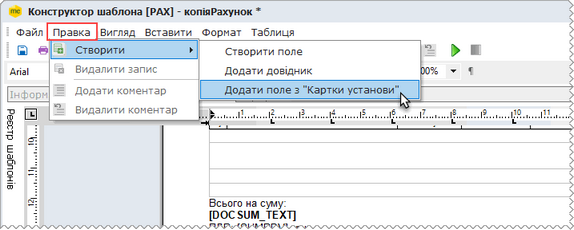

Натисніть, щоб збільшити малюнок

Відкриється вікно Вибір поля з картки установи. Оберіть потрібне поле і натисніть ОК.

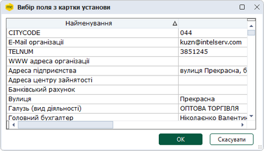

Натисніть, щоб збільшити малюнок

Поле додається в блок Картка підприємства панелі Структура шаблона. Тепер його можна вставити в шаблон будь-яким зручним для Вас способом, описаним в даному розділі.

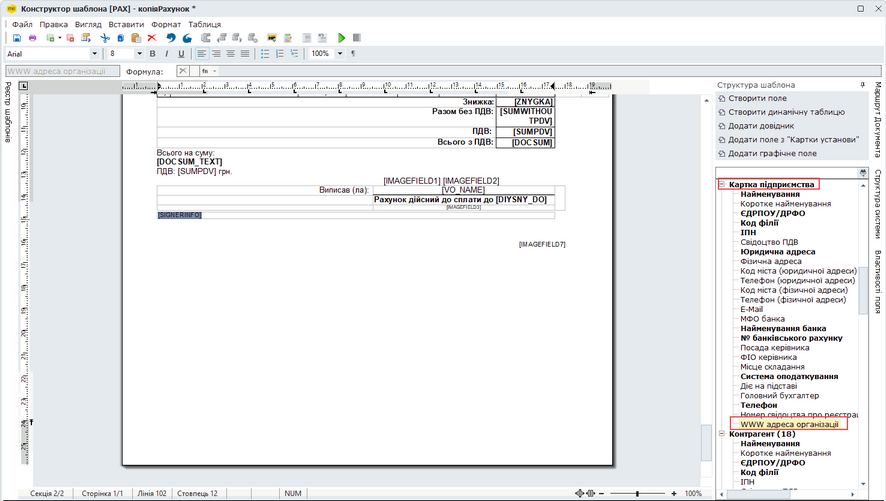

Натисніть, щоб збільшити малюнок

[До початку](#ucrtfdoctemplate-pdocs_shablon_constructor_func_2)

Як додати довідник

Вставити поле з підключеним довідником в документ можна одним із наступних способів:

- в меню Правка оберіть команду Створити - Додати довідник
- оберіть команду Додати довідник на панелі Структура шаблона
- оберіть кнопку Створити - Додати довідник на панелі інструментів.

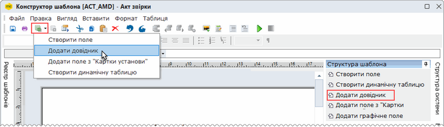

Натисніть, щоб збільшити малюнок

На виконання команди відкриється вікно Підключити. У полі Довідник натисніть кнопку вибору. У вікні, що відкрилось, оберіть потрібний довідник та натисніть кнопку ОК.

У вікні Підключити довіднику привласнюється ідентифікатор - унікальний набір цифр та/або літер для однозначної ідентифікації поля довідника. За замовчанням система пропонує код, але, у разі потреби, його можна змінити.
Натисніть ОК для продовження.

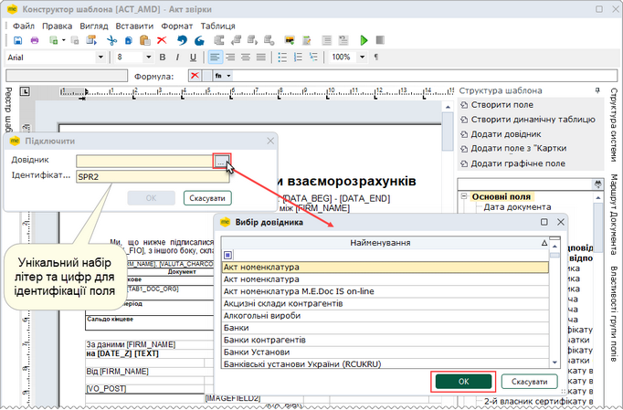

Натисніть, щоб збільшити малюнок

Обраний довідник відобразиться на панелі Структура шаблона.

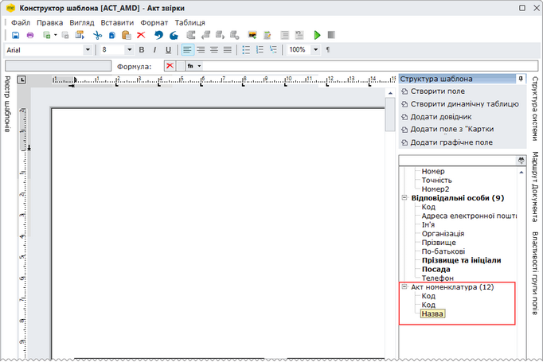

Натисніть, щоб збільшити малюнок

Тепер будь-яке поле з обраного довідника можна вставити в шаблон, описаним в [вище](#ucrtfdoctemplate-pdocs_shablon_constructor_func_2) способом.

[До початку](#ucrtfdoctemplate-pdocs_shablon_constructor_func_2)

Як дозволити вводити значення у поле документа лише з довідника

Вставити поле з підключеним довідником в документ, [як описано вище](#ucrtfdoctemplate-pdocs_shablon_constructor_func_2), або виділіть вже додане у документ поле, до якого підключено довідник.

На панелі Властивості поля встановіть відмітку у рядку властивості Заборонити введення значення вручну:

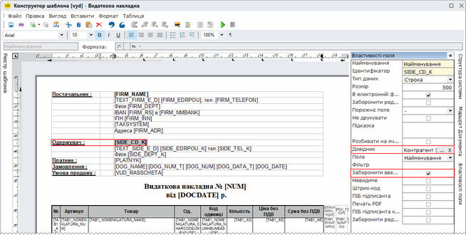

Натисніть, щоб збільшити малюнок

При активованій властивості Заборонити введення значення вручну користувач не зможе вводити значення з клавіатури або вставляти скопійований текст у відповідне поле. Значення у полі можна буде обрати виключно з довідника, зазначеного у властивості Довідник

[До початку](#ucrtfdoctemplate-pdocs_shablon_constructor_func_2)

Як вставити в документ динамічну таблицю

Вставити динамічну таблицю в документ можна одним із наступних способів:

- в меню Таблиця оберіть команду Створити динамічну таблицю
- оберіть команду Створити динамічну таблицю на панелі Структура шаблона
- оберіть кнопку Створити - Створити динамічну таблицю на панелі інструментів.

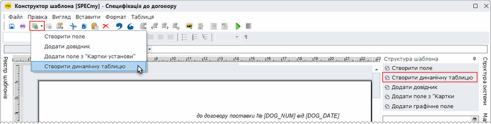

Натисніть, щоб збільшити малюнок

Відкриється додаткове вікно вибору параметрів динамічної таблиці. За замовчанням пропонується створити таблицю на 1 рядок та 6 стовпчиків. Встановіть потрібне значення рядків і стовпчиків таблиці та натисніть Вставити.

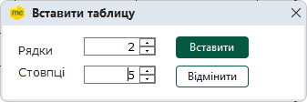

Таблиця вставляється в шаблон. Дані про поля таблиці відображаються на панелі Структура шаблона. Налаштувати індивідуальні параметри кожного окремого поля таблиці можна на панелі [Властивості поля](#ucrtfdoctemplate-pdocs_shablon_constructor_func_2).

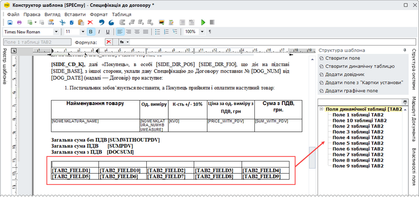

Натисніть, щоб збільшити малюнок

[До початку](#ucrtfdoctemplate-pdocs_shablon_constructor_func_2)

Як додати поля реквізитів учасників багатостороннього обміну документами

Поля для введення реквізитів учасників [багатостороннього обміну документами](UCDFDocsRstNew.html#ucdfdocsrstnew-obmin_shema) додаються на вкладці Маршрут документа.

Вкладка активна при встановлені значення параметру шаблона [Кількість отримувачів](#ucrtfdoctemplate-pdocs_shablon_stvor) більше 1.

Вкладка Маршрут документа містить блоки Отримувач для визначення полів, у яких вводитимуться реквізити учасників багатостороннього обміну документами. Кількість блоків визначається кількістю отримувачів, що були вказані у параметрі шаблона Кількість отримувачів.

Кожен блок містить поля ЄДРПОУ та Код філії. Оберіть назву полів, що міститимуть відповідні реквізити, натиснувши кнопку . Поле для введення реквізитів отримувача попередньо повинно бути [створене](#ucrtfdoctemplate-pdocs_shablon_constructor_func_2) та [додане](#ucrtfdoctemplate-pdocs_shablon_constructor_func_2) у шаблон документа.

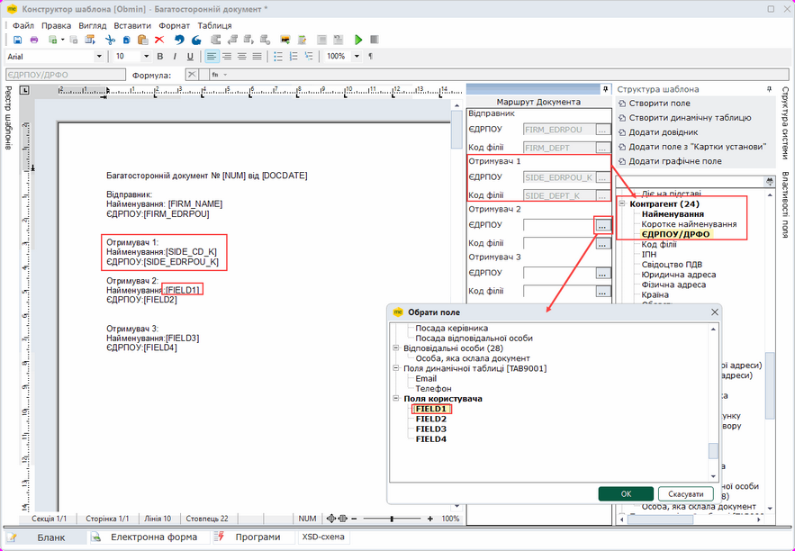

Натисніть, щоб збільшити малюнок

- За замовчуванням, маршрут документа відповідає послідовності, у якій поля реквізитів отримувачів зазначені на вкладці Маршрут документа у Конструкторі шаблона.
- Системні поля для збереження ЄДРПОУ та коду філії контрагента SIDE\_EDRPOU\_K та SIDE\_DEPT\_K автоматично встановлюються для першого отримувача (блок Отримувач 1 на вкладці конструктора шаблона Маршрут документа). Відповідно, за замовчуванням, першим отримувачем документа буде контрагент, для якого використовуються ці поля у шаблоні документа.
- Змінити черговість надсилання документа учасникам багатостороннього обміну можна у вікні відкритого документа у Реєстрі електронних документів на вкладці [Маршрут документа](UCDFDocsRstNew.html#ucdfdocsrstnew-obmin_shema).

[До початку](#ucrtfdoctemplate-pdocs_shablon_constructor_func_2)

Як налаштувати графічне відображення підписів та печаток на документі

Поля для графічного відображення підписів та печаток додаються на вкладці Структура шаблона.

1. У області Структура шаблона виконайте команду Додати графічне поле.

2. У список полів шаблона, у блоці Користувацькі зображення, додасться нове графічне поле IMGFIELD<порядковий номер поля>.

3. У області Властивості поля налаштуйте необхідні параметри:

- Тип – тип графічного відображення, що буде знаходитися у полі: із списку, що відкривається, оберіть значення Підпис або Печатка;
- Сторона – зі списку оберіть сторону, підпис або печатка якої буде знаходитися у полі: Відправник або Отримувач;

Для багатостороннього обміну значення у полі Сторона обирається з фіксованого списку, у відповідності до кількості сторін обміну: Відправник, Отримувач 1, … Отримувач n. Кількість отримувачів визначається значенням параметру шаблона [Кількість отримувачів](#ucrtfdoctemplate-pdocs_shablon_stvor).

- Номер підпису – номер підпису сторони, графічне відображення якої буде знаходитися у полі (вводиться значень від 1 до 10).

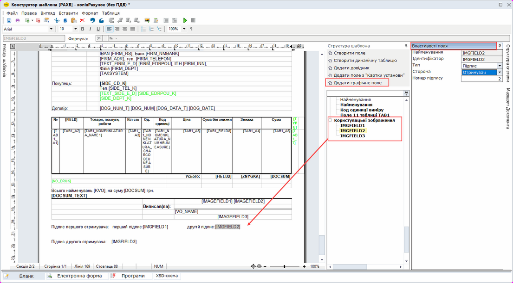

Натисніть, щоб збільшити малюнок

4. [Додайте поле у шаблон](#ucrtfdoctemplate-pdocs_shablon_constructor_func_2) та розташуйте його у потрібному місті документа. У первинному документі зображення підписів/печаток будуть відображатися згідно з налаштуваннями графічних полів.

[До початку](#ucrtfdoctemplate-pdocs_shablon_constructor_func_2)

Експорт опису полів шаблонів первинних документів

У конструкторі шаблона можливо експортувати опис полів шаблонів первинних документів.

Таким чином можливо отримати інформацію щодо призначення та розташування полів шаблона, яка допоможе налаштовувати створення первинних документів на основі існуючих за [власними налаштуваннями](UCRtfFromDocSettings.html#ucrtffromdocsettings-ucrtffromdocsettings).

Для збереження опису полів:

1. Оберіть шаблон первинного документа, опис якого необхідно отримати.

2. Виконайте команду головного меню Файл – Експорт – Експорт опису шаблону.

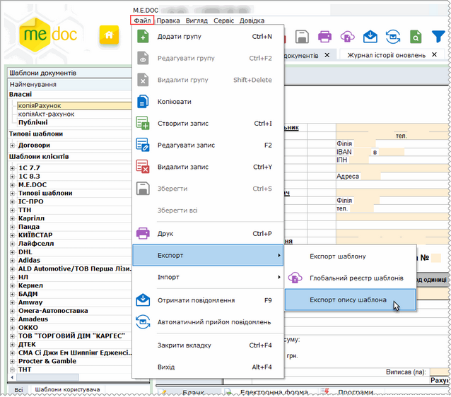

Натисніть, щоб збільшити малюнок

3. У вікні, що відкриється, оберіть шлях для збереження файлів, та формат збереження:

PDF – зберегти відображення розташування полів у документі у форматі .pdf;

Excel – зберегти докладний опис полів шаблона, що містить назву, тип даних тощо у форматі .xls.

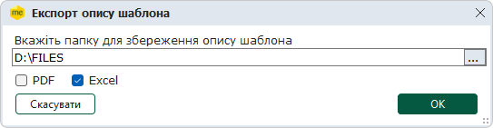

Натисніть ОК.

4. Система повідомить про завершення експорту даних.

Залежно від обраних налаштувань, буде збережено документи відповідного формату, назва яких містить код обраного шаблона.

Якщо опції PDF та Excel не встановлено, зберігаються дані у файлах формату .doc: розташування полів шаблона у документі та опис формату XML для імпорту.

Виконати експорт опису полів шаблонів також можливо у розділі Первинні документи – Реєстр електронних документів з вікна відкритого документа за допомогою команди головного меню Файл – Експорт – Експорт опису шаблону.

При експорті опису полів з розділу Реєстр електронних документів у документі «Опис формату XML для імпорту» буде присутній приклад XML обраного документа для імпорту.

[До початку](#ucrtfdoctemplate-pdocs_shablon_constructor_func)

#### Функції конструктору шаблона

_Шлях у довідці: Розділи програми › Первинні документи › Шаблони первинних документів › Конструктор шаблона документа › Функції конструктору шаблона_

В цьому розділі:

[Як змінити орієнтацію сторінки](#ucrtfdoctemplate-pdocs_shablon_constructor_func)

[Завантаження готового шаблона](#ucrtfdoctemplate-pdocs_shablon_constructor_func)

[Налаштування комплекту підписів](#ucrtfdoctemplate-pdocs_shablon_constructor_func)

Як змінити орієнтацію сторінки

Для зміни орієнтації сторінки в меню Файл оберіть опцію Параметри сторінки. Відкриється окреме вікно, в якому оберіть потрібну орієнтацію сторінки.

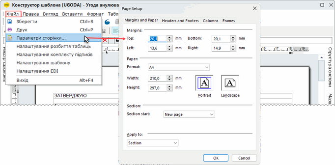

Натисніть, щоб збільшити малюнок

[До початку](#ucrtfdoctemplate-pdocs_shablon_constructor_func)

Завантаження готового шаблона

Можливо завантажувати в конструктор шаблонів вже готовий шалон, створений у зовнішніх текстових редакторах.

Для завантаження готового шаблона в меню Вставити оберіть опцію Файл... Відкриється вікно, в якому вкажіть шлях до розташування шаблона та оберіть потрібний файл.

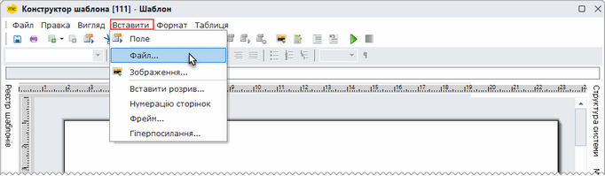

Натисніть, щоб збільшити малюнок

Вміст готового шаблона завантажиться в редактор.

Зверніть увагу! Динамічні таблиці не завантажуються, їх потрібно буде створити в редакторі шаблонів.

[До початку](#ucrtfdoctemplate-pdocs_shablon_constructor_func)

Налаштування комплекту підписів

У конструкторі шаблона можливо налаштувати комплект підписів, якими необхідно підписувати документ, створений за шаблоном.

1. Оберіть команду меню Файл - Налаштування комплекту підписів.

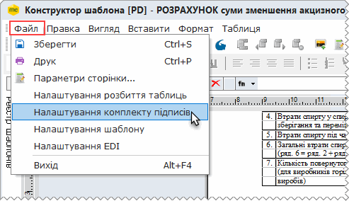

2. Відкриється вікно Підписи.

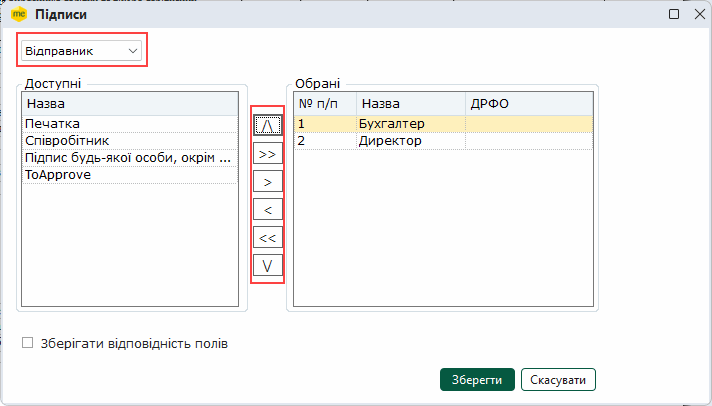

3. У списку, що відкривається, оберіть тип комплекту підписів: Відправник або Отримувач. При виборі типу Відправник, у вікні виконується налаштування комплекту підписів для підписання документа на стороні відправника. Відповідно, при виборі типу Отримувач, у вікні виконується налаштування комплекту підписів для затвердження документа на стороні контрагента-отримувача.

4. За допомогою кнопок зі стрілками сформуйте бажані комплекти підписів відправника та/або отримувача для даного документа.

5. У разі потреби, встановіть опцію Зберігати відповідність полів, щоб дотриматись встановленої послідовності підписання та зберегти правильне відображення зображень підписів у документі. Якщо опція встановлена, виконується прив'язка зображення підпису до відповідного поля шаблона. Назва поля шаблона відповідає порядковому номеру підпису у вікні налаштування комплекту підписів.

Так, у прикладі на малюнку нижче, підпис Бухгалтер буде прив'язаний до поля Перший підпис, підпис Директор - до поля 2-й підпис відправника:

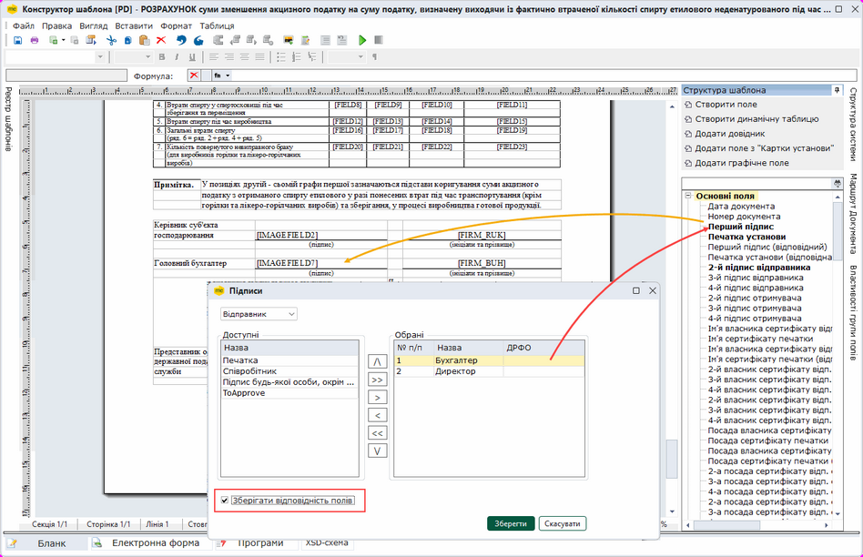

Натисніть, щоб збільшити малюнок

Якщо опція не встановлена, прив'язка зображень підписів відбувається відповідно до порядку розташування полів підписів у шаблоні. Так, перший підпис комплекту прив'язується до першого поля підпису у шаблоні, другий - до другого тощо.

Порядок полів у шаблоні визначається зліва направо та згори донизу.

6. Натисніть кнопку Зберегти, для збереження виконаних налаштувань.

[До початку](#ucrtfdoctemplate-pdocs_shablon_constructor_func)

#### Особливості написання програм модифікацій на вкладці "Програми"

_Шлях у довідці: Розділи програми › Первинні документи › Шаблони первинних документів › Конструктор шаблона документа › Особливості написання програм модифікацій на вкладці "Програми"_

Вкладка Програми призначена для створення програм модифікації документа з використанням мови програмування VBScript.

Основні програми, що використовуються:

|  |  |
| --- | --- |
| CREATE | Створення. Виконується при створенні нового документа. |
| OPEN | Відкриття. Виконується при відкритті документа. |
| SAVE | Збереження. Виконується при збереженні документа. |
| CLOSE | Закриття. Виконується при закритті документа. |
| CHECK | Перевірка документа. Виконується по кнопці перевірки документа. |
| MODIFY | Модифікація тіла документа. Виконується при зміні кожного поля тіла документа. Виконується при зміні сумарних полів таблиць.     Перед викликом MODIFY заповнюється глобальна змінна VBScript  DocEditedFieldName = <ім'я поля тіла таблиці, що модифікується>  або DocEditedFieldName = Null, якщо перерахування викликане не по введенню в поле. |
| TABLE | Модифікація рядка таблиці. Виконується при зміні кожного поля таблиці, при необхідності перераховуються підсумки.     Перед викликом TABLE заповнюється глобальна змінна VBScript  DocEditedTableNumber = <номер підтаблиці, що модифікується>  або DocEditedTableNumber = Null, якщо перерахування викликане не по введенню в поле.     Поточним записом ZDataSet таблиці є рядок таблиці, де виконується редагування. |
| AFTER\_SPR | Модифікація. Виконується при зміні поля з підключеним довідником. |

### Імпорт та експорт шаблона

_Шлях у довідці: Розділи програми › Первинні документи › Шаблони первинних документів › Імпорт та експорт шаблона_

ЕКСПОРТ ШАБЛОНА

Експорт виконується для збереження шаблона на диску комп'ютера чи електронному носії у файлі формату .xml.

Для збереження шаблона виконайте такі дії:

1. У меню Файл оберіть команду Експорт - Експорт шаблона.

2. У діалоговому вікні Зберегти як оберіть каталог, введіть ім'я файлу та натисніть кнопку Зберегти.

Шаблон буде збережено в обраному каталозі.

ІМПОРТ ШАБЛОНА

Імпорт шаблона надає можливість завантажувати у програму шаблони, що збережені у файлах формату .xml.

1. У меню Файл оберіть команду Імпорт - Імпорт шаблона.

2. У діалоговому вікні Відкрити оберіть ім'я файлу, який потрібно імпортувати, та натисніть кнопку Відкрити.

3. На виконання функції відкриється модальне вікно Імпорт шаблону.

4. Вкажіть параметри імпорту:

- Код
Унікальний набір цифр та/або літер для ідентифікації шаблона документа. Заповнюється вручну із клавіатури.

- Найменування
Назва шаблона документа. Заповнюється вручну із клавіатури. Радимо використовувати унікальне найменування.

- Тип документа
Назва групи документів, що визначає їх тип. За обраним у даному полі типом групуються документи в реєстрі первинних документів (фільтр Тип документа). Обирається із списку, що відкривається.

- Група
Назва групи, в яку буде додано новостворений шаблон. Обирається із списку. В переліку відображається користувацька група Власні та всі створені користувачем підгрупи.

- Багатосторонній документ - якщо опцію встановлено, для первинного документа, створеного за таким шаблоном, здійснюється [багатосторонній обмін](UCDFDocsRstNew.html#ucdfdocsrstnew-obmin_shema);

Зверніть увагу, опція Багатосторонній документ та атрибут Потребує заповнення з боку отримувача не можуть використовуватись одночасно. При встановленні опції Багатосторонній документ дія атрибуту Потребує заповнення з боку отримувача автоматично скасовується.

- Атрибути - по натисканню кнопки відкривається вікно із [списком атрибутів](#ucrtfdoctemplate-pdocs_shablon_stvor), що можуть бути призначені шаблона.

Увага! Дозволений імпорт користувацьких шаблонів з однаковим кодом, але різними ознаками (для всіх установ чи для поточного підприємства). При присвоєнні шаблона поточному підприємству буде відображатись лише цей шаблон.

5. Натисніть на кнопку ОК. Розпочнеться процес імпорту.

6. По закінченні відобразиться протокол імпорту.


