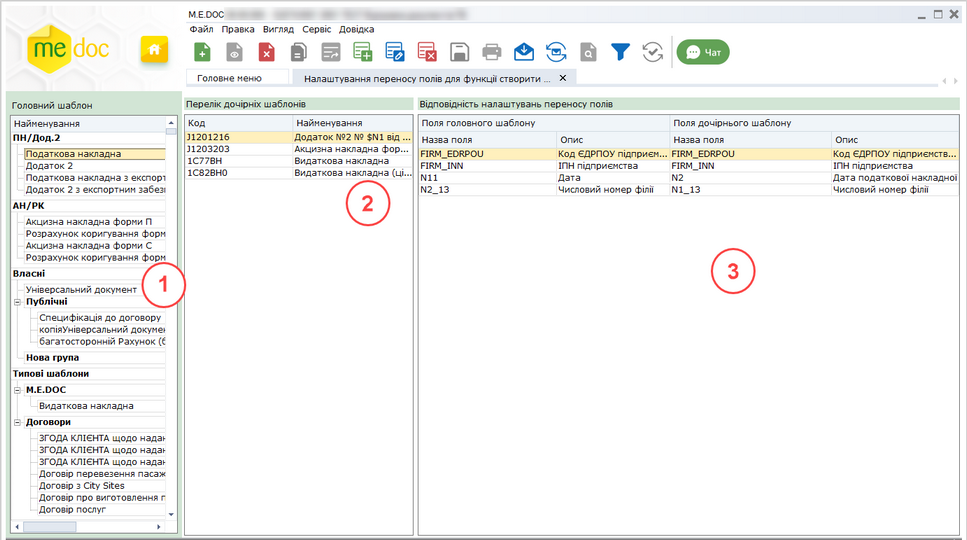
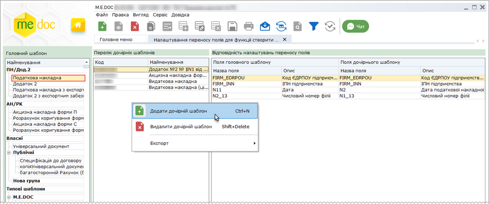
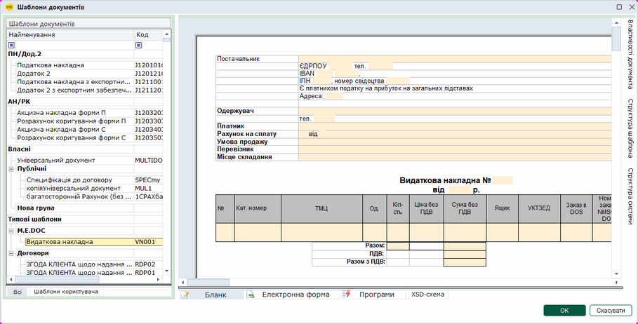
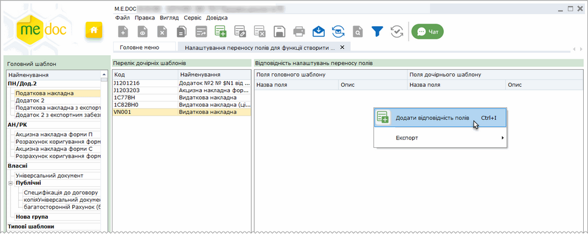
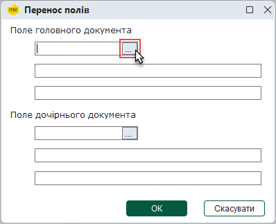
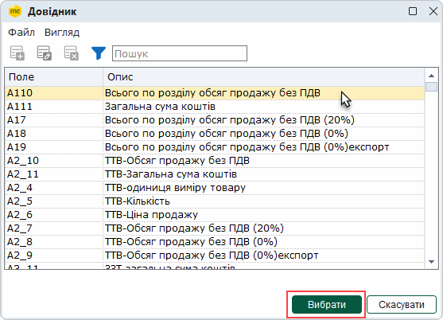
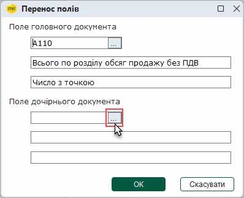
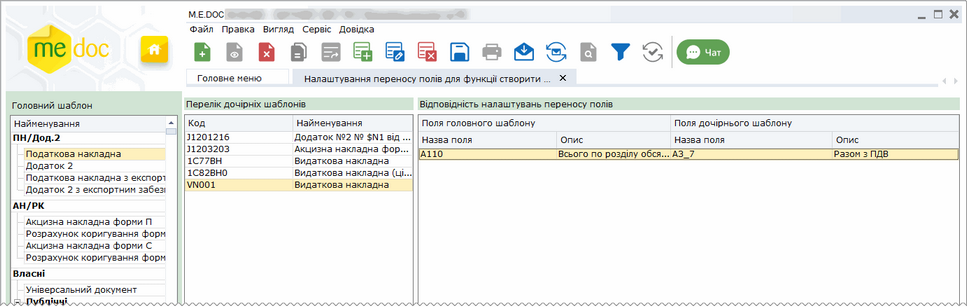

[← Зміст довідки](../)


# Налаштування переносу полів для функції Створити на основі

## Налаштування переносу полів для функції Створити на основі

_Шлях у довідці: Розділи програми › Первинні документи › Налаштування переносу полів для функції Створити на основі_

Модуль призначений для налаштування перенесення даних з головного документа у дочірні документи, що створюються за допомогою функції Створити на основі.

У модулі користувачі мають можливість обрати шаблон головного документа, визначити шаблони дочірніх документів та налаштувати відповідність полів головного та дочірнього документів.

Визначені таким чином дочірні документи можуть бути створені у модулі Реєстр податкових документів або Реєстр електронних документів за допомогою команди [Створити на основі - Власні налаштування](Creat_doc_.html#creat_doc_-creat_doc_).

Вікно модуля містить:

Натисніть, щоб збільшити малюнок

1. Панель Головний шаблон, яка містить перелік шаблонів первинних документів, для яких можуть створюватися дочірні документи.

2. Область для визначення та перегляду списку шаблонів дочірніх документів, що можуть бути створені за допомогою функції Створити на основі.

3. Область налаштування відповідності полів шаблонів головного та дочірніх документів, у які здійснюватиметься перенесення даних.

Можна налаштовувати перенесення значень полів, що містять дані однакового типу.

Щоб налаштувати перенесення даних:

1. Оберіть шаблон головного документа на панелі ліворуч. Зверніть увагу! Для головного та дочірнього документів можна обрати шаблони, що опубліковані у [Глобальному реєстрі шаблонів](UCRtfDocTemplate.html#ucrtfdoctemplate-pdocs_shablon).

2. Натисніть правою кнопкою миші на області Перелік дочірніх шаблонів. У контекстному меню, що відкриється, оберіть пункт Додати дочірній шаблон.

Натисніть, щоб збільшити малюнок

3. Відкриється вікно Шаблони документів. Оберіть шаблон документа, який повинен створюватися по команді Створити на основі. Натисніть ОК.

Натисніть, щоб збільшити малюнок

4. Рядок з обраним документом з'явиться у області Перелік дочірніх шаблонів.

5. Додайте поля головного документа та встановіть відповідні їм поля дочірнього документа. Для цього на області Відповідність налаштувань переносу полів натисніть праву кнопку миші та у контекстному меню оберіть пункт Додати відповідність полів.

Натисніть, щоб збільшити малюнок

6. Якщо для дочірнього документа ще не налаштовано відповідності полів, відкриється вікно повідомлення:

_204_zoom90.png>)

Натисніть, щоб збільшити малюнок

Якщо ви бажаєте заповнити відповідність полів дочірнього документа автоматично, натисніть на кнопку Так. Виконається автоматичне заповнення налаштувань відповідності всіх полів дочірнього документа полям головного документа:

_204_zoom70.png>)

Натисніть, щоб збільшити малюнок

7. Якщо необхідно заповнити відповідність полів дочірнього документа у ручному режимі, у вікні повідомлення натисніть на кнопку Ні. Відкриється вікно Перенос полів.

У разі, якщо для дочірнього документа вже присутні налаштування відповідності полів, вікно Перенос полів відкривається по команді контекстного меню Додати відповідність полів.

8. Для налаштування відповідності полів у ручному режимі і вікні Перенос полів, у області Поле головного документу натисніть кнопку .

У вікні, що відкриється, оберіть поле, з якого будуть переноситися дані та натисніть Вибрати.

Для пошуку потрібного поля натисніть кнопку  та у рядку, що з'явиться, введіть назву поля або його опис.

9. У області Поле дочірнього документу вікна Перенос полів аналогічним чином оберіть поле дочірнього документа, у яке буде здійснюватися перенесення даних.

10. Повторюючи пункти 7 - 9 встановіть відповідність для всіх полів, що потребують перенесення даних. Додані поля будуть відображені у області Відповідність налаштувань переносу полів:

Натисніть, щоб збільшити малюнок

Якщо необхідно видалити або змінити налаштування, оберіть команди контекстного меню:

|  |  |  |
| --- | --- | --- |
|  | Видалити дочірній шаблон | Видалити обраний дочірній документ |
|  | Видалити відповідність полів | Видалити обраний запис, що містить відповідність полів |
|  | Редагувати відповідність полів | Редагувати обраний запис |

- Можна зберегти налаштування перенесення значень полів у файл, виконавши команду меню Файл - Експорт. А також завантажити збережені налаштування за допомогою команди Файл - Імпорт.
- Налаштування відповідності полів документів можуть бути надіслані отримувачу разом з головним документом. Для цього відправник головного документа повинен бути власником шаблона головного документа, а для шаблона головного документа повинен бути встановлений атрибут [Відправляти отримувачу перенос полів](UCRtfDocTemplate.html#ucrtfdoctemplate-pdocs_shablon_stvor).


