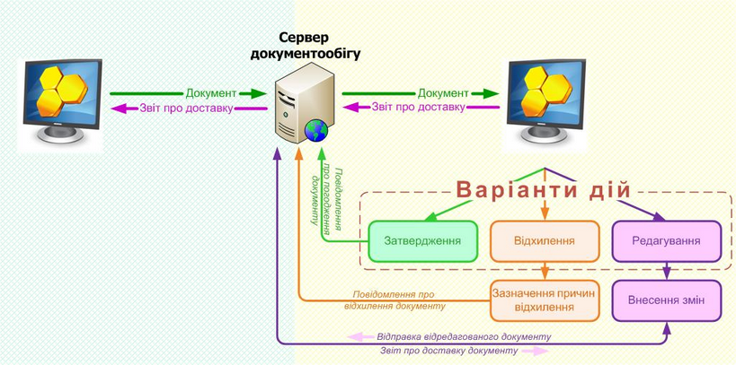

[← Зміст довідки](../)


# Первинні документи

## Первинні документи

_Шлях у довідці: Розділи програми › Первинні документи_

Розділ призначений для створення, редагування та збереження актів виконаних робіт, рахунків фактур, платіжних доручень та інших первинних документів, як зовнішніх - з метою обміну ними з контрагентами, так і внутрішніх - для власних потреб підприємства.

У розділі реалізовані зручні засоби створення документів за власним шаблоном. Тобто, користувач може самостійно створити потрібний йому документ, використавши вбудований конструктор шаблонів документів. Всі створені документи зберігаються в системі, що дозволяє їх використовувати надалі.

У даному розділі довідки розглянуто наступне:

- [Функціональні особливості розділу](#ucrtfrstmain-ucdfdocsrst_nwes). Опис особливостей функціонування розділу.
- [Обмін первинними документами між контрагентами](#ucrtfrstmain-pdocs_shema). Схема та докладний опис процесу обміну первинними документами.
- [Багатосторонній обмін електронними документами](UCDFDocsRstNew.html#ucdfdocsrstnew-obmin_shema). Обмін документами з довільною кількістю отримувачів, що визначається користувачем.
- [Посилання на первинний документ](UCDFDocsRstNew.html#ucdfdocsrstnew-obmin_link_sota).  Створення посилання на первинний документ та відправка посилання контактній особі контрагента за допомогою електронної пошти.
- [Створення Універсального документа із вкладеннями](Doc_Dov_Form.html#doc_dov_form-doc_dov_form). Створення документів спеціального формату, що призначенні для відправки контрагентам вкладень різних форматів, з можливістю визначати маршрут відправки документа.
- [Реєстр податкових документів](UCDFDocsRst.html#ucdfdocsrst-pdocs_reestr). Містить всі створені у розділі податкові документ: Податкові накладні та Розрахунки коригування, а також ті податкові документи, що надійшли від контрагентів.
- [Реєстр електронних документів](UCDFDocsRstNew.html#ucdfdocsrstnew-ucdfdocsrstnew). Містить всі створені у розділі первинні документи (акти виконаних робіт, рахунки, платіжні доручення тощо), а також ті, що надійшли від контрагентів.
- [Податкові накладні та Розрахунки коригування](UCNaklExchangeRst.html#ucnaklexchangerst-ucnaklexchangerst_). Механізм створення, імпорту-експорту та збереження Податкових накладних та Розрахунків коригуваннч з метою обміну ними з контрагентами та контролюючими органами.
- [Монітор обміну документами](UCDFMon.html#ucdfmon-ucdfmon). Відображення первинних документів, які в поточний момент знаходяться в обробці.
- [Автоматична обробка](UCGlobalAutoProcJournal.html#ucglobalautoprocjournal-pdocs_avto). Автоматичне виконання імпорту податкових накладних створених в інших бухгалтерських системах та подальшої реєстрації їх в Єдиному реєстрі податкових накладних (ЄРПН)
- [Налаштування обміну документами](FormDocParams.html#formdocparams-formdocparams). Налаштовується порядок обробки Податкових накладних та встановлюються допустимий час обробки кожного виду первинних документів.
- [Налаштування переносу полів для функції Створити на основі](UCRtfFromDocSettings.html#ucrtffromdocsettings-ucrtffromdocsettings). Налаштовується перенесення даних з головного документа у дочірній документ, що створюється за допомогою функції [Створити на основі](Creat_doc_.html#creat_doc_-creat_doc_).
- [Сценарії підписання первинних документів](UCPDocSignSettings.html#ucpdocsignsettings-ucpdocsignsettings). Налаштування користувацьких сценаріїв підписання первинних документів - визначення умов та пріоритетів підписання первинних документів, визначення умов застосування комплектів підписів відповідно до внутрішніх положень підприємства.
- [Шаблони первинних документів](UCRtfDocTemplate.html#ucrtfdoctemplate-pdocs_shablon). Дозволяє переглянути існуючі шаблони документів, а також створити нові шаблони.
- [Реєстр документів довільних форматів](UCSignFile.html#ucsignfile-ucsignfile). Дозволяє підписувати Електронним підписом (ЕП) та відправляти засобами електронної пошти на довільні електронні адреси будь-яких файлів.
- [Особливості роботи з первинними документами для ФОП](#ucrtfrstmain-pdocs_osoblyvosty). Опис додаткових налаштувань для ФОП, що мають лише сертифікат ЕП з типом Директор.
- [Реєстр шаблонів звітів](UCFRRst.html#ucfrrst-formrepstat-new). Створення звітів щодо обміну первинними документами за встановлений проміжок часу.

Більшість компонентів розділу Первинні документи (окрім дій з ПН та Дод.2) не підтримуються в ОС Windows 2000.

Для повноцінної коректної роботи оновіть операційну систему згідно [апаратних та програмних вимог для експлуатації програми](Help.html#help-setup_progr).

### Функціональні особливості розділу

_Шлях у довідці: Розділи програми › Первинні документи › Функціональні особливості розділу_

1. Обробка документів у Реєстрі податкових документів та Реєстрі електронних документів здійснюється за доступними командами на вкладці Наступні дії. Наприклад, підписати документ, відправити контрагенту або у ДПС.

2. На панелі вкладок звіту відображаються вкладки, що містять інструменти керування та результати обробки документів: Наступні дії, Властивості та Протокол. Вкладка Протокол умовно поділена на дві частини, де ліворуч відображається перелік подій в ході обробки документа в хронологічному порядку, а праворуч - зміст обраної події.

3. Реєстрі податкових документів та Реєстрі електронних документів міститять [Архів](PDocs_reestr_funkc.html#pdocs_reestr_funkc-pdocs_reestr_arhiv). Архів призначений для зберігання документів, які набули кінцевого стану обробки, тобто були затверджені або відхилені контрагентом.

4. Модулі Реєстрі податкових документів та Реєстрі електронних документів мають зручний і потужний інструмент [фільтрації](PDocs_reestr_funkc.html#pdocs_reestr_funkc-pdocs_reestr_filtr) та сортування для відображення вибіркових документів за заданими параметрами.

5. Всі стадії обробки та руху первинних документів від створення до їх кінцевого затвердження/відхилення можна відслідкувати в [Моніторі обміну документів](UCDFMon.html#ucdfmon-ucdfmon). Архівні документи в Моніторі не відображаються.

6. Для всіх первинних документів здійснюється [контроль часу обробки](FormDocParams.html#formdocparams-formdocparams). В налаштуваннях до розділу для кожного типу документа задається ліміт часу проходження етапів обробки. Якщо заданий час перевищено, система візуально повідомляє про це користувача та в разі необхідності надсилається повідомлення на вказану електронну поштову адресу.

### Обмін первинними документами між контрагентами

_Шлях у довідці: Розділи програми › Первинні документи › Обмін первинними документами між контрагентами_

[багатосторонній обмін](UCDFDocsRstNew.html#ucdfdocsrstnew-obmin_shema)Обмін первинними документами між контрагентами відбувається за наступною схемою:

Натисніть, щоб збільшити

Cхема обміну первинними документами з Контрагентом:

В розділі Первинні документи програмного комплексу M.E.Doc ви створюєте первинний документ за власним або наданим розробником шаблоном. Документ перевіряється за допомогою вбудованих програм перевірки, зберігається в системі. Готовий документ підписується [встановленим комплектом ЕЦП](FormCompanyParams.html#formcompanyparams-admcomanyparams_pen) та відправляється на електронну адресу вашого Контрагента. Відправка документів може здійснюватися одним із способів:

За замовчанням всі електронні документи з системи доставляються по прямому з'єднанню на сервер документообігу (платформа "ПТАХ").

Такий спосіб доставки документів дозволяє скоротити час обробки документів та гарантувати доставку. Крім того, завдяки серверу документообігу збільшується пропускна можливість системи прийому та обробки документів.

Для відправлення документа потрібно знати лише ЄДРПОУ-код отримувача.

Даний вид доставки забезпечує:

|  |  |
| --- | --- |
| Надійність | - виключається можливість втрати/недоставки повідомлення. Повідомлення буде гарантовано доставлено адресату без використання поштових серверів; |
| Безпеку | - виключається можливість втручання сторонніх осіб та підміни інформації. Для взаємодії з "ПТАХ" використовується Електронний цифровий підпис, тому "підробити" відправника або адресата неможливо. Всі повідомлення шифруються на відповідних отримувачів на боці клієнтської програми M.E.Doc. Кореспонденція для "ПТАХ" подібна до поштової посилки, "зазирнути" всередину якої на сервері документообігу неможливо. Кореспонденція видається тільки тому користувачу, що має відповідний ЕЦП; |
| Швидкість | - пришвидшення доставки документів в декілька разів, минаючи поштові сервери. |

Доставлений на "ПТАХ" документ знаходиться в режимі очікування, доки від програми Контрагента, якому призначався документ, не надійде запит на наявність нових поштових повідомлень. Як тільки запит отримано, документ відразу відправляється Контрагенту. У відправленого документа автоматично змінюється статус, щоб запобігти повторної відправки дублюючого документа.

В момент прийому документа Контрагентом, вам автоматично відсилається звіт про доставку документа. Звіт про доставку теж надходить на ПТАХ, де зберігається до моменту надходження запиту про наявність нових повідомлень від вашої програми M.E.Doc.

Отримавши електронний документ, Контрагент опрацьовує документ, обираючи один з варіантів дій:

|  |  |
| --- | --- |
| Затвердити | - обирається за умови, що отриманий документ не містить помилок та повністю влаштовує Контрагента.  При цьому вам, як відправнику документа, буде автоматично надіслано повідомлення про погодження документа. |
| Відхилити | - обирається за умови наявності в документі помилок та/або небажання співпрацювати.  В цьому випадку Контрагенту необхідно вказати причину відхилення документа. Вам буде автоматично надіслано повідомлення про відхилення документа із зазначенням причини відмови. |
| Редагувати | - обирається за умови, що документ містить помилки або неточності та Контрагент має намір виправити їх. Контрагент вносить в документ бажані зміни, підписує його комплектом ЕЦП та відправляє вам для доопрацювання.  В свою чергу, вам також потрібно буде вирішити, що робити з документом, що був змінений Контрагентом: Затвердити, Відхилити або Редагувати.  - - Документ може редагуватись нескінчену кількість разів, допоки остаточний варіант не влаштує обидві сторони.  - Вся історія змін (редагувань) документа фіксується у системі та може бути переглянутою в будь-який момент. |

Повідомлення про погодження/відхилення/редагування відправляються через "ПТАХ".

На сервері документообігу зберігається історія проходження документа. Історія дозволяє не допустити проходження документів, що мають дубльовані реквізити: ім'я файлу, квитанції, тощо. Термін зберігання недоставлених документів, квитанцій та історії проходження - необмежений.

### Особливості роботи з первинними документами для ФОП

_Шлях у довідці: Розділи програми › Первинні документи › Особливості роботи з первинними документами для ФОП_

Згідно діючого законодавства, зареєстровані фізичні особи - підприємці можуть вести свою господарську діяльність не маючи печатки підприємства, а тільки на підставі підпису директора.

В ПК M.E.Doc для таких фізичних осіб - підприємців, які мають лише сертифікат ЕП з типом Директор, реалізовано можливість обміну первинними документами, окрім Податкових накладних та Додатків 2.

Для використання даної можливості обов’язково потрібно виконати налаштування в [Параметрах системи](FormCompanyParams.html#formcompanyparams-admcomanyparams_pen), а саме:

в групі «Податкові накладні, Додаток 2 та Первинні документи» встановити комплект «Директор (тільки для Первинних документів)».

Зверніть увагу! При обранні цього комплекту підписів, для користувачів заблоковано можливість надсилати Податкові накладні та Додаток 2, тільки первинні документи.


