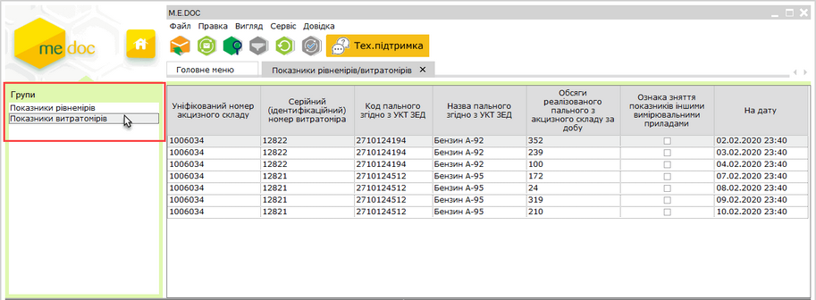

[← Зміст довідки](../)


# Показники рівнемірів/витратомірів

## Показники рівнемірів/витратомірів

_Шлях у довідці: Розділи програми › Облік акцизу › Реєстр акцизних документів (пальне) › Показники рівнемірів/витратомірів_

В цьому розділі:

[Завантаження та перегляд показників рівнемірів/витратомірів](#ucsiurspr-ucsiurspr)

[Експорт показників рівнемірів/витратомірів у форматі Excel](#ucsiurspr-ucsiurspr)

Модуль Показники рівнемірів/витратомірів надає можливість завантажувати та переглядати показники системи моніторингу рівнемірів і витратомірів (SІUR).

Для того, щоб скористатися можливостями модуля Показники рівнемірів/витратомірів необхідно виконати підготовчі дії:

- з’ясувати у свого постачальника рівнемірів/витратомірів, чи підключені або чи здатні до підключення наявні прилади до системи моніторингу палива, та забезпечити обмін даними між системою моніторингу та програмою M.E.Doc (за детальною інформацією зверніться до представника розробника);
- придбати ліцензію Облік акцизного податку з доступом до API та ліцензію M.E.Doc.Облік акцизного податку; для користування модулем користувачам необхідно володіти ліцензіями двох типів;
- виконати підключення системи моніторингу у розділі [Адміністрування - Параметри системи - Налаштування API акциз](FormCompanyParams.html#formcompanyparams-admcompanyparams_rivnemir).

Завантаження та перегляд показників рівнемірів/витратомірів

При кожному відкритті модуля Показники рівнемірів/витратомірів відбувається оновлення показників рівнемірів та/або витратомірів (за наявності нових даних).

Для перегляду показників оберіть відповідний розділ на панелі ліворуч:

Натисніть, щоб збільшити малюнок

Дані показників використовуються для автоматичного заповнення Довідки про зведені за добу підсумкові облікові дані щодо обсягів обігу (отримання/відпуску) та залишків пального на акцизному складі пального (докладно див. у розділі [Робота з акцизними документами (пальне) - Створення Довідки про зведені за добу дані](AkcizRstFunkc.html#akcizrstfunkc-akciz_reestr_funkc_stvor_vytratomir)).

У розділі [Адміністрування - Параметри системи - Налаштування API акциз](FormCompanyParams.html#formcompanyparams-admcompanyparams_rivnemir) за допомогою опції Автоматичне отримання даних рівнеміра щодоби можливо задати час автоматичного завантаження показників рівнемірів та витратомірів.

[До початку](#ucsiurspr-ucsiurspr)

Експорт показників рівнемірів/витратомірів у форматі Excel

У файл Excel експортуються дані, що відображені у таблиці модуля на момент виконання експорту.

Для збереження показників на електронному носії чи у обраному каталозі:

1. Оберіть команду головного меню Файл – Експорт – Експорт таблиці в Excel.

2. У вікні Збереження файлу оберіть каталог для збереження даних, ведіть ім'я файлу та натисніть кнопку Зберегти.

3. Система повідомить про результати експорту даних. Файл з даними буде збережено у обраному каталозі.

Дані зберігаються у одному файлі на окремих аркушах з відповідною назвою: Рівнеміри та/або Витратоміри. Дані колонки Ознака зняття показників іншими вимірювальними приладами зберігаються у форматі: "1" - ознака наявна, "0" - ознака відсутня.

[До початку](#ucsiurspr-ucsiurspr)


