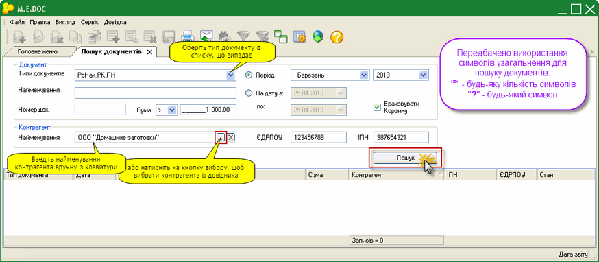

[← Зміст довідки](../)


# Пошук документів

## Пошук документів

_Шлях у довідці: Додатково: UCSearch › Пошук документів_

Функціонал модулю забезпечує найбільш швидкий спосіб пошуку первинних документів.

Пошук документів відбувається по будь-якому відомому параметру:

- період створення документу;
- найменування документу;
- тип документу;
- номер документу;
- підсумкова сума;
- ЄДРПОУ контрагента;
- ІПН контрагента;
- найменування контрагента.

Є можливість шукати і серед документів, що розміщенні в корзині.

Натисніть на рисунок, щоб збільшити його

Документ

- Тип документів
За замовчанням встановлено значення "Всі", тобто пошук відбувається за заданими параметрами серед усіх первинних документів. Якщо потрібно знайти документи певного типу, наприклад, податкові накладні або рахунок-фактура, встановіть галочки напроти потрібного типу документу у списку, що випадає.

- Найменування -
Якщо відомо найменування документу, його можна ввести в дане поле.
Якщо відома тільки частина імені, можна використовувати символи узагальнення для пошуку серед документів, що містять цю частину імені. Наприклад, за запитом "\*акт\*" будуть знайдені документи "Акт виконаних робіт", "Рахунок-фактура на купівлю".

- Номер док.
Використовується для пошуку документів за номером.
Також передбачено застосування символів узагальнення.

- Сума
Даний параметр містить додатковий фільтр рівності, який обирається зі списку, що випадає.
Таким чином, дозволяє знаходити документи за підсумковою сумою, що дорівнює вказаній, більше/менше вказаної або більше/менше чи дорівнює.
Для того, щоб очистити поле від даних, потрібно видалити всі цифри, в тому числі після коми (чистим поле вважається, якщо відображається "\_\_\_\_\_,\_\_").

- Період
Вкажіть місяць та рік, коли були створені потрібні первинні документи.
Відповідно, пошук відбувається в межах вказаного періоду. Якщо потрібно збільшити/зменшити часовий діапазон пошуку, скористайтесь параметром "На дату з .. по", який дозволяє задавати довільні дати початку та закінчення періоду пошуку.

- На дату з .. по -
Вкажіть дату початку та закінчення періоду, в межах якого були створені потрібні первинні документи.

- Враховувати корзину -
Встановлена галочка в даному полі вмикає пошук документів, окрім реєстру первинних документів, ще й серед видалених (переміщєних в Корзину).

Контрагент

- Найменування
Дозволяє знайти прийняті та відправлені документи певного контрагента.
Найменування контрагента можна ввести як вручну з клавіатури (передбачено застосування символів узагальнення), так і вибрати із довідника "Контрагенти", який відкривається після натиснення на кнопку вибору . При виборі контрагента із довідника, автоматично заповнюються поля "ЄДРПОУ" та "ІПН".

- ЄДРПОУ
Дозволяє знайти документи, що були відправлені/прийняті контрагента, якщо відомо його код установи за Єдиним державним реєстром підприємств та організацій України.

- ІПН
Дозволяє знайти документи, що були відправлені/прийняті контрагента, якщо відомо його індивідуальний податковий номер.

Для початку пошуку натисніть кнопку «Пошук».

Список всіх знайдених документів відобразиться нижче у таблиці. Подвійний клік по запису документу, що знаходиться серед результату пошуку, відкриває цей документ у окремому вікні.


