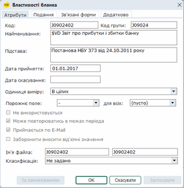
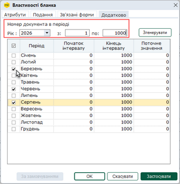
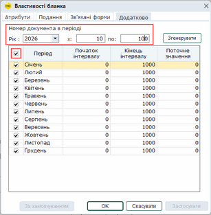

[← Зміст довідки](../)


# Реєстр бланків

## Реєстр бланків

_Шлях у довідці: Розділи програми › Довідники › Реєстр бланків_

У модулі Реєстр бланків зібрані шаблони всіх форм звітності (документів), що використовуються у програмному комплексі.

Реєстр бланків умовно розділений на дві частини: у лівій частині розташований ієрархічний список із систематизованим переліком всіх бланків, наявних у програмі, а у правій - представлені записи вибраної в даний момент групи бланків.

У реєстрі доступні шаблони будь-яких документів. У відкритому шаблоні можна сформувати шаблони імпорту зовнішніх даних, створювати та підключати власні програми до обраного бланка.
Також із реєстру бланків доступні властивості обраного документа, де налаштовуються основні параметри використання бланка.

За замовчанням у реєстрі відображаються тільки актуальні бланки документів. Для відображення всіх існуючих у програмному комплексі бланків зніміть в меню Вигляд позначку Актуальні бланки.
Записи, що позначені червоним кольором - бланки недійсних документів, тобто тих, у яких в полі "Відмінено" встановлена дата.
Записи, що позначені сірим кольором - бланки, які не використовуються (в атрибутах властивостей бланка встановлена позначка Не використовується).

Шаблон документа – це графічне зображення бланка документа, де у заповнюваних полях розміщені назви ідентифікаторів бази даних. Створений на основі шаблону звіт буде мати такий же вигляд, як і шаблон документа.

Для того, щоб відкрити шаблон бланка, на панелі інструментів натисніть кнопку  або натисніть 2 рази лівою кнопкою миші на рядку бланка.

Властивості бланка

Форма Властивості бланка призначена для налаштування параметрів використання бланка, а також містить докладну інформацію про шаблон документа та сам документ, який створюється на основі бланка.

Для того, щоб викликати форму властивостей бланка, на панелі інструментів натисніть кнопку .

Записи у полях властивостей згруповані за ознаками: Атрибути, Подання та Зв’язані форми.

Увага! Всі зміни, які внесені у форму Властивості бланка, впливатимуть на властивості всіх документів, створених на основі даного шаблона!

Атрибути

Натисніть, щоб збільшити малюнок

- Поля Код, Найменування, Підстава, Дата прийняття, Дата відміни, Ім’я файла заповнюються розробником на основі даних, отриманих від контролюючих органів. Змінювати їх не рекомендується.
- Одиниця виміру - формат відображення числового значення. Виберіть із списку значень.
- Порожнє поле - оберіть із списку символ, яким повинні заповнюватися рядки документа, де відсутні дані для заповнення;
- для всіх - оберіть із списку символ, який буде заповнювати всі інші порожні поля документа.

Ці поля можу бути пустими (значення "пусто"), містити прочерк (-); 0; 0,00 залежно від розділу звітності. Символи у цих полях для кожного документа встановлюються відповідно до Інструкції із заповнення документа.

УВАГА! Для форм податкової звітності у обох частинах поля за замовчанням обраний символ "-".

- Не використовується - проставляється відмітка, якщо даний бланк в установі не використовується. У цьому випадку в реєстрі бланків даний бланк буде виділений сірим кольором. Цей бланк буде відсутній у списку, який викликається із модулю Реєстр звітів при створенні нового звіту і на основі цього бланка не можна буде створити документ.
- Може повторюватись в межах періоду - проставляється відмітка, якщо документ може дублюватись у звітному періоді.
- Приймається по E-Mail - проставляється позначка, якщо даний документ можна відправляти електронною поштою.
- Заборонити вносити від'ємні значення - проставляється відмітка, за умови, що при формуванні документа на основі даного бланка заборонено вносити від'ємні значення.
- Класифікація - обирається класифікація для документів, створюваних на основі бланка (для бюджетної конфігурації).

Подання

Дана вкладка містить інформацію про періодичність та терміни подання звітів до державних органів.

Всі дані настроєно на основі загальної інформації, наданої ДПА України та Держкомстатом. Радимо проконсультуватись у Вашій ДПІ щодо конкретних термінів подачі звітності!

Зв’язані форми

Дана вкладка містить інформацію про зв’язані форми бланка. Заповнюється розробником на основі даних, отриманих від державних органів.

Додатково

Закладка призначена для налаштування порядкового номера документа у періоді.

Примітка:

Закладка присутня лише для бланків документів розділу Податкова інспекція.

Номер документа у періоді використовується для формування імен XML-файлів однотипних звітів, які подаються у контролюючий орган декілька разів в одному звітному періоді. Налаштування інтервалу номерів у періоді дозволяє уникнути дублювання імен файлів звітів при відправці у контролюючий орган.

Дублювання номерів, також, може виникати у випадках якщо:

- декілька філій відправляють звіти під ЄДРПОУ головного підприємства, і у ПЗ M.E.Doc кожної філії налаштована однакова нумерація документів;
- здійснено перехід з іншого програмного забезпечення на ПЗ M.E.Doc, або ПЗ M.E.Doc було перевстановлено, у такому випадку нумерація документів почнеться з 0.

За замовчуванням, у полі Початок інтервалу встановлено значення "0", а у полі Кінець інтервалу - значення "1000". Тобто, нумерація у імені файлу починається з нуля і збільшується на 1 для кожного нового відправленого документа, що створюється за певним бланком у одному періоді.

Натисніть, щоб збільшити малюнок

Щоб встановити нумерацію для окремих періодів:

1. Встановіть позначку у рядках періодів, в яких необхідно застосувати нумерацію.

2. У полях Початок інтервалу та Кінець інтервалу вкажіть початкове та кінцеве значення номерів для кожного обраного періоду.

У полі Поточне значення відображено останнє значення номера документа у періоді, який був відправлений у контролюючий орган.

Зверніть увагу! Початкове значення нової нумерації не повинно бути менше значення, зазначеного у полі Поточне значення, тобто менше ніж номер останнього документа, який був відправлений у контролюючий орган

3. Для збереження налаштувань натисніть кнопку ОК або Застосувати.

Зверніть увагу! Для періодів, що були позначені маркерами до натискання кнопки Згенерувати, значення нумерації не змінюється.

Натисніть, щоб збільшити малюнок

Щоб встановити нумерацію для всіх періодів:

1. У полі Рік оберіть рік подання звіту.

2. У полях з та по вкажіть початкове та кінцеве значення інтервалу номерів.

3. Щоб швидко обрати всі періоди, встановіть відмітку у заголовку таблиці.

4. Натисніть кнопку Згенерувати. У полях Початок інтервалу та Кінець інтервалу будуть проставлені вказані початкове та кінцеве значення інтервалу номерів. У рядках періодів будуть проставлені маркери.

Зверніть увагу! Початкове значення нової нумерації не повинно бути менше значення, зазначеного у полі Поточне значення, тобто менше ніж номер останнього документа, який був відправлений у контролюючий орган

5. Для збереження налаштувань натисніть кнопку ОК або Застосувати.

У полі Поточне значення відображено останнє значення номера документа у періоді, який був відправлений у контролюючий орган.

Після встановлення нового інтервалу номерів, нумерація у іменах файлів звітів почнеться з вказаного значення.

Номер документа у періоді зазначається у імені файлу у тексті Квитанції.

Щоб відновити налаштування нумерації за замовчуванням, натисніть  За замовчуванням.


