[← Зміст довідки](../)


# Налаштування отримання первинних документів

## Налаштування отримання первинних документів

_Шлях у довідці: Розділи програми › Адміністрування › Налаштування отримання первинних документів_

В цьому розділі:

[Вхід до модуля "Налаштування отримання первинних документів"](#ucsettrcvdoc-ucsettrcvdoc)

[Налаштування сповіщення про повідомлення на платформі "ПТАХ"](#ucsettrcvdoc-ucsettrcvdoc)

[Налаштування сповіщення про повідомлення на платформі "ПТАХ" за кодом документа та ЄДРПОУ відправника](#ucsettrcvdoc-ucsettrcvdoc)

[Налаштування прийому для всіх первинних документів](#ucsettrcvdoc-ucsettrcvdoc)

[Налаштування прийому для документів СЕА від контрагента, що підлягають реєстрації](#ucsettrcvdoc-ucsettrcvdoc)

[Налаштування прийому первинних документів за кодом документа та ЄДРПОУ відправника](#ucsettrcvdoc-ucsettrcvdoc)

[Налаштування  прийому документів за ідентифікаторами АPІ.ПТАХ та FlyDoc](#ucsettrcvdoc-ucsettrcvdoc)

[Скасування розподілення прийому первинних документів](#ucsettrcvdoc-ucsettrcvdoc)

Програмний комплекс надає можливість розподіляти прийом вхідних первинних документів від контрагентів.

Якщо підприємство використовує більше ніж один програмний продукт: M.E.Doc, АPІ.ПТАХ, СОТА, FlyDoc або FREDO, можливо налаштувати у якій саме програмі слід приймати той чи інший документ.

Увага! При застосуванні налаштувань, документи від контрагента будуть прийматися виключно у тому програмному продукті, який був вказаний у налаштуваннях.

Вхід до модуля Налаштування отримання первинних документів

Доступ до модуля Налаштування отримання первинних документів здійснюється за допомогою ЕП.

Для входу в меню налаштувань прийому первинних документів необхідно ввести пароль до секретного ключа сертифікату підписання директора або печатки установи:

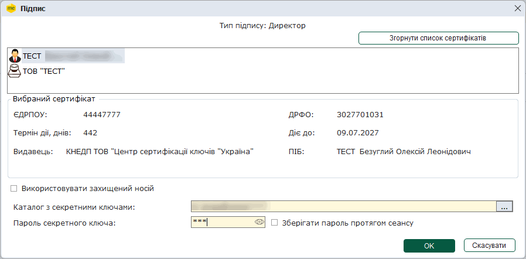

Після підтвердження сертифікату відкриється вікно модуля, яке містить меню налаштування прийому первинних документів:

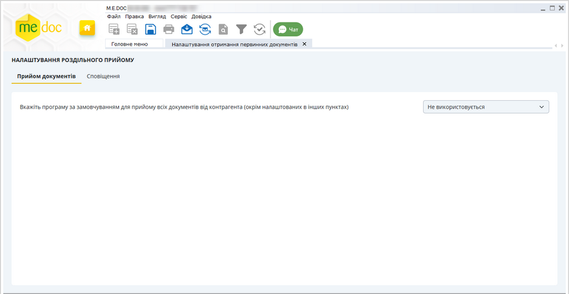

Натисніть, щоб збільшити малюнок

Якщо для підприємства раніше вже було виконано налаштування прийому первинних документів у програмах M.E.Doc, АPІ.ПТАХ, СОТА, FlyDoc або FREDO, то ці налаштування будуть автоматично завантажені та відображені у вікні модуля.

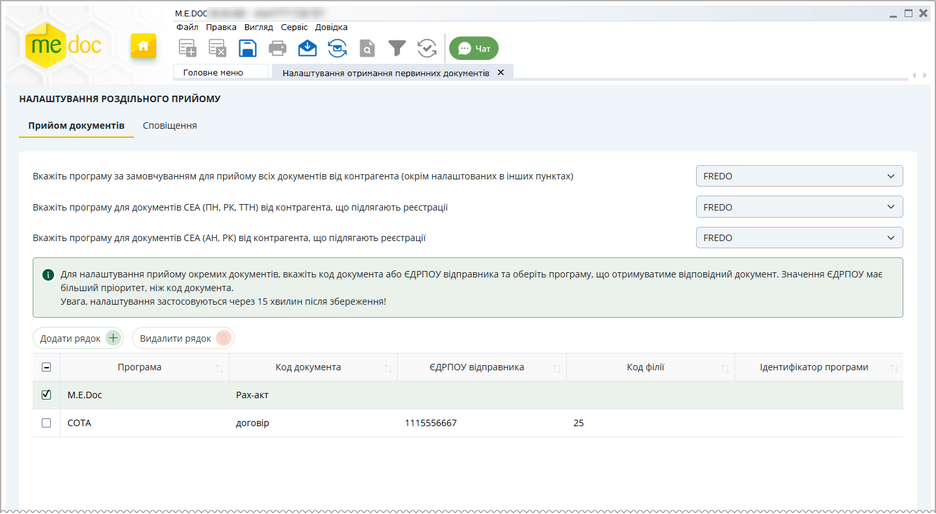

Натисніть, щоб збільшити малюнок

Розподілити прийом вхідних первинних документів можливо декількома способами:

- встановити програму для прийому всіх без винятку вхідних первинних документів;
- вказати окрему програму для прийому документів СЕА, що підлягають реєстрації;
- вказати окрему програму для прийому акцизних ПН/РК СЕА, що підлягають реєстрації;
- виконати спеціальні налаштування розподілення документів за їх кодами та/або ЄДРПОУ відправника документа.

[До початку](#ucsettrcvdoc-ucsettrcvdoc)

Налаштування сповіщення про всі повідомлення на платформі "ПТАХ"

Для отримання повідомлень про всі наявні нові документи на платформі "ПТАХ":

1. Перейдіть на вкладку Сповіщення.

2. У блоці налаштувань Email-повідомлення сповіщень з платформи "ПТАХ"  введіть електронну адресу, на яку бажаєте отримувати всі сповіщення про будь-які повідомлення на платформі "ПТАХ":

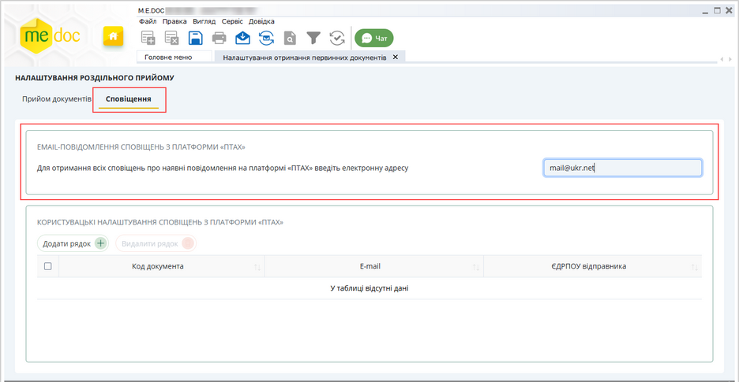

Натисніть, щоб збільшити малюнок

На вказану адресу електронної пошти буде надходити сповіщення про нові документи на платформі "ПТАХ", які ще не були прийняті у відповідних програмах.

Сповіщення про неприйняті документи на платформі "ПТАХ" надходитимуть для будь-якого розподілу прийому вхідних первинних документів (незалежно від налаштованих програм для прийому документів).

[До початку](#ucsettrcvdoc-ucsettrcvdoc)

Налаштування сповіщення про повідомлення на платформі "ПТАХ" за кодом документа та ЄДРПОУ відправника

Для отримання повідомлень про нові документи на платформі "ПТАХ" залежно від коду документа або ЄДРПОУ відправника:

1. Перейдіть на вкладку Сповіщення.

2. У блоці налаштувань Користувацькі налаштування сповіщень з платформи "ПТАХ" натисніть на кнопку Додати рядок:

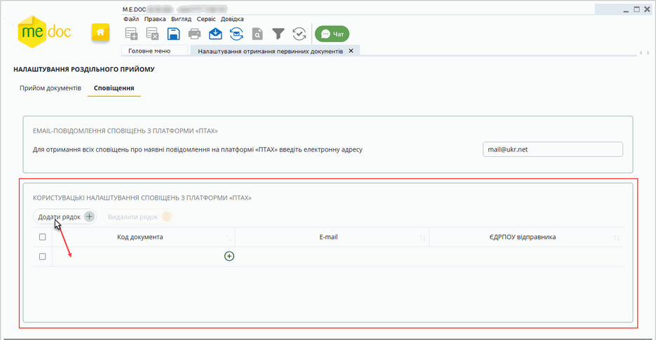

Натисніть, щоб збільшити малюнок

3. Якщо потрібно налаштувати отримання сповіщення за кодом документа, у новому рядку у колонці Код документа вкажіть код документа. Можна ввести код документа вручну або обрати його з довідника одним із способів:

- Почніть вводити код документа, під полем відкриється список з кодами документів, що містять введені символи. Оберіть потрібний код у списку.
- Натисніть кнопку  у підсвіченому рядку. Відкриється вікно довідника документів:

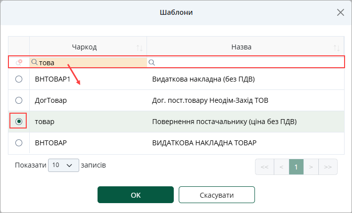

Встановіть позначку у рядку потрібного документа та натисніть кнопку ОК. Обраний документ буде додано у таблицю налаштувань.

Щоб здійснити пошук у вікні довідника, почніть вводити код документа або назву документа у полі з зображенням лупи у однойменній колонці. У вікні довідника будуть відображені лише ті документи, назва або/та код яких містять введені символи.

Щоб налаштувати кількість рядків у вікні довідника, оберіть потрібне значення у полі Показати \_\_ записів. Також можливо посортувати записи, натиснувши на заголовок колонки.

4. Якщо потрібно налаштувати отримання сповіщення за ЄДРПОУ відправника, у колонці ЄДРПОУ відправника введіть відповідний код ЄДРПОУ:

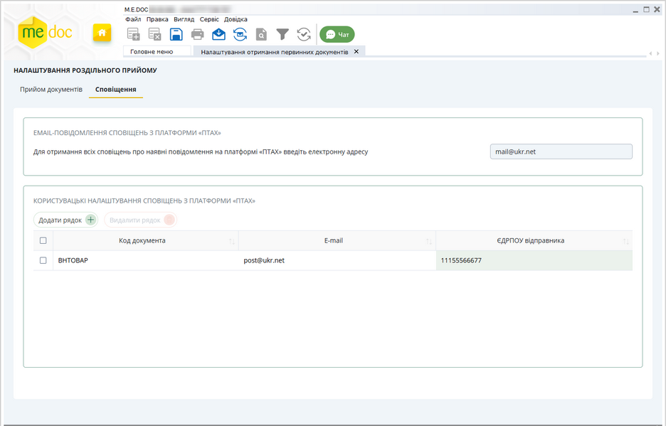

Натисніть, щоб збільшити малюнок

Можна одночасно налаштувати отримання документів за їх кодом та за ЄДРПОУ відправника. Для цього у рядку налаштування встановіть відповідні значення у полях Код документа та ЄДРПОУ відправника.

5. Щоб додати налаштування для наступного документа, натисніть кнопку Додати рядок та виконайте описані вище дії.

6. Натисніть кнопку Зберегти  на панелі інструментів.

На вказану адресу електронної пошти буде надходити сповіщення про нові документи на платформі "ПТАХ", які ще не були прийняті у відповідних програмах.

Зверніть увагу, сповіщення надходитимуть лише про документи, що мають вказаний код та/або ЄДРПОУ відправника (контрагента).

Сповіщення про неприйняті документи на платформі "ПТАХ" надходитимуть для будь-якого розподілу прийому вхідних первинних документів (незалежно від налаштованих програм для прийому документів).

Щоб видалити налаштування, встановіть позначку на початку рядка та натисніть на кнопку Видалили рядок.

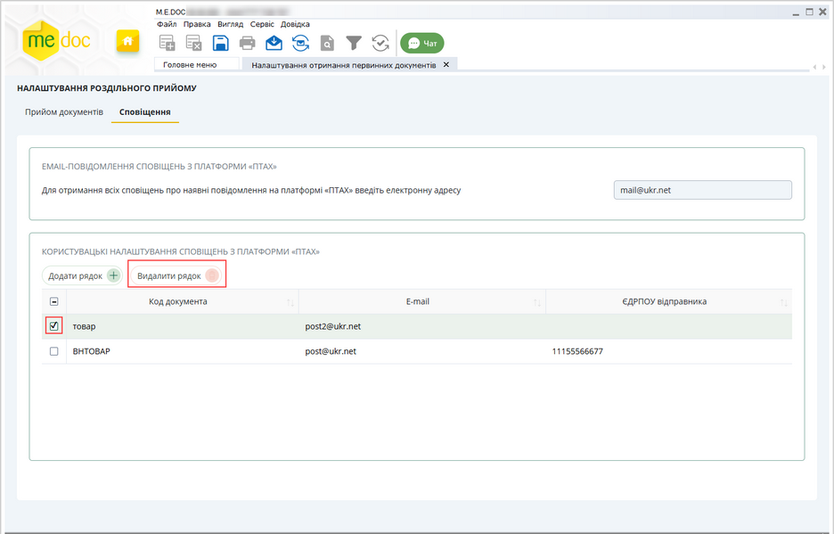

Натисніть, щоб збільшити малюнок

[До початку](#ucsettrcvdoc-ucsettrcvdoc)

Налаштування прийому для всіх первинних документів

Щоб налаштувати прийом первинних документів у блоці налаштувань Налаштування за замовчуванням:

1. Перейдіть на вкладку Прийом документів.

2. У пункті Вкажіть програму за замовчуванням для прийому всіх документів від контрагента (окрім налаштованих в інших пунктах): оберіть назву програмного продукту, у якому буде здійснюватися отримання всіх первинних документів, що надходитимуть від контрагентів та від серверу обміну коригуваннями ДПС (РК, ПН, РК, АН, ТТН, акти, рахунки та ін.).

Налаштування пункту Вкажіть програму за замовчуванням для прийому всіх документів від контрагента (окрім налаштованих в інших пунктах) розповсюджується на усі без винятку первинні документи, якщо не були виконані налаштування у інших пунктах модуля ([прийом за кодом документа або ЄДРПОУ відправника](#ucsettrcvdoc-ucsettrcvdoc) або прийом документів, що [підлягають реєстрації](#ucsettrcvdoc-ucsettrcvdoc)).

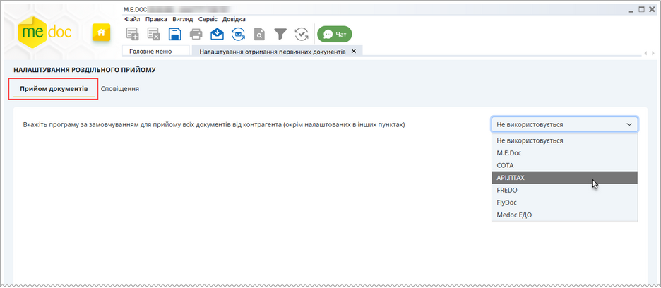

Натисніть, щоб збільшити малюнок

У вікні з'явиться пункт Вкажіть програму для документів СЕА  (ПН, РК, ТТН) від контрагента, що підлягають реєстрації та Вкажіть програму для документів СЕА (АН, РК) від контрагента, що підлягають реєстрації. За замовчуванням у цих полях встановлюється назва програми, що була обрана у пункті Вкажіть програму за замовчуванням для прийому всіх документів від контрагента (окрім налаштованих в інших пунктах). Тобто, за замовчуванням прийом всіх документів СЕА, що підлягають реєстрації буде здійснюватися у тій же програмі що й інші вхідні первинні документи.

Про налаштування прийому документів СЕА, що підлягають реєстрації, [дивіться у наступному розділі](#ucsettrcvdoc-ucsettrcvdoc).

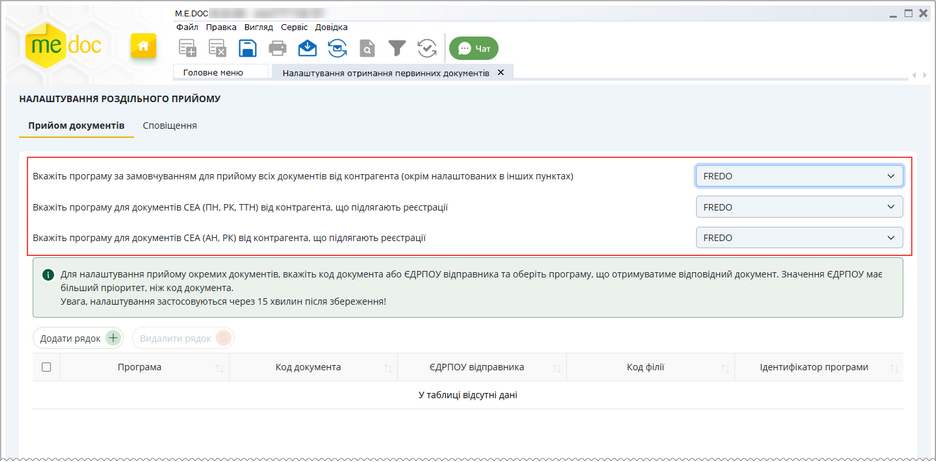

Натисніть, щоб збільшити малюнок

3. Натисніть кнопку Зберегти  на панелі інструментів, або натисніть Так у вікні повідомлення, що з'явиться при закритті модуля. Налаштування розподілення прийому вхідних первинних документів починають діяти з моменту збереження.

Зверніть увагу, всі виконані налаштування застосовуються через 15 хвилин після збереження!

[До початку](#ucsettrcvdoc-ucsettrcvdoc)

Налаштування прийому для документів СЕА від контрагента, що підлягають реєстрації

Якщо необхідно організувати прийом документів СЕА від контрагента, що підлягають реєстрації, у окремій програмі:

1. На вкладці Прийом документів у пункті Вкажіть програму за замовчуванням для прийому всіх документів від контрагента (окрім налаштованих в інших пунктах) оберіть назву програмного продукту, у якому буде здійснюватися отримання усіх вхідних первинних документів.

2. У пунктах Вкажіть програму для документів СЕА  (ПН, РК, ТТН) від контрагента, що підлягають реєстрації та/або Вкажіть програму для документів СЕА (АН, РК) від контрагента, що підлягають реєстрації, оберіть назву програми, у якій необхідно приймати відповідний тип документів, що потребують реєстрації. Ці пункти стають доступним тільки після вибору програми у полі Вкажіть програму за замовчуванням для прийому всіх документів від контрагента (окрім налаштованих в інших пунктах).

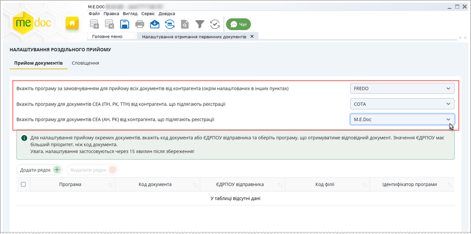

Натисніть, щоб збільшити малюнок

Прийом документів СЕА (НН, АН, ТТН та РК),  документи з серверу обміну коригуваннями ДПС (РК) та документи з серверу "ПТАХ" (ПН, РК, ТТН, АН) прийматимуться тільки у програмному продукті, що обраний у пункті Вкажіть програму для документів СЕА  (ПН, РК, ТТН) від контрагента, що підлягають реєстрації та/або Вкажіть програму для документів СЕА (АН, РК) від контрагента, що підлягають реєстрації.

Інші первинні документи (Договори, Акти, Рахунки, ВН тощо) будуть прийматися у програмі, що вказана у полі Вкажіть програму за замовчуванням для прийому всіх документів від контрагента (окрім налаштованих в інших пунктах), за умови, що для них не були виконані спеціальні налаштування [прийому документів за кодом або ЄДРПОУ](#ucsettrcvdoc-ucsettrcvdoc).

3. Натисніть кнопку Зберегти  на панелі інструментів, або натисніть Так у вікні повідомлення, що з'явиться при закритті модуля.

Виконані налаштування застосовуються через 15 хвилин після збереження!

[До початку](#ucsettrcvdoc-ucsettrcvdoc)

Налаштування прийому документів за кодом документа та ЄДРПОУ відправника

M.E.Doc надає можливість налаштувати прийом документів за їх кодами та ЄДРПОУ відправника, тобто можливо вказати коди відповідних документів та/або коди ЄДРПОУ організацій, що відправили документи, та спрямувати їх до певних програмних продуктів: M.E.Doc, АPІ.ПТАХ, СОТА, FlyDoc або FREDO.

Налаштувати прийом документів ПН, РК, ТТН, АН за їх кодами неможливо. Програма для прийому цих документів обирається виключно у пункті Вкажіть програму для документів СЕА  (ПН, РК, ТТН) від контрагента, що підлягають реєстрації та/або Вкажіть програму для документів СЕА (АН, РК) від контрагента, що підлягають реєстрації.

Щоб налаштувати прийом первинних документів за кодом:

1. На вкладці Прийом документів у пункті Вкажіть програму за замовчуванням для прийому всіх документів від контрагента (окрім налаштованих в інших пунктах): оберіть назву програмного продукту, у якому буде здійснюватися отримання усіх вхідних первинних документів.

2. У таблиці, що розташована під пунктами налаштувань, натисніть кнопку Додати рядок. Таблиця стає доступною тільки після вибору програми у пункті Вкажіть програму за замовчуванням для прийому всіх документів від контрагента (окрім налаштованих в інших пунктах).

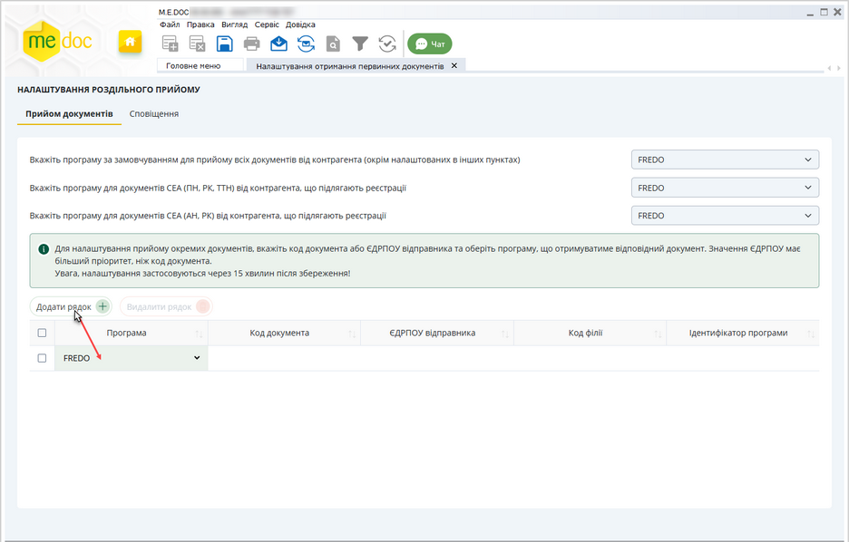

Натисніть, щоб збільшити малюнок

3. За замовчуванням у новому рядку, у колонці Програма зазначено назву програми, яка обрана у полі Вкажіть програму за замовчуванням для прийому всіх документів від контрагента (окрім налаштованих в інших пунктах). Щоб обрати іншу програму для прийому документа, оберіть її назву у колонці Програма:

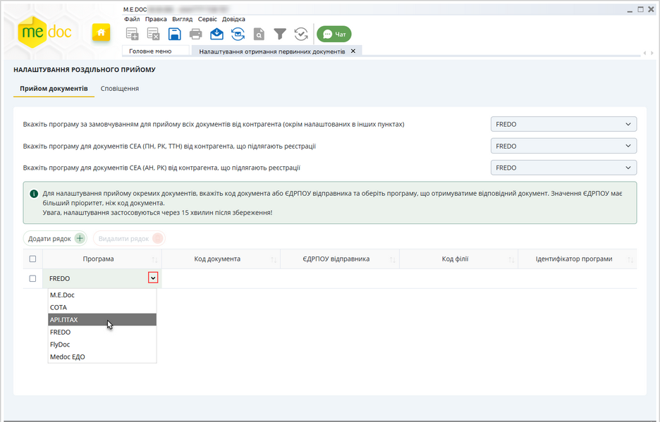

Натисніть, щоб збільшити малюнок

4. Налаштуйте прийом документів за кодом документа або ЄДРПОУ відправника.

Щоб налаштувати прийом документів за кодом, у колонці Код документа введіть код:

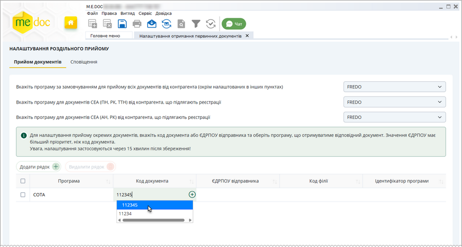

Натисніть, щоб збільшити малюнок

Можна ввести код документа вручну або обрати його з довідника одним із способів:

- Почніть вводити код документа, під полем відкриється список з кодами документів, що містять введені символи. Оберіть потрібний код у списку.
- Натисніть кнопку  у підсвіченому рядку. Відкриється вікно довідника документів:

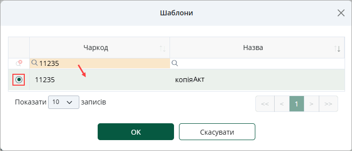

Встановіть позначку у рядку потрібного документа та натисніть кнопку ОК. Обраний документ буде додано у таблицю налаштувань.

Щоб здійснити пошук у вікні довідника, почніть вводити код документа або назву документа у полі з зображенням лупи у однойменній колонці. У вікні довідника будуть відображені лише ті документи, назва або/та код яких містять введені символи.

Щоб налаштувати кількість рядків у вікні довідника, оберіть потрібне значення у полі Показати \_\_ записів. Також можливо посортувати записи, натиснувши на заголовок колонки.

Щоб налаштувати прийом документів за ЄДРПОУ відправника, у колонці ЄДРПОУ відправника введіть відповідний код ЄДРПОУ. У разі потреби, у полі Код філії введіть код філії відправника документа:

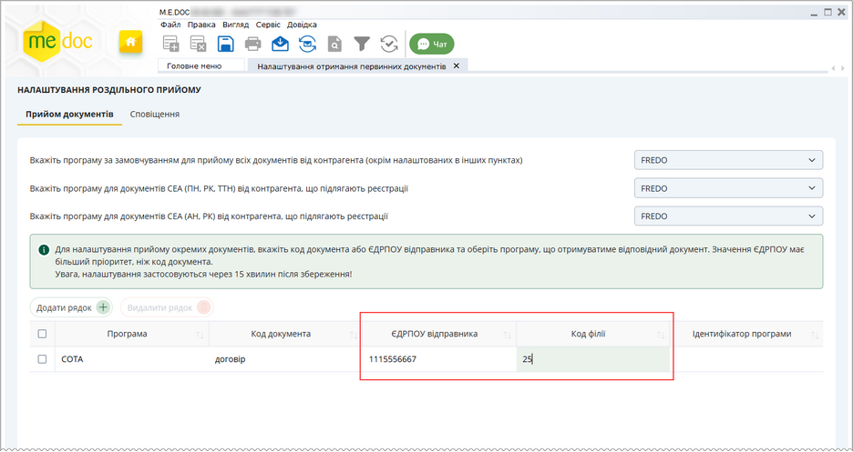

Натисніть, щоб збільшити малюнок

Поле Код філії стає доступним для введення даних після заповнення поля ЄДРПОУ відправника.

Важливо!

Можна одночасно налаштувати отримання документів за їх кодом та за ЄДРПОУ відправника. Для цього у рядку налаштування встановіть відповідні значення у полях Код документа та ЄДРПОУ відправника.

Налаштування отримання документа за ЄДРПОУ відправника має вищий пріоритет, ніж налаштування отримання за кодом документа.

Наприклад, якщо у окремих рядках таблиці налаштовано отримання документа з кодом ДОГОВІР у програмі M.E.Doc та отримання документів від відправника з ЄДРПОУ 12345678 у програмі СОТА, документи з кодом ДОГОВІР, що надійдуть від відправника з ЄДРПОУ 12345678 будуть отримані у програмі СОТА.

5. Щоб додати налаштування для наступного документа, натисніть кнопку Додати рядок та виконайте описані вище дії.

6. Натисніть кнопку Зберегти  на панелі інструментів.

Документи, для яких налаштовано розподілення прийому за кодом або ЄДРПОУ, будуть прийматися виключно у  тих програмних продуктах, які вказані в рядку документа у полі Програма.

Для видалення налаштувань прийому документа за кодом або ЄДРПОУ встановіть позначку у рядку відповідного коду та натисніть кнопку Видалити рядок:

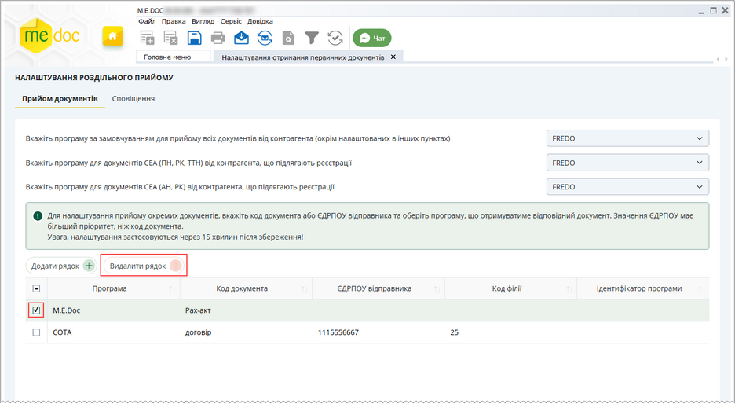

Натисніть, щоб збільшити малюнок

Виконані налаштування застосовуються через 15 хвилин після збереження!

[До початку](#ucsettrcvdoc-ucsettrcvdoc)

Налаштування  прийому документів за ідентифікаторами АPІ.ПТАХ та FlyDoc

Якщо на підприємстві використовується декілька баз даних, обмін з якими виконується за допомогою програмних продуктів АPІ.ПТАХ або FlyDoc, можливо налаштувати роздільний прийом документів за допомогою ідентифікаторів, які присвоєні цим програмним продуктам.

Ідентифікатор повинен бути встановлений у налаштуваннях АPІ.ПТАХ або FlyDoc заздалегідь. Як встановити ідентифікатор у програмі АPІ.ПТАХ або FlyDoc дивіться у керівництві користувача до цих програмних продуктів або зверніться за необхідною інформацією до розробника.

1. На вкладці Прийом документів у полі Вкажіть програму за замовчуванням для прийому всіх документів від контрагента (окрім налаштованих в інших пунктах) оберіть FlyDoc або АРІ.ПТАХ.

2. У вікні налаштувань з’явиться додаткове поле Вкажіть ідентифікатор обраної програми, у якому введіть значення, що буде ідентифікувати програму прийому даних:

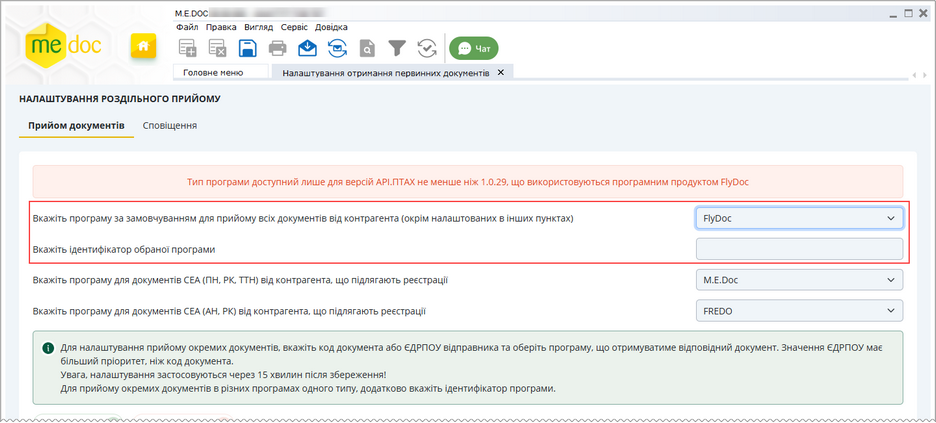

Натисніть, щоб збільшити малюнок

3. Якщо потрібно налаштувати різні програми для прийому окремих документів за їх кодами, вкажіть ідентифікатор потрібної програми у колонці Ідентифікатор програми.

Щоб скасувати налаштування прийому документів у різних програмних продуктах, у пункті Вкажіть програму за замовчуванням для прийому всіх документів від контрагента (окрім налаштованих в інших пунктах) оберіть значення Не використовується.

Виконані налаштування застосовуються через 15 хвилин після збереження!

[До початку](#ucsettrcvdoc-ucsettrcvdoc)

Скасування розподілу прийому первинних документів

Щоб скасувати налаштування прийому первинних документів у різних програмних продуктах:

1. У пункті Вкажіть програму за замовчуванням для прийому всіх документів від контрагента (окрім налаштованих в інших пунктах): оберіть значення Не використовується.

2. Натисніть кнопку Зберегти  на панелі інструментів, або натисніть Так у вікні повідомлення, що з'явиться при закритті модуля.

Якщо обрано значення Не використовується, розподілення первинних документів за програмними продуктами не здійснюється. Документи надходитимуть у програмне забезпечення, яке першим встановить поштове з'єднання або ж з'єднання з сервером документообігу.

Відновити скасовані налаштування неможливо. Щоб повернутися до розподілу прийому первинних документів, необхідно виконати всі налаштування повторно.

Виконані налаштування застосовуються через 15 хвилин після збереження!

[До початку](#ucsettrcvdoc-ucsettrcvdoc)


