[← Зміст довідки](../)


# Реєстр документів СЕВ ОВВ

## Реєстр документів СЕВ ОВВ

_Шлях у довідці: Додатково: UCSevOvvRst › Реєстр документів СЕВ ОВВ_

Модуль Реєстр документів СЕВ ОВВ призначений для обміну електронними документами між суб’єктами господарювання, що підключені до СЕВ ОВВ (системи електронної взаємодії органів виконавчої влади) та використовують платформу ПТАХ для документообігу.

За допомогою розділу можливо здійснювати:

- створювати документи у форматах СЕВ ОВВ із вкладеннями різних форматів;
- реєструвати вхідні/вихідні документи;
- погоджувати/відхиляти отримані документи;
- створювати відповіді на основі вхідного документа;
- підписувати документи ЕП та відправляти отримувачам.

Для обміну документів необхідно:

- придбати ліцензію на використання розділу;
- виконати підключення сервісу у розділі Адміністрування - Параметри системи - СЕВ ОВВ.

У даному розділі довідки розглянуто:

- [Опис основних функціональних елементів інтерфейсу](#ucsevovvrst-sev_ovv_opis)
- [Створення електронних документів](#ucsevovvrst-sev_ovv_stvor)
- [Підписання та відправка електронних документів](#ucsevovvrst-sev_ovv_vidp)
- [Отримання вхідних документів](#ucsevovvrst-sev_ovv_oprac)
- [Створення відповіді на основі вхідного документа](#ucsevovvrst-sev_ovv_oprac)
- [Реєстрація, опрацювання або відхилення вхідних електронних документів](#ucsevovvrst-sev_ovv_oprac)
- [Відправка документів кільком отримувачам](#ucsevovvrst-sev_ovv_stvor)

### Опис основних функціональних елементів інтерфейсу модуля

_Шлях у довідці: Додатково: UCSevOvvRst › Реєстр документів СЕВ ОВВ › Опис основних функціональних елементів інтерфейсу модуля_

Розділ СЕВ ОВВ містить модуль Реєстр документів СЕВ ОВВ, побудований у вигляді таблиці-реєстру, окремий рядок якої відображає коротку інформацію про кожен документ.

У лівій частині модуля розташована навігаційна панель. Панель містить області, що призначені для полегшення пошуку документів. При виборі певного значення на панелі навігації, в робочій області відображаються документи, що відповідають заданим умовам фільтрації.

-064_zoom65.png>)

Натисніть, щоб збільшити малюнок

Фільтр

Робота з Реєстром розпочинається з Фільтру - інструменту відбору потрібних документів.

У Фільтрі представлені атрибути документів, за якими здійснюється пошук та сортування.

Ви можете самостійно задавати відображення параметрів відбору в Реєстрі. Натисніть на кнопку  та в окремому вікні, що відкрилось, встановіть/зніміть галочки напроти потрібного атрибуту:

Напрямок - містить перемикач між напрямками документів. Передбачені наступні варіанти:

- Всі - всі документи незалежно від напрямку;
- Отриманий - отримані документи;
- Виданий - документи, створені у поточному підприємстві.

Стан обробки - містить перемикач між призначеннями первинних документів. Передбачені наступні варіанти:

- На опрацюванні - документи, які знаходяться безпосередньо в роботі;
- Корзина - документи, які були видалені з Реєстру.

Дата  - дозволяє відсортувати документи за датою створення, встановіть позначку для вибору певного періоду:

- За період - вкажіть період (місяць, рік), в межах якого були створені документи;
- Створення/отримання - вкажіть дату початку та закінчення довільного інтервалу, в межах якого створений/отриманий документ.

Терміновий - відсортувати документи в яких є відмітка Терміновий.

Призначення документа -  відбір документів за призначенням, значення для відбору обираються з довідника Призначення документа, за замовчанням встановлено значення Всі, тобто пошук відбувається за заданими параметрами серед усіх документів.

Термін виконання - відбір документів за терміном виконання, оберіть необхідну дату у вікні календаря.

Виконавець - відбір документів за іменами користувачів, що створювали документи, оберіть значення з довідника Співробітники.

Контрагент:

- ЄДРПОУ - дозволяє знайти документи контрагента, що були відправлені/прийняті, якщо відомо його код установи за Єдиним державним реєстром підприємств та організацій України. Значення вводиться з клавіатури, обирається з підключеного довідника (кнопка ) або заповнюється автоматично при виборі інших даних контрагента з довідника;
- Назва - дозволяє знайти документи, які були виписані на ім'я або отримані від певного контрагента. Назва контрагента можна ввести як з клавіатури, так і вибрати із довідника Контрагенти, який відкривається після натиснення на кнопку . При виборі контрагента із довідника, автоматично заповнюються поле ЄДРПОУ.

Якщо документ має декілька отримувачів, то у таблиці модуля відображається саме той контрагент, який зазначено у фільтрі, відповідно у колонці Стан документа відображається стан документа саме по обраному контрагенту.

Для того, щоб очистити Фільтр від даних, натисніть на кнопку .

Якщо панель Фільтра не потрібна та/або заважає, її можна згорнути. Для цього натисніть на кнопку . Щоб розгорнути Фільтр, натисніть на згорнуту панель.

Робоча область

Містить безпосередньо записи Реєстру документів відправлених/отриманих: відображає записи, що відповідають заданим умовам фільтрації та сортування.

Таблиця умовно розділена на три частини:

- Документ - містить інформацію про основні атрибути документів: напрямок (Виданий / Отриманий), назва документа, дата створення, призначення документа, короткий зміст, кількість файлів у вкладенні, ознака Терміновий; ;
- Інформація щодо відправлення - містить інформацію про відправку документа: реєстраційний №, що присвоєний документу відправником, найменування відправника, термін виконання, вказаний відправником, виконавець, дата реєстрації відправником;
- Інформація щодо отримання - містить інформацію про отримання документа та результати обробки документа: найменування отримувача (якщо документ має декілька отримувачів, зазначаються всі отримувачі), дата отримання, реєстраційний номер, що присвоєний документу отримувачем, дата реєстрації, дата відхилення, та причина відхилення (за наявності), результат погодження/виконання та коментар до погодження/виконання (за наявності).

Щоб відкрити документ, оберіть його у списку та скористайтеся одним із способів:

- натисніть 2 рази лівою кнопкою миші на документі у списку;
- виконайте команду меню Файл - Відкрити;
- оберіть команду Відкрити у контекстному меню;
- натисніть кнопку Відкрити  на панелі інструментів;
- скористайтесь комбінацією клавіш Ctrl+F2.

Панель вкладок

Містить службову інформацію щодо обраного документа. Панель доступна як у відкритому документі, так і з Реєстру (за умови виділення потрібного документа, набір вкладок залежить від стану та етапу обробки документа).

- Наступні дії – містить інформацію щодо поточного стану документа, а також перелік можливих дій з документом у цьому стані. Слугує підказкою користувачу про доступні дії, які можна виконати з документом у поточному стані;

Властивості – у режимі читання містить всю службову інформацію про документ, таку як: стан, період створення, дата та час останньої модифікації, інформація про сертифікати, якими підписано документ тощо. Інформація на цій вкладці постійно оновлюється та доповнюється при будь-яких змінах документа;

- Протокол – містить перелік подій, що відбулись з документом під час його обробки в хронологічному порядку. При виборі події справа на панелі відображається її детальний опис.
- Примітка – текстове поле для внесення будь-якої інформації стосовно поточного документа. Дана вкладка доступна тільки у відкритому документі і тільки до моменту відправлення його засобами електронного зв’язку. Інформація, яка внесена в дане поле також відображається в колонці "Примітка" реєстру.

Панель інструментів.

Містить кнопки, що надають швидкий доступ до найбільш часто використовуваних функцій. Наведіть покажчик миші на інструмент і чекайте протягом секунди, для відображення короткої підказки, що описує його призначення.

|  |  |
| --- | --- |
|  | Створення документа |
|  | Перегляд (редагування) поточного документа |
|  | Вилучення поточного документа |
|  | Створення копії документа. Копія документа створюється, якщо він може повторюватися у рамках звітних періодів, а також у випадку, якщо потрібно відредагувати та повторно відіслати раніше відправлений електронною поштою звіт (у тому числі і підписаний ЕП) |
|  | Створення відповіді на основі вхідного документа |
|  | Реєстрація вхідного документа |
|  | Відхилення вхідного документа |
|  | Друкування обраного документа |
|  | Відправити документ |
|  | Отримати повідомлення |

### Створення нового документа

_Шлях у довідці: Додатково: UCSevOvvRst › Реєстр документів СЕВ ОВВ › Створення нового документа_

В цьому розділі:

[Заповнення вкладки Основні відомості](#ucsevovvrst-sev_ovv_stvor)

[Заповнення вкладки Адресати](#ucsevovvrst-sev_ovv_stvor)

[Заповнення вкладки Завдання (доручення)](#ucsevovvrst-sev_ovv_stvor)

[Додавання вкладень](#ucsevovvrst-sev_ovv_stvor)

[Копіювання документа](#ucsevovvrst-sev_ovv_stvor)

Для створення нового документа:

1. Скористайтесь одним із способів:

- на панелі інструментів натисніть кнопку Створити  та оберіть пункт Документ СЕВ ОВВ;
- виберіть команду Файл - Створити - Документ СЕВ ОВВ;
- у контекстному меню оберіть команду Створити - Документ СЕВ ОВВ.

2. Відкриється вкладка СЕВ ОВВ.

Вікно документа має три блока для заповнення:

- [Документ](#ucsevovvrst-sev_ovv_stvor) - заповнення основних атрибутів документа;
- [Інформація щодо отримувачів](#ucsevovvrst-sev_ovv_stvor) - додавання адресатів, яким буде відправлятися документ;
- [Прикріплені файли](#ucsevovvrst-sev_ovv_stvor) - додавання вкладень.
- [Завдання (доручення)](#ucsevovvrst-sev_ovv_stvor) - детальна інформація щодо виконання завдання, заповнюється у разі потреби, для документів з призначенням До виконання.

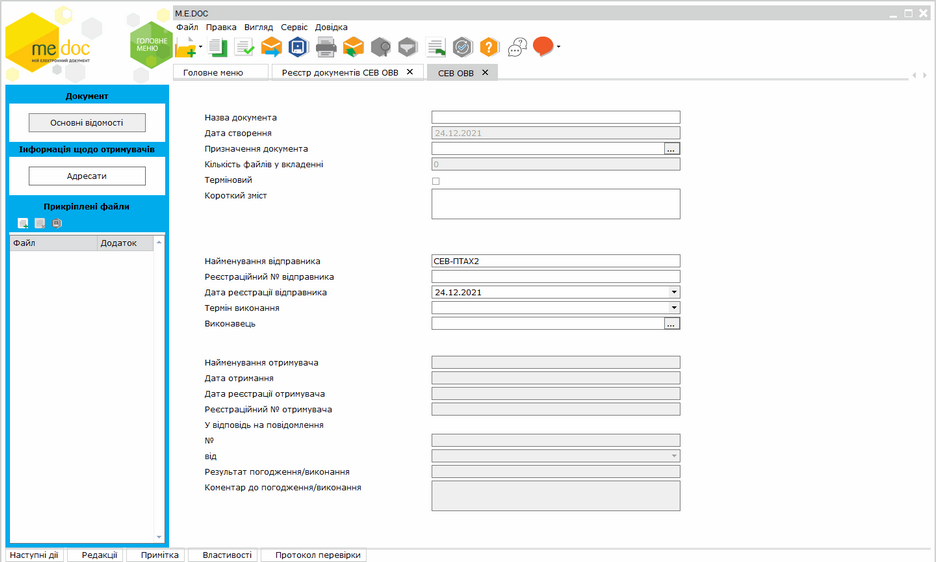

Натисніть, щоб збільшити малюнок

Документ обов'язково повинен містити хоча б один файл вкладення.

3. [Заповніть відомості](#ucsevovvrst-sev_ovv_stvor) про документ, [додайте адресата](#ucsevovvrst-sev_ovv_stvor), якому призначається документ, та [завантажте файли вкладень](#ucsevovvrst-sev_ovv_stvor), як описано нижче.

4. Збережіть документ, одним із способів:

- натиснувши кнопку  ;
- натиснувши комбінацію клавіш Ctrl+S;
- обравши пункт головного меню Файл - Зберегти.

Збережений документ буде відображено у таблиці [Реєстру документів СЕВ ОВВ](#ucsevovvrst-sev_ovv_opis).

[До початку](#ucsevovvrst-sev_ovv_stvor)

Заповнення вкладки Основні відомості

На вкладці Основні відомості заповніть поля:

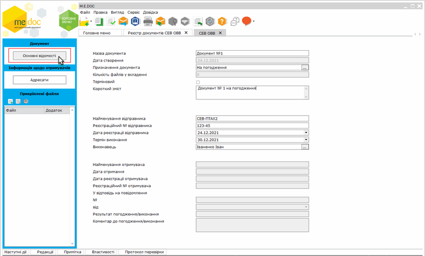

Натисніть, щоб збільшити малюнок

Поля заповнюються Відправником при створенні документа:

- Назва документа - введіть назву документа.
- Дата створення - автоматично, вказується поточна дата.
- Призначення документа - оберіть значення з довідника Призначення документа, натиснувши кнопку . Якщо обрано значення ДС1. До виконання, на панелі ліворуч з'явиться додаткова вкладка Завдання (доручення), заповніть поля цієї вкладки, як [описано нижче](#ucsevovvrst-sev_ovv_stvor).
- Кількість файлів у вкладенні - у полі автоматично відображається кількість файлів вкладень, що будуть прикріплені до документа на вкладці [Прикріплені файли](#ucsevovvrst-sev_ovv_stvor).
- Терміновий -  встановіть позначку, якщо документ вимагає термінового опрацювання.
- Короткий зміст - введіть короткий зміст документа.
- Найменування відправника - поле заповнюється автоматично, відображається назва організації із Картки підприємства.
- Реєстраційний № відправника - введіть реєстраційний номер вихідного документа;
- Дата реєстрації  відправника - введіть дату реєстрації документа.
- Термін виконання - у разі потреби, вкажіть дату до якої необхідно опрацювати документ.
- Виконавець - оберіть виконавця, що складає документ, можливе ввести ПІБ вручну або обирати значення з довідника Співробітники, натиснувши кнопку .
- Найменування отримувача - поле заповнюється автоматично після вибору адресата у розділі Адресати.

Наступні поля недоступні у вихідному документі, заповнюються на боці Отримувача після отримання та реєстрації документа:

- Дата отримання - поле заповнюється автоматично після отримання документа адресатом.
- Дата реєстрації отримувача - поле заповнюється автоматично після виконання  реєстрації документа Отримувачем.
- Реєстраційний № отримувача - поле заповнюється автоматично після виконання  реєстрації документа Отримувачем.

На боці відправника інформація стає доступною після надходження квитанції про отримання та реєстрацію документа отримувачем.

У разі створення відповіді на отриманий документ заповніть поля:

- У відповідь на повідомлення - поля заповнюються у разі створення документа-відповіді на вхідний документ, можливо автоматичне створення відповіді за допомогою функції [Створення відповіді на основі вхідного документа](#ucsevovvrst-sev_ovv_oprac):
- № -  містить номер повідомлення, у відповідь на яке створюється документ.
- від - містить дату повідомлення, у відповідь на яке створюється документ.
- Результат погодження/виконання - у разі потреби, введіть результат погодження документа.
- Коментар до погодження/виконання - поле заповнюється отримувачем після опрацювання документа, містить коментар до виконання або погодження документа (заповнюється за потреби).

[До початку](#ucsevovvrst-sev_ovv_stvor)

Заповнення вкладки Адресати

На вкладці Адресати оберіть адресата, якому необхідно відправити документ:

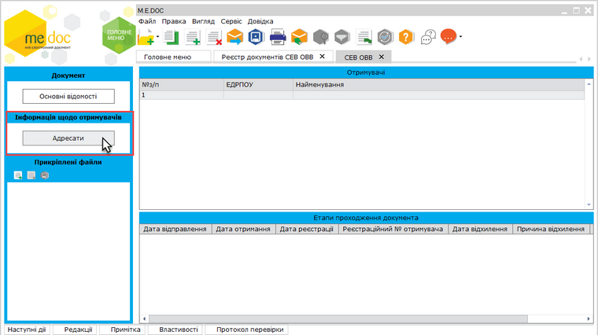

Натисніть, щоб збільшити малюнок

Заповнити дані отримувачів можливо у ручному режимі, ввівши дані за допомогою клавіатури, або обрати необхідних адресатів із довідника Контрагенти.

Додайте отримувача документа. У полі рядка ЄДРПОУ або Найменування натисніть кнопку  . У довіднику Контрагенти оберіть потрібного адресата, натисніть кнопку Вибрати:

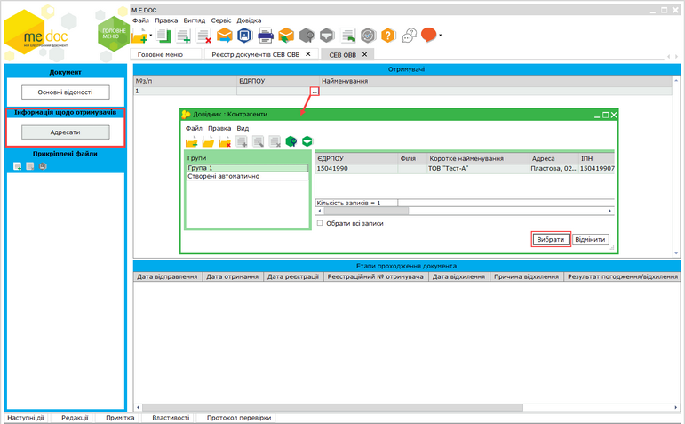

Натисніть, щоб збільшити малюнок

Рядок з даними обраного контрагента буде відображено у розділі Адресати.

Для видалення отримувача виділіть відповідний рядок у верхній частині вікна та натисніть кнопку   на панелі інструментів або оберіть пункт головного меню Файл - Видалити запис.

[До початку](#ucsevovvrst-sev_ovv_stvor)

Заповнення вкладки Завдання (доручення)

На вкладці Завдання (доручення) заповніть детальну інформацію щодо виконання завдання (доручення). Дані заповнюються у разі потреби, для документів з призначенням До виконання:

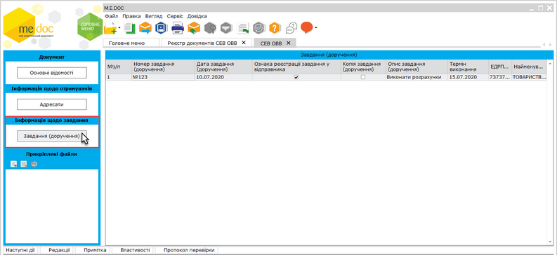

Натисніть, щоб збільшити малюнок

Для документів, у яких обрано призначення відмінне від До виконання (поле Призначення документа на вкладці Основні відомості), поля вкладки Завдання (доручення) недоступні для заповнення.

- Номер завдання (доручення) - введіть номер документа.
- Дата завдання (доручення) - вкажіть дату створення документа.
- Ознака реєстрації завдання у відправника - встановіть відмітку, якщо документ було зареєстровано.
- Копія завдання (доручення) - встановіть відмітку, якщо документ є копією.
- Опис завдання (доручення) -  введіть короткий опис документа.
- Термін виконання -  у разі потреби, вкажіть дату до якої необхідно виконати завдання.
- Найменування отримувача - введіть адресата вручну або оберіть значення з довідника Контрагенти;
- ЄДРПОУ -  введіть значення ЄДРПОУ адресата або оберіть значення з довідника Контрагенти

За потреби, додайте ще одне завдання (доручення), натиснувши кнопку Створити запис . Для видалення виділіть відповідний рядок та натисніть кнопку   на панелі інструментів.

[До початку](#ucsevovvrst-sev_ovv_stvor)

Додавання вкладень

У якості вкладень повинні використовуватись оригінали електронного документу (не відскановані файли) у форматі \*.DOC, \*.DOC(X), \*.PDF, \*.XLS, \*.XLS(X), \*.RTF тощо. Кількість файлів-вкладень - необмежена. Загальний розмір файлів вкладен не повинен перевищувати 2МБ.

Для додавання вкладень з Реєстру документів СЕВ ОВВ:

Щоб додати вкладення у документ з Реєстру документів СЕВ ОВВ, виділіть документ у таблиці реєстру та натисніть кнопку  на вкладці Наступні дії. У вікні Відкриття файлу оберіть потрібний документ та натисніть Відкрити.

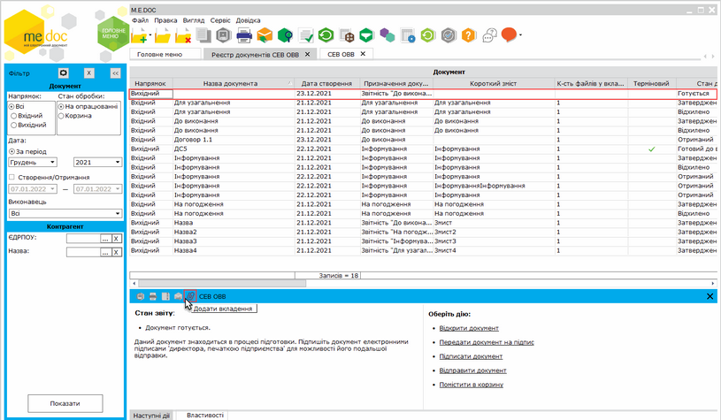

Натисніть, щоб збільшити малюнок

Для додавання вкладень у вікні відкритого документа:

1. Відкрийте документ та оберіть один із способів:

- натисніть кнопку  Додати вкладення  на вкладці Прикріплені файли;
- натисніть іконку  на вкладці Наступні дії у нижній частині вікна;
- виконайте команду головного меню Правка - Додати вкладення.

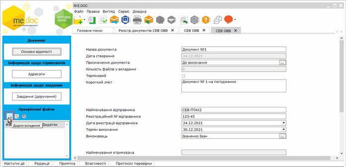

Натисніть, щоб збільшити малюнок

2. У вікні Відкриття файлу оберіть потрібний документ та натисніть Відкрити.

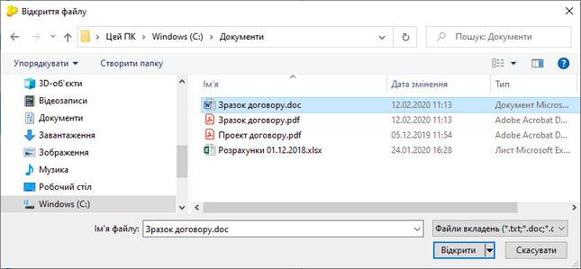

Натисніть, щоб збільшити малюнок

3. Ім'я завантаженого файлу буде відображено у переліку прикріплених файлів. Для перегляду файлу натисніть на його назві. Вміст документа буде відкрито у вкладці праворуч:

-064_zoom60.png>)

Натисніть, щоб збільшити малюнок

Зберегти вкладення можна, натиснувши на кнопку  на панелі Прикріплені файли у лівій частині вікна

4. Щоб додати наступний документ, виконайте дії описані у [п.1](#ucsevovvrst-sev_ovv_stvor) або натисніть іконку  на вкладці Вкладення у нижній частині вікна.

За допомогою вкладки Вкладення можливо додавати вкладення як у вікні відкритого документа, так і безпосередньо з Реєстру документів СЕВ ОВВ, попередньо виділивши потрібний документ у таблиці Реєстру.

Додавати та видаляти вкладення можливо лише у документах, що мають стан Готується.

Щоб видалити вкладення у вікні відкритого документа, виділіть назву файлу на панелі Прикріплені файли у лівій частині вікна та натисніть кнопку  :

-064_zoom60.png>)

Натисніть, щоб збільшити малюнок

Для позначення додатків до основного вкладення встановіть позначку Додаток.

5. Збережіть зміни у документі, натиснувши кнопку  або комбінацію клавіш Ctrl+S.

Зберегти документ у форматі PDF можна, за допомогою вкладки Графічне відображення як описано у розділі [Експорт первинних документів](Exp_perv.html#exp_perv-exp_perv).

[До початку](#ucsevovvrst-sev_ovv_stvor)

Копіювання документа

Для копіювання документа:

1. Виділіть документ, копію якого потрібно створити у таблиці Реєстру документів СЕВ ОВВ. Для копіювання групи документів виділіть потрібне курсором миші, утримуючі клавіші <Ctrl> або <Shift>.

2. Оберіть один із способів копіювання:

- на панелі інструментів натисніть кнопку Копіювати - ;
- із контекстного меню команда Копіювати;
- команда Файл - Копіювати.

Із вікна відкритого документа копіюється тільки поточний документ.

3. На виконання функції копіювання відкриється вікно Дата виписки, у якому оберіть дату виписки копії документа.

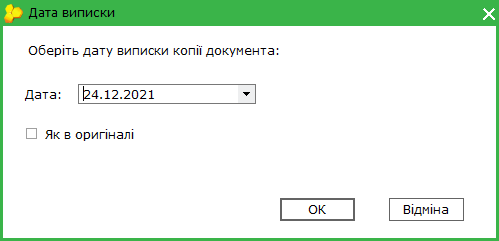

За замовчуванням встановлюється дата виписки документа, що копіюється.

Для того, щоб обрати іншу дату виписки, натисніть кнопку  у полі Дата. Відкриється вікно календаря, у якому оберіть потрібну довільну дату.

Якщо у копії необхідно зберегти дату виписки первинного документа, встановіть позначку Як в оригіналі.

4. Після того, як дату обрано, натисніть кнопку ОК. Відкриється вікно копії документа. Скопійовані документи можна редагувати.

[До початку](#ucsevovvrst-sev_ovv_stvor)

### Підписання ЕП та відправка документів

_Шлях у довідці: Додатково: UCSevOvvRst › Реєстр документів СЕВ ОВВ › Підписання ЕП та відправка документів_

В цьому розділі:

[Налаштування комплекту підписів для документів СЕВ ОВВ](#ucsevovvrst-sev_ovv_vidp)

[Підписання та відправка документа](#ucsevovvrst-sev_ovv_vidp)

Налаштування комплекту підписів для документів СЕВ ОВВ

Обов'язково налаштуйте комплект підписів, якими будуть підписуватись документи СЕВ ОВВ, обравши комплекти підписів для типу СЕВ ОВВ. Налаштування комплектів підписів виконується у розділі [Адміністрування - Параметри системи - Підпис](FormCompanyParams.html#formcompanyparams-admcomanyparams_pen).

1. У блоці Комплект підписів оберіть тип СЕВ ОВВ.

2. Під назвою типу, із списку оберіть варіант комплекту накладання електронних підписів відповідно до потреб вашого підприємства.

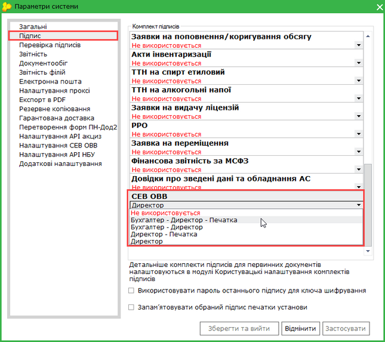

Натисніть, щоб збільшити малюнок

3. Для редагування списку підписантів, виділіть тип сертифікату та натисніть кнопку .

4. Відкриється вікно Налаштування комплекту підписів. За допомогою кнопки Додати оберіть потрібний сертифікат.

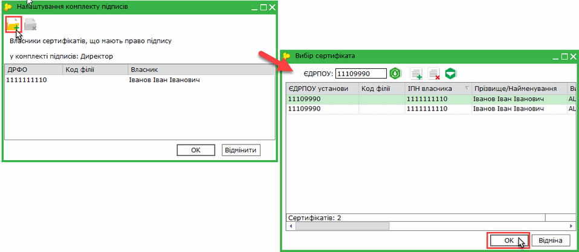

Натисніть, щоб збільшити малюнок

Таким же чином оберіть всіх необхідних підписантів.

5. При підписанні документа буде виводитись список заданих відповідальних осіб.

[До початку](#ucsevovvrst-sev_ovv_vidp)

Підписання та відправка документа

Існує декілька способів відправки документів:

1. Із вкладки "Наступні дії"

Даний спосіб дозволяє відправити лише один документ - відкритий або виділений в Реєстрі документів СЕВ ОВВ.

В доступних діях з документом передбачено декілька варіантів для зручності користувача:

Передати документ на підпис

На виконання цієї команди документ блокується від редагування та набуває статусу На підпис відповідальній особі. Документ знаходиться в стані очікування.
В Наступних діях стає доступним можливість [Підписати документ](UC_ECP.html#uc_ecp-ecp).
Після накладення підписів стає доступною функція Відправити документ. Програма повторно запропонує підписати файл сертифікатом шифрування, таким чином підписується "конверт", в який поміщається файл для відправки.

Підписати документ

На виконання команди відразу розпочнеться стандартний процес [підписання документа](UC_ECP.html#uc_ecp-ecp) ЕП.
Після накладення підписів та печатки установи, стає доступною функція Відправити. Програма повторно запропонує підписати файл сертифікатом шифрування, таким чином підписується "конверт", в який поміщається файл для відправки.

2. Безпосередньо з Реєстру документів СЕВ ОВВ

Даний спосіб дозволяє відправляти як один документ, так и групу документів одночасно.

У реєстрі виберіть потрібний документ або групу документів та оберіть один із варіантів:

- на панелі інструментів натисніть кнопку Відправити - ;
- виберіть команду Файл - Відправити;
- у контекстному меню оберіть команду Відправити.

На виконання команди розпочнеться [підписання документа](UC_ECP.html#uc_ecp-ecp) ЕП та одразу відправка документа адресату. По закінченню процедури, система виведе протокол відправки документів.

При підписанні документів виконується також і підписання вкладень.

[До початку](#ucsevovvrst-sev_ovv_vidp)

### Реєстрація та опрацювання вхідного документа

_Шлях у довідці: Додатково: UCSevOvvRst › Реєстр документів СЕВ ОВВ › Реєстрація та опрацювання вхідного документа_

В цьому розділі:

[Реєстрація вхідного документа](#ucsevovvrst-sev_ovv_oprac)

[Відхилення вхідного документа](#ucsevovvrst-sev_ovv_oprac)

[Створення відповіді на основі вхідного документа](#ucsevovvrst-sev_ovv_oprac)

Відправлені контрагентом документи надходять як звичайна вхідна кореспонденція. Отримати вхідний документ (перевірити наявність вхідних повідомлень) можливо, скориставшись одним із способів:

- на панелі інструментів кнопкою ;
- із меню Файл - Отримати повідомлення;
- за допомогою клавіші F9.

Отримані (вхідні) документи розміщуються у групі Вхідний (колонка Напрямок), стан Отримано у Реєстр документів СЕВ ОВВ,. Як тільки документи отримано, відправнику надійде повідомлення про доставку.

Інформація щодо отримання та обробки документа відображається на відповідних вкладках у вікні відкритого документа: Отримано, Затверджено, Доставлено контрагенту, Відхилено контрагентом тощо.

Реєстрація вхідного документа

Для реєстрації вхідного документа (присвоєння документу вхідного номеру) оберіть документ у списку та виконайте операції:

1.Оберіть один із способів:

- на панелі інструментів кнопкою ;
- із меню Файл -Зареєструвати;
- із контекстного меню Зареєструвати.

2. У вікні, що відкриється, заповніть поля:

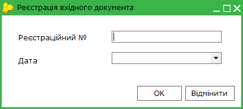

- Реєстраційний № - введіть реєстраційний номер вхідного ;
- Дата - оберіть дату у підключеному календарі.

3. Натисніть кнопку ОК.

4. Документ набуває стану Зареєстровано. У вхідному документі заповнюються реквізити Реєстраційний № отримувача та Дата реєстрації (у блоці відкритого документа Основні відомості), ці дані також відображаються на стороні відправника.

5. Відправнику відправляється повідомлення про реєстрацію документа.

[До початку](#ucsevovvrst-sev_ovv_oprac)

Відхилення вхідного документа

У разі, якщо ви не згодні зі вмістом документа, для відхилення вхідного документа оберіть документ у списку та виконайте операції:

1.Оберіть один із способів:

- на панелі інструментів кнопкою ;
- із меню Файл - Відхилити;
- із контекстного меню Відхилити.

2. У вікні, що відкриється, вкажіть причину відхилення:

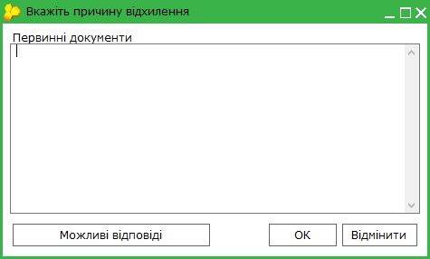

Можливо обрати готовий коментар із довідника, натиснувши кнопку Можливі відповіді.

3. Натисніть кнопку ОК.

4. Документ набуває стану  Відхилено. У вхідному документі заповнюються реквізити Дата відхилення та, якщо вказано причину, Причина відхилення (вкладки відкритого документа Адресати), ці дані також відображаються на стороні відправника.

5. Відправнику відправляється сповіщення про відхилення документа.

[До початку](#ucsevovvrst-sev_ovv_oprac)

Створення Відповіді на основі вхідного документа

Для створення відповіді на основі вхідного документа оберіть документ у списку та виконайте операції:

1.Оберіть один із способів:

- на панелі інструментів кнопкою ;
- із меню Файл - Створити відповідь;
- із контекстного меню Створити відповідь.

2. Відкриється вікно нового документа, у якому автоматично заповнюються поля:

У блоці Основні відомості:

- Призначення документа - значення поля визначається призначенням документа на основі якого формується відповідь, та може приймати значення:

|  |  |
| --- | --- |
| Призначення вхідного документа | Призначення Листа-відповіді |
| До виконання | Звітність "До виконання" |
| На погодження | Звітність "На погодження" |
| Інформування | Звітність "Інформування" |
| Для узагальнення | Звітність "Для узагальнення" |

- У відповідь на повідомлення:  № - значення заповнюється з поля Реєстраційний № відправника вхідного документа, на основі якого створено відповідь;
- від - дата реєстрації відправником вхідного документа, на основі якого створюється відповідь.

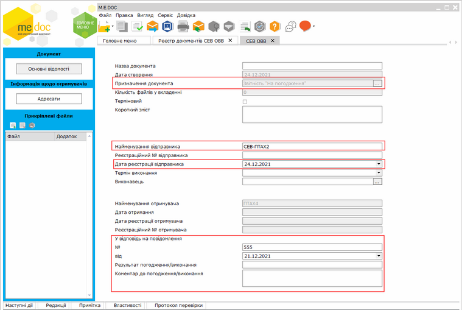

Натисніть, щоб збільшити малюнок

У блоці Адресати:

- Найменування - значення заповнюється з поля Найменування відправника вхідного документа, на основі якого створено відповідь;
-  ЄДРПОУ - значення заповнюється з картки контрагента.

3. Заповніть інші поля, та, за потреби, додайте вкладення, як описано у розділі [Створення нового документа](#ucsevovvrst-sev_ovv_stvor).

4. Збережіть документ, одним із способів:

- натиснувши кнопку  ;
- натиснувши комбінацію клавіш Ctrl+S;
- обравши пункт головного меню Файл - Зберегти.

Збережений документ буде відображено у таблиці [Реєстру документів СЕВ ОВВ](#ucsevovvrst-sev_ovv_opis).

[До початку](#ucsevovvrst-sev_ovv_oprac)

### Друк документів у PDF

_Шлях у довідці: Додатково: UCSevOvvRst › Реєстр документів СЕВ ОВВ › Друк документів у PDF_

Дана функція дозволяє зберегти обрані документи на диску комп’ютера у файлах формату .pdf.

Для друку документів у PDF необхідно виділити потрібний документ пакета.
У Реєстрі документів СЕВ ОВВ реалізована можливість друку як одного файлу, так и групи файлів одночасно. Для групового друку документів виділіть потрібні звіти пакета курсором миші, утримуючи клавішу <Shift> або <Ctrl>.

Для друку документів у PDF:

1. Оберіть один із способів:

- із контекстного меню команда Друк в PDF;
- команда меню Файл - Друк в PDF.

2. У вікні Огляд папок вкажіть каталог, у якому потрібно зберегти файли .pdf.

3. Система повідомить про закінчення операції друку.

Також функція друку документа  у PDF доступна і у відкритому вікні документа: команда меню Файл - Друк в PDF. Із вікна відкритого документа у форматі PDF зберігається тільки поточний документ.

У форматі .pdf зберігається як Документ СЕВ ОВВ, та вкладення до нього. Файли зберігаються у окремій папці, назва якої відповідає шаблону: СЕВ ОВВ від <дата створення документа> (n), де n - порядковий номер документа, що був збережений у форматі .pdf .


