[← Зміст довідки](../)


# Співробітники

### Співробітники

_Шлях у довідці: Розділи програми › Довідники › Співробітники_

В цьому розділі:

[Створення та заповнення картки співробітника](#ucsharepers-sprperson)

[Створення та заповнення картки пайовика](#ucsharepers-sprperson)

[Створення та заповнення картки іншої особи](#ucsharepers-sprperson)

[Експорт реєстру співробітників/пайовиків](#ucsharepers-sprperson)

[Імпорт реєстру співробітників/пайовиків](#ucsharepers-sprperson)

[Групове заповнення полів](#ucsharepers-sprperson)

Довідник Співробітники містить інформацію про працівників та пайовиків підприємства. Даними із цього довідника автоматично заповнюються деякі звітні форми, зокрема 1-ДФ, документи персоніфікованого обліку, тощо.

Дані про співробітників та пайовиків вносяться у однойменних розділах довідника - Співробітники, Пайовики та Інші. Ці розділи присутні у системі за замовчуванням. У довіднику Співробітники неможливо видаляти чи створювати розділи.

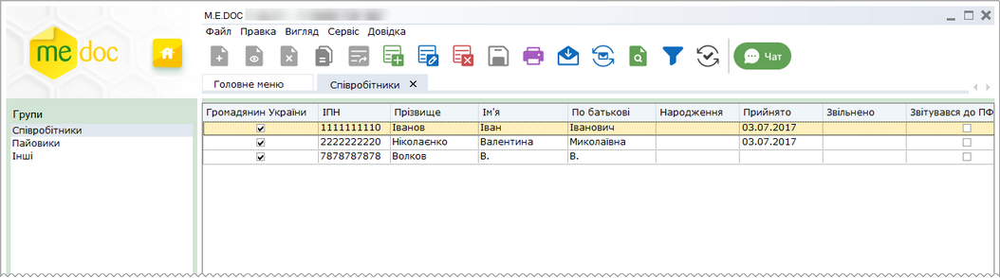

Натисніть, щоб збільшити малюнок

Модуль побудований у вигляді таблиці, окремий рядок якої відображає коротку інформацію про кожну особу. Переглянути більш повну інформацію про особу можна у окремому вікні, яке відкривається подвійним кліком по потрібному запису.

Дані кожного співробітника та пайовика заповнюються у відповідній картці, безпосередньо користувачем програмного комплексу. Також передбачено імпорт даних із відповідних файлів, створених у інших бухгалтерських системах, наприклад, імпорт документів персоніфікованої звітності. Наразі імпорт можливий тільки з dbf-файлів.

У модулі також передбачена функція експорту реєстру співробітників та пайовиків у спеціальний файл.

Створення та заповнення картки співробітника

1. Оберіть розділ Співробітники. На панелі інструментів виберіть команду Створити, або натисніть комбінацію клавіш Ctrl+I.

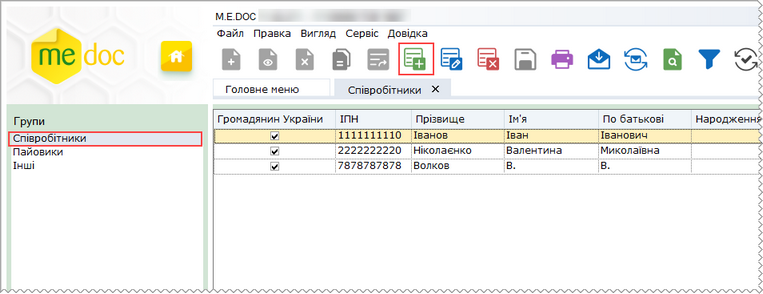

Натисніть, щоб збільшити малюнок

2. Відкриється вікно Фізична особа. Заповніть запропоновані поля форми. Поля, що підсвічені жовтим кольором, є обов'язковими для заповнення.

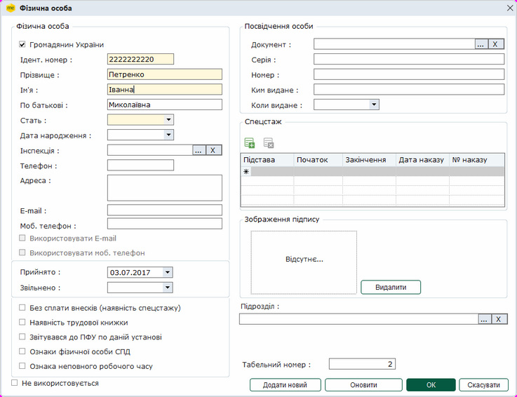

Натисніть, щоб збільшити малюнок

- поля Ідент. номер, Прізвище, Ім'я, По батькові, Телефон, Адреса, E-mail, Моб. телефон, Номер, Ким видане, Серія, Табельний номер заповніть вручну з клавіатури;

У випадку, якщо співробітник відмовився від отримання реєстраційного номера облікової картки платника податків, у полі Ідент. номер можна зберігати  значення номеру ID-картки співробітника.

- у полі Документ натисніть кнопку  та із підключеного довідника Посвідчення особи оберіть вид документа, що використовується. Якщо обрано вид документа ID-паспорт, у блоці Посвідчення особи відображається поле Запис №, у якому зазначається унікального номера запису в Єдиному державному демографічному реєстрі, що зазначений у ID-картці співробітника:

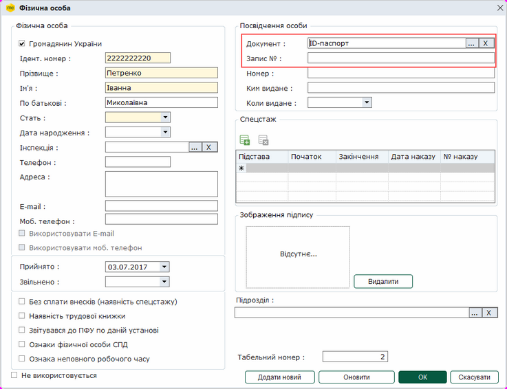

Натисніть, щоб збільшити малюнок

- поля Інспекція, Документ, Підрозділ, Сертифікат співробітника заповніть із підключених довідників, скориставшись кнопкою ;
- поля Дата народження, Прийнято, Звільнено, Коли видано заповніть із календаря;
- у полях Громадянин України, Без сплати внесків, Наявність трудової книжки, Ознака фізичної особи СПД, Використовувати Е-mail  проставляється відмітка при наявності даних ознак у співробітника.
       Позначка у полі Використовувати моб. телефон проставляється за умови, що у звітні документи потрібно підтягувати саме мобільний телефон даної особи;

- ознака Звітувався до ПФУ по даній установі встановлюється для тих співробітників, дані яких подавались у ПФУ у попередньому звітному періоді. Ця позначка призначена для того, щоб форма (СП) Список осіб системи персоніфікованого обліку включала лише записи нових співробітників підприємства та тих, у яких змінились дані у поточному звітному періоді;
- Дану відмітку також можна встановити і у Реєстрі співробітників.

Для встановлення відмітки з реєстру співробітників, у таблиці необхідно виділити потрібні записи та із контекстного меню обрати функцію Встановити відмітку "Звітувався до ПФУ", або за потреби Зняти відмітку.

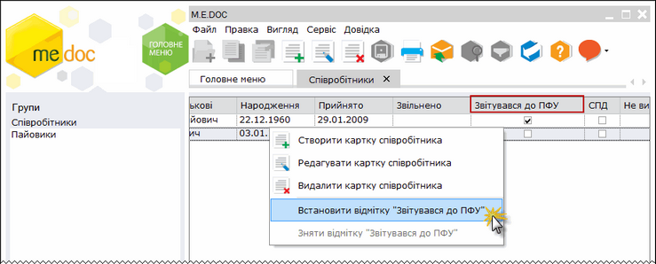

Натисніть, щоб збільшити малюнок

- позначка у полі Не використовується проставляється у тому випадку, якщо дані співробітника не потрібно використовувати при формуванні звітності, не видаляючи картку співробітника (наприклад, при звільненні).

3.  Також передбачено внесення спецстажу робітника. Щоб додати спецстаж, натисніть лівою клавішею миші кнопку Додати у області Спецстаж:

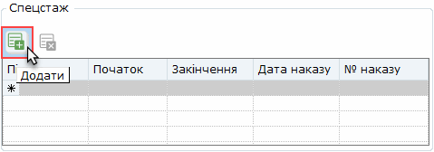

У доданому рядку, у колонці Підстава, натисніть кнопку . Відкриється вікно довідника Підстави для пільг страхувальника. Оберіть необхідну підставу, та натисніть Вибрати.

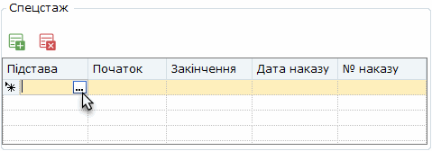

У колонках Початок, Закінчення, Дата наказу оберіть відповідні дати у календарі.

У колонці № наказу, введіть номер наказу за допомогою клавіатури.

2.8. Для того, щоб додати зображення підпису співробітника натисніть двічі лівою клавішею миші по порожньому полю:

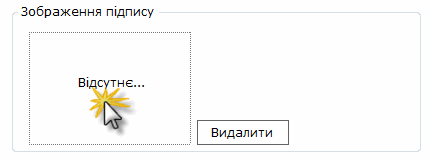

Відкриється вікно Оберіть файл зображення для імпорту... , де вкажіть шлях до розміщення попередньо зісканованого зображення підпису особи. Оберіть потрібний файл та натисніть Відкрити.

Наступним кроком є налаштування зображення підпису. Перемістіть рамку в потрібне місце та вкажіть межі зразка підпису за допомогою курсора миші. Для продовження натисніть кнопку ОК.

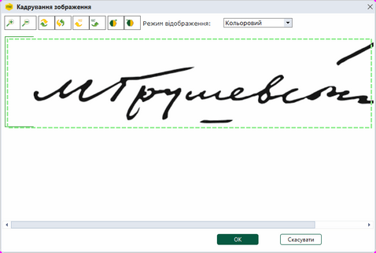

Натисніть, щоб збільшити їмалюнок

Зразок підпису додано. При підписанні співробітником документів за допомогою ЕП, у документах буде відображено зразок підпису.

3. Для збереження даних натисніть кнопку ОК. Для відміни внесених даних натисніть Відміна.
Для того, щоб не виходячи у реєстр створити нову картку співробітника, натисніть Додати новий.
Кнопка Оновити використовується для синхронізації даних у річній персоніфікації (Форма "Індивідуальні відомості (ІН ДАНІ)").

В списку співробітників підприємства також доступні наступні функції:

|  |  |  |
| --- | --- | --- |
|  | Видалити картку співробітника  (Ctrl+Y) | Дозволяє безповоротно вилучити запис. |
|  | Редагувати картку співробітника  (F2) | Редагування даних в разі необхідності. |

[До початку](#ucsharepers-sprperson)

Створення та заповнення картки пайовика

1. Оберіть розділ Пайовики. На панелі інструментів натисніть кнопку Створити, або натисніть комбінацію клавіш Ctrl+I.

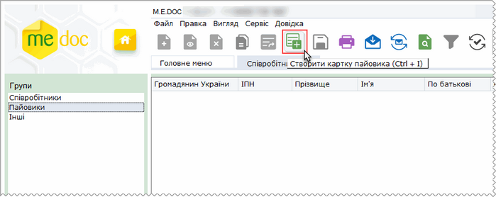

Натисніть, щоб збільшити їмалюнок

2. Відкриється вікно Пайовик. Заповніть запропоновані поля форми. Поля, що підсвічені жовтим кольором, є обов'язковими для заповнення.

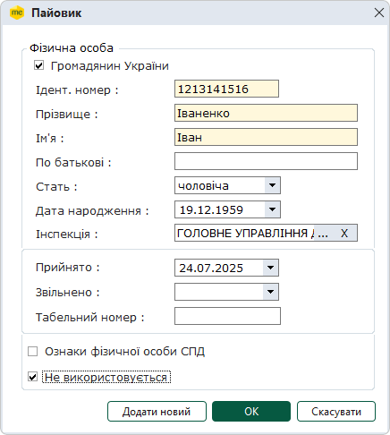

- поля Ідент. номер, Прізвище, Ім'я, По батькові, Табельний номер заповніть вручну з клавіатури;
- поле Інспекція заповніть із підключеного довідника, скориставшись кнопкою ;
- поля Дата народження, Прийнято, Звільнено заповніть із календаря;
- значення поля Стать оберіть зі списку;
- у полі Ознака фізичної особи СПД встановіть галочку при наявності даної ознаки у співробітника;
- позначка у полі Не використовується проставляється у тому випадку, якщо дані пайовика не потрібно використовувати при формуванні звітності, не видаляючи картку пайовика.

Для збереження даних натисніть кнопку ОК. Для відміни внесених даних натисніть Відміна.
Для того, щоб не виходячи у реєстр створити нову картку пайовика, натисніть Додати.

В списку пайовиків підприємства також доступні наступні функції:

|  |  |  |
| --- | --- | --- |
|  | Видалити картку (Ctrl+Y) | Дозволяє безповоротно вилучити запис. |
|  | Редагувати картку (F2) | Редагування даних в разі необхідності. |

[До початку](#ucsharepers-sprperson)

Створення та заповнення картки іншої особи

1. Оберіть розділ Інші. На панелі інструментів натисніть кнопку Створити, або натисніть комбінацію клавіш Ctrl+I.

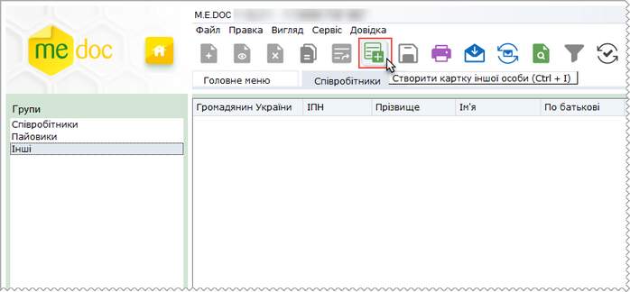

Натисніть, щоб збільшити їмалюнок

2. Відкриється вікно Інша особа. Заповніть запропоновані поля форми. Поля, що підсвічені жовтим кольором, є обов'язковими для заповнення.

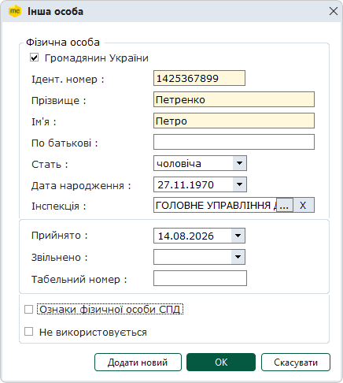

- поля Ідент. номер, Прізвище, Ім'я, По батькові, Табельний номер заповніть вручну з клавіатури;
- поле Інспекція заповніть із підключеного довідника, скориставшись кнопкою ;
- поля Дата народження, Прийнято, Звільнено заповніть із календаря;
- значення поля Стать оберіть зі списку;
- у полі Ознака фізичної особи СПД встановіть галочку при наявності даної ознаки у співробітника;
- позначка у полі Не використовується проставляється у тому випадку, якщо дані пайовика не потрібно використовувати при формуванні звітності, не видаляючи картку пайовика.

Для збереження даних натисніть кнопку ОК. Для відміни внесених даних натисніть Відміна.
Для того, щоб не виходячи у реєстр створити нову картку пайовика, натисніть Додати.

Експорт реєстру

Функція експорту реєстру співробітників/пайовиків призначена для вивантаження та збереження файлу із даними про осіб у каталог поза програмним комплексом.

Вивантажені данні зберігаються у форматі \*.dbf.

Щоб експортувати реєстр у файл, оберіть потрібний розділ: Співробітники, Пайовики або Інші, та виконайте команду Експорт в меню Файл.

Відкриється вікно Експорт даних.

Встановіть позначку, що відповідає бажаному кодуванню даних та формату DBF-файлу. Оберіть каталог, у якому необхідно зберегти експортовані дані, для цього натисніть кнопку Вибрати. Відкриється вікно Огляд папок, у якому вкажіть каталог для збереження даних.

Натисніть ОК для початку експорту.

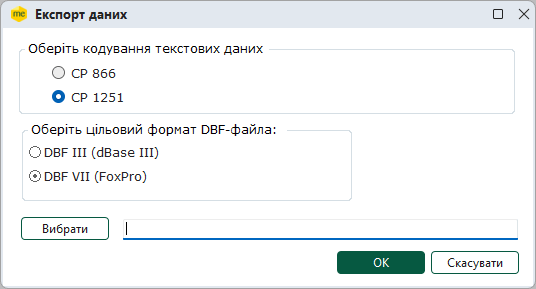

При експорті дані розбиваються на дві групи:
 - перелік співробітників у файл PERSONS.DBF;
 - спецстаж співробітників у файл PERSEXP.DBF (при наявності).

По закінченню процедури, система виведе результати експорту, де буде вказано шлях до розміщення файлу експорту та його назву.

[До початку](#ucsharepers-sprperson)

Імпорт реєстру

Довідник може бути створений автоматично шляхом перенесення даних із файлу з розширенням \*.dbf. Для цього призначена функція імпорту.

Примітка:

Опис структури DBF для імпорту файлів у програму міститься у документі з назвою "Структура файлу DBF для довідника Співробітники.doc", який знаходиться у каталозі встановлення програми ...help\manuals.

Оберіть потрібний розділ: Співробітники, Пайовики або Інші та виконайте команду Імпорт в меню Файл.

Відкривається вікно Імпорт. Вигляд вікна імпорту залежить від того, дані якого розділу імпортуються:

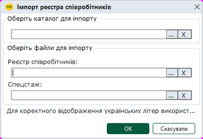

Натисніть, щоб збільшити їмалюнок
Вікно Імпорт при імпорті реєстру Співробітники

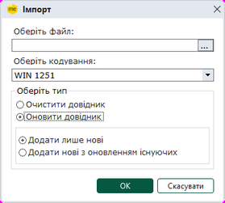

Натисніть, щоб збільшити їмалюнок
Вікно Імпорт при імпорті реєстру Пайовики або Інші

Якщо виконується імпорт даних реєстру Співробітники:

1. У полі Оберіть каталог для імпорту вкажіть шлях до каталогу розміщення dbf-файлів реєстру співробітників.

2. У полях Реєстр співробітників та Спецстаж автоматично відобразяться назви відповідних dbf-файлів, що містять дані про перелік співробітників, та спецстаж співробітників.

Якщо дані збережені з іменем, що відрізняється від встановленого у програмі за замовчуванням, можливо обрати dbf-файли, натиснувши кнопку  у відповідному полі.

3. Натисніть ОК для початку процесу імпорту.

Кнопка Відмінити скасовує режим імпорту.

Якщо імпортуються дані реєстру Пайовики або Інші:

1. У полі Оберіть файл вкажіть шлях до каталогу розміщення dbf-файлів.

2. У полі Оберіть файл вкажіть шлях до каталогу розміщення dbf-файлів.

3. У полі Оберіть кодування вкажіть кодування даних, що застосовано у dbf-файлі.

4. Встановіть опцію, що відповідаю режиму імпортування даних:

- Очистити довідник - дані, що містяться у довіднику, буде видалено, після чого у довідник будуть записані лише імпортовані дані;
- Оновити довідник - дані, що містяться у довіднику програми, будуть збережені, імпортовані дані будуть додані до вже існуючих.

5. Оберіть опцію, що визначає як зберегти дані у реєстрі (доступно при встановленні опції Оновити довідник). В залежності від обраної опції, під час імпорту виконується контроль дублювання даних:

- Додати нові з оновленням існуючих - якщо імпортоване значення ІПН вже існує у довіднику, виконується оновлення даних особи;
- Додати лише нові - якщо імпортоване значення ІПН вже існує у довіднику, дані особи не імпортуються.

Також виконується контроль на обов’язкове заповнення полів: ІПН, Прізвище, Ім’я. Якщо одне з цих полів не заповнено, дані не імпортуються.

6. Натисніть ОК для початку процесу імпорту.

Кнопка Відмінити скасовує режим імпорту.

7. По закінченні процедури, система виведе протокол імпорту даних.

[До початку](#ucsharepers-sprperson)

Групове заповнення полів

1. Якщо заміну треба виконати лише по окремим записам, виділіть записи, в яких буде виконана заміна даних.

2. У меню Правка оберіть пункт Групова заміна полів.

3. У вікні Групова заміна встановіть потрібні опції:

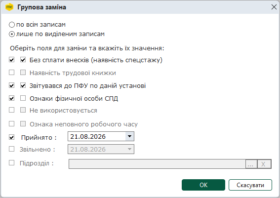

- по всім записам
встановіть ознаку, якщо потрібно змінити значення полів у всіх записах довідника;

- лише по виділеним записам
встановіть ознаку, якщо потрібно змінити значення полів у попередньо обраних записах.

4. Оберіть поля, значення яких потрібно змінити. Для цього встановіть галочки в першій колонці. Обрані поля стануть доступними для вибору значення.

5. Оберіть значення полів, на які буде проведена заміна. Для цього:

- встановіть галочку в другій колонці для зазначення наявності або відсутності ознаки;
або

- оберіть дату з календаря
або

- оберіть значення з довідника, натиснувши на кнопку .

6. Натисніть на кнопку ОК.

[До початку](#ucsharepers-sprperson)

## Встановлення відмітки "Звітувався до ПФУ" з реєстру співробітників

_Шлях у довідці: Співробітники › (поза змістом)_

Для встановлення відмітки з реєстру співробітників, у таблиці необхідно виділити потрібні записи та із контекстного меню обрати функцію Встановити відмітку "Звітувався до ПФУ" або за потреби Зняти відмітку. Результатом буде наявність галочки у стовпчику "Звітувався до ПФУ".

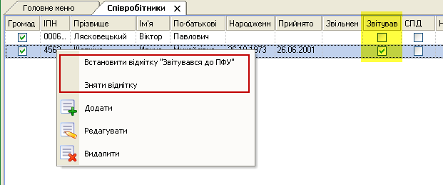

[Назад](#ucsharepers-sprperson)


