[← Зміст довідки](../)


# Реєстр документів довільних форматів

## Реєстр документів довільних форматів

_Шлях у довідці: Розділи програми › Первинні документи › Реєстр документів довільних форматів_

В цьому розділі:

[Створення папок документів](#ucsignfile-ucsignfile)

[Завантаження файлів](#ucsignfile-ucsignfile)

[Підписання файлів](#ucsignfile-ucsignfile)

[Підписання файлів у форматі P7S](#ucsignfile-ucsignfile)

[Збереження документа, підписаного у форматі .p7s](#ucsignfile-ucsignfile)

[Завантаження документа, підписаного у форматі .p7s](#ucsignfile-ucsignfile)

[Відправлення файлів](#ucsignfile-ucsignfile)

[Зашифрувати та зберегти](#ucsignfile-ucsignfile)

[Збереження документів довільного формату](#ucsignfile-ucsignfile)

[Прийом документів довільного підписання](#ucsignfile-ucsignfile)

Модуль призначений для підписання Електронним підписом (ЕП) та відправки засобами електронної пошти на довільні електронні адреси документи будь-яких форматів.

У розділі ви маєте можливість:

- здійснювати підписання ЕП документів, що зберігаються у будь-якому (довільному) форматі (doc, docx, rtf, pdf, tif, jpeg, flac, mkv тощо);
- здійснювати відправку цих документів;
- завантажувати та зберігати документи довільного формату;
- організувати зручну ієрархічну систему зберігання документів: зберігати документи як окремо, так і об’єднувати їх за змістом, напрямком або призначенням у пачки та групи;
- отримувати довільні документи від контрагентів по електронній пошті.

У розділі передбачена можливість завантажувати в програмний комплекс як один файл так і групу файлів.

Зліва розташована панель Каталог документів, що дозволяє створювати ієрархічну структуру папок.

У каталог документів окремо виведено папку Вхідні, в якій розміщуються всі документи, що надійшли по електронній пошті. Папка Вхідні заблокована від видалення.

При виборі кореневої папки Каталог документів у реєстрі відображається перелік документів, що містяться у всіх підкаталогах модуля.

Для оновлення записів реєстру (наприклад, після прийому вхідних повідомлень) натисніть кнопку  на панелі інструментів, або виконайте команду  головного меню Вигляд - Оновити реєстр.

Праворуч розміщено пачки документів.

Праворуч у нижній частині вікна – документи, що входять в обрану пачку.

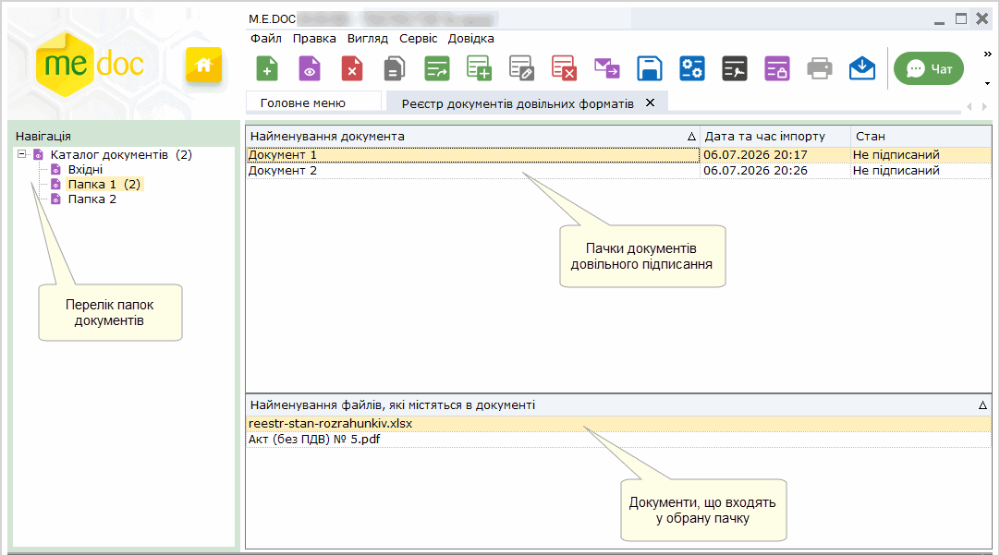

Створення папок документів

Перш ніж додати нові документи необхідно створити групу, якій вони будуть зберігатися:

1. На панелі інструментів виберіть команду Створити папку, або натисніть комбінацію клавіш Ctrl+N.

Для створення підгрупи, виділіть рядок головної групи, у яку буде додаватись розділ.

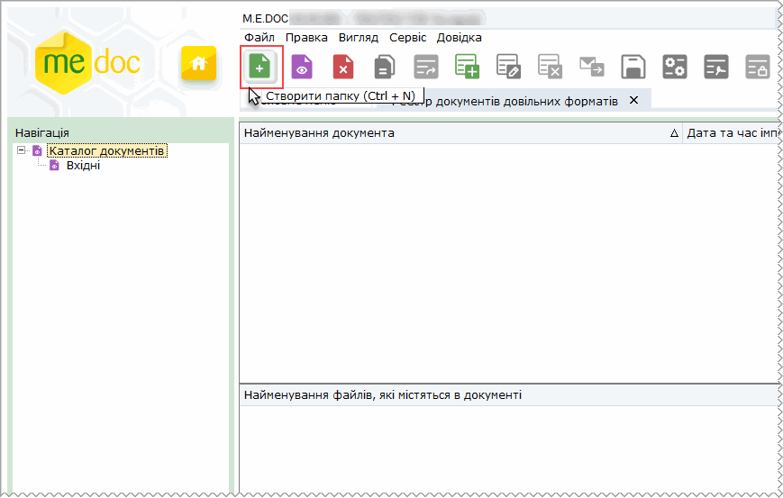

2. Відкриється вікно Створення папки. Введіть назву папки та натисніть кнопку ОК.

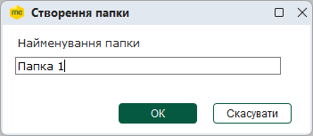

3. Назва нової групи відобразиться на навігаційній панелі.

В списку груп документів доступні функції:

|  |  |
| --- | --- |
| Видалити папку | Дозволяє безповоротно вилучити запис.  УВАГА!   При видаленні групи безповоротно видаляється увесь її вміст - всі підпорядковані їй записи документів довільного підписання. |
| Редагувати папку | Редагування даних. |

[До початку](#ucsignfile-ucsignfile)

Завантаження файлів

1. Для того, щоб додати файл у модуль скористайтесь одним із наступних способів:

- на панелі інструментів натисніть кнопку Створити документ;
- виберіть команду Файл - Створити документ;
- у контекстному меню оберіть команду Створити документ;
- натисніть комбінацію клавіш Ctrl+I.

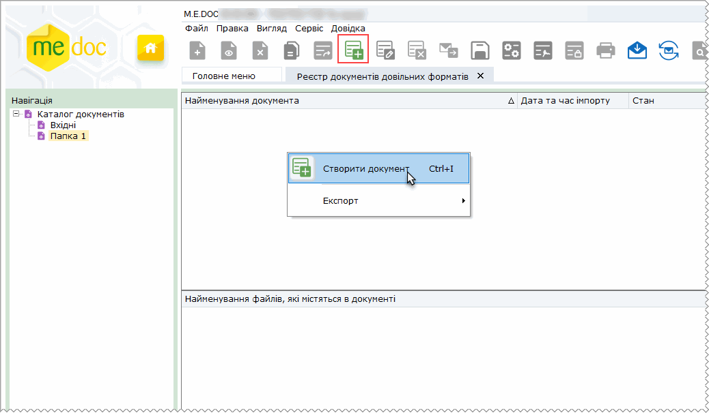

2. Відкриється вікно Відкриття файлу. Оберіть каталог, де розташовано потрібний файл або група файлів.

Виділити цей файл (групу файлів) курсором миші та натиснути кнопку Відкрити.

3. Вкажіть назву пачки документів, під якою документ(и) проімпортуються у базу даних.

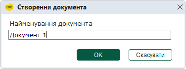

4. По закінченні процедури, система виведе протокол імпорту даних.

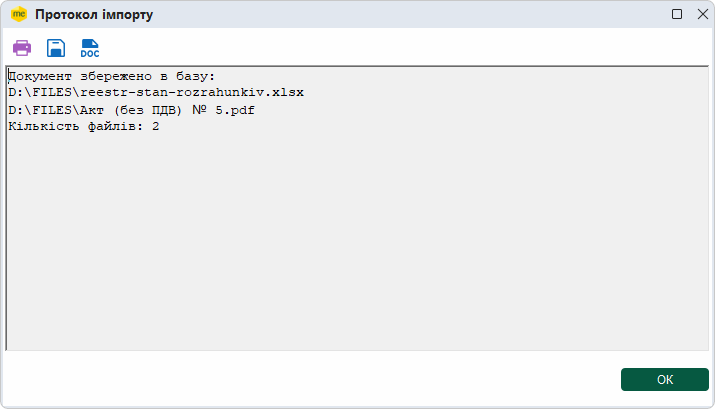

[До початку](#ucsignfile-ucsignfile)

Переміщення документів між папками

Для переміщення виділіть потрібну пачку документів (або декілька пачок документів) та скористайтесь одним із наступних способів:

- на панелі інструментів натисніть кнопку Перемістити;
- виберіть команду Файл - Перемістити;
- у контекстному меню оберіть команду Перемістити.

Щоб обрати кілька пачок документів, натискайте на рядках пачок документів курсором миші, утримуючі клавіші <Ctrl> або <Shift>.

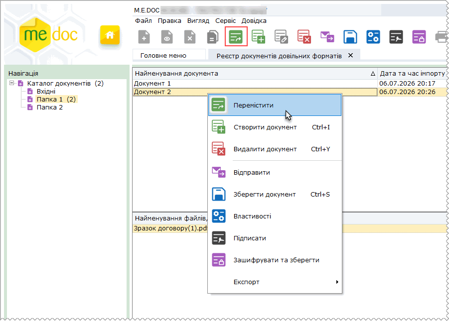

Оберіть каталог, в який потрібно перемістити документ та натисніть ОК.

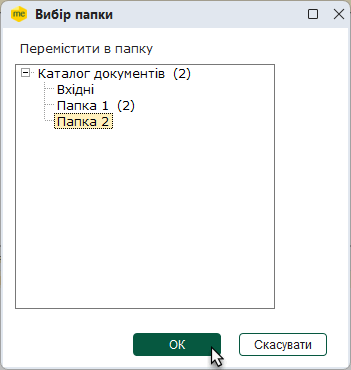

Пачку документів буде переміщено у вказаний каталог.

Якщо для переміщення обрано кілька пачок документів, у обраний каталог будуть переміщені всі обрані пачки.

[До початку](#ucsignfile-ucsignfile)

Підписання файлів

Виділіть потрібну пачку документів (або декілька пачок документів) та скористайтесь одним із наступних способів:

- на панелі інструментів натисніть кнопку Підписати;
- виберіть команду Файл - Підписати;
- у контекстному меню оберіть команду Підписати.

Щоб обрати кілька пачок документів, натискайте на рядках пачок документів курсором миші, утримуючі клавіші <Ctrl> або <Shift>.

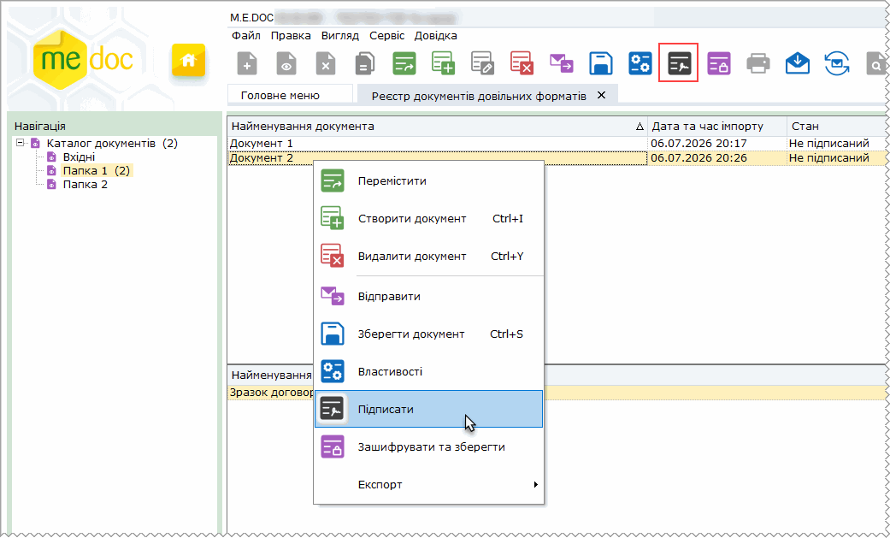

У вікні Підпис оберіть будь-який із доступних ЕП, вкажіть каталог розміщення секретних ключів та введіть пароль секретного ключа. Натисніть ОК.

Документ набуде стану Підписаний.

Якщо для підписання виділено кілька документів, ЕП будуть підписані всі обрані пачки документів.

Зверніть увагу! Пачки документів можливо підписати декілька разів, наприклад, печаткою установи, підписом директора та підписом головного бухгалтера. Кількість підписів, що може бути накладена на пачку документів, необмежена.

При підписанні ЕП накладаються на кожен документ, що міститься у пачці.

Щоб переглянути інформацію про підписи, оберіть документ або пачку документів у списку та натисніть кнопку панелі інструментів , або натисніть праву кнопку миші та оберіть з контекстного меню команду Властивості.

[До початку](#ucsignfile-ucsignfile)

Підписання файлів у форматі P7S

Для підписання документів у форматі .P7S, виконайте послідовність дій:

1. Оберіть команду меню Сервіс та встановіть відмітку Підписання у форматі .р7s. Програма запам'ятовує виконані налаштування, позначка зберігається встановленою при наступних сеансах роботи з програмою.

Якщо використовувати підписання документів у форматі .P7S непотрібно, видаліть позначку Підписання у форматі .р7s.

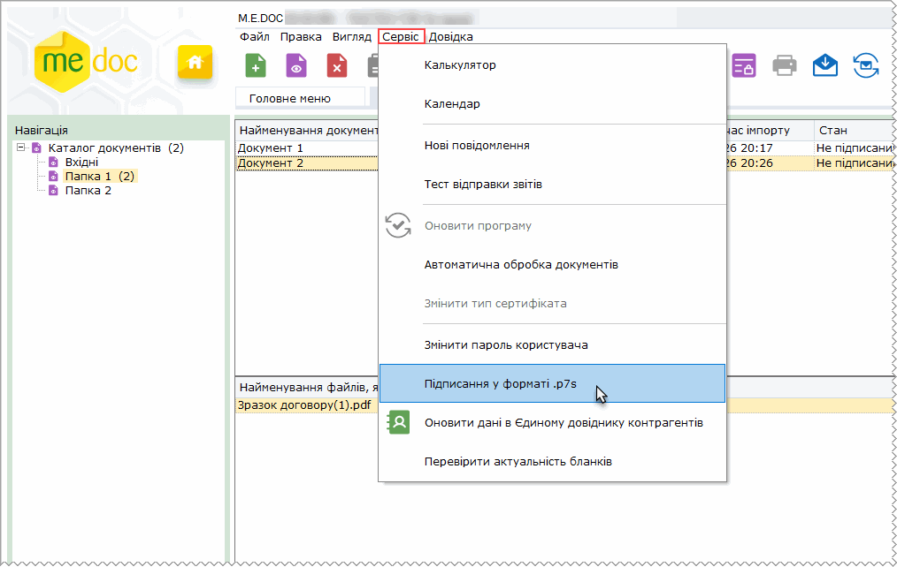

2.[Завантажте](#ucsignfile-ucsignfile) файли, які необхідно підписати у форматі .р7s.

3. Для того, щоб підписати документ(и), виділіть потрібну пачку (пачки) документів та скористайтесь одним із наступних способів:

- на панелі інструментів натисніть кнопку Підписати;
- виберіть команду Файл - Підписати;
- у контекстному меню оберіть команду Підписати.

Щоб обрати кілька пачок документів, натискайте на рядках пачок документів курсором миші, утримуючі клавіші <Ctrl> або <Shift>.

4. У вікні Підпис оберіть будь-який із доступних ЕП, вкажіть каталог розміщення секретних ключів та введіть пароль секретного ключа. Натисніть ОК.

5. У вікні розділу стан підписаного документа зміниться на Підписаний.

При кожному підписанні формується окремий файл-підпис. Початковий файл документа залишається незмінним.

Зверніть увагу! Документ можливо підписати декілька разів, наприклад, печаткою установи, підписом директора та підписом головного бухгалтера.

Для перевірки сертифікатів, якими був підписаний документ, оберіть документ у списку (або пачку документів) та натисніть кнопку панелі інструментів , або натисніть праву кнопку миші на рядку документа чи пачки документа та оберіть з контекстного меню команду Властивості. Відкриється вікно Властивості, що містить інформацію про використані сертифікати. Натисніть кнопку Перевірити. Відкриється вікно протоколу перевірки сертифіката.

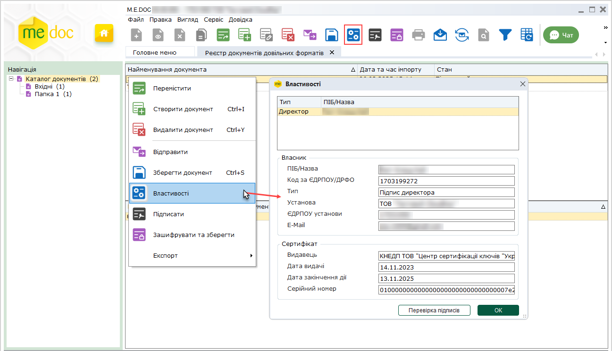

[До початку](#ucsignfile-ucsignfile)

Збереження документа, підписаного у форматі .p7s

Для збереження пачки документів виконайте дії:

1. Виділіть потрібну пачку або декілька пачок документів та скористайтесь одним із наступних способів:

- на панелі інструментів натисніть кнопку ;
- виберіть команду Файл - Зберегти документ;
- у контекстному меню оберіть команду Зберегти документ;
- натисніть комбінацію клавіш Ctrl+S.

Щоб обрати кілька пачок документів, натискайте на рядках пачок документів курсором миші, утримуючі клавіші <Ctrl> або <Shift>.

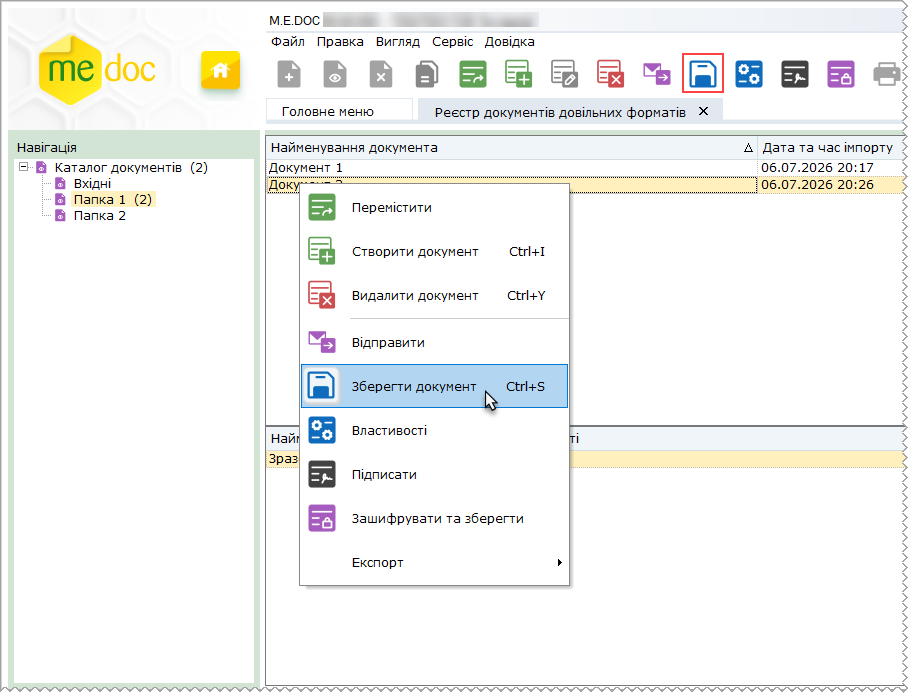

2. У вікні Огляд папок оберіть каталог, в якому потрібно зберегти документи та натисніть кнопку ОК.

3. Якщо документи підписані ЕП, відкриється вікно повідомлення. Якщо потрібно зберегти файли підписаними, натисніть кнопку Так.

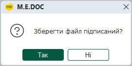

4. Відкриється протокол збереження файлів.

Документ разом зі всіма підписами зберігається у окремому каталозі. Ім'я каталогу збігається з ім'ям пачки, у якій знаходився документ, це ім'я зазначене у колонці Найменування документа. Підписи зберігаються у окремих файлах з розширенням .p7s. Ім'я файлу підпису має формат: <ім’я файлу документа>.<розширення файлу документа>.(N).p7s, де N – номер підпису.

[До початку](#ucsignfile-ucsignfile)

Завантаження документа, підписаного у форматі .p7s

Для завантаження документа (документів) виконайте дії:

1. Скористайтеся одним із наступних способів:

- на панелі інструментів натисніть кнопку Створити документ;
- виберіть команду Файл - Створити документ;
- у контекстному меню оберіть команду Створити документ;
- натисніть комбінацію клавіш Ctrl+I.

2. Відкриється вікно Відкриття файлу. Оберіть каталог, де розташовано підписаний файл або група файлів.

Виділити цей файл (групу файлів) курсором миші та натиснути кнопку Відкрити.

3. Вкажіть назву пачки документів, під якою документ(и) проімпортуються у базу даних.

4. По закінченні процедури, система виведе протокол імпорту даних.

Завантажений документ у вікні модуля буде відображено зі статусом Підписаний.

[До початку](#ucsignfile-ucsignfile)

Відправлення файлів

Виділіть потрібну пачку документів (або декілька пачок) та скористайтесь одним із наступних способів:

- на панелі інструментів натисніть кнопку Відправити;
- виберіть команду Файл - Відправити;
- у контекстному меню оберіть команду Відправити.

Щоб обрати кілька пачок документів, натискайте на рядках пачок документів курсором миші, утримуючі клавіші <Ctrl> або <Shift>.

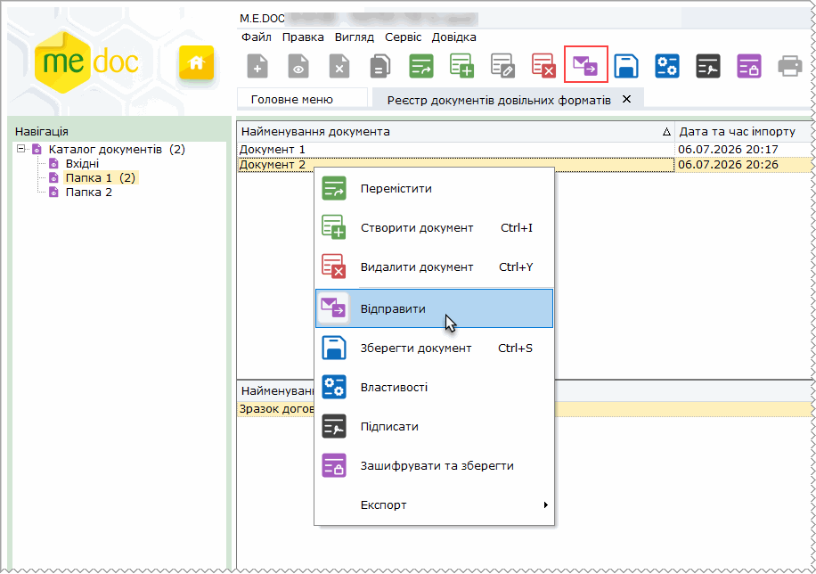

Відкриється вікно Вибір адресата. Оберіть адресу, на яку маєте намір відправити файл.

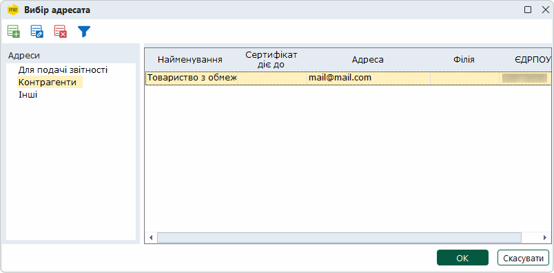

Відкриється вікно Дані листа:

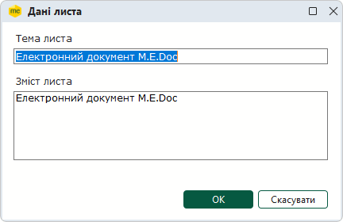

Заповніть тему та опишіть короткий зміст листа. За замовчуванням виводяться значення "Електронний документ M.E.Doc".

При відправленні на поштову скриньку ДПС документів, які не підлягають опрацюванню через "Єдине вікно", обов'язковою вимогою є чітка тема листа, наприклад: Заява щодо ліцензії на право зберігання пального.

Відправлені пачки документів набувають стану Відправлений. У нижній частині вікна з'являється вкладка Відправлено, на якій відображається інформація про одержувача, тему та зміст листа:

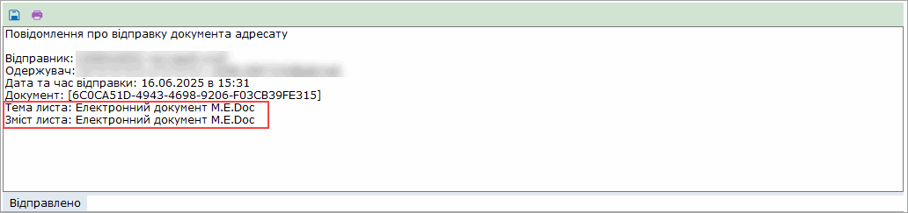

Вказані значення теми та змісту листа також відображаються у вхідній пошті отримувача:

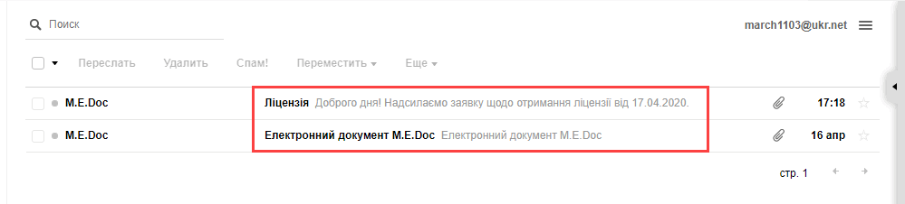

Коли адресат отримав документ, внизу вікна з'являється вкладка Доставлено.

[До початку](#ucsignfile-ucsignfile)

Зашифрувати та зберегти

Функція Зашифрувати та зберегти дозволяє підписати пачку документів довільним ЕП та зберегти на жорсткому диску комп'ютера.

Виділіть потрібну пачку та скористайтесь одним із наступних способів:

- на панелі інструментів натисніть кнопку Зашифрувати та зберегти;
- виберіть команду Файл - Зашифрувати та зберегти;
- у контекстному меню оберіть команду Зашифрувати та зберегти.

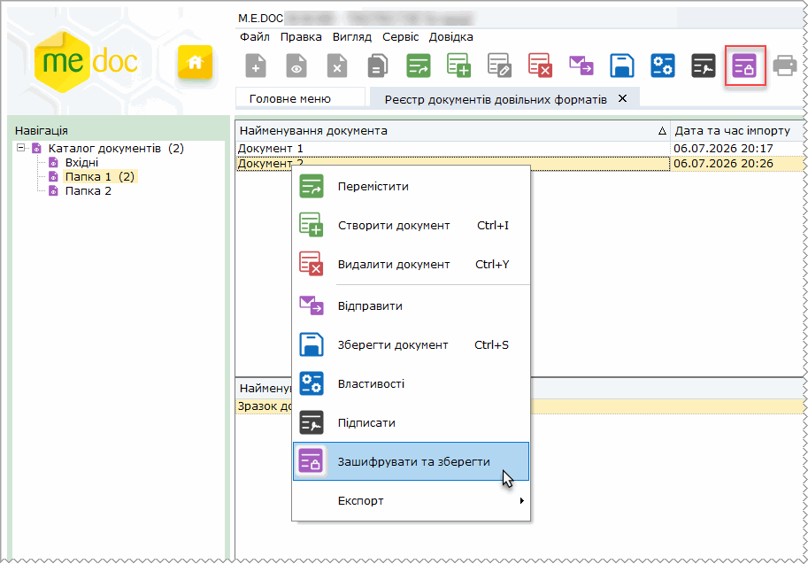

На виконання команди відкриється вікно Огляд папок. Вкажіть шлях, де зберегти файли, вкажіть адресата та підпишіть файл ЕП. У обраному каталозі будуть збережені всі файли документів, що містяться у виділених пачках.

[До початку](#ucsignfile-ucsignfile)

Збереження документів довільного формату

Виділіть потрібну пачку документів (або кілька пачок) та скористайтесь одним із наступних способів:

- на панелі інструментів натисніть кнопку Зберегти документ;
- виберіть команду Файл - Зберегти документ;
- у контекстному меню оберіть команду Зберегти документ.

Щоб обрати кілька пачок документів, натискайте на рядках пачок документів курсором миші, утримуючі клавіші <Ctrl> або <Shift>.

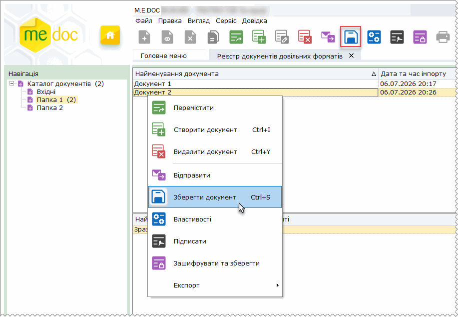

На виконання команди відкриється вікно Огляд папок. Вкажіть шлях, де зберегти файли та натисніть кнопку ОК.

Якщо документи підписані ЕП, відкриється вікно повідомлення. Якщо потрібно зберегти файли підписаними, натисніть кнопку Так.

По закінченні процедури, система виведе протокол збереження даних.

У разі, якщо каталог, у який зберігаються документи вже містить файл з таким самим іменем, до імені файлу, що зберігається, буде додано порядковий номер. У обраному каталозі будуть збережені всі файли документів, що містяться у виділених пачках.

[До початку](#ucsignfile-ucsignfile)

Прийом документів довільного формату

Відправлені електронною поштою документи довільного формату надходять як звичайна вхідна кореспонденція.

Отримані документи поміщаються у папку Вхідні, набувають стану Отриманий. Внизу вікна з'являється вкладка Отримано.

Як тільки документи отримано, відправнику надійде повідомлення про доставку.

[До початку](#ucsignfile-ucsignfile)


