[← Зміст довідки](../)


# Створення податкових накладних на основі чеків

## Створення податкових накладних на основі чеків

_Шлях у довідці: Розділи програми › Облік ПДВ › Створення податкових накладних на основі чеків_

В цьому розділі:

[Опис основних функціональних елементів інтерфейсу](#uctaxbasedoncheckrst-uctaxbasedoncheckrst_interface)

[Завантаження чеків з СОД РРО](#uctaxbasedoncheckrst-uctaxbasedoncheckrst_import)

[Перегляд даних чека](#uctaxbasedoncheckrst-uctaxbasedoncheckrst_import)

[Створення податкових накладних](#uctaxbasedoncheckrst-uctaxbasedoncheckrst_createpn)

[Cтворення Зведеної ПН на основі чеків](#uctaxbasedoncheckrst-uctaxbasedoncheckrst_createpn)

За допомогою модуля Створення податкових накладних на основі чеків можна завантажити чеки з СОД РРО та на основі завантажених чеків створити Податкові накладні.

Створені на основі завантажених чеків Податкові накладні можна зареєструвати в ДПС.

Для роботи у модулі потрібна ліцензія Створення податкових накладних на основі чеків.

У модулі доступні операції:

- [завантаження чеків з СОД РРО](#uctaxbasedoncheckrst-uctaxbasedoncheckrst_import);
- [збереження інформації про ГО та ПРРО на основі даних із завантажених чеків](#uctaxbasedoncheckrst-uctaxbasedoncheckrst_import);
- [перегляд основних даних чека](#uctaxbasedoncheckrst-uctaxbasedoncheckrst_import);
- [створення Податкових накладних на основі завантажених чеків](#uctaxbasedoncheckrst-uctaxbasedoncheckrst_createpn):

¾

створення ПН в рамках однієї ГО;

¾

створення ПН в рамках одного ПРРО;

¾

створення ПН в рамках різних ГО та ПРРО;

¾

створення ПН за день чи за обраний період;

¾

створення ПН на основі одного або кількох чеків.

- [створення Зведеної податкової накладної на основі завантажених чеків](#uctaxbasedoncheckrst-uctaxbasedoncheckrst_create-zpn).

### Опис основних функціональних елементів інтерфейсу

_Шлях у довідці: Розділи програми › Облік ПДВ › Створення податкових накладних на основі чеків › Опис основних функціональних елементів інтерфейсу_

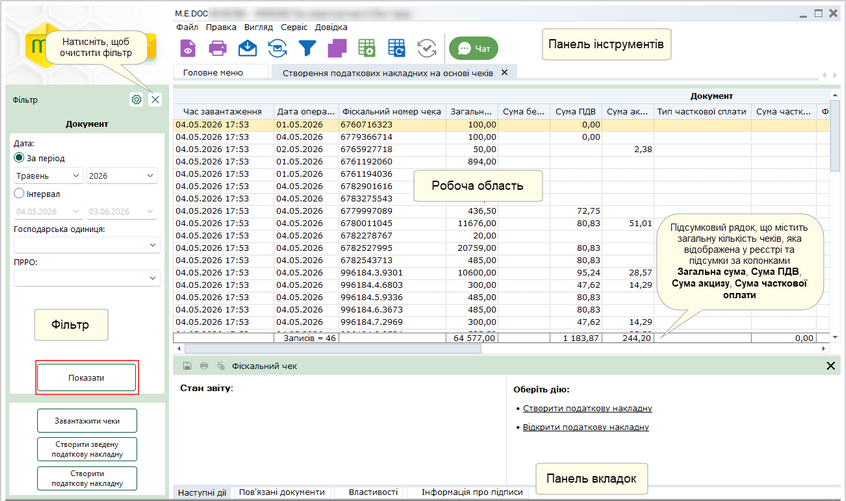

Натисніть, щоб збільшити малюнок

Фільтр

У Фільтрі зібрані атрибути чеків, за якими здійснюється їх пошук та сортування:

¾

За періодом та Інтервал - дозволяє обрати період часу, у який було зареєстровано чеки.

¾

Господарська одиниця - дозволяє знайти чеки за назвою господарської одиниці (ГО), обрати назву ГО можна із списку, що відкривається. Якщо обрано значення Всі - виконується пошук чеків для всіх ГО. Можна обрати кілька ГО одночасно.

¾

ПРРО - дозволяє знайти чеки за фіскальним номером ПРРО, які належать обраним ГО (поле Господарська одиниця). Можна обрати кілька ПРРО одночасно.

Для пошуку чеків оберіть потрібні параметри у відповідних полях та натисніть на кнопку Показати.

Робоча область

Містить записи, що відповідають заданим на панелі Фільтр параметрам.

Кожний рядок відображає дані по окремому чеку.

Для зручності можна групувати записи реєстру по колонках таблиці. Для цього оберіть команду меню Вигляд - Групування даних або натисніть на кнопку  на панелі інструментів.

Над реєстром з'явиться додаткова панель. Перетягніть на цю панель потрібні колонки.

Колонки таблиці реєстру поділені на 2 групи: Документ та ПРРО.

Група Документ містить колонки:

- Час завантаження - відображається дата та час завантаження чека;
- Дата операції - відображається дата і час здійснення розрахункової операції (дата реєстрації чека);
- Фіскальний номер чека;
- Загальна сума - містить загальну суму, сплачену по чеку (із врахуванням податків і зборів);
- Сума ПДВ - сума ПДВ в чеку;
- Сума без податків - сплачена сума без податків і зборів;
- Тип часткової сплати - містить один із типів сплати по чеку: Чергова сплата, Передплата, Остаточний розрахунок.
- Сума часткової сплати - сума часткової сплати по чеку;
- Фіскальний номер чека передплати;
- Форма оплати -  містить один із типів оплати по чеку: Готівка, Картка, Безготівкова, Кредит, Передоплата, Післяплата. Якщо в одному чеку присутні декілька видів оплат - відображається тип Комбінована;
- Податкова накладна - наявність податкової накладної для обраного чека: символ  означає, що за даними чека створено ПН, якщо колонка порожня – ПН не створювалась.

Група ПРРО містить колонки:

- Найменування точки продажу;
- Адреса точки продажу;
- Фіскальний номер ПРРО.

Панель вкладок

Службова інформація щодо обраного чека:

- Наступні дії – містить інформацію щодо поточного стану та перелік можливих дій. Слугує підказкою про доступні дії, які можна виконати з чеком у поточному стані.
- Властивості – містить всю службову інформацію про чек.

Панель інструментів

Містить кнопки, що надають швидкий доступ до найбільш часто використовуваних функцій. Наведіть покажчик миші на кнопку для відображення підказки щодо призначення кнопки.

### Завантаження чеків з СОД РР0

_Шлях у довідці: Розділи програми › Облік ПДВ › Створення податкових накладних на основі чеків › Завантаження чеків з СОД РР0_

1. Для завантаження чеків з СОД РРО натисніть на кнопку Завантажити чеки.

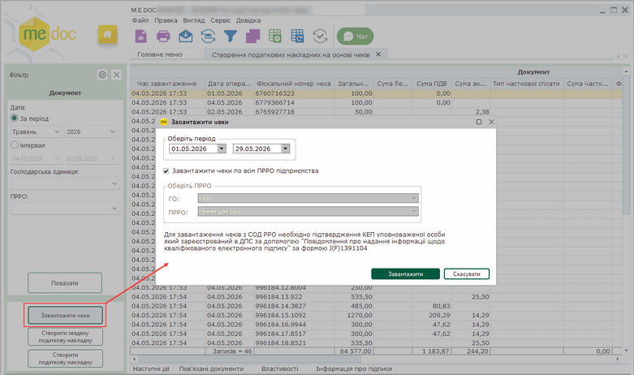

Натисніть, щоб збільшити малюнок

2. У вікні Завантажити чеки вкажіть період часу, за який потрібно отримати чеки (можна обрати період не більше 1 місяця), та натисніть Завантажити.

За замовчуванням встановлено опцію Завантажити чеки по всім ПРРО підприємства, тобто будуть завантажуватися чеки по всім ГО та ПРРО.

При завантаженні чеків у програмі зберігається інформація про ГО та ПРРО, що міститься у чеках. Зверніть увагу, при першому використанні модуля у програмі відсутні дані про ГО та ПРРО, тому перше завантаження чеків необхідно виконувати зі встановленою опцією Завантажити чеки по всім ПРРО підприємства.

Якщо потрібно імпортувати чеки з ГО та/або ПРРО, які ще не додані у програму (наприклад, зареєстровані нещодавно), активуйте відмітку Завантажити чеки по всім ПРРО підприємства та вкажіть період, в якому є зареєстровані чеки з цих ГО або ПРРО. Після завантаження чеків буде автоматично збережено дані про нові ГО та ПРРО.

Для завантаження чеків по окремих господарських одиницях та ПРРО (дані яких вже збережені у програмі) видаліть відмітку Завантажити чеки по всім ПРРО підприємства та у полях області Оберіть ПРРО оберіть назву ГО та фіскальний номер ПРРО, чеки з якого необхідно завантажити:

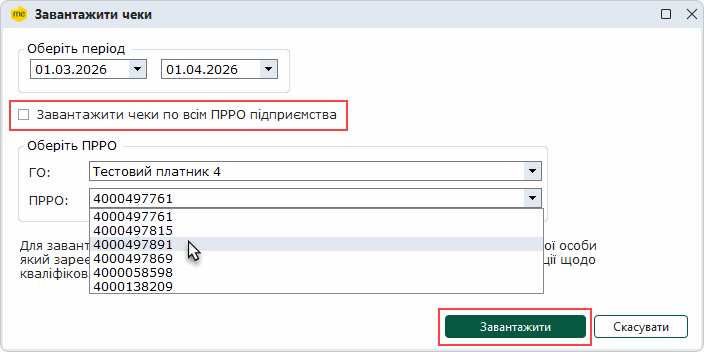

3. Буде сформовано запит на СОД РРО, який необхідно підписати сертифікатом відповідальної особи:

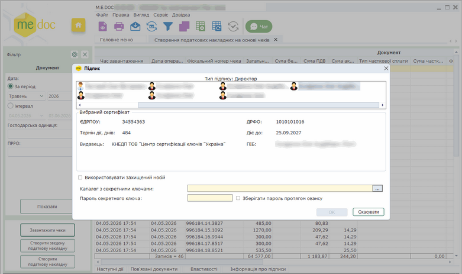

Натисніть, щоб збільшити малюнок

4. Після з'єднання з СОД РРО програма інформує користувача про отримання переліку чеків:

та про процес завантаження чеків:

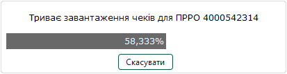

5. По завершенні імпорту відкриється Протокол завантаження чеків.

В Протоколі містяться дані про наявність чеків у обраному періоді та кількість завантажених чеків в розрізі ПРРО.

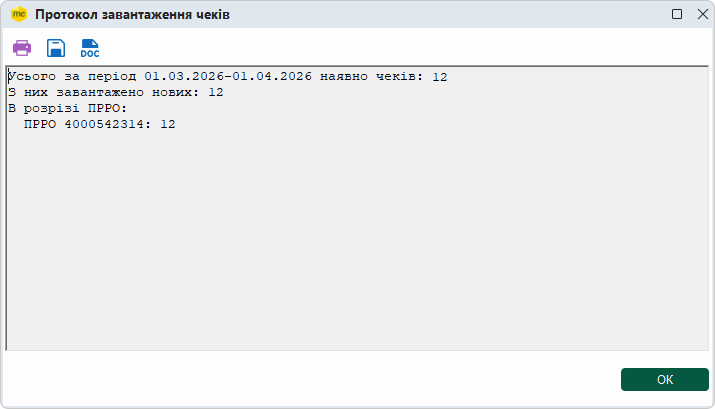

6. Рядки з інформацією про отримані чеки відображаються у реєстрі.

Для перегляду даних чека виділіть рядок чека у реєстрі та скористайтеся одним із способів:

- натисніть 2 рази лівою кнопкою миші на рядок чека;
- виконайте команду меню Файл - Відкрити;
- натисніть кнопку  на панелі інструментів модуля;
- виконайте команду контекстного меню Перегляд у вікні;
- натисніть комбінацію клавіш <Ctrl + F2>.

Відкриється вкладка обраного чека:

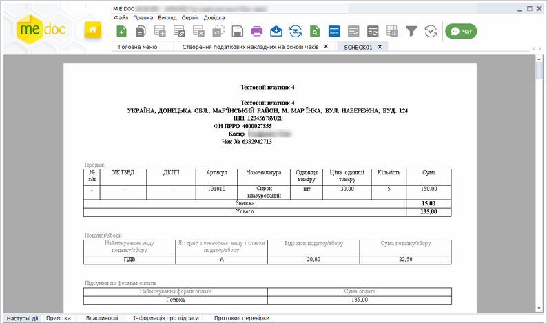

Натисніть, щоб збільшити малюнок

### Створення податкових накладних на основі завантажених чеків

_Шлях у довідці: Розділи програми › Облік ПДВ › Створення податкових накладних на основі чеків › Створення податкових накладних на основі завантажених чеків_

В цьому розділі:

[Створення ПН на основі групи чеків](#uctaxbasedoncheckrst-uctaxbasedoncheckrst_createpn)

[Створення ПН на основі обраних чеків](#uctaxbasedoncheckrst-uctaxbasedoncheckrst_createpn)

[Особливості створення ПН на основі даних чеків](#uctaxbasedoncheckrst-uctaxbasedoncheckrst_createpn)

[Створення ПН на основі чеків, що містять позиції зі ставкою податку 7%, 14%, 20%](#uctaxbasedoncheckrst-uctaxbasedoncheckrst_createpn)

[Створення ПН на основі чеків, товари у яких звільнені від оподаткування](#uctaxbasedoncheckrst-uctaxbasedoncheckrst_createpn)

[Відображення створених ПН у розділі Створення податкових накладних на основі чеків](#uctaxbasedoncheckrst-uctaxbasedoncheckrst_createpn)

На основі даних завантажених чеків у програмі можна створювати Податкові накладні за щоденними підсумками операцій з постачання товарів/послуг, оплата за які здійснена через ПРРО.

Передбачено 2 способи створення ПН:

- створення ПН на основі даних групи чеків для вказаних ГО та ПРРО за обраний день чи за обраний період;
- створення ПН на основі даних одного або кількох обраних чеків.

Якщо для створення ПН обрано чеки, що зареєстровані у різні дати, або обрано період реєстрації чеків, що містить декілька дат, дані обраних чеків автоматично об’єднуються у розрізі дати реєстрації чека, для кожної дати реєстрації створюється окрема Податкова накладна за щоденними підсумками операцій.

Про особливості створення та заповнення ПН дивіться у розділах:

- [Особливості створення ПН на основі даних чеків](#uctaxbasedoncheckrst-uctaxbasedoncheckrst_createpn);
- [Створення ПН на основі чеків, що містять позиції зі ставкою податку 7%, 14%, 20%](#uctaxbasedoncheckrst-uctaxbasedoncheckrst_createpn);
- [Створення ПН на основі чеків, товари у яких звільнені від оподаткування](#uctaxbasedoncheckrst-uctaxbasedoncheckrst_createpn).

Після створення ПН на основі чеків перевірте дані, що були автоматично заповнені, дозаповніть необхідні поля, після чого збережіть Податкову накладну. ПН зберігаються у модулі [Облік ПДВ - Реєстр податкових документів](UCDFDocsRst.html#ucdfdocsrst-pdocs_reestr).

Підписання та відправлення на реєстрацію в ЄРПН, отримання квитанцій виконуються за звичайною [процедурою обробки](UCDFDocsRst.html#ucdfdocsrst-pdocs_reestr) Податкової накладної.

Створення ПН на основі групи чеків

1. На панелі Фільтр оберіть параметри для відбору чеків, за якими потрібно створити ПН.

У полях Господарська одиниця та ПРРО оберіть назву (назви) ГО та фіскальні номери ПРРО. Встановіть дату операцій у полі Інтервал або оберіть період часу, у який реєструвалися чеки, у полі За період.

Натисніть на кнопку Показати. У реєстрі будуть відображені рядки чеків, що відповідають заданим параметрам.

2. У лівій частині вікна натисніть на кнопку Створити податкову накладну.

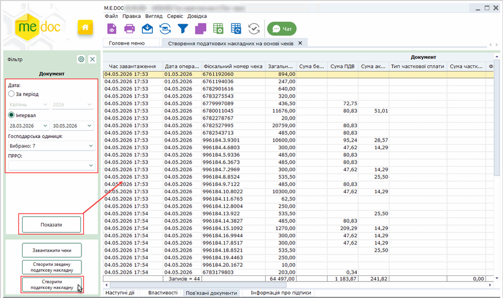

Натисніть, щоб збільшити малюнок

3. Буде створена ПН на основі всіх чеків, які відповідають параметрам, встановленим на панелі Фільтр та які відображаються в реєстрі. Відкриються вкладки створених ПН:

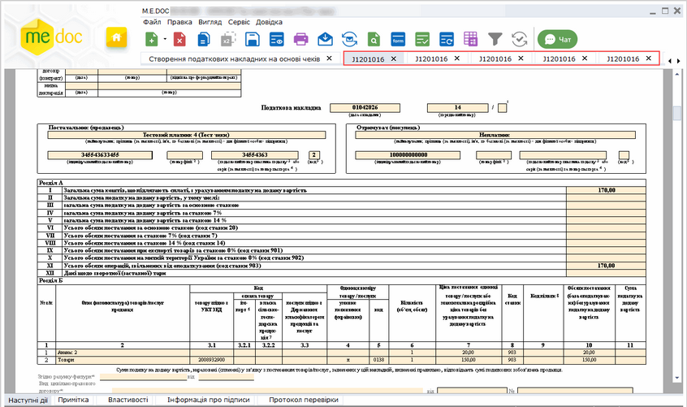

Натисніть, щоб збільшити малюнок

Про особливості створення та заповнення ПН дивіться у розділі [Особливості створення ПН на основі даних чеків](#uctaxbasedoncheckrst-uctaxbasedoncheckrst_createpn).

[До початку](#uctaxbasedoncheckrst-uctaxbasedoncheckrst_createpn)

Створення ПН на основі обраних чеків

1. За допомогою лівої кнопки миші у таблиці реєстру виділіть рядки чека або кількох чеків, за якими потрібно створити ПН. Щоб виділити кілька рядків, натисніть та утримуйте клавішу <Shift> (щоб виділити послідовно розташовані рядки) або <Ctrl> (щоб виділити поодинокі рядки).

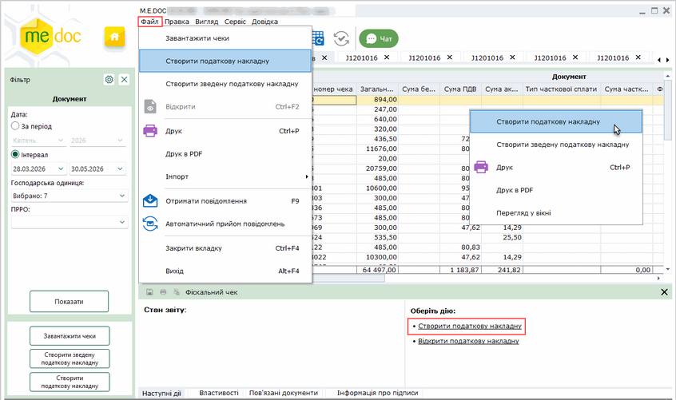

Натисніть, щоб збільшити малюнок

2. Виконайте команду Створити податкову накладну в контекстному меню або в головному меню Файл.

3. Буде створена ПН на основі виділених у реєстрі чеків.

Створити Податкову накладну на основі даних обраних чеків можна також за допомогою команди Створити податкову накладну на вкладці Наступні дії.

Про особливості створення та заповнення ПН дивіться у розділі [Особливості створення ПН на основі даних чеків](#uctaxbasedoncheckrst-uctaxbasedoncheckrst_createpn).

[До початку](#uctaxbasedoncheckrst-uctaxbasedoncheckrst_createpn)

Особливості створення ПН на основі даних чеків

При створенні ПН відбувається аналіз наступних даних в чеках:

- дата чеків - всі чеки, які були обрані для створення ПН, групуються по датам та додаються в окремі ПН - на кожен день створюється окрема ПН;
- номенклатура чеків - (наприклад, в кількох чеках продали однаковий товар) номенклатура групується та при повному співпадінні вказаних параметрів відображається одним рядком:

­

назва номенклатури;

­

код УКТЗЕД або код ДКПП;

­

умовне позначення одиниці вимірювання;

­

ціна за одиницю товару;

- ставка податку кожного товару в чеку - відбувається аналіз ставки податку кожного товару в чеку, якщо у чеках присутні позиції, що оподатковуються за різними ставками [ПДВ (7%, 14%, 20%](#uctaxbasedoncheckrst-uctaxbasedoncheckrst_createpn)) та [за нульовою ставкою та/або Без ПДВ](#uctaxbasedoncheckrst-uctaxbasedoncheckrst_createpn), для позицій, що оподатковуються, та для позицій, звільнених від оподаткування, складаються окремі Податкові накладні. Якщо у чеках присутні такі позиції, відкриється вікно повідомлення:

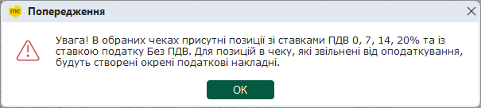

Натисніть, щоб збільшити малюнок

Щоб продовжити, натисніть ОК.

- якщо серед обраних чеків, на основі яких відбувається створення ПН, наявні чеки з неповною сплатою - вони не будуть враховані, Податкові накладні за даними таких чеків не створюються:

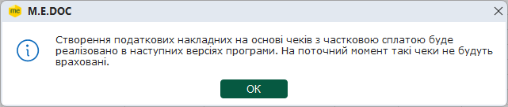

Натисніть, щоб збільшити малюнок

Щоб продовжити, натисніть ОК.

Будуть створені податкові накладні, що відкриються у окремих вкладках:

Натисніть, щоб збільшити малюнок

[До початку](#uctaxbasedoncheckrst-uctaxbasedoncheckrst_createpn)

Створення ПН на основі чеків, що містять позиції зі ставкою податку 7%, 14%, 20%

Важливо!

У Податковій накладній, створеній на основі чеків, позиції яких реалізовані за ставкою податку 7%, 14%, 20% або з продажем товарів, до яких одночасно застосовується ставка 7%, 14%, 20%, автоматично заповнюються наступні поля:

- Отримувач (Покупець) - "Неплатник";
- Індивідуальний податковий номер (ІПН) - "100000000000";
- Не підлягає наданню отримувачу (покупцю) - встановлюється позначка;
- Тип причини - "11";
- Назва номенклатури;
- Код УКТЗЕД (або Код ДКПП);
- Умовне позначення одиниці вимірювання;
- Назва одиниці вимірювання;
- Кількість номенклатури - додається уся кількість згрупованої номенклатури;
- Код ставки;
- Ціна за одиницю товару.

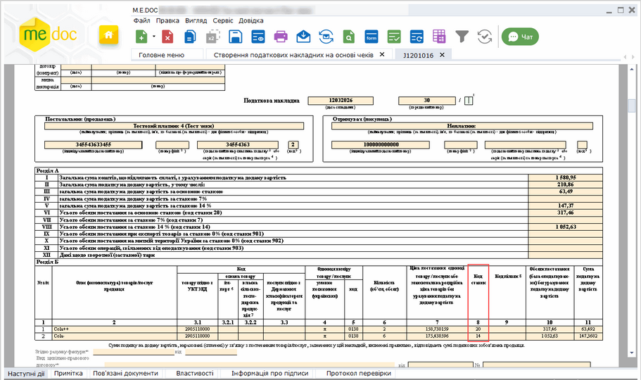

Натисніть, щоб збільшити малюнок

[До початку](#uctaxbasedoncheckrst-uctaxbasedoncheckrst_createpn)

Створення ПН на основі чеків, товари у яких звільнені від оподаткування

У Податковій накладній, що створена на основі даних чеків, позиції яких звільнені від оподаткування, автоматично заповнюються наступні поля:

- Отримувач (Покупець) - "Неплатник";
- Індивідуальний податковий номер (ІПН) - "100000000000";
- Не підлягає наданню отримувачу (покупцю) - встановлюється позначка;
- Тип причини - "11";
- Назва номенклатури;
- Код УКТЗЕД (або Код ДКПП);
- Умовне позначення одиниці вимірювання;
- Назва одиниці вимірювання;
- Кількість номенклатури - додається уся кількість згрупованої номенклатури;
- Код ставки;
- Ціна за одиницю товару;
- Складена на операції, які звільнені від оподаткування - "Без ПДВ";
- Код ставки - "903".

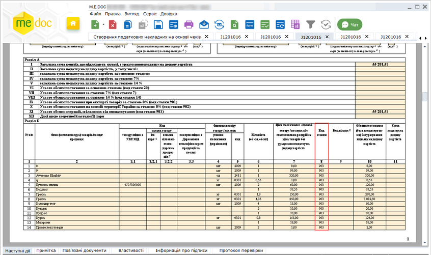

[До початку](#uctaxbasedoncheckrst-uctaxbasedoncheckrst_createpn)

Відображення створених ПН у розділі Створення податкових накладних на основі чеків

Після створення Податкової накладної у рядках чеків, за якими було створено ПН, у колонці Податкова накладна встановлюється відмітка .

У разі якщо за даними чека було створено кілька Податкових накладних, перелік цих ПН відображається на вкладці Пов'язані документи. Також на вкладці Пов'язані документи відображається перелік інших чеків, позиції з яких були додані у ці Податкові накладні:

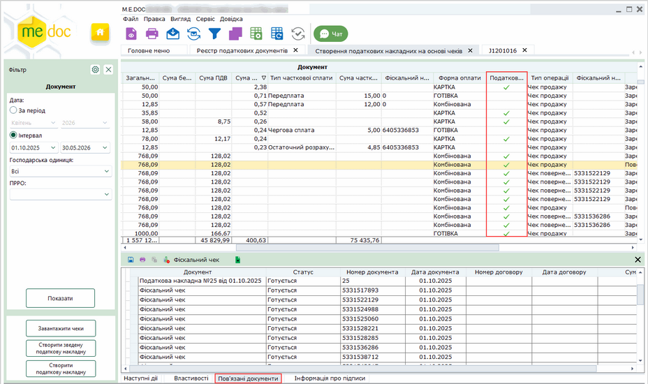

Натисніть, щоб збільшити малюнок

Щоб відкрити Податкову накладну або Чек, натисніть 2 рази лівою кнопкою миші на відповідний рядок на вкладці Пов'язані документи. Документ буде відкрито у окремій вкладці.

Також Податкові накладні, що створені за даними чека, відображаються на вкладці Пов'язані документи у [Реєстрі податкових документів](UCDFDocsRst.html#ucdfdocsrst-pdocs_reestr).

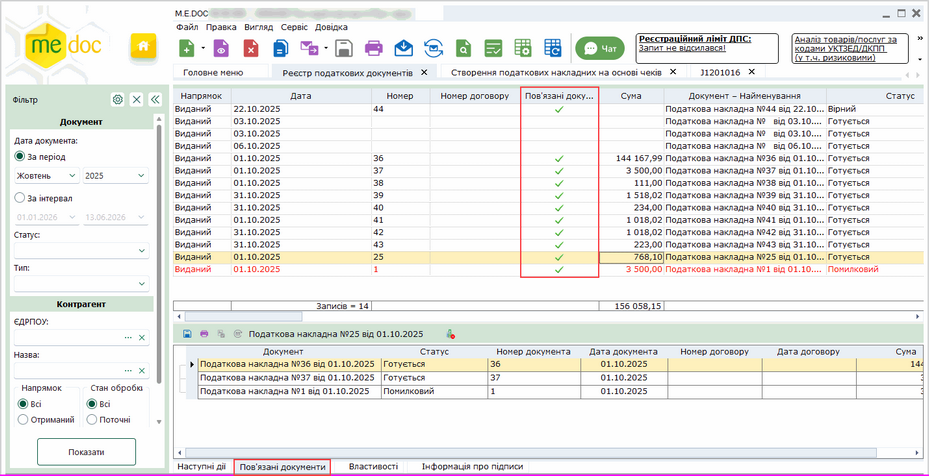

Натисніть, щоб збільшити малюнок

### Створення Зведеної податкової накладної на основі завантажених чеків

_Шлях у довідці: Розділи програми › Облік ПДВ › Створення податкових накладних на основі чеків › Створення Зведеної податкової накладної на основі завантажених чеків_

В цьому розділі:

[Створення Зведеної ПН на основі групи чеків](#uctaxbasedoncheckrst-uctaxbasedoncheckrst_create-zpn)

[Створення Зведеної ПН на основі обраних чеків](#uctaxbasedoncheckrst-uctaxbasedoncheckrst_create-zpn)

На основі даних завантажених чеків у програмі можна створювати Зведену податкову накладну для операцій, які мають безперервний або ритмічний характер (постачання два та більше разів на місяць товарів/послуг одному кінцевому споживачеві, який не є платником податку).

Передбачено 2 способи створення ПН:

- створення Зведеної ПН на основі даних групи чеків для вказаних ГО та ПРРО за обраний день чи за обраний період;
- створення Зведеної ПН на основі даних одного або кількох обраних чеків.

Про особливості створення Зведеної ПН на основі даних чеків дивіться [тут](#uctaxbasedoncheckrst-uctaxbasedoncheckrst_createpn).

Після створення Зведеної ПН на основі чеків перевірте дані, що були автоматично заповнені, дозаповніть необхідні поля, після чого збережіть Зведену ПН.

Зведені ПН зберігаються у модулі [Облік ПДВ - Реєстр податкових документів](UCDFDocsRst.html#ucdfdocsrst-pdocs_reestr).

Підписання та відправлення на реєстрацію в ЄРПН, отримання квитанцій виконуються за звичайною [процедурою обробки](UCDFDocsRst.html#ucdfdocsrst-pdocs_reestr) Податкової накладної.

Створення Зведеної ПН на основі групи чеків

1. На панелі Фільтр оберіть параметри для відбору чеків, за якими потрібно створити ПН.

У полях Господарська одиниця та ПРРО оберіть назву (назви) ГО та фіскальні номери ПРРО. Встановіть дату операцій у полі Інтервал або оберіть період часу, у який реєструвалися чеки, у полі За період.

Натисніть на кнопку Показати. У реєстрі будуть відображені рядки чеків, що відповідають заданим параметрам.

2. У лівій частині вікна натисніть на кнопку Створити зведену податкову накладну.

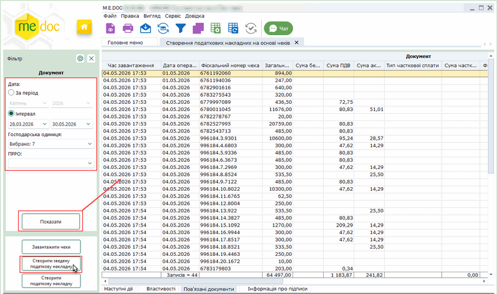

Натисніть, щоб збільшити малюнок

3. Відкриється вікно повідомлення:

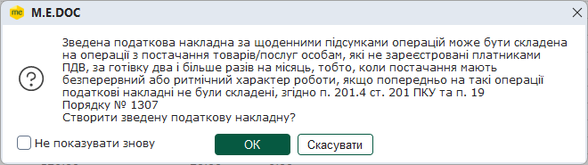

Натисніть, щоб збільшити малюнок

Натисніть ОК, що підтвердити створення Зведеної ПН.

4. Буде створена Зведена ПН на основі чеків, які відповідають параметрам, встановленим на панелі Фільтр (відображаються в реєстрі), та які відповідають операціям, що мають безперервний або ритмічний характер. Відкриються вкладки створених Зведених ПН:

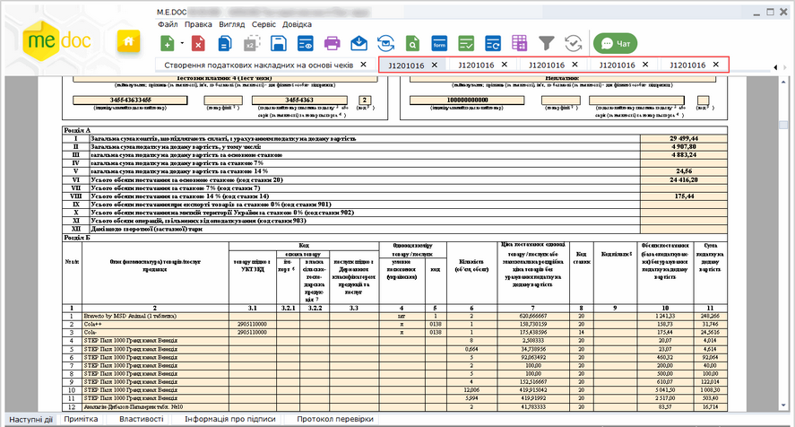

Натисніть, щоб збільшити малюнок

Якщо серед відібраних чеків наявні чеки на постачання товарів/послуг, які звільнені від оподаткування, на основі таких чеків буде створено окрему Зведену ПН. Така ПН буде відкрита у окремій вкладці.

[До початку](#uctaxbasedoncheckrst-uctaxbasedoncheckrst_create-zpn)

Створення Зведеної ПН на основі обраних чеків

1. За допомогою лівої кнопки миші у таблиці реєстру виділіть рядки чека або кількох чеків, за якими потрібно створити Зведену ПН. Щоб виділити кілька рядків, натисніть та утримуйте клавішу <Shift> (щоб виділити послідовно розташовані рядки) або <Ctrl> (щоб виділити поодинокі рядки).

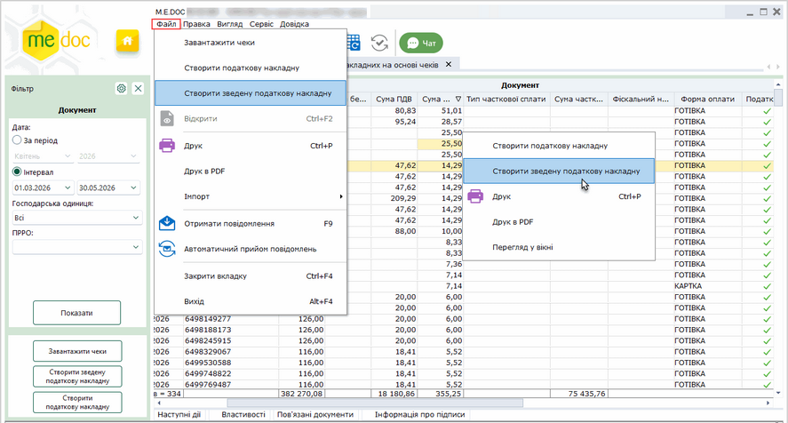

Натисніть, щоб збільшити малюнок

2. Виконайте команду Створити зведену податкову накладну в контекстному меню або в головному меню Файл.

3. Буде створена ПН на основі виділених у реєстрі чеків.

Якщо серед відібраних чеків наявні чеки на постачання товарів/послуг, які звільнені від оподаткування, на основі таких чеків буде створено окрему Зведену ПН. Така ПН буде відкрита у окремій вкладці.

[До початку](#uctaxbasedoncheckrst-uctaxbasedoncheckrst_create-zpn)


