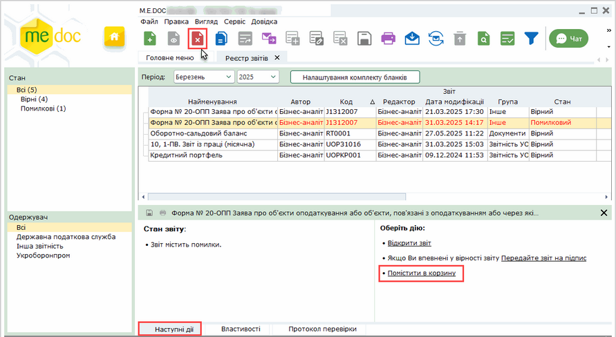
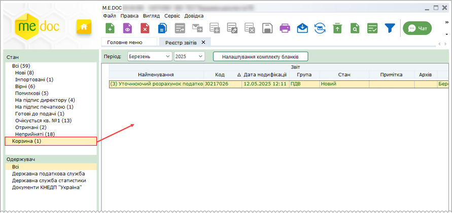
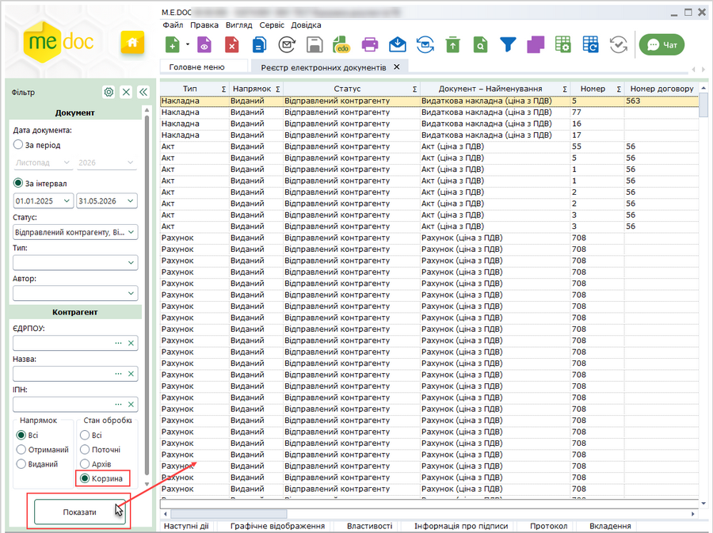
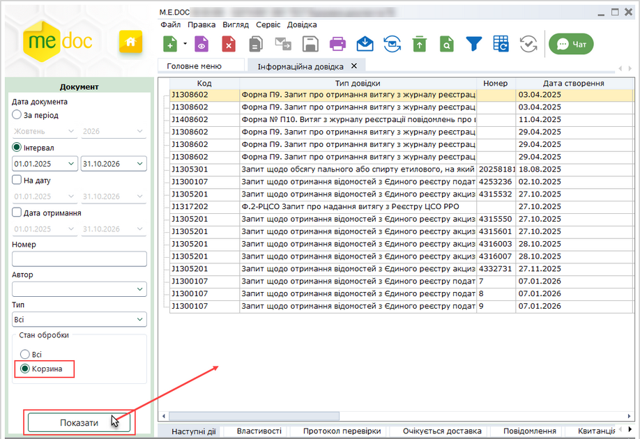
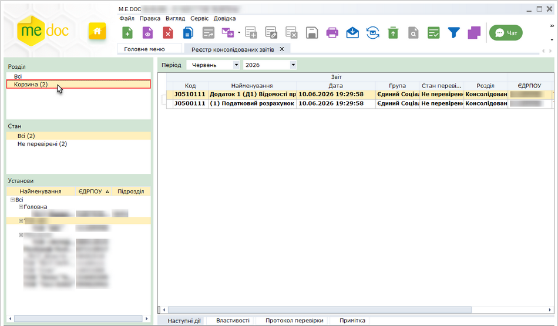
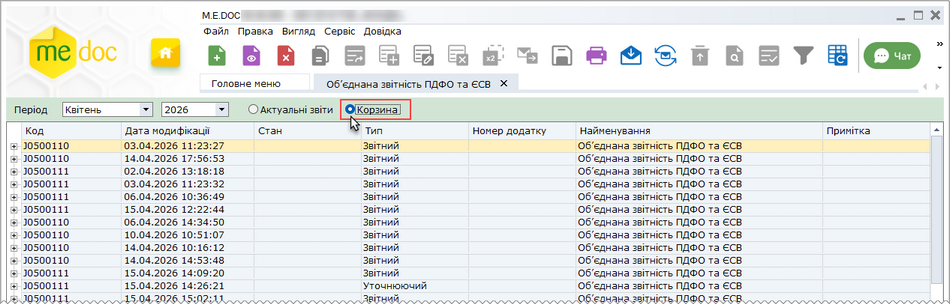

[← Зміст довідки](../)


# Корзина

## Корзина

_Шлях у довідці: Допоміжні сервіси › Корзина_

В цьому розділі:

[Переміщення документів до "Корзини"](#uctrash-uctrash)

[Перегляд "Корзини"](#uctrash-uctrash)

[Перегляд та редагування документів у "Корзині"](#uctrash-uctrash)

[Відновлення документів з "Корзини"](#uctrash-uctrash)

[Видалення документів з "Корзини"](#uctrash-uctrash)

Корзина використовується для зберігання вилучених з обробки документів, що були створені помилково, відхилені при реєстрації, чернеток, дублюючих екземплярів тощо. Документи, переміщені до корзини вилучаються з обробки. Під час змінення даних у пов'язаних документах, дані документа, що знаходиться у Корзині, не змінюються.

Скористатися Корзиною можливо у модулях:

- [Реєстр звітів](UCDocRstByPer5.html#ucdocrstbyper5-rdocs);
- [Реєстр первинних документів](UCDFDocsRst.html#ucdfdocsrst-pdocs_reestr);
- [Об'єднана звітність ПДФО та ЄСВ](UCEsv1DfRST.html#ucesv1dfrst-ucesv1dfrst_creation);
- [Інформаційна довідка](UCGovQry.html#ucgovqry-ucgovqry);
- [Реєстр консолідованих звітів](CorpIncRst.html#corpincrst-m_e_doc-corp_modul_rz);
- [Реєстр акцизних документів (пальне)](UCExciseLicenseFuelRst.html#ucexciselicensefuelrst-ucexciselicensefuelrst);
- [Реєстр акцизних документів (спирт етиловий)](UCExciseAlcoRst.html#ucexcisealcorst-ucexcisealcorst);
- [Реєстр документів РРО](UCRRORst.html#ucrrorst-ucrrorst).

Примітка:

У модулях Реєстр звітів, Реєстр консолідованих звітів, Об'єднана звітність ПДФО та ЄСВ та Інформаційна довідка у Корзині відображаються документи, що належать до обраного періоду. У модулях Реєстр електронних документів та Реєстр податкових документів відображено всі документи, що знаходяться у Корзині.

Переміщення документів до Корзини

У всіх модулях переміщення у Корзину виконується аналогічним чином. Далі переміщення розглянуто на прикладі модуля Реєстр звітів.

Оберіть документ зі списку та для переміщення документа у корзину скористайтеся одним із способів:

- натисніть кнопку Видалити панелі інструментів, або натисніть комбінацію клавіш Shift+Del;
- відкрийте вкладку Наступні дії. Оберіть пункт Помістити в корзину.

виберіть команду меню Файл - Видалити звіт;

- натисніть правою кнопкою миші на обраному документі, та у контекстному меню оберіть команду Видалити звіт;
- Функція переміщення до Корзини доступна і у відкритому вікні документа:
- у меню Файл - Видалити або по натисненню кнопки Видалити панелі інструментів.
- із вікна відкритого документа до Корзини переміщується тільки поточний документ.

Можна обрати групу документів для переміщення у Корзину. Якщо документи у списку розташовані послідовно, натисніть та утримуйте клавішу Shift, лівою кнопкою миші клацніть перший, а потім останній документ групи. Або натисніть та утримуйте клавішу Ctrl, лівою кнопкою миші клацайте рядки довільно розташованих документів, які потрібно обрати.

[До початку](#uctrash-uctrash)

Перегляд Корзини

Перегляд Корзини у модулі Реєстр звітів

Якщо у модулі присутні документи, що переміщені у Корзину, у правій частині вікна присутній фільтр Корзина. Праворуч від назви фільтру, у дужках, вказана кількість документів, що знаходиться у Корзині.

Для перегляду списку звітів, клацніть лівою клавішею миші на фільтрі Корзина.

У Корзині відображаються звіти за поточний період.

Перегляд Корзини у модулях Реєстр електронних документів, Реєстр податкових документів, Реєстр акцизних документів (пальне), Реєстр акцизних документів (спирт етиловий) та Реєстр документів РРО

Встановіть позначку Корзина на панелі Фільтр та натисніть Показати. У вікні буде виведено список всіх документів, що містяться у Корзині.

Для налаштування відображення документів згідно з певними параметрами, використовуйте активні поля панелі Фільтр.

Перегляд Корзини у модулі Інформаційна довідка

На панелі Документ, у лівій частині вікна, встановіть позначку Корзина та натисніть Показати. У вікні буде виведено список всіх документів, що містяться у Корзині.

Перегляд Корзини у модулі Реєстр консолідованих звітів

Для перегляду списку звітів, що містяться у Корзині, клацніть лівою клавішею миші на фільтрі Корзина у лівій частині вікна.

Натисніть, щоб збільшити малюнок

Можна відібрати звіти по установам, для цього оберіть назву установу на панелі Установи.

Для відображення звітів згідно стану скористайтеся фільтрами панелі Стан.

Перегляд Корзини у модулі Об'єднана звітність ПДФО та ЄСВ

Для перегляду списку звітів, що містяться у Корзині, у заголовку модуля встановіть позначку Корзина:

Натисніть, щоб збільшити малюнок

Можна відібрати для перегляду документи, що належать до певного періоду, обравши значення у полі Період.

[До початку](#uctrash-uctrash)

Перегляд та редагування документів у Корзині

Для перегляду документа, що переміщений у Корзину, оберіть документ зі списку, та скористайтеся одним із способів:

- на панелі інструментів натисніть кнопку Відкрити - ;
- подвійним кліком лівої клавіші миші на назві документа;
- із контекстного меню команда Відкрити;
- команда Файл - Відкрити;
- натисніть комбінацію клавіш Ctrl+F2.

В режимі перегляду діють основні правила заповнення звітних документів описані у розділі [Правила заповнення та редагування документів](UCPravila.html#ucpravila-pravyla)

[До початку](#uctrash-uctrash)

Відновлення документів з Корзини

У всіх модулях переміщення у Корзину виконується аналогічним чином. Далі переміщення розглянуто на прикладі модуля Реєстр звітів.

Відкрийте Корзину, оберіть документ або групу документів, які потрібно відновити, та скористайтеся одним із способів:

- Натисніть кнопку Відновити  панелі інструментів.
- Відкрийте вкладку Наступні дії. Оберіть пункт Відновити з корзини.
- Виберіть команду меню Правка - Відновити з корзини.
- Клацніть правою кнопкою миші на обраному документі, та у контекстному меню оберіть команду Відновити з корзини.

[До початку](#uctrash-uctrash)

Видалення документів з Корзини

З корзини неможливо видалити документи, що містять підпис, та які були відправлені або отримані від сторонніх організацій.

Оберіть документ або групу документів, які потрібно видалити, та скористайтеся одним із способів:

- Натисніть кнопку Видалити  панелі інструментів, або натисніть комбінацію клавіш Shift+Del.
- Виберіть команду меню Файл - Видалити.
- Клацніть правою кнопкою миші на обраному документі, та у контекстному меню оберіть команду Видалити.
- Функція видалення з Корзини доступна і у відкритому вікні документа:
- у меню Файл - Видалити або по натисненню кнопки Видалити панелі інструментів. Із вікна відкритого документа видаляється тільки поточний документ.

Видалений з Корзини документ видаляється з системи без можливості відновлення.

[До початку](#uctrash-uctrash)


