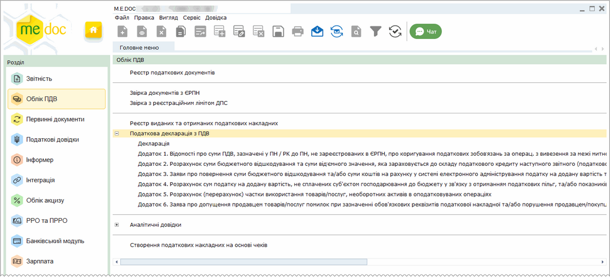
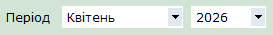
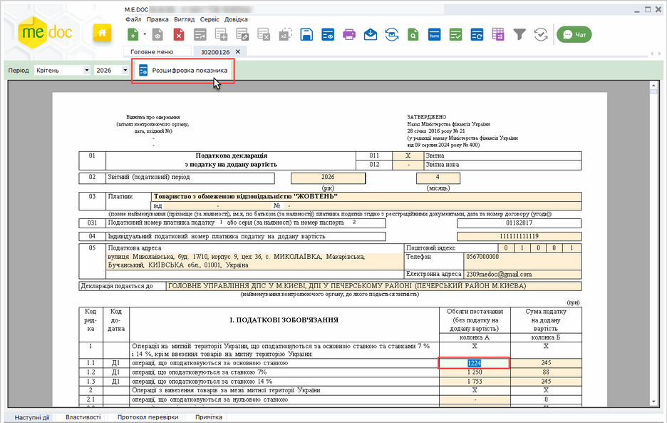
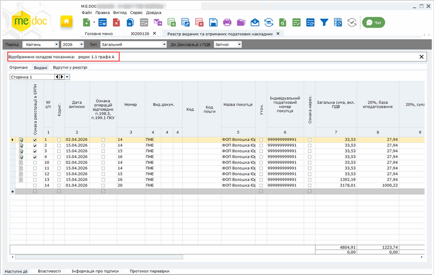
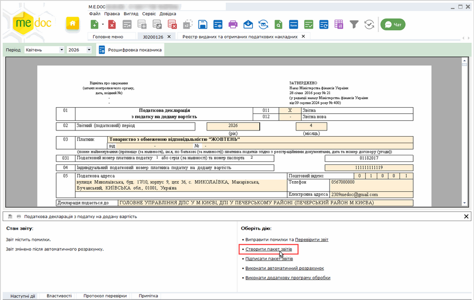
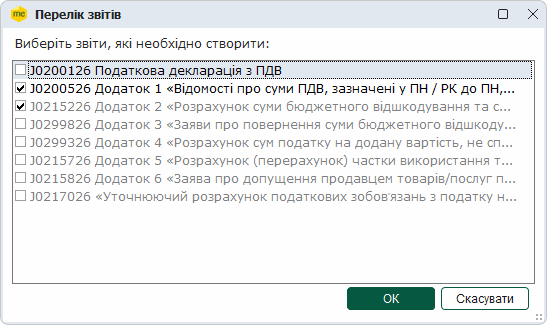
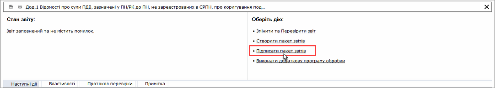
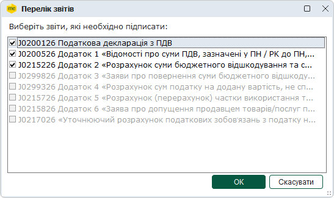
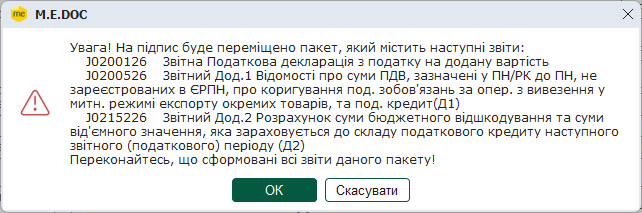

[← Зміст довідки](../)


# Податкова декларація з ПДВ

## Податкова декларація з ПДВ

_Шлях у довідці: Розділи програми › Облік ПДВ › Податкова декларація з ПДВ_

В цьому розділі:

[Розшифровка показників](#ucvat-ucvat)

[Створення та відправка пакета звітів](#ucvat-ucvat)

У модулі Облік ПДВ міститься сама декларація та додатки до неї. Модуль призначений для перевірки звітних податкових документів.

Натисніть, щоб збільшити малюнок

Відкрити групу звітів можна натиснувши на

Сформовані у Реєстрі виданих та отриманих податкових накладних документи необхідно відкрити, перевірити та зберегти. Перевірені та збережені документи (Декларація та Додаток) поміщаються у модуль Реєстр звітів у тому звітному періоді, в якому вони були створені.

Розшифровка показників

1. Відкрийте податкову декларацію. Оберіть період відображення даних декларації.

2. Оберіть клітинку декларації, для якої потрібно переглянути склад показників (Наприклад, рядок 5, колонка А). Натисніть на кнопку Розшифровка показника.

Натисніть на рисунок, щоб збільшити його

3. Відкриється вікно Реєстру виданих та отриманих податкових накладних, в якому відображені тільки ті рядки реєстру, на основі яких сформувалась сума у вибраній клітинці декларації.

Натисніть, щоб збільшити малюнок

4. Після перевірки декларації, збережіть документ, натиснувши кнопку .

Створення та відправка пакета звітів

Із відкритих документів декларації та додатків можна сформувати пакет податкових документів, а також відправити його у контролюючі органи.

Для формування пакета документів:

1. На панелі стану документа виберіть закладку Наступні дії і натисніть Створити пакет звітів.

Натисніть, щоб збільшити малюнок

2. Відкриється вікно Перелік звітів. Позначте галочками документи, що потрібно сформувати. Натисніть кнопку ОК.

3. Створені документи відкриються у окремих вкладках. Заповніть документи необхідними даними, перевірте та збережіть їх.

Створені документи також можна переглянути у модулі Реєстр звітів.

4. Для відправки у контролюючі органи, пакет спочатку необхідно підписати ЕП. Для цього виберіть закладку Наступні дії і натисніть Підписати пакет звітів.

Натисніть, щоб збільшити малюнок

5. Відкриється вікно у якому наводяться перелік звітів, які міститиме пакет. Перевірте вміст пакета. Щоб підтвердити переміщення пакета на підпис, натисніть ОК.

6. Відкриється вікно у якому наводяться перелік звітів, які міститиме пакет. Щоб підтвердити переміщення пакета на підпис, натисніть ОК.

7. Розпочнеться стандартна процедура підписання документів ЕП.

8. По завершенні на вкладці Наступні дії стає доступною функція Відправити у контролюючий орган. На виконання команди Відправити у контролюючий орган розпочнеться процедура відправлення пакета звітів у контролюючий орган.

Важливо!

Якщо при перевірці (команда Перевірити документ або клавіша F4) виявлено невідповідність сум у Декларації та Додатках, або якщо вже після формування пакета було внесено зміни у картці установи чи у Декларації або Додатках, відкрийте кожен з Додатків пакета та у вікні кожного документа виконайте такі операції:

1. Оновити поля (F5).

2. Перерахувати документ (F6).

3. Перевірити документ (F4).

4. Зберегти (Ctrl+S).

Після чого відкрийте Декларацію та виконайте команди у тій же послідовності, що й для Додатків.

[До початку](#ucvat-ucvat)


