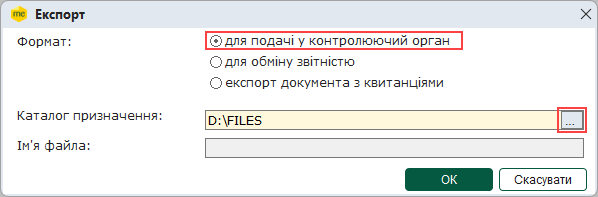
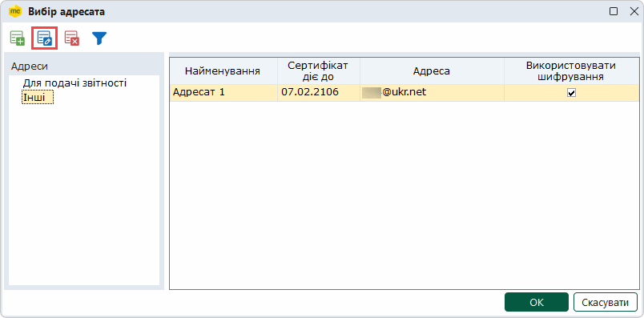
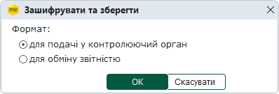

[← Зміст довідки](../)


# Експорт товарно-транспортних накладних

## Експорт товарно-транспортних накладних

_Шлях у довідці: Розділи програми › Облік акцизу › Реєстр ТТН  (спирт, алкоголь) › Робота з товарно-транспортними накладними › Експорт товарно-транспортних накладних_

В цьому розділі:

[Експорт документів у формат XML для подання у контролюючі органи](#ucwaybillexport-ucwaybillexport)

[Експорт підписаних документів](#ucwaybillexport-ucwaybillexport)

[Шифрування та збереження документів](#ucwaybillexport-ucwaybillexport)

[Експорт таблиці в Excel](#ucwaybillexport-ucwaybillexport)

[Експорт квитанцій про реєстрацію в РТТН](#ucwaybillexport-ucwaybillexport)

Експорт ТТН призначений для збереження документів у обраному каталозі або електронному носії з метою подачі вивантажених звітів у контролюючі органи.

При експорті ТТН із програми назва та розширення відповідають регламентованим правилам подання звітів до певних контролюючих органів. Звіти перевіряються на заповнюваність обов'язкових реквізитів у документі згідно затверджених схем XSD. Ці перевірки аналогічні тим, які виконуються при прийманні документів у контролюючих органах.

Експорт документів в каталог чи на електронний носій можливий тільки в повній робочій версії ПК M.E.Doc.

У Реєстрі товарно-транспортних накладних реалізована можливість експортувати як один файл, так и групу файлів одночасно. Для групового експорту документів виділіть потрібне курсором миші, використовуючи стандартні методи виділення декількох записів ОС Windows.

Експорт документів для подання у контролюючі органи

Дана функція призначена для збереження звіту на електронному носії чи у обраному каталозі.

Експорт документів виконується у наступній послідовності:

1. Виділіть потрібний для експорту документ у Реєстрі товарно-транспортних накладних.

2. Експорт документа викликається одним із наступних способів:

- команда Файл - Експорт - Експорт;
- із контекстного меню команда Експорт.

2.1. Функція експорту доступна і у відкритому вікні документа:
у меню Файл - Експорт - Експорт.

Із вікна відкритого документа експортується тільки поточний документ.

3. Відкривається вікно Експорт.

4. Вкажіть каталог для збереження експортованих даних у полі Каталог призначення.

Документ зберігається у файлі формату .xml. Ім'я файлу регламентоване правилами подання звітів до контролюючого органу.

5. Натисніть ОК.

6. По закінченні процедури, система виведе протокол експорту документів. Якщо для експорту було обрано групу документів, у разі вдалого виконання операції, у протоколі вказано кількість сформованих звітів та імена файлів, у яких збережено дані.

[До початку](#ucwaybillexport-ucwaybillexport)

Експорт підписаних документів

Дана функція призначена для збереження на електронні носії підписаних документів. Виконати такий експорт можливо тільки для документів, які підписані повним комплектом підписів та готові до відправки в ДПС чи контрагенту, або вже були відправлені.

Документи, які були відправлені, експортуються з накладеними підписами, не зашифровані на адресата.

Експорт документів виконується у наступній послідовності:

1. Виділіть підписаний документ, який необхідно експортувати.

2. У вкладці Наступні дії оберіть нову функцію Експортувати підписаний документ.

3. Вкажіть каталог, де зберегти файл.

4. Документи, які відправлені чи призначені для відправки в ДПС, зберігаються у файлі формату для подачі у контролюючий орган (.xml).

Документи, які відправлені чи призначені для відправки контрагенту, також зберігаються у файлі формату для подачі у контролюючий орган (.xml).

[До початку](#ucwaybillexport-ucwaybillexport)

Шифрування та збереження документів

Дана функція призначена для збереження підписаних та зашифрованих на одержувача документів. Даний спосіб, наприклад, може використовуватися для відправлення документів електронною поштою контрагентам чи в ДПС у випадку відсутності доступу до мережі Інтернет на даному комп'ютері.

У процесі  вивантаження обирається формат експорту.

Підпис, шифрування та експорт документів виконується у наступній послідовності:

1. У таблиці розділу виділіть документи, які необхідно експортувати підписаними та зашифрованими.

2. Оберіть один із способів:

- команду Файл - Зашифрувати та зберегти;
- із контекстного меню команду Зашифрувати та зберегти;
- на вкладці Наступні дії команду Зашифрувати та зберегти.

Функція доступна також у відкритому вікні документа:

- у меню Файл - Зашифрувати та зберегти;
- на вкладці Наступні дії команду Зашифрувати та зберегти.

В цьому випадку дії виконуються лише з цим відкритим документом.

3. Відкриється вікно Вибір адресата.

Для документів, що призначені контрагентам, оберіть у розділі Інші потрібний запис:

Обов'язково перевірте, чи використовується підпис та шифрування при обміні з цим контрагентом.

Якщо підпис та шифрування не використовуються, Ваші документи будуть незахищені.

4. У наступному вікні оберіть формат файлу:

- для подачі у контролюючий орган,
- для обміну звітністю

5. Вкажіть шлях для збереження файлу.

6. Далі запускається звичайна процедура накладання підписів та шифрування файлу.

7. По закінченні відкривається протокол операції, в якому вказується каталог із збереженими файлами.

[До початку](#ucwaybillexport-ucwaybillexport)

Експорт таблиці в Excel

Дана функція призначена для збереження даних, що відображені на момент експорту у вікні Реєстру товарно-транспортних накладних.

Експорт документів виконується у наступній послідовності:

1. У меню Файл оберіть Експорт - Експорт таблиці  Excel.

2. Відкривається вікно діалогу збереження файлів ОС Windows, у якому вкажіть ім'я файлу для збереження даних.

5. Натисніть кнопку Зберегти.

6. Система повідомить про закінчення процесу експорту.

[До початку](#ucwaybillexport-ucwaybillexport)

Експорт квитанцій про реєстрацію в РТТН

Дана функція призначена для збереження даних про квитанції реєстрації документів у Єдиному реєстрі товарно-транспортних накладних (РТТН). Дані зберігаються у вигляд текстового файлу формату RTF на електронному носії чи у обраному каталозі. Виконати експорт можливо тільки для документів, що зареєстровані у РТТН.

Експорт документів виконується у наступній послідовності:

1. Виділіть потрібний для експорту документ у Реєстрі товарно-транспортних накладних.

2. Експорт документа викликається одним із наступних способів:

- команда Файл - Експорт - Експортувати в RTF квитанцію про реєстрацію в РТТН;
- із контекстного меню команда Експортувати в RTF квитанцію про реєстрацію в РТТН.

3. Відкривається вікно Огляд папок, у якому оберіть шлях до каталогу, в якому буде збережено файл з експортованими даними. Натисніть кнопку ОК.

4. Система повідомить про закінчення процесу експорту.

[До початку](#ucwaybillexport-ucwaybillexport)


