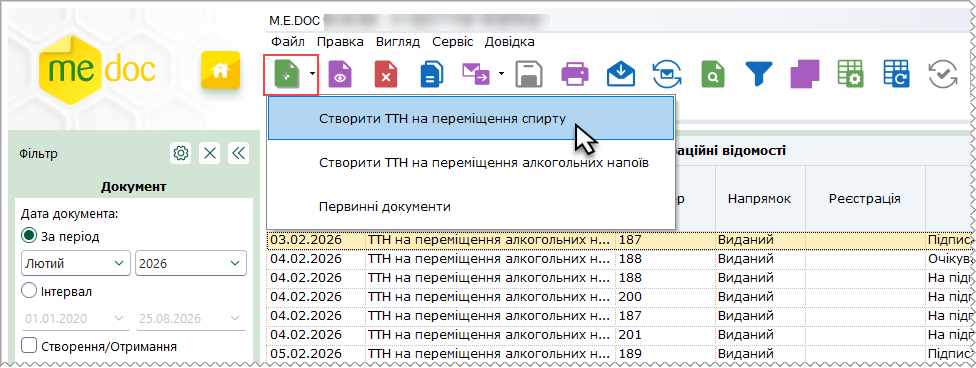
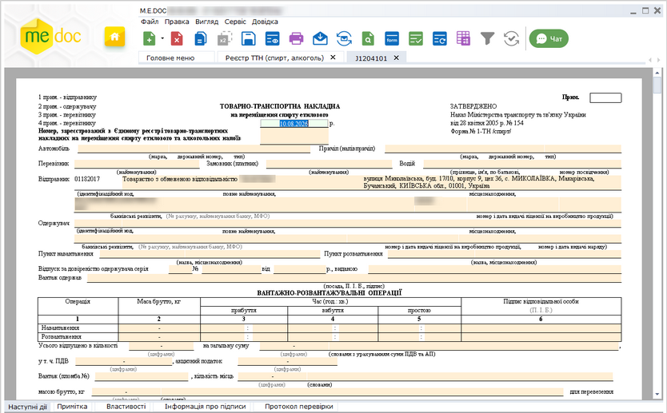
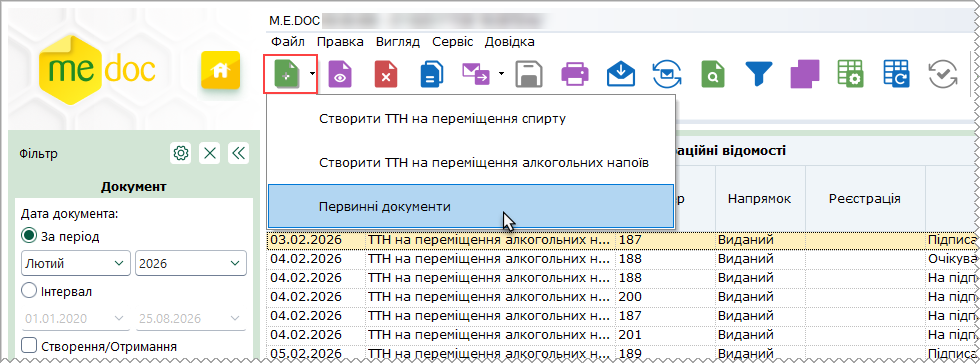
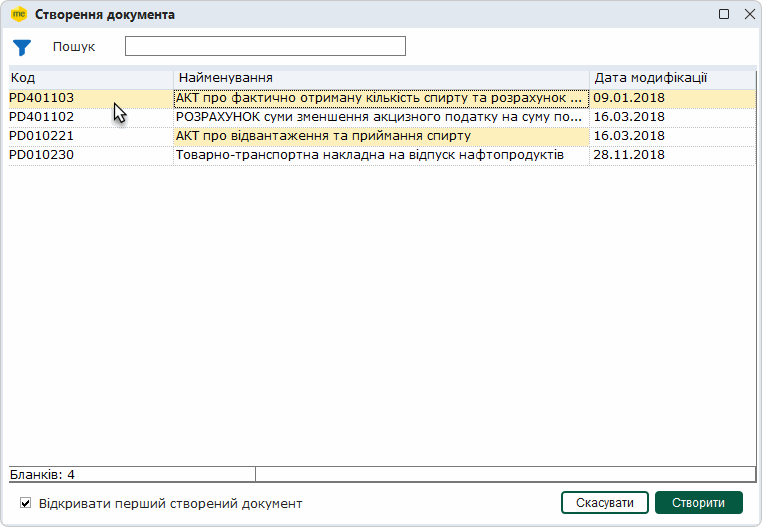
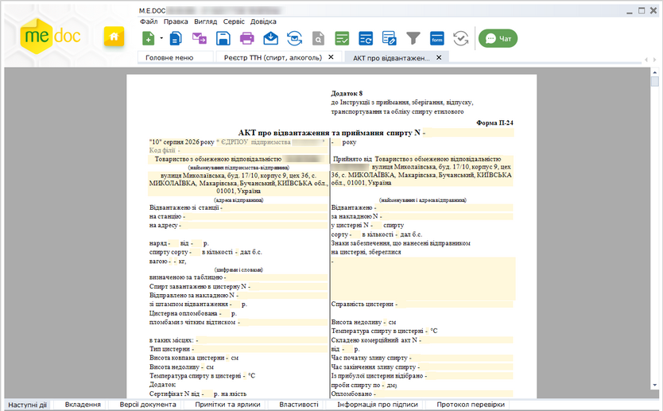
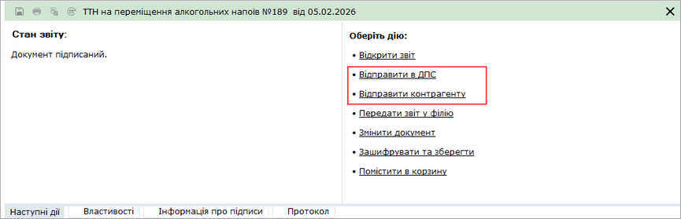

[← Зміст довідки](../)


# Робота з товарно-транспортними накладними

## Робота з товарно-транспортними накладними

_Шлях у довідці: Розділи програми › Облік акцизу › Реєстр ТТН  (спирт, алкоголь) › Робота з товарно-транспортними накладними_

У даному розділі довідки розглянуто наступне:

- [Як створити ТТН](#ucwaybillfunkc-ttn_stvor)
- [Як створити первинний документ](#ucwaybillfunkc-ttn_stvor_perv)
- [Підписання ЕП та відправлення ТТН електронним каналом зв'язку](#ucwaybillfunkc-ttn_vidp)
- [Повторне відправлення ТТН](#ucwaybillfunkc-ttn_vidp_2)
- [Експорт ТТН](UCWaybillExport.html#ucwaybillexport-ucwaybillexport)
- [Експорт документів у формат XML для подання у контролюючі органи](UCWaybillExport.html#ucwaybillexport-ucwaybillexport)
- [Експорт підписаних документів](UCWaybillExport.html#ucwaybillexport-ucwaybillexport)
- [Шифрування та збереження ТТН](UCWaybillExport.html#ucwaybillexport-ucwaybillexport)
- [Експорт таблиці в Excel](UCWaybillExport.html#ucwaybillexport-ucwaybillexport)
- [Експорт квитанцій про реєстрацію в РТТН](UCWaybillExport.html#ucwaybillexport-ucwaybillexport)

### Як створити ТТН

_Шлях у довідці: Розділи програми › Облік акцизу › Реєстр ТТН  (спирт, алкоголь) › Робота з товарно-транспортними накладними › Як створити ТТН_

Для створення нової товарно-транспортної накладної виконайте дії в наступній послідовності:

1. Скористайтесь одним із способів:

- на панелі інструментів натисніть кнопку Створити;
- виберіть команду Файл - Створити;
- у контекстному меню оберіть команду Створити.

2. Оберіть потрібний тип ТТН.

3. У окремому вікні відкриється бланк документа, який потрібно заповнити.

Поля, що підсвічені жовтим кольором, доступні для заповнення.

Натисніть, щоб збільшити малюнок

4. Внесіть дані в поля, які потребують заповнення із клавіатури.

5. Оберіть команду Правка/Перевірити документ або F4 для перевірки звіту.

Перевіряється правильність заповнення полів, і у випадку помилок система підсвітить червоним кольором поля, що необхідно виправити. Виправте помилки та знову виконайте перевірку.

6. Збережіть документ, натиснувши кнопку  або комбінацію клавіш Ctrl+S.

### Як створити первинний документ

_Шлях у довідці: Розділи програми › Облік акцизу › Реєстр ТТН  (спирт, алкоголь) › Робота з товарно-транспортними накладними › Як створити первинний документ_

У модулі можливо створити первинні документи:

- Розрахунок суми зменшення акцизного податку на суму податку, визначену виходячи із фактично втраченої кількості спирту етилового неденатурованого під час транспортування та зберігання...
- Акт про фактично отриману кількість спирту та розрахунок акцизного податку
- Товарно-транспортна накладна на відпуск нафтопродуктів
- Акт про відвантаження та приймання спирту

Для створення первинного документа виконайте дії в наступній послідовності:

1. Скористайтесь одним із способів:

- на панелі інструментів натисніть кнопку Створити;
- виберіть команду Файл - Створити;
- у контекстному меню оберіть команду Створити.

2. Оберіть пункт Первинні документи:

3. Відкриється вікно, у якому оберіть потрібний документ, та натисніть кнопку Створити:

Можливо обрати декілька документів для створення. Для цього оберіть потрібні документи мишею, утримуючи клавішу <Shift> або <Ctrl>.

Всі створені документи будуть відображені у таблиці реєстру. (Для перегляду нових документів оновіть таблицю реєстру - команда меню Вигляд - Оновити реєстр.)

Якщо встановлено опцію Відкривати перший створений документ, у окремій вкладці буде відкрито документ, що був першим обраний у вікні Створення звіту.

4. У окремому вікні відкриється бланк документа, який потрібно заповнити.

Поля, що підсвічені жовтим кольором, доступні для заповнення.

Натисніть, щоб збільшити малюнок

5. Внесіть дані в поля, які потребують заповнення із клавіатури.

6. Оберіть команду Правка - Перевірити документ або F4 для перевірки звіту.

Перевіряється правильність заповнення полів, і у випадку помилок система підсвітить червоним кольором поля, що необхідно виправити. Виправте помилки та знову виконайте перевірку.

7. Збережіть документ, натиснувши кнопку  або комбінацію клавіш Ctrl+S.

### Підписання ЕП та відправлення ТТН

_Шлях у довідці: Розділи програми › Облік акцизу › Реєстр ТТН  (спирт, алкоголь) › Робота з товарно-транспортними накладними › Підписання ЕП та відправлення ТТН_

Вихідні документи відправляються контрагентам електронним каналом зв'язку. Для відправки документ повинен бути заповненим, перевіреним та збереженим.

Існує декілька способів відправки ТТН контрагентам:

Із вкладки "Наступні дії"

Даний спосіб дозволяє відправити лише один документ - відкритий або виділений в Реєстрі.

В доступних діях з документом передбачено декілька варіантів для зручності користувача:

Передати документ на підпис

На виконання цієї команди документ блокується від редагування та набуває статусу На підпис директору/бухгалтеру (статус залежить від [обраного комплекту підписів](FormCompanyParams.html#formcompanyparams-admcomanyparams_pen) для ТТН). Документ знаходиться в стані очікування.
В Наступних діях стає доступним можливість [Підписати документ](UC_ECP.html#uc_ecp-ecp).
Після накладення підписів директора/бухгалтера та печатки установи документ набуває статусу Готовий до відправки, стає доступною функція Відправити документ. Програма повторно запропонує підписати файл сертифікатом печатки установи, таким чином підписується "конверт", в який поміщається файл для відправки.

Підписати документ

На виконання команди відразу розпочнеться стандартний процес [підписання документа](UC_ECP.html#uc_ecp-ecp) ЕП.
Після накладення підписів директора/бухгалтера та печатки установи документ набуває статусу Готовий до відправки, стає доступною функція Відправити документ. Програма повторно запропонує підписати файл сертифікатом печатки установи, таким чином підписується "конверт", в який поміщається файл для відправки.

Відправити в ДПС / Відправити контрагенту

На виконання команди розпочнеться [підписання документа](UC_ECP.html#uc_ecp-ecp) ЕП та одразу відправка документа адресату.

З Реєстру товарно-транспортних накладних

Даний спосіб дозволяє відправляти як один документ, так и групу документів одночасно.

У реєстрі виберіть одну або декілька ТТН  та оберіть один із варіантів:

- на панелі інструментів натисніть кнопку Відправити - ;
- виберіть команду Файл - Відправити;
- у контекстному меню оберіть команду Відправити.

Оберіть потрібного адресата з доступних: ДПС або контрагент.

На виконання команди розпочнеться [підписання документа](UC_ECP.html#uc_ecp-ecp) ЕП та одразу відправка документа адресату. По закінченню процедури, система виведе протокол відправки документів.

Також зверніть увагу:

- Після підписання документів комплектом електронних підписів, у відповідних місцях бланка документів встановлюється позначка ЕП, що свідчить про накладений підпис/печатку. Якщо в Картці підприємства [налаштовані зразки підписів](UCOrg.html#ucorg-sprorg_podp) директора/бухгалтера та печатки підприємства, то після підписання документа у відповідних місцях бланка відображаються завантажені у програму сканкопії зразків для більшої наочності.
Контрагент, що отримав документ, також бачить зображення підпису та печатки установи.

- Для того, щоб документ роздруковувався разом із зображеннями підпису та печатки, необхідно встановити позначку в полі Накладати графічні зображення підписів та печатки під час друку в [Параметрах системи](FormCompanyParams.html#formcompanyparams-admcompanyparams_zv).
- Для документів реалізовано функцію мультишифрування, яка полягає в шифруванні документа всіма наявними сертифікатами контрагента одночасно (сертифікати з типом "директор", "бухгалтер", "співробітник", "печатка установи"). Таким чином, при отриманні документа, контрагент може розшифрувати його будь-яким з цих сертифікатів.
- Якщо відправляється документ новому контрагенту, який відсутній в адресній книзі та/або в довіднику "Контрагенти", система пропонує створити їх записи.
Аналогічно при отриманні документа від нового контрагента, автоматично створюється запис в адресній книзі та картка в довіднику "Контрагенти".

- Документи, які були відправлені, неможливо видалити з Реєстру, функція видалення заблокована. Такі документи можливо лише перемістити в Архів.
- Після отримання контрагентом документів надійде повідомлення про доставку.

### Повторне відправлення ТТН

_Шлях у довідці: Розділи програми › Облік акцизу › Реєстр ТТН  (спирт, алкоголь) › Робота з товарно-транспортними накладними › Повторне відправлення ТТН_

Відправлено документ з помилкою

Після відправки документі були виявлені помилки, які потрібно виправити.

Що необхідно зробити в цьому випадку:

1. В Наступних діях відкритого чи закритого документа оберіть команду Змінити для перевідправки.

2. На окремій вкладці відкриється обраний документ. У вікні відкритого документа перейдіть на вкладку Наступні дії та натисніть Змінити для перевідправки.

Відкриється вікно повідомлення з запитом на видалення підписів. Щоб відредагувати документ, натисніть Так.

3. Відредагуйте документ.

4. [Підпишіть](#ucwaybillfunkc-ttn_vidp) документ ЕП та відправте його знову Контрагенту.

В отриманому документі на вкладці Протокол у розділі Отримано зазначається помітка про те, що документ був змінений та відправлений повторно.

Контрагент отримав квитанцію, що документ не розшифровано

При отриманні вхідних повідомлень Контрагентом деякі з документів не розшифровані.

Нерозшифровані повідомлення поміщаються в папку \incoming\Partner\not\_decrypted\ххххххххх\ (де ххххххххх – ЄДРПОУ підприємства-отримувача).

Що необхідно зробити в цьому випадку:

Повідомити відправника про ситуацію, що виникла, та попросити відправити документ знову.

Що необхідно зробити Відправнику:

1. [Завантажити](UCAsignCert.html#ucasigncert-admcert_cert) в систему актуальні сертифікати ЕП Контрагента.

2. Відправити документ повторно, скориставшись одним із наступних способів:

- на панелі інструментів натисніть кнопку ;
- виберіть команду Файл - Відправити знову;
- у контекстному меню оберіть команду Файл - Відправити знову.

В момент прийому нових розшифрованих документів, нерозшифровані файли автоматично видаляються з папки "incoming".


