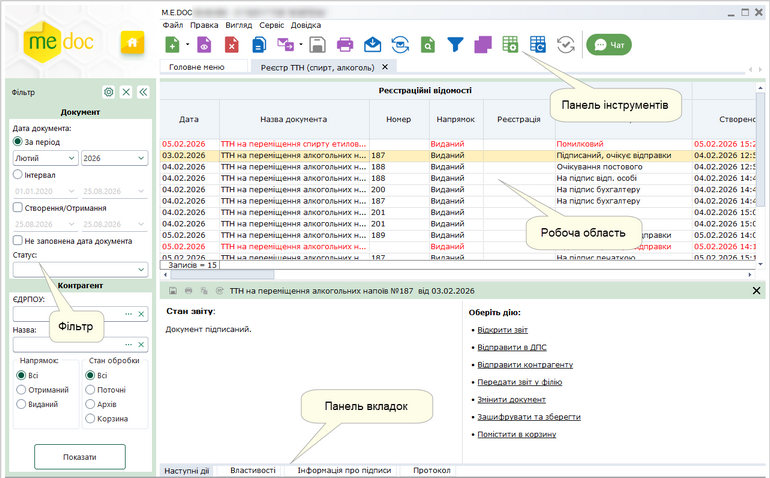
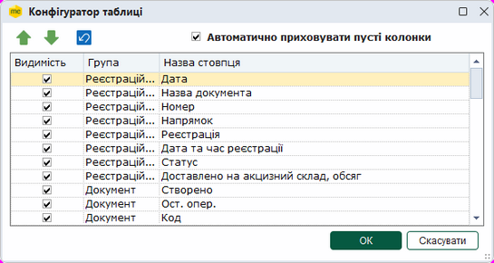
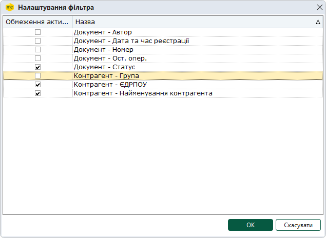
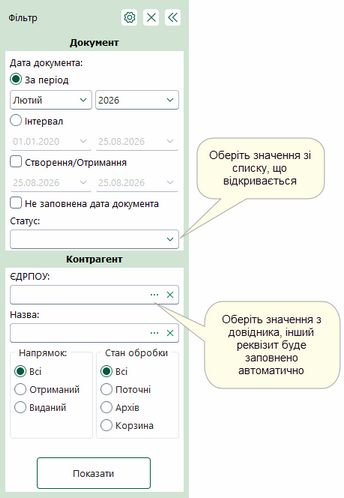
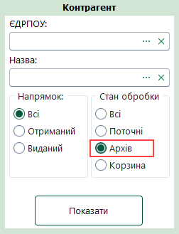

[← Зміст довідки](../)


# Реєстр ТТН  (спирт, алкоголь)

## Реєстр ТТН  (спирт, алкоголь)

_Шлях у довідці: Розділи програми › Облік акцизу › Реєстр ТТН  (спирт, алкоголь)_

Розділ призначений для роботи з товарно-транспортними накладними.  Розділ дозволяє відправляти ТТН в ДПС та обмінюватися ТТН з контрагентами за допомогою електронної пошти.

У даному розділі довідки розглянуто наступне:

- [Механізм реєстрації ТТН](#ucwaybillrst-ucwaybill_reestration)
- [Опис основних функціональних елементів інтерфейсу](#ucwaybillrst-ucwaybill_int)
- [Фільтр - початок роботи з Реєстром ТТН](#ucwaybillrst-ucwaybill_int)
- [Архів документів](#ucwaybillrst-ucwaybill_arhiv)
- [Робота з ТТН](UCWaybillFunkc.html#ucwaybillfunkc-ucwaybillfunk)
- [Маршрути відправки товарно-транспортних накладних](UCWaybillMarshrut.html#ucwaybillmarshrut-ucwaybillmarshrut)

### Механізм реєстрації ТТН

_Шлях у довідці: Розділи програми › Облік акцизу › Реєстр ТТН  (спирт, алкоголь) › Механізм реєстрації ТТН_

1. Посадова особа підприємства-виробника або реалізатора спирту/алкогольних напоїв за допомогою програмного продукту створює ТТН, підписує ЕП:

- перший - ЕП бухгалтера або особи, відповідальної за облік відвантажених матеріальних цінностей;
- другим - ЕП керівника або особи, на яку покладено відповідні обов'язки;
- третій - ЕП печатки (за наявності).

  Далі направляє ТТН в ДПС на адресу «Єдиного вікна подання електронної звітності».

2. Після надходження ТТН до ДПС здійснюється перевірка ЕП та формату електронного документа на відповідність затвердженому стандарту, також здійснюється перевірка повноти та достовірності заповнення показників ТТН відповідно до алгоритмів контролів, затверджених ДПС.

3. У разі не проходження контролів, суб'єкт господарювання отримує негативну квитанцію №1.

4. Якщо контролі пройдені, суб'єкт господарювання отримує позитивну квитанцію №1.
    Посадова особа підприємства інформує представника контролюючого органу на акцизному складі (далі - Постовий) з квитанцією №1.

5. Постовий перевіряє накладну в Реєстрі ТТН на відповідність вимогам чинного законодавства, супровідним документам, фактичному відвантаженню продукції, звіряє номери транспортного засобу, звіряє сплату податків і зборів та ін.
    Далі Постовий здійснює підтвердження або відхилення ТТН.

6. У разі не проходження контролів у Постового суб'єкт господарювання отримує негативну квитанцію №2, підписану ЕП Постового.

7. Якщо Постовим не виявлено розбіжностей даних ТТН і фактичних показників, він накладає на ТТН свою ЕП Постового, і документ реєструється в Реєстрі ТТН.
   Далі на ТТН накладається ЕП ДПС, і документ надсилається суб'єкту господарювання.

8. Суб'єкт господарювання отримує ТТН, яка стає доступна для друку. Документ друкується в 4 екземплярах.

### Опис основних функціональних елементів інтерфейсу

_Шлях у довідці: Розділи програми › Облік акцизу › Реєстр ТТН  (спирт, алкоголь) › Опис основних функціональних елементів інтерфейсу_

Реєстр акцизних документів складається з 4 основних функціональних частин:

Натисніть, щоб збільшити малюнок

Фільтр

Робота з Реєстром товарно-транспортних накладних розпочинається з Фільтру - зручного і потужного інструменту відбору потрібних документів.

У Фільтрі максимально зібрані атрибути документів, за якими здійснюється пошук та сортування.

Передбачена можливість самостійно задавати відображення параметрів відбору в Реєстрі. Натисніть на кнопку  та в окремому вікні, що відкрилось, встановіть/зніміть галочки напроти потрібного реквізиту. Після встановлення параметрів фільтрації натисніть на кнопку Показати. В робочій області відобразиться перелік документів згідно заданих параметрів пошуку.

Для того, щоб очистити Фільтр від даних, натисніть на кнопку .

Якщо Фільтр не потрібен та/або заважає, його можна згорнути. Для цього натисніть на кнопку . Щоб розгорнути Фільтр, натисніть на згорнуту панель.

Детальний опис Фільтру та роботи з ним описано в розділі даної довідки [Фільтр - початок роботи з Реєстром](#ucwaybillrst-ucwaybill_filtr).

Робоча область

Містить безпосередньо записи Реєстру товарно-транспортних накладних: відображає записи, що відповідають заданим умовам фільтрації та сортування.

Набором колонок у таблиці Реєстру та порядком їх розміщення можна керувати. Для цього натисніть на кнопку  на панелі інструментів.
Відкриється вікно Конфігуратор таблиці. Встановіть відповідні галочки для відображення колонок.

Скористайтесь кнопками   для встановлення довільного порядку за власним бажанням, або  для встановлення порядку колонок за замовчанням.

Якщо встановлено опцію Автоматично приховувати пусті колонки, колонки, що не містять даних, не відображаються у Робочій області.

Для збереження змін натисніть кнопку ОК.

Для зручності роботи у реєстрі, реалізована функція ГРУПУВАННЯ записів реєстру по колонкам таблиці реєстру.
Для активації цієї функції необхідно вибрати в меню Вигляд - Групування даних або натиснути на кнопку  на панелі інструментів.
Над реєстром з'явиться додаткова панель. На цю панель за допомогою миші перетягніть потрібні колонки таблиці.

Щоб відкрити документ, оберіть його у списку та скористайтеся одним із способів:

- натисніть 2 рази лівою кнопкою миші на документі у списку;
- виконайте команду меню Файл - Відкрити;
- оберіть команду Відкрити у контекстному меню;
- натисніть кнопку Відкрити  на панелі інструментів;
- скористайтесь комбінацією клавіш Ctrl+F2.

Можливо відкрити декілька документів одночасно, для цього виділіть потрібні документи у списку та скористайтеся одним із способів, що вказані вище. При спробі відкрити більше 20 документів, виводиться повідомлення про можливе уповільнення роботи програми, через велику кількість відкритих документів.

Панель вкладок звіту

Містить службову інформацію щодо обраного документа. Панель доступна як у відкритому документі, так і з Реєстру акцизних документів (за умови виділення потрібного документа).

- Наступні дії – містить інформацію щодо поточного стану документа, а також перелік можливих дій з документом у цьому стані. Слугує підказкою користувачу про доступні дії, які можна виконати з документом у поточному стані;
- Властивості – у режимі читання містить всю службову інформацію про документ, таку як: стан, період створення, дата та час останньої модифікації, інформація про сертифікати, якими підписано документ тощо. Інформація на цій вкладці постійно оновлюється та доповнюється при будь-яких змінах документа;
- Протокол – містить перелік подій, що відбулись з документом під час його обробки в хронологічному порядку. При виборі події справа на панелі відображається її детальний опис.

Панель інструментів

Містить кнопки, що надають швидкий доступ до найбільш часто використовуваних функцій. Наведіть покажчик миші на інструмент і чекайте протягом секунди, для відображення короткої підказки, що описує його призначення.

### Фільтр - початок роботи з Реєстром ТТН

_Шлях у довідці: Розділи програми › Облік акцизу › Реєстр ТТН  (спирт, алкоголь) › Фільтр - початок роботи з Реєстром ТТН_

Фільтр - це зручний і потужний інструменту відбору потрібних документів в Реєстрі товарно-транспортних накладних.

1. Задайте відображення параметрів відбору в Реєстрі. Натисніть на кнопку . Відкриється вікно Налаштування фільтра. Зніміть (або встановіть для відновлення відображення параметру) галочки напроти потрібного реквізиту та натисніть ОК.

2. Встановіть необхідні параметри відбору акцизних документів в Реєстрі:

Натисніть, щоб збільшити малюнок

Документ

- Дата документа- встановіть позначку для вибору певного періоду або довільного періоду:
- За період - вкажіть місяць та рік, в межах якого були створені потрібні документи;
- Інтервал - вкажіть дату початку та закінчення довільного інтервалу, в межах якого були виписані потрібні документи;
- Створення/Отримання - вкажіть дату початку та закінчення довільного інтервалу, в межах якого були створенні або отриманні потрібні документи;
- Не заповнена дата документа - у вибірку за цим параметром потрапляють документи, у яких не вказана дата створення. У вибірки за іншими періодами ці документи не потрапляють.
- Дата та час реєстрації - вкажіть дату початку та закінчення довільного інтервалу, в межах якого були зареєстровані документи.
- Код - вкажіть чар-код документа.
- Номер - використовується для пошуку документів за номером.

Якщо відома тільки частина номеру, можна використовувати символи узагальнення для пошуку серед документів, що містять цю частину номеру. Наприклад, за запитом "\*123\*" будуть знайдені документи з номером "1234567", "654123987".
Є можливість здійснювати пошук документів за декількома номерами, або їх частинами. Для цього у полі Номер вкажіть значення номерів через кому. У вікні буде відображено документи, номери яких містять вказані значення. Наприклад, за запитом "1,2,3" будуть знайдені документи з номером "1234567", "6521987", "Вер-13".

- Статус - оберіть із списку, що випадає, назву статусу, що відповідає етапу обробки документа. За замовчанням встановлено значення "Всі", тобто пошук відбувається за заданими параметрами серед усіх документів.
- Остання операція- вкажіть дату початку та закінчення періоду, в межах якого були виконані останні операції (наприклад, підписання директором, відправка контрагенту) з первинними документами.
- Користувач - вкажіть користувача, який створив документ: оберіть значення з довідника користувачів.

Контрагент

- ЄДРПОУ - дозволяє знайти документи контрагента, що були відправлені/прийняті, якщо відомо його код установи за Єдиним державним реєстром підприємств та організацій України. Вводиться з клавіатури, обирається з підключеного довідника (кнопка вибору ) або заповнюється автоматично при виборі інших даних контрагента з довідника.
- Назва - дозволяє знайти документи, які були виписані на ім'я або отримані від певного контрагента.
Найменування контрагента можна ввести як з клавіатури, так і вибрати із довідника "Контрагенти", який відкривається після натиснення на кнопку вибору . При виборі контрагента із довідника, автоматично заповнюється поля ЄДРПОУ.

- Група - дозволяє знайти документи, які були виписані на ім'я або отримані від контрагентів певної групи.
При виборі групи блокується фільтрування за полями Найменування, ЄДРПОУ.

Напрямок

Містить перемикач між напрямками акцизних документів. Передбачені наступні варіанти:

- Всі - всі документи Реєстру акцизних документів незалежно від напрямку;
- Отриманий - отримані документи електронним каналом зв'язку від контрагентів;
- Виданий - створені документи, призначені для відправлення контрагентам електронним каналом зв'язку.

Стан обробки

Містить перемикач між призначеннями акцизних документів. Передбачені наступні варіанти:

- Всі - всі документи Реєстру акцизних документів, окрім видалених;
- На опрацюванні - документи, які знаходяться безпосередньо в роботі;
- Архів - документи, які досягли кінцевого стану обробки, тобто були затверджені або відхилені. Детальніше про Архів описано в розділі даної довідки [Архів документів](#ucwaybillrst-ucwaybill_arhiv).
- Корзина - документи, які були видалені з Реєстру.

3. Після встановлення параметрів фільтрації натисніть на кнопку Показати. В робочій області відобразиться перелік документів згідно заданих параметрів пошуку.

Для того, щоб очистити Фільтр від даних, натисніть на кнопку .

Якщо Фільтр не потрібен та/або заважає, його можна згорнути. Для цього натисніть на кнопку . Щоб розгорнути Фільтр, натисніть на згорнуту панель.

### Архів документів

_Шлях у довідці: Розділи програми › Облік акцизу › Реєстр ТТН  (спирт, алкоголь) › Архів документів_

Архів призначений для зберігання документів, які пройшли повний цикл обробки, тобто були затверджені або відхилені контрагентом, або зареєстровані в РТТН. Також передбачено примусове переміщення в архів документів, які не досягли кінцевого циклу обробки, але втратили свою актуальність, або документи внутрішнього використання на підприємстві.

Архівні документи доступні лише для перегляду, їх не можна змінювати та редагувати.

Для відображення архівних документів необхідно у [Фільтрі](#ucwaybillrst-ucwaybill_filtr) обрати напрямок Архів.

У робочій області відобразяться документи в режимі Для перегляду.

Архівні документи можна відправляти контрагентам та у ДПС:

- Для архівних документів в статусі Зареєстровано на вкладці Наступні дії доступна команда Відправити контрагенту.
- Для архівних документів в статусі Затверджено контрагентом та Відхилено контрагентом на вкладці Наступні дії доступна команда Відправити в ДПС.


